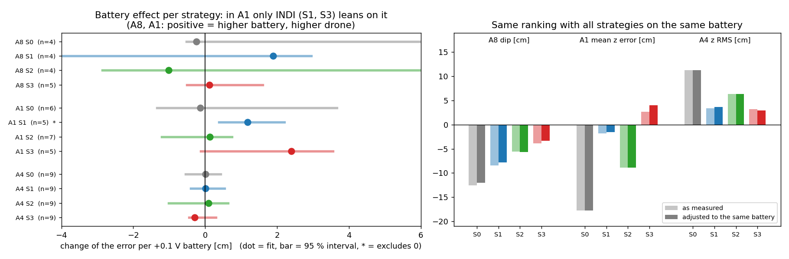
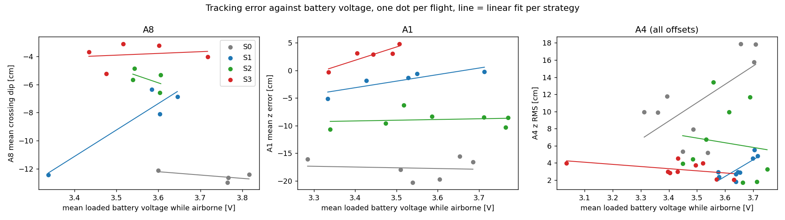

# Battery vs tracking error (pilot flights 2026-10-19/20) — side analysis, not in meeting doc or thesis

- **A1:** INDI (S1, S3) drifts lower with a lower battery, about 1.4 cm per 0.1 V (interval 0.6 to 2.4). Geometric: no effect.
- **A8:** same direction, weaker; S1 is driven by one 3.34 V flight.
- **A4:** no usable signal; one S3 flight at about 3.0 V still flew at 4 cm RMS.
- **Ranking is not a battery artefact:** same order in A8, A1 and A4 after adjusting.
- **Caveats:** n = 4–9 per strategy, 3.3–3.8 V range; loaded voltage also depends on the flight; no resting voltage logged.
- **Next:** log resting voltage at takeoff in the tier-1 study and repeat.

Data and method: 76 flights (A8 17, A1 23, A4 36), bottom drone, uSD only; battery = mean loaded voltage while airborne. Script `experiments/analysis/battery_vs_error.py`; tables `experiments/results/battery_analysis_2026-10-20/results.md`, per-flight data `per_flight.csv`.
