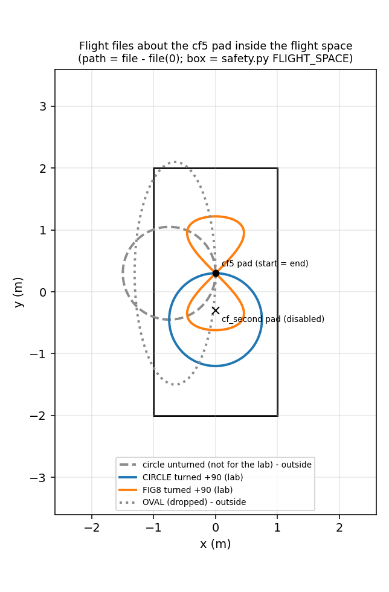
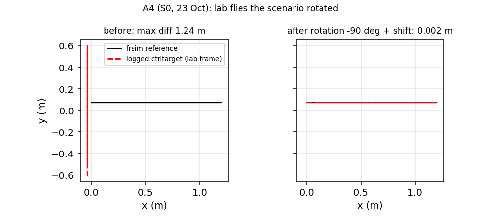
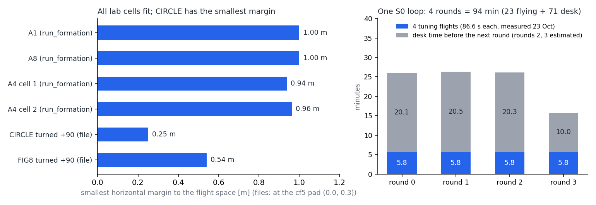

# DiffCoTune lab protocol for S0: DRAFT (Stage 4a, desk work only)

Status: draft. Nothing flown, nothing flashed. Every rule below names its source. Anything without a source is listed under "open" and is not a rule.

## Figures

## One round (method version: noise in the tuning step + ±25 % gain limit)

| Step | What | Source |
|---|---|---|
| 1 | Check the uSD file count on both cards, archive at >= 85 | `docs/lab_sessions/2026-10-26.md` item 5; memory feedback (card must never reach 100 files) |
| 2 | Fresh batteries: rest >= 4.1 V, swap if either drone < 4.0 V | `docs/comparative_study_protocol.md` §4 |
| 3 | `check_usd_deck.py` before flying | `docs/comparative_study_protocol.md` §4; memory feedback |
| 4 | Load the round's gain file (`lab/S0/round_<l>/gains.yaml`) and read the gains back | `docs/diffcotune_lab_plan_2026-11-02.md` §3 (yaml readback) |
| 5 | After a flash only: `flying_drone_stack/tools/check_active_controller.py` | memory feedback (controller slot) |
| 6 | Fly the 4 tuning scenarios A1, A8, CIRCLE, FIG8 (1 flight each) | sim loop: 1 flight per scenario per round; lab plan says 4 flights (open, see below) |
| 7 | Merge the uSD files (merged files only, never radio CSVs) | `flying_drone_stack/tools/merge_usd_logs.py`; memory feedback |
| 8 | `python lab/round.py --controller S0 --round <l> --logs <folder> --n-rounds 5` | this stage |
| 9 | Next gain file and report appear in `lab/S0/round_<l>/` and `round_<l+1>/` | this stage |

Rounds: l = 0 ... 4 (5 flown sets; user decision 13 Nov evening, replaces 4 rounds; the paper has L = 5; `round.py --n-rounds 5`). Round 0 flies the default gains. In the last round the fit of β is skipped and `gains_theta_best.yaml` is written (keep-best over the flown sets).

## Crash and floor handling

| Rule | Source |
|---|---|
| Abort at |roll| or |pitch| > 25 deg for 0.5 s, or z < 0.25 m | `docs/comparative_study_protocol.md` §4 |
| Stop after 2 crashes | `docs/comparative_study_protocol.md` §4 |
| After a crash toggle `stabilizer.estimator` 1 -> 2 | `docs/comparative_study_protocol.md` §4; memory (stuck EKF) |
| A crashed, tilted or floor flight is repeated and not used for the fit; at most 2 repeats (attempt <= 3) | task text of 13 Nov, implemented in `round.py` |
| Floor rule in the ingest: z mean of the scored part < 50 % of the reference z mean | our choice (Stage 3d) |
| Keep-best: the gain set with the lowest real cost over the flown sets is the result | method version (Stage 3d / 3e) |

Note: in the plant run, the default gains on A1 fail (floor) in every run. The sim fit uses that flight. In the lab it would be repeated and not used, so the lab round 0 can differ from the sim (open).

## How the real flights enter the model

| Item | Rule | Evidence |
|---|---|---|
| Frame | The lab flies some scenarios rotated (A4: -90 deg). The ingest estimates rotation and translation per flight and maps the flight into the frsim frame | `lab/figs/a4_frame.png`; A4 remaining difference to reference 1.6–1.8 mm |
| Figure 8 | The flight file is turned by 90 deg (long axis ±0.92 m along y); the frsim reference stays unchanged and the ingest maps the frame as for A4 | `lab/test_frame_fig8.py`: angle -89.99999971 deg, residual 2.9e-6 m |
| Quaternion | Turned by conjugation, body rates by the rotation. This assumes the airframe is symmetric under 90 deg yaw (Jx 16.57e-6, Jy 16.66e-6, 0.5 %); accepted by the user | spec Stage 3e / 4a |
| Time lag | The logged command runs ahead of the frsim reference by 40–58 ms (A4) and 82–120 ms (A8). Cause: `merge_usd_logs.py --meta` sets t = 0 by matching the measured position to the commanded trajectory, which absorbs the tracking delay. The lag is fitted per flight, stored in the manifest (`lag_s`) and reported, not hidden | `lab/results/lag_a8.json` (search ±200 ms) |
| A1 lag | Not observable (the reference does not move enough); set to 0 | ingest test |
| Top drone path | For A1 and A8 the logged top-drone path is the default peer input (`round.py --top auto`). On 23 Oct A1 this moves the model from 10.1 cm to 20.4–20.7 cm against the real 20.5–22.1 cm. A4 and CIRCLE / FIG8 use the planned path | `lab/results/ingest_oct23.json` |
| J_sysId | position + velocity + attitude (the gyro part is not used) | user decision 13 Nov |

## Flight files

Corrected in Stage 4d. `simple_flight` hovers at `initial_position` + `--height` and starts the trajectory with `relative=True` (crazyflie_py default); the firmware shifts the trajectory so that its first point sits at the current position (`planner.c:335–348`). The path about the hover point is file − file(0). The Stage 4a margins (0.25 / 1.25, 0.54 / 1.08, 0.345 / 0.20 m) took the file origin as the hover point and were wrong for files that start at the edge.

| File | Role | Max difference to frsim | Peak speed | Peak acceleration | Pieces | Path about the hover point | Pad window x / y | Margin at the cf5 pad (0.0, 0.3) | Distance to the cf_second pad |
|---|---|---|---|---|---|---|---|---|---|
| `circle_frsim_rot90_tuning_mode1.csv` | lab (CIRCLE, turned +90°) | 0.0026 mm | 0.667 m/s | 0.747 m/s² | 19 | x ±0.75, y −1.5…0 | [−0.25, 0.25] / [−0.50, 2.00] | 0.25 m | 0.60 m |
| `figure8_frsim_rot90_tuning_mode1.csv` | lab (FIG8, turned +90°) | 0.0029 mm | 0.902 m/s | 0.948 m/s² | 23 | x ±0.46, y ±0.92 | [−0.54, 0.54] / [−1.08, 1.08] | 0.54 m | 0.32 m |
| `circle_frsim_tuning_mode1.csv` | **not for the lab: does not fit at the current pad** | 0.0026 mm | 0.667 m/s | 0.747 m/s² | 19 | x −1.5…0, y ±0.75 | [0.50, 1.00] / [−1.25, 1.25] | −0.50 m (outside) | 0.21 m |
| `oval_frsim_study_mode1.csv` | **dropped from the lab test set** (user, 13 Nov) | 0.0030 mm | 0.891 m/s | 0.968 m/s² | 30 | x −1.31…0, y ±1.8 | [0.31, 1.00] / [−0.20, 0.20] | −0.31 m (outside) | 0.04 m |

All in `experiments/diffcotune/flightfiles/`, with `checks.json`. Height 1.0 m: margin 0.70 m to the ceiling and 1.0 m to the floor. Flight space `safety.FLIGHT_SPACE`: x ±1.0, y ±2.0, z 0–1.70 m. Pads from the crazyswarm2 yaml as read on 13 Nov: cf5 (0.0, 0.3), cf_second (0.0, −0.3); the lab PC's yaml decides at lab time (`fly_file.py --check`). Distance to the cf_second pad is horizontal; that drone is disabled on the floor and the path is at z = 1.0 m; no limit is stated. Nothing was copied to crazyswarm2.

## What is loaded when

| When | What |
|---|---|
| Before round l | `round_<l>/gains.yaml` (fragment `robots: cf5: firmware_params: ctrlOmarIndi: {...}`; parameter mapping Pxy -> Kpos_Px/Py, ..., KIxy -> KI_x/y from `controller_omar_indi.c` lines 679–717) |
| After round l | the report (`report.md`) and the state file (`round_<l+1>/state.json`) stay on the desk PC |
| End | `gains_theta_best.yaml` |

## Desk time between rounds

| Part | Seconds (dry test, round 0, 4 flights, CPU, `nice -n 19`) |
|---|---|
| ingest + gate | 0.5 |
| fit of β (50 epochs) | 568 |
| tune θ (A + B, 50 epochs, 2 noise seeds) | 592 |
| total | 1163 (19.4 min) |

The last round has no fit of β and no tuning, so its desk step is the ingest only: about 0.1 min, measured in the Stage 5 dry runs (the earlier text assumed about 10 min; corrected 14 Nov, Stage 5b). Source: `lab/results/dry_test.json`. Times with real flights can differ (ingest of 500 Hz files with lag search is not in this test; the 23 Oct ingest ran in seconds).

## Open (not stated anywhere, not invented here)

Status after the user decisions of 13 Nov (section "Decisions and proposals" below): items 2, 3, 5 are decided; item 1 is decided except the number of test flights; item 4 follows from item 3; item 9 stays open. Original list:

1. Scenario order inside a block, and the number of flights per scenario and per final evaluation (sim: 1 per scenario per round; lab plan: 4).
2. `rotate_deg` and the command lines for CIRCLE, FIG8 and the test cells.
3. How the yaml fragment is applied in the lab (merge into `crazyflies.yaml`, branch, or set at runtime).
4. The logs hold no per-flight gain readback (the readback must be done and written down by hand).
5. File names and `--kt` label so that `simple_flight.py` can load the new files (it only accepts `figure8|circle|oval|hover` with `--kt`).
6. The lag on A1 is not observable.
7. The gyro part of J_sysId (1.5–30 rad²/s² on the 23 Oct flights) is not an error of units, sign, axis or frame (Stage 4b, `lab/results/gyro_check*.json`): real and model both oscillate at 1.0–1.4 Hz with large body rates and their phases are uncorrelated. It is not used in the fit. Correlation of real and model body rates is about 0 on A1 and mixed on A4 / A8 (−0.58 to 0.75). J_q on A1 is consistent with it (Stage 4b, `lab/attitude_check.py`: tilt rms 26.7 / 26.8° real / model, pitch and roll correlation −0.17 … 0.24 even at the best lag within ±0.5 s, dominant frequency 1.27 against 1.07 Hz, so the phase drifts through a full turn in about 5 s; the model tilts in pitch and roll, the real drone mostly in pitch). J_v on A1 is 1.2 (m/s)², J_p 0.03 m², both far above the noise floor; J_v was not checked for phase. Decided (user, 13 Nov): the fit keeps position + velocity + attitude on all scenarios, A1 included.
8. Round 0 on A1 at the default gains: the sim run fails on the floor; the lab rule repeats it.
9. Battery rule for a repeat flight and the time limit per battery are not stated.
10. Abort rule on A1 (Stage 4b, `lab/tilt_abort_check.py`): on the three 23 Oct A1 flights the bottom drone pitches to 38.6–40.5° (p99 37.9–39.0°, `gyro_y` up to 512 °/s) over the scored part, above 25° for 47–51 % of the time. "|roll| or |pitch| > 25° for 0.5 s" (`docs/comparative_study_protocol.md` §4) does not fire if it means 0.5 s continuous (longest run 0.22–0.25 s at 1.27 Hz); it fires on all three if it means 0.5 s in total within one second (0.64–0.68 s). The wording does not say which (not stated). A4 and A8 do not reach it on either reading. Decided (user, 13 Nov): "for 0.5 s" is read as 0.5 s continuous, so the 23 Oct A1 flights would not have been aborted.

## Decisions and proposals (Stage 4c; corrected in Stage 4d, 13 Nov 2026)

### Decided (user, 13 Nov)

1. Gain file: option A, merge into `crazyflies.yaml` each round (`lab/apply_gains.py merge`), then read back on a fresh connection (`readback`).
2. Flight files: the `lab/fly_file.py` wrapper; nothing is copied into crazyswarm2.
3. One flight per tuning scenario per round (as in the dry runs).
4. Order in a round: A1, A8 (both drones), then CIRCLE, FIG8 (`cf_second` disabled).
5. CIRCLE is turned by 90° so that it fits the current pad, as the figure 8; the frsim reference stays unchanged, the ingest maps the frame.
6. OVAL is dropped from the lab test set. Lab test cells: A4 cell 1 and A4 cell 2. The dry-run results and the simulation test set stay as they are.
7. Open, the user's call: the number of test flights and the battery rule (flights per pack, repeats).

### Flight card per round (4 flights, order fixed; gains of the round loaded first)

| # | Cell | Drones | Command | `rotate_deg` in `flights.json` | Check before the flight |
|---|---|---|---|---|---|
| 1 | A1 dz 0.375, hold 15 s | cf5 + cf_second | `ros2 run crazyflie_examples run_formation --scenario A1 --dz 0.375 --hold 15.0 --height 0.5 --auto-center --yes` | 0 | script prints "checks passed" (`cmd_check.py`: 0.000 mm) |
| 2 | A8 dz 0.375, 8 s per pass, 2 passes | cf5 + cf_second | `… --scenario A8 --dz 0.375 --duration 8.0 --passes 2 --height 0.5 --auto-center --yes` | 0 | same (0.30 / 0.60 mm) |
| – | change: `set_tree_strategy.py S0 --solo` (cf_second `enabled: false`), `lab_check_strategy.py`, relaunch CS2 | | | | gains of the round still on cf5 (`apply_gains.py readback`) |
| 3 | CIRCLE r 0.75, period 7.065 s, turned +90° | cf5 | `python3 experiments/diffcotune/lab/fly_file.py --cell CIRCLE` | **−90 must be given** (the frame fit cannot separate a circle's rotation from its lag, see below) | `fly_file.py --cell CIRCLE --check`: pad window x ±0.25 m, y [−0.5, 2.0] m; margin 0.25 m |
| 4 | FIG8 a 0.92, period 9.064 s, turned +90° | cf5 | `python3 experiments/diffcotune/lab/fly_file.py --cell FIG8` | −90 (leave empty: the fit finds it; compare) | `--check`: pad window x ±0.54 m, y ±1.08 m; margin 0.54 m |

Lab test cells (after the last round, number of flights open): A4 cell 1 `--scenario A4 --dz 0.4 --speed 0.35 --offset 0.125 --motion line --rotate 90 --height 0.5 --auto-center --yes`, A4 cell 2 with `--offset 0.075`; `rotate_deg` −90 (fitted −90.0 on the 23 Oct flights).

### P1. Command lines and `rotate_deg`: checks (Stage 4d corrected)

`lab/cmd_check.py` parses each command with the lab's own `run_formation` parser, builds and compiles the scenario in memory and compares it with the frsim cell (`lab/results/cmd_check.json`).
- **run_formation cells (A1, A8, A4): start.** The scenarios are anchored absolutely: the drones take off to `anchor + slot`, `goTo` it, then `startTrajectory(relative=True)`. The first point of every compiled curve is 0.0 mm, so the firmware shift is zero and the path is `anchor + slot + curve`; the pads only matter for the vertical takeoff and the goTo. At the centred anchor (`--auto-center`) the paths stay inside the flight space with margins x ≥ 0.94 m, y ≥ 1.4 m, z ceiling ≥ 0.8 m (A1 1.0 / 2.0 / 0.83; A8 1.0 / 1.5 / 0.83; A4 0.94 / 1.4 / 0.8 m). `safety.check` and `check_spec` report no problem.
- **Reference differences:** A1 0.000 mm, A8 0.30 mm (top − bottom 0.60 mm), A4 0.38 mm, flight files 0.003 mm; start z 0.500 / 0.500 m. The 0.3–0.6 mm is the Poly4D fit tolerance of `compile_curve`.
- **A8:** the frsim cells have 2 passes; the 23 Oct command had `--passes 4` (first 14.5 s equal the study cell, 0.05 mm). The tuning cell needs `--passes 2 --duration 8.0`.
- **`rotate_deg`:** the ingest value is the negative of the lab `--rotate` (A4 `--rotate 90` → fitted −90.0). For the turned figure 8 the fit finds −90 (Stage 4a). **For the turned circle the fit is degenerate:** `lab/test_frame_circle.py` returns −95.4° and a lag of −112 ms instead of −90° and +80 ms (a rotation of a circle is a time shift: ω = 0.889 rad/s, 5.4° = 112 ms); with `rotate_deg = −90` given the angle is exact, lag 80 ms, residual 2.7 µm. So `flights.json` must give `rotate_deg: -90` for CIRCLE. (The earlier proposal to leave `rotate_deg` empty everywhere is withdrawn.)
- Solo cells need `cf_second` disabled; `simple_flight` flies the same trajectory with every enabled drone.

### P2. How the gain file is applied (open points 3 and 4)

| | A. yaml merge per round (recommended) | B. set over the radio before the CS2 launch | C. set from a CS2 client while CS2 runs |
|---|---|---|---|
| Steps | `apply_gains.py merge --fragment S0/round_<l>/gains.yaml --yaml <crazyflies.yaml>` (checks that only the 15 `ctrlOmarIndi` values of cf5 changed, writes `<yaml>.new`); put it in place; `lab_check_strategy.py`; launch CS2; read the `Update parameter` lines; then the firmware readback (CS2 stopped, `apply_gains.py readback`, relaunch) | CS2 stopped: `apply_gains.py set --uri radio://0/80/2M/E7E7E7BB02 --fragment …` (writes, reconnects, reads back), then launch CS2 | a ROS script with `cf.setParam(...)` (like `set_param.py`); not written |
| Why it works | the yaml is what CS2 applies on launch (`firmware_params`); same routine as the 23 Oct and 26 Oct blocks (patch, `lab_check_strategy.py`, launch) | no yaml edit | no radio stop |
| Risk of a wrong gain set | merge script verifies the 15 keys and that nothing else changed (tested on a copy of the present `crazyflies.yaml`); stale install copy is caught by `lab_check_strategy.py`; a power cycle may drop RAM values if CS2 does not re-push the yaml on reconnect (not stated) → readback after every battery swap | the later CS2 launch re-applies the yaml's own `Kpos_Iz` (1.5) and `indi` → the tuned `Kpos_Iz` would be overwritten unless the cf5 yaml has no `Kpos_Iz` line; values lost at a power cycle | readback only from the server cache, not from the firmware |
| Time per round | stop / launch times are not recorded in the repository → not stated (2 launches per round with the readback, 3 if CIRCLE / FIG8 need `cf_second` disabled) | 1 radio session (~15 values × 0.1 s + reconnects) + 1 launch; not measured | not stated |
| Readback | firmware, fresh connection (cflib's `get_value` after a set on the same connection is a cache: `fbl_prime_controller.py`, memory note 2026-10-24) | built in (same code) | none independent |

Facts behind it: (1) `controller_omar_indi.c` (crazyflie-firmware `ccb0606d`, read only): `controllerOmarIndiInit` does `*self = g_self` and the boot call is `controllerOmarIndiInit(&g_self)` → no-op for the gains, so switching to controller 9 does not reset `KR_*`, `Kw_*`, `Kpos_*`, `KI_*` (the earlier wipe was `fbl_defaults()` for `ctrlFbl.*`). The image on the drones was not checked → the readback covers it. (2) The 15 gains are not in the uSD log: `usd_study_config.txt` has no `ctrlOmarIndi.KR|Kw|Kpos` line; 12 of the 15 exist as firmware log variables (not `Kpos_Iz`, `KI_x`, `KI_y`), but the file already has about 100 entries (memory: 96-variable cap) → a per-flight readback in the log would mean removing others (not done). (3) `crazyflies.yaml` as read: cf5 block has `ctrlOmarIndi: indi 0, Kpos_Iz 1.5` and no other gain.

### P3. Flight files through `simple_flight.py` (decided: wrapper)

`simple_flight._csv_path` returns `DATA_DIR/<trajectory>_mode1_kt<kt>.csv`. `lab/fly_file.py` replaces that one function in memory with the file in `experiments/diffcotune/flightfiles/`, sets `--trajectory circle|figure8 --kt <label> --height 1.0` (labels 0.0007 / 0.0008, only names the log) and runs `simple_flight.main()`; copies nothing. The check (Stage 4d) computes the path about the hover point as file − file(0) (`planner.c:335–348`), the pad window per axis, the z window at `--height`, the margins and the distance to the cf_second pad, and refuses to fly when it fails; OVAL is refused. Not tested with ROS or on hardware. Not stated: whether the pad in the yaml of the lab PC equals the one read here (0.0, 0.3).

### P4. Remaining points

**Gain readback (point 4):** follows P2: firmware readback with `apply_gains.py readback` after the launch of every round and after every battery swap; not available from the uSD log (above).

**Battery rule for repeats (point 6): existing rules only**

| Rule | Source |
|---|---|
| fresh batteries, rest ≥ 4.1 V; swap if either drone < 4.0 V, or after the flights agreed at the shakedown | `docs/comparative_study_protocol.md` §4 |
| note the resting voltage before every flight; ≥ 2 fresh packs per drone per block; INDI strategies: a fresh pack per INDI flight (S0 is not INDI) | `docs/lab_sessions/ns2_unseen_block_checklist.md` §0, `next_session_plan.md` item 4 ("proposal, to be confirmed") |
| change below ≈ 4.1 V resting (four S2 flights were lost to 2.6 V cut-offs) | `next_session_plan.md` |
| fresh batteries, `vbat` logged | `docs/diffcotune_lab_plan_2026-11-02.md` §3 |
| **not stated:** flights per pack for S0, time limit per battery, whether a repeat gets a fresh pack, the voltage limit for a repeat, whether pack changes during a round are allowed | open |

### P5. Lab time for one S0 loop (5 rounds × 4 tuning flights; estimate; Stage 4e, 13 Nov 2026)

| Round | Tuning flights | Flying (86.6 s each) | Desk time before the next round | Basis |
|---|---|---|---|---|
| 0 (default gains) | 4 | 5.8 min | 20.1 min | dry test round 0, 1209 s (measured) |
| 1 | 4 | 5.8 min | 20.5 min | dry test round 1, 1232 s (measured) |
| 2 | 4 | 5.8 min | about 20.3 min | mean of the two (estimate) |
| 3 | 4 | 5.8 min | about 20.3 min | mean of the two (estimate) |
| 4 (last, no β fit, no tuning) | 4 | 5.8 min | about 0.1 min | measured in the loop (ingest only, `--skip-last-fit`); corrected 14 Nov (Stage 5b), was "about 10 min (estimate)" |
| **Total** | **20** | **28.9 min** | **81.3 min** | **110.2 min** |

Test flights (user decision 13 Nov evening: A4 cell 1 and 2, 3 flights each, default gains and θ_best = 12 flights): 12 × 86.6 s = 17.3 min flying, so about 127.5 min with the test flights (desk time of the test flights not included). Repeats: none expected from 23 Oct (10 of 10 flights usable); upper bound if every flight were flown three times: 60 tuning flights = 86.6 min of flying. Per round one extra CS2 relaunch for the `--solo` change (time not stated). Not included (not stated): CS2 stop / launch, yaml change, readback, battery changes, card checks, the pilot's time. The desk step of round l needs the files of round l.

### Decided by the user (13 Nov, after Stage 4d)

1. **Test flights:** A4 cell 1 and A4 cell 2, 3 flights each, with the default gains (in round 0) and with θ_best (after the last round, round 4): 12 flights (estimate about 17 min at 86.6 s per flight).
2. **Battery rule:** the existing rule as it is, repeats included: fresh batteries, rest ≥ 4.1 V; swap if either drone is below 4.0 V (`docs/comparative_study_protocol.md` §4).
3. **Times** for CS2 stop / launch, yaml change, readback and battery change: measured in the first lab block.
4. **yaml after a power cycle:** covered by the firmware readback (`apply_gains.py readback`) after every launch and every battery swap.
5. **Pad:** the cf5 pad is checked at the lab PC before the first flight, and `fly_file.py --check --pad <x> <y>` is rerun with the real pad. A drone parked 0.32 m (horizontal) from the FIG8 path, 1 m below it, is accepted; alternatively `cf_second` is moved off the floor area for the solo flights.

### Still open

1. `apply_gains.py readback|set` and `fly_file.py` (without `--check`) are not tested with ROS or on hardware (first lab block).
2. The supervisor's agreement to the deviations 8–11 (5 rounds and the lab load: decided by the user, 13 Nov evening).

## S1–S3 (Stage 5, 14 Nov 2026; desk only, marked "Stage 5", "Stage 5b", "Stage 5c" and "Stage 5c, RPM delay fixed (user, 14 Nov)"; the decided S0 items above stay as they are)

Source of every number: `experiments/diffcotune/dryrun/stage5/report_stage5.md` and its `results/` files. **Status (Stage 5c, 15 Nov, desk side): S0 lab-ready; S1 lab-ready (round 22.5 min, criteria a to c yes); S2 lab-ready (25.9 min; criteria yes; the recorded gradient-gate failure at finite-difference step 1e-7 is the finite difference, confirmed at 1e-8); S3 not lab-ready (criterion c fails: the round-0 tuning step finds no descent from the default gains, θ_best = θ_0).** Exact gradient at near-normal speed: `grad_mode` mixed (below). Sources: `dryrun/stage5c/report_stage5c.md`, `dryrun/stage5c_rdfix/report_rdfix.md`. **S0 is lab-ready.** Lab order (user decision 14 Nov): S0, S2, then S1, S3; the first real S1 round shows whether the INDI thrust-arrival gap (below) matters; no model change for it. The method is frozen as for S0 (DiffCoTune Split-Alternate, 50 epochs per inner loop with the best iterate, J_sysId = p+v+q, noise in the tuning step with 2 seeds per round, ±25 % gain limit, lr 0.01, Adam reset per inner loop, 5 rounds l = 0…4, keep-best, `--skip-last-fit`); nothing was tuned for S1–S3.

### Per controller

| | S1 | S2 | S3 |
|---|---|---|---|
| Controller | INDI mode 3 | S0 + NS2 | INDI 3 + NS2 |
| crazyswarm2 branch (yaml, read with `git show`) | `study_S1` (43a1562) | `study_S2` (45138c3) | `study_S3` (df311c2) |
| Switches (`ctrlOmarIndi.indi` / `rnn.en`; `stabilizer.controller` = 9) | 3 / 0 | 0 / 1 | 3 / 1 |
| β list (Stage 5c, RPM delay fixed, user 14 Nov: S1 and S3 keep the RPM delay at the calibrated 4.0502 ms and fit the other four) | 5 entries, **4 fitted** (thrust gain, motor lag, downwash, plume; RPM delay fixed) | 4 | 5 entries, **4 fitted** |
| `round.py` | `--controller S1` | `--controller S2` | `--controller S3` |
| Gradient mode (Stage 5c; `round.py --grad-mode`, table `GRAD_MODE_DEFAULT`) | `mixed`: the noise-free β fit on A1 uses the exact forward sensitivity (compiled, `fsens.py`), everything else compiled reverse; equals eager forward mode to ≤ 6e-14 (S1) | `mixed` | `mixed` |
| (S0, for the record) | `reverse` for S0 (unchanged) | | |
| Desk time per round, measured in the Stage 5c dry runs (rounds 0–3; the last round about 0.1 min); round test (round.py) 22.5 / 25.9 / 28.8 min | 22.7 / 20.4 / 20.4 / 20.4 min (RPM delay fixed) | 26.1 / 23.5 / 23.6 / 23.7 min | 28.9 / 25.6 / 25.6 / 25.4 min (RPM delay fixed) |
| Dry run (Stage 5c), real cost round 0 → 4 (tuning mean) | 10.32 → 2.93 cm (θ_best 2.30 / 1.81 cm tuning / test against 9.04 / 5.73 with default gains) | 15.71 → 6.81 cm (5.25 / 5.26 against 12.36 / 6.77) | 10.75 → 10.79 cm, flat; θ_best = θ_0 (9.02 / 5.78) |
| Flight card | as S0 (A1, A8, CIRCLE turned, FIG8 turned; test: A4 cell 1 and 2) | same | same |
| Differences to the S0 flight card | only the strategy of the loaded yaml; `apply_gains.py merge --strategy` refuses a yaml whose indi/rnn.en do not match, `readback` / `set --strategy` check `stabilizer.controller` = 9, indi and rnn.en | same | same |

### Known risks (with source)
- **Hardware INDI thrust arrival (S1, S3):** on hardware only 64–72 % of the commanded thrust rise arrives at A8 crossings (S1 64/64/72 %, S3 71/70 %; S0 and S2 96–109 %); likely cause motor headroom (busiest motor median 0.74–0.85 with INDI against 0.58–0.62 without), plausible but not proven. A8 dips: S0 −15.7, S1 −10.6, S2 −5.5, S3 −1.9 cm; S3 upward peak +1.5 cm on average (max +5.7). The simulator's INDI is near-ideal. Source: `docs/s3_indi_ns2_decision_2026-10-18.md` line 24 and following. **The real-data check does not show a gap that no β covers, and cannot show one:** the model has no β for thrust arrival (S1 real J_pva 0.214 against a fitted simulation value of about 0.11, S0 about 0.49 real; the scenario mixes differ). The question stays open for the user.
- **Low battery (S1):** part of the S1 A1 flights were at 3.44–3.49 V (`docs/validation_s3_versions_2026-10-18.md`); the battery rule of `docs/comparative_study_protocol.md` §4 stays (swap below 4.0 V).
- **INDI needs RPM telemetry:** `deck.bcRpm == 1` (`docs/study_parameter_decisions.md` line 21); check in the first block.
- **A1 gradient (Stage 5c, resolved):** Stage 5b showed that reverse mode on A1 is rounding driven; Stage 5c computes the noise-free A1 fit gradient with the exact forward sensitivity of one 2 ms block, traced once and compiled (`fsens.py`), at reverse-mode speed; checks: equals eager forward mode to ≤ 6e-14 for S1, S2, S3, round test identical to the loop (θ₁ and β difference 0.0), gradient gate with the adopted mode passed for S1 and S3 and for S2 at step 1e-8 (at 1e-7 the finite difference of S2 with noise is not converged). The truncated-reverse fallback was not run.
- **S3 dry run (Stage 5c):** the real cost stays at 10.5–11.0 cm over all rounds (delay fitted: 9.26 cm in round 4). With the RPM delay fixed the round-0 tuning step finds no descent from the default gains (best iterate = epoch 0), so θ₁ = θ₀ and criterion c fails by identity; the β errors for lag and plume grow over the rounds (lag −75 %, plume +158 % after round 3) and the tuning cost at θ_l grows. Cause not established; whether S3 needs another β set or start is a user decision.
- **RPM delay β (S1, S3), Stage 5c, RPM delay fixed (user, 14 Nov):** error after the round-0 fit S1 −44 %, S3 −63 % (above the 25 % rule), so the RPM delay is fixed at the calibrated 4.0502 ms (plant truth 8.0 ms: a −49.4 % offset by construction). The S1 downwash error drifts to −74 % in round 2 with or without the fixed delay; the S1 criteria and test error are unchanged by the fix.

### Lab time (estimate; basis: the S0 table P5 and the measured dry-run times above)
Per controller (Stage 5c numbers): 5 rounds × 4 tuning flights = 20 flights × 86.6 s = 28.9 min flying; desk time = sum of the measured rounds 0–3 plus about 0.1 min for the last round (ingest only, `--skip-last-fit`); 12 test flights = 17.3 min flying.

| Controller | Flying (20 flights) | Desk (5 rounds) | Tuning loop total | + 12 test flights |
|---|---|---|---|---|
| S0 (table P5) | 28.9 min | 81.3 min | 110.2 min | 127.5 min |
| S1 | 28.9 min | 84.0 min | 112.9 min | 130.2 min |
| S2 | 28.9 min | 97.0 min | 125.9 min | 143.2 min |
| S3 | 28.9 min | 105.6 min | 134.5 min | 151.8 min |
| **All four** | 115.6 min | 367.9 min | 483.5 min | **552.7 min (9.2 h)** |

Not included (not stated anywhere, measured in the first lab block): CS2 stop / launch, yaml change, readback, battery change, the extra relaunch per round for `--solo`, repeats. Desk time can overlap with nothing on the lab PC if the same machine runs the loop; the GPU is not used.

## Fast lab session (Stage 6, proposed, not decided; 15 Nov 2026; desk only)

Everything in this section is **Stage 6, proposed**: nothing here is decided and nothing was flown; the decided S0 items above are unchanged. Source: `experiments/diffcotune/dryrun/stage6/report_stage6.md`, `lab/results/session_timeline.md`, `lab/INTERLEAVED_LAB_CARD.md`.

**Desk settings (adopted: none).** Speed-ups were tested on the round-0 dry test with the rule "θ₁ and β identical within 1e-10": 8 tuning workers failed the identity gate and was slower (23.3 against 19.4 min); 4 threads per worker was identical for S0 but 2 % faster only and not identical for S2; a pre-warmed pool can save at most the compile share (about 36 s of 19.4 min); the compiled-graph cache had no effect; ingest takes at most 0.78 s per flight (no per-flight ingest needed). GPU not used (driver/library version mismatch of the NVIDIA stack, which is not touched here; the loop has no GPU path). The desk step per round stays: S0 19.4, S2 26.0 min alone (round test; S1 22.5, S3 28.8 from Stage 5c).

**Two controllers at once.** Round-0 tests of S0 and S2 run together on the desk PC: S0 24.8 min (alone 19.4), S2 30.7 min (alone 26.0), MemAvailable minimum 9.6 GB, load maximum 7.2, θ₁ and β identical to the runs alone. S1 + S3 at once: not measured (the S2 factor 1.18 is used as a stand-in in the timeline). Which PC runs `round.py` in the lab: not stated.

**Timeline** (model with 86.6 s per flight, 4 tuning flights per round, 12 test flights per controller, measured desk minutes; switch overhead and the extra `--solo` relaunch are **parameters, not measured**): hours per session, sequential against interleaved pairs (round l of A, switch, round l of B, switch back).

| Overhead per switch / relaunch | S0 + S2 sequential | S0 + S2 interleaved | S1 + S3 sequential | S1 + S3 interleaved | all four sequential | all four interleaved |
|---|---|---|---|---|---|---|
| 3 min | 4.82 h | 3.28 h | 5.01 h | 3.45 h | 9.83 h | 6.72 h |
| 5 min | 5.22 h | 3.68 h | 5.41 h | 3.83 h | 10.63 h | 7.51 h |
| 10 min | 6.22 h | 5.21 h | 6.41 h | 5.21 h | 12.63 h | 10.41 h |

Figure: `lab/figs/session_timeline.png`. Battery packs per hour: not stated.

**Strategy switch (exact sequence from the existing tools; `lab/session.py switch --to <C> [--solo] --fragment lab/<C>/round_<l>/gains.yaml` prints it):** stop CS2; `set_tree_strategy.py <C>` (cf5 `ctrlOmarIndi.indi` 0 / 3 and `rnn.en` 0 / 1; `--solo` sets cf_second `enabled: false`); `apply_gains.py merge`; `lab_check_strategy.py`; launch CS2; stop; `apply_gains.py readback` on a fresh connection; relaunch. S2 / S3 beyond S0: `rnn.en` 1 on cf5 and the neighbour enabled for A1 / A8; the NS2 weights are part of the flashed image (not checked by these tools: not stated).

**Files.** One explicit `flights.json` per controller and round (`session.py manifest`, scenario-to-file assignment by hand, refuses a file already registered for another controller or round, warns if modification times do not follow the card order); count the card files (assumption 1 file per flight and card, not stated: 32 per controller, 64 per pair; archive at ≥ 85, never reach 100). **Battery:** the S0 rule stays; flights per pack: not stated. **Decisions needed:** scenario option (`dryrun/stage6/scenario_decision.md`, recommendation keep A), switch overhead assumption, which PC runs the loop, whether two desk steps at once are acceptable there.

## Lab variant and session plan (Stage 8b, user decisions 15 Nov evening; supersedes the tuning-set and round-count statements above where they differ)

* **Variant (decided):** the frozen "ours" for S0, S1, S2, S3: DiffCoTune Split-Alternate loop (Krishna et al. 2025) with DiffTune's quadrotor settings (Cheng et al. 2024: position cost, per-step gain limit, sensor noise in simulation, learning rate from its compared values); 5 tuning scenarios A1 (dz 0.375), A8 (8 s pass), A4 cell 1, CIRCLE, FIG8 (5 flights per round); test cells A4 cell 2 (held out) and A4 cell 1 (in-sample), 3 flights each with the default gains and 3 with θ_best; **6 rounds** (l = 0 … 5), keep-best over the 6 flown sets, no fit or tuning after round 5; J_sysId = position + velocity + attitude; 50 + 50 epochs, best iterate, Adam reset, lr 0.01; ±25 % gain limit per round; sensor noise in the tuning step (2 seeds); compiled forward sensitivity; RPM delay of S1 / S3 fixed at 4.0502 ms. The scenario option A of the earlier text is replaced by this tuning set (Stage 7 decision).
* **Safety preview (proposed in Stage 8b, a check only):** after each desk step `round.py` simulates the new gain set in frsim on the 5 tuning scenarios (the round's fitted β, 2 noise seeds, protocol abort rules) and prints `PREVIEW PASSED` or `PREVIEW FAILED: <scenario, seed, reason>`; it never changes the gains; on FAILED the default action is to fly the best flown set again, the decision belongs to the user in the lab.
* **Session plan:** session 1 = S0 + S2 interleaved (`INTERLEAVED_LAB_CARD.md`); session 2 = S1, with S3 if its dry run passes (S3 stays out of the first session). Switch overhead and the extra `--solo` relaunch are measured in the first block. uSD cards: empty both before the session, archive once in the middle (after round 2 of both controllers), never ≥ 85 files; check on the first flight that it is one file per flight. Which PC runs `round.py` in the lab: open (user).
