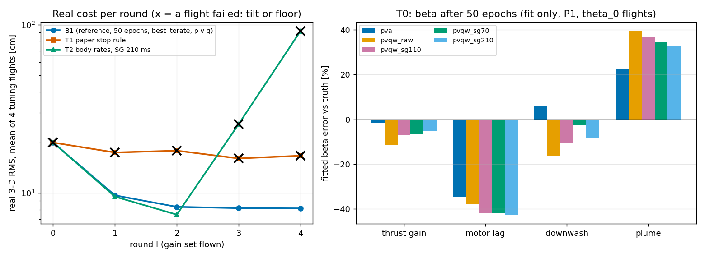

# DiffCoTune for the study controllers: method, deviations from the paper, lab plan (summary, 13 Nov 2026)

For the supervisor. Details: `docs/diffcotune_spec.md` §17 (deviation list), `docs/diffcotune_lab_protocol_S0_DRAFT.md` (lab protocol), `docs/plan_diffcotune_2026-11-11.md`.

*Left: real cost per round in the simulator-to-simulator dry run (S0, plant P1). Blue = our method version. Orange = the paper's literal stop rule. Green = body rates in the simulator fit. × = a flight failed (tilt or floor). Right: fitted simulator values against the truth with and without body rates.*

## Method

DiffCoTune (Krishna et al. 2025, arXiv:2505.24068), Split-Alternate scheme (Alg. 3). One round = one real flight of each tuning scenario (A1, A8, circle, figure 8), then fit the simulator (thrust gain, motor lag, downwash, plume) to these flights, then tune the gains in the refitted simulator. 5 rounds (l = 0…4, paper L = 5), keep the best flown gain set. One gain set per controller for all scenarios. Test scenarios A4 (2 cells) are never tuned on.

## Dry run result (S0, simulator as the "real drone" with shifted values, P1)

| | Tuning mean (3-D RMS) | Test mean (3-D RMS) |
|---|---|---|
| Default gains | 15.36 cm | 9.02 cm |
| Tuned, best of rounds 0–4 | 6.41 cm | 7.61 cm |

Real cost per round: 19.99 → 9.71 → 8.30 → 8.16 → 8.13 cm. One run; run-to-run spread not measured.

### All four controllers (update 15 Nov 2026, Stage 5c)

| Controller | Tuning mean, default → tuned | Test mean, default → tuned | Desk time per round | Status |
|---|---|---|---|---|
| S0 | 15.36 → 6.41 cm | 9.02 → 7.61 cm | about 20 min | ready |
| S1 | 9.04 → 2.30 cm | 5.73 → 1.81 cm | 22.5 min | ready |
| S2 | 12.36 → 5.25 cm | 6.77 → 5.26 cm | 25.9 min | ready |
| S3 | 9.02 → 9.02 cm | 5.78 → 5.78 cm | 28.8 min | not ready: the tuning step finds no improvement; under diagnosis |

Notes:
- **Gradient:** for S1–S3 the simulator fit on A1 uses forward-mode differentiation (reverse mode lost precision there). This is the same exact gradient, so it is not a deviation.
- **RPM delay (S1, S3):** the simulator's RPM delay could not be identified (errors of −44 % and −63 %), so it is fixed at the calibrated 4.05 ms and the fit adjusts the other four values.

## Deviations from the paper

No official code exists (the paper links only a video), so "as in the paper" means Algorithms 1 and 3, the formulas and the stated settings.

| # | Deviation | Why | Evidence |
|---|---|---|---|
| 1 | Cost averaged over 4 tuning scenarios | one gain set must serve all scenarios | needed (the only intended deviation) |
| 2 | Task cost on 3-D position only | position is what the study measures | user decision |
| 3 | Each inner loop runs 50 epochs and returns the best iterate, instead of stopping at \|ΔJ\| < 10⁻³ | on our costs the paper's rule stops after 1–6 Adam steps (from round 1 on: 1–2) | paper's literal rule: rounds 1–4 at 16–18 cm, A1 never leaves the floor, tuning mean 13.00 against 6.41 cm. A normalised version failed too (Stage 3) |
| 4 | Simulator fit uses position, velocity, attitude, not body rates | the body-rate error is 94–96 % of the fit cost and the fit cannot reduce it (a low-frequency dynamics gap, not noise) | with body rates: simulator values recovered worse (thrust gain −5 to −11 % against −1.7 %); the loop drifts, all 4 tuning scenarios fail in round 4. Real 23 Oct flights: body-rate share 95.7 %, unchanged by filtering |
| 5 | Sensor noise in the tuning step (2 fixed seeds per round) | without noise the tuning picks gains that only work noise-free | noise-free tuning: rounds 3–5 leave A1 on the floor when flown with noise. With noise + limit (6): 19.8 → 10.2 → 8.5 → 6.9 cm |
| 6 | Gains move at most ±25 % per round (projected Adam) | stops large jumps between real rounds | without it the loop diverges (round 3: 97 cm). The paper also projects the gains for its biped (p. 5) |
| 7 | Learning rate 0.01 | the paper does not state it | pilot of 0.01 / 0.03 / 0.1 |
| 8 | Keep-best over the 5 flown sets; the last update is never flown | Alg. 1 needs the real cost of a set before it can be kept | our reading |

Not choices of ours: quadrotor instead of cart-pole / quadruped / biped; PyTorch instead of JAX; our simulator values instead of link masses and friction.

## Lab plan per controller (estimate)

| Item | Flights | Time |
|---|---|---|
| 5 rounds × 4 tuning flights | 20 | 29 min flying + 91 min desk between rounds |
| Test flights: A4 cell 1 and 2, 3 each, default and tuned | 12 | 17 min |
| Total per controller | 32 + repeats | about 2.3 h |

Order: S0, S1, S2, S3; the 4 FBL variants later. Nothing has been flown with this method yet.

**Faster lab sessions (proposed 15 Nov, Stage 6):** about 75 % of the session is waiting for the desk step. Two controllers are flown interleaved: while the PC computes one controller's round, the drones fly the other's. The results are identical to flying them one after another (shown in a mock session). Estimated with a 3-minute strategy switch:
- **S0 + S2:** 4.8 → 3.3 h.
- **S1 + S3:** 5.0 → 3.5 h.

The switch time is measured in the first lab block. Planned sessions: (1) S0 + S2, (2) S1, with S3 once it is ready.

**Scenarios (decided 15 Nov):** tuning on A1, A8, circle, figure 8; testing on A4 cells 1 and 2. The tuning settings differ from the study settings (A1 dz 0.375, A8 8 s pass), so no study cell is tuned on.

## For the supervisor to agree

1. The deviations 3–6 above (each tested in the dry run).
2. 5 rounds and the lab load per controller (about 2.3 h, 32 flights plus repeats).
3. Order S0 → S3 first, FBL later.
