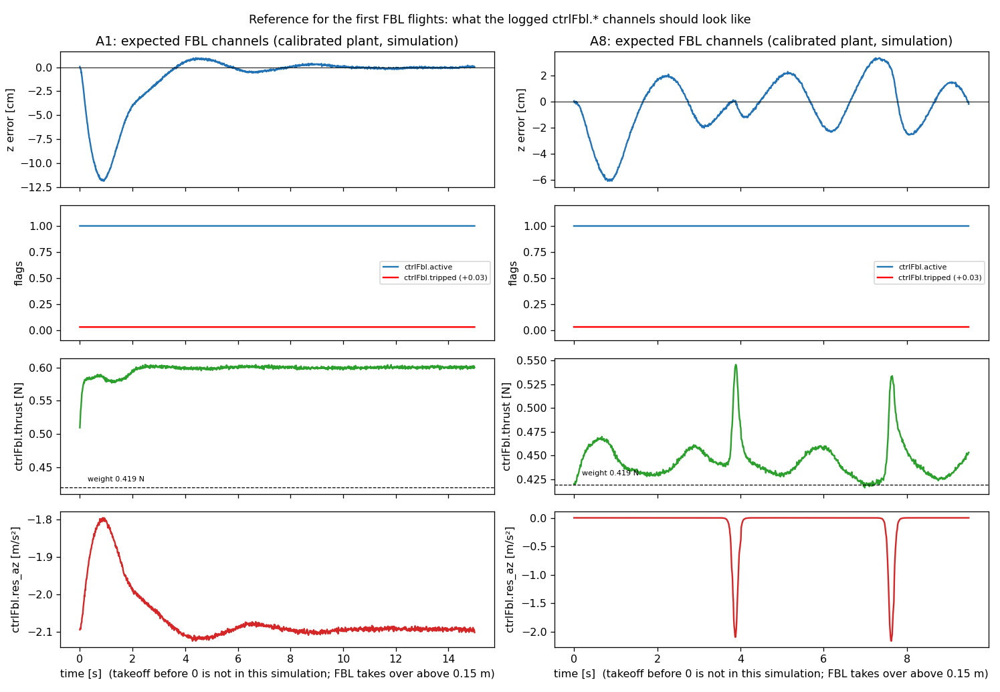

# FBL first flights — reading guide (desk-prepared 2026-10-21; simulation values, hardware will be worse)

**What the logged `ctrlFbl.*` channels should look like** (calibrated plant: thrust as measured, downwash 1.3×, measured peer feed). Order of flights as in `LAB_PLAN.md` (A1 first, then A8, then A4). These are suggestions for reading the logs, not protocol rules.

| Channel / quantity | A1 hold (dz 0.5) expected in simulation | If the first flight looks different |
|---|---|---|
| `ctrlFbl.active` | 1 from z > 0.15 m until landing | stays 0 / `steps` = 0: FBL did not run (it was Omar = S0): check `ctrlFbl.en`, controller 9, yaml (`fbl_bench_check.py --readback`) |
| `ctrlFbl.tripped`, `faults` | 0, 0 | `tripped` 1: tilt latch (> 60°) or a non-finite value; the flight continued on Omar. Look at tilt and `faults` at that time |
| `ctrlFbl.steps` | + 1 per uSD sample (500 Hz) while active | jumps or stalls: controller timing problem |
| z error | first second of the hold down to about −12 cm (settling from takeoff), then within ±1 cm | steady sag > 5 cm after 5 s: downwash compensation too weak → `ctrlFbl.cd` 0.43 → 0.6, or `ctrlFbl.ki_z` 12 → 16 (live parameters, no reflash) |
| `ctrlFbl.thrust` | 0.55–0.65 N while stacked (1.3–1.5 × weight 0.419 N); A8: 0.42–0.47 N with peaks to 0.55 N at the crossings | far above 0.65 N: motors near their limit (check `motor_max_pct`; INDI strategies already use 100 % there) |
| `ctrlFbl.res_az` | about −2.1 m/s² while the top drone is within ~0.3 m horizontally above, 0 otherwise | 0 while stacked: the peer feed is not reaching FBL (check `locSrv.*` and the neighbour position in the log) |
| tilt | < 1° in A1, ≤ 3.5° in A8 | oscillation with period < 1 s: gains too stiff for the actual motor lag / battery (stable up to lag 60 ms in simulation); fresh packs first. Bursts above ~20° only appeared in the parameter sweep when lag ≥ 54 ms **and** delay ≥ 5.5 ms coincided (`ROBUSTNESS_2026-10-21.md` §6) |
| takeoff / landing | smooth handover at 0.15 m and below 0.10 m (no jump) | transient at the handover: raise `ctrlFbl.z_on` (e.g. 0.30) so FBL takes over later |

After the flight (CS2 stopped): `python3 flying_drone_stack/tools/fbl_bench_check.py <cf5 uri> --post-flight` and `python3 experiments/analysis/fbl_log_check.py <log>`; the strategy of the block is FBL only if `steps > 0`.

Simulation numbers to compare with (A1 hold, calibrated plant): z RMS 3.2 cm, A8 dip 1 cm, A8 z RMS 2.2 cm (`SIM_COMPARISON_2026-10-20.md`); knob effects in `ROBUSTNESS_2026-10-21.md` §3. Script: `experiments/fbl/stage3_port/expected_traces.py`.
