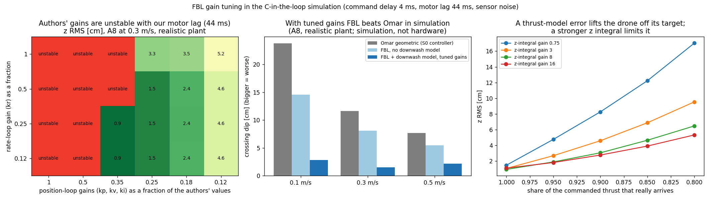
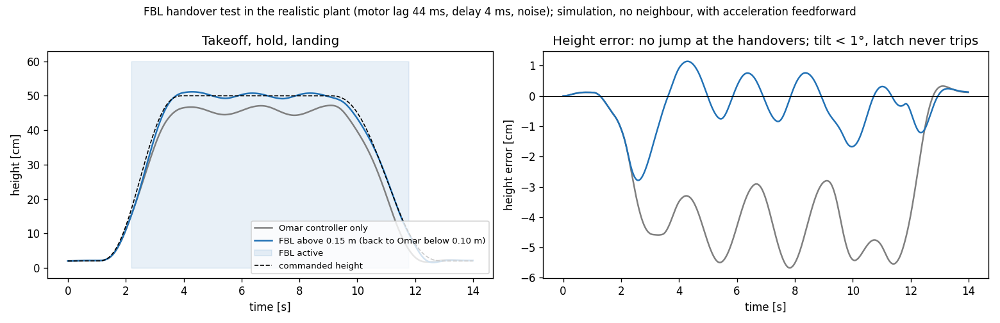
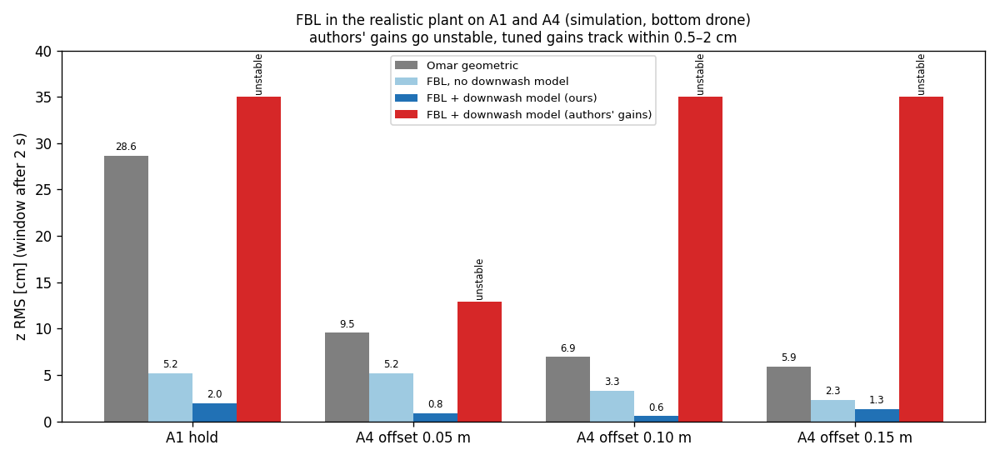
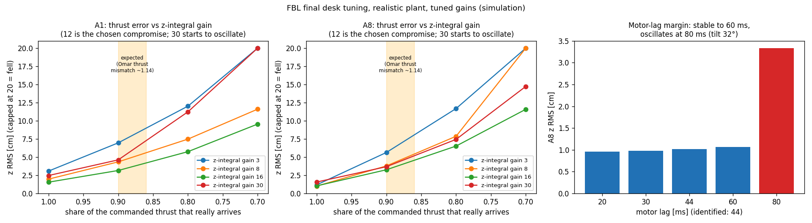

# FBL gain tuning in simulation (2026-10-20) — desk step 1 of 5

- **Plant:** the real firmware controller (C-in-the-loop) with command delay 4 ms, motor lag 44 ms (our identified value, `docs/09`), sensor noise; A8 swap.
- **Authors' gains are unstable on our vehicle:** position loop at full strength diverges (tilt > 60°, latch trips) once the motor lag is ≥ 15 ms (with 4 ms delay). Delay alone (up to 6 ms) or noise alone is harmless. The authors' vehicle and loop differ; their hardware gains will tell.
- **Working region:** position gains (kp, kv, ki) at ≤ 0.25× the authors' values; the rate gain kr matters little (0.12–0.5× all fine at 0.25× position gains). Chosen: **position 0.25×, kr 0.25×** (the best cell, 0.35×, sits next to the unstable region, so no margin).
- **Result in this plant (A8, dip, 0.1 / 0.3 / 0.5 m/s):** Omar geometric −23.8 / −11.6 / −7.7 cm, FBL without downwash model −14.6 / −8.1 / −5.5, FBL with it −2.8 / −1.5 / −2.1. Stable for motor lag 20–60 ms. **Simulation only**; the plant has no thrust-map error, ground effect or battery sag.
- **Weak point: thrust-model error.** FBL's z integral is small (ki_z 3). If only 90 % of the commanded thrust arrives, z RMS goes 1.5 → 4.6 cm (ki_z 3) or 3.1 cm (ki_z 8). Proposal: ki_z 8.
- **In the firmware (patch `fbl_gain_presets.patch`, applied after `fbl_integration.patch`):** parameter `ctrlFbl.preset`. **0 = the authors' gains exactly as in their code (kept for reference and comparison)**, **1 = ours (default)**: kp 14/11.25, kv 9.5/5.4, ki 12/12, kr 59.5/35. Individual `ctrlFbl.kp_xy` ... still override after the preset. Checked: defaults read back as preset 1; preset 0 reproduces the authors' unstable result in the plant (z RMS 15.2 cm, tripped), preset 1 gives z RMS 0.9 cm, dip −0.2 cm (A8, 0.3 m/s); G4 byte-identical at `en = 0` (4 of 4); ARM candidate `study_tree_v2_fbl_candidate_presets.bin` (sha256 `956479a7…`, flash 56 %, local only) builds clean. Not flashed.
- **Platform note:** our vehicle is a brushless Crazyflie with ~44 ms motor lag and 42.7 g, close to but not the authors' platform; both gain sets stay available and the authors' hardware gains will be added as a third preset when they arrive.

- **Handover (takeoff from 0.02 m, hold at 0.5 m, landing), same plant, no neighbour, acceleration feedforward on the ramp:** FBL took over at 0.15 m and handed back below 0.10 m without a jump; tilt stayed below 1°, the latch never tripped; hold error ±1 cm (Omar alone −6 … −3 cm). (An earlier version of this test showed a −10/+6 cm swing after takeoff; it was a test artefact: the test still applied the downwash of the scripted top drone that was not there. Fixed 2026-10-21.)
- **Tilt latch:** a sudden roll-rate kick of 25 / 40 / 60 rad/s (tilt 61° → 178°) trips the latch in every case; the Omar controller takes over and the height recovers like with Omar alone. A single-tick NaN in the position poisons Omar's own integrators (not FBL), so it is not a useful FBL test (the real estimator never outputs NaN).

- **A1 and A4 in the same plant (simulation, 0.5 m/s line for A4):** FBL with downwash model z RMS 2.0 cm (A1) and 0.8 / 0.6 / 1.3 cm (A4 offsets 0.05 / 0.10 / 0.15 m); Omar geometric 28.6 and 9.5 / 6.9 / 5.9; authors' gains unstable everywhere. Optimistic: the plant has no thrust-map error, battery sag or ground effect, and the downwash truth is the NS2 network that the lookup table was fitted to. (Numbers from before the 2026-10-21 test fix; the A1/A4 runs do not use the handover test and are unaffected.)

- **Next:** none at the desk, see the final round below and `LAB_PLAN.md`.

Reproduce: `experiments/fbl/stage3_port/gain_tuning.py --stage scale|grid|robust|eff`, plot `gain_tuning_plot.py`, outputs `experiments/fbl/out/stage3/gain_tuning_*.json`, plant `c_in_the_loop_real.py`.

## Final round (desk closed)

- **ki_z 12** (was 8): chosen with an assumed 12 % thrust shortfall (superseded 2026-10-21: the measured shortfall is 2.3 %, `ROBUSTNESS_2026-10-21.md`; ki_z 12–16 stays best there) — original reasoning: with the thrust error expected on hardware (~12 %, assumed from Omar's thrust mismatch 1.14; FBL uses the same thrust map) z RMS is 4.0 cm (A1) / 4.0 cm (A8) at ki_z 12 against 4.9 / 4.5 at 8; 16–20 give little more and add overshoot; 30 oscillates.
- **Estimator gains beta, gamma:** no effect (0.2/0.05 … 1.0/0.5 identical), kept 0.4/0.1.
- **Motor lag margin:** stable up to 60 ms; at 80 ms the loop starts to oscillate (tilt 32°). Identified lag is 44 ms.
- **Thrust error is the main risk:** below ~80 % arriving thrust FBL sags a lot in simulation; its z integral is the only protection. Knobs per flight: `ctrlFbl.ki_z`, `ctrlFbl.cd`, `ctrlFbl.preset`.
- Scripts: `final_tuning.py`; tools prepared: `fbl_bench_check.py`, `usd_fbl_config.txt` + `restore_study_sd_config.py --fbl`, `fbl_log_check.py`, `lab_check_strategy.py` (FBL aware), crazyswarm2 `study/from_main_FBL.patch`. Lab steps: `LAB_PLAN.md`.
