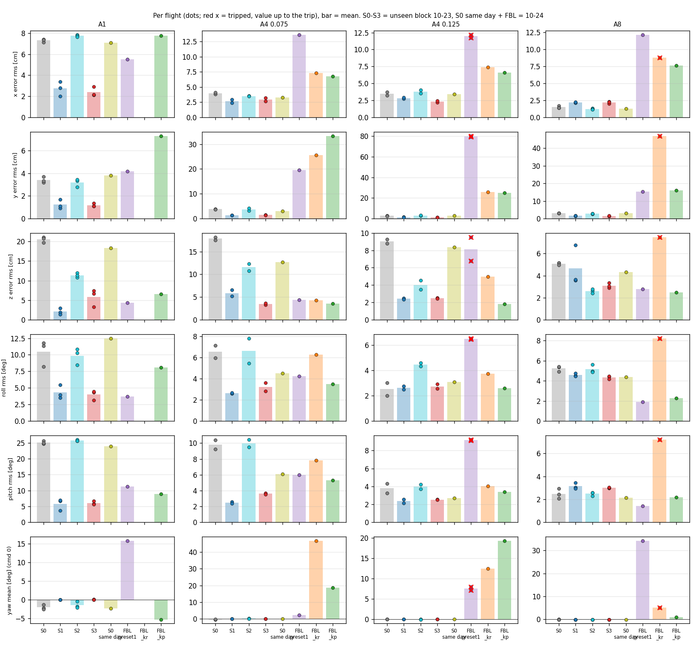
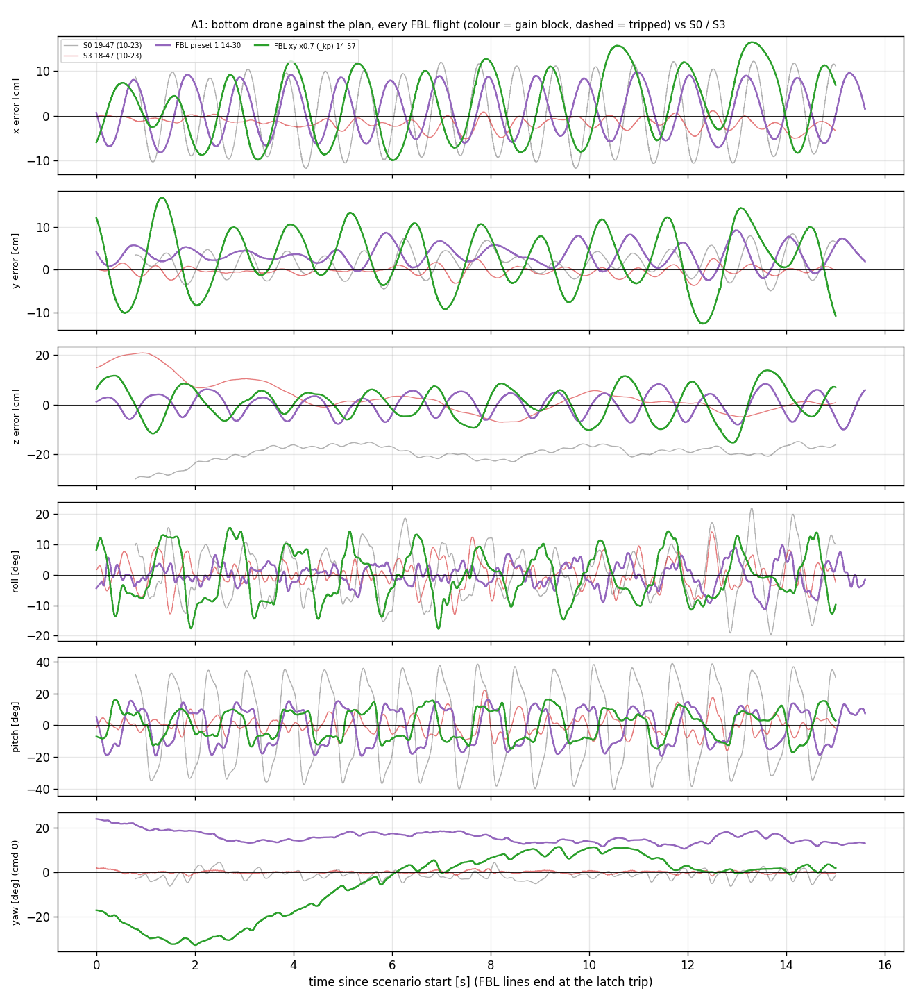
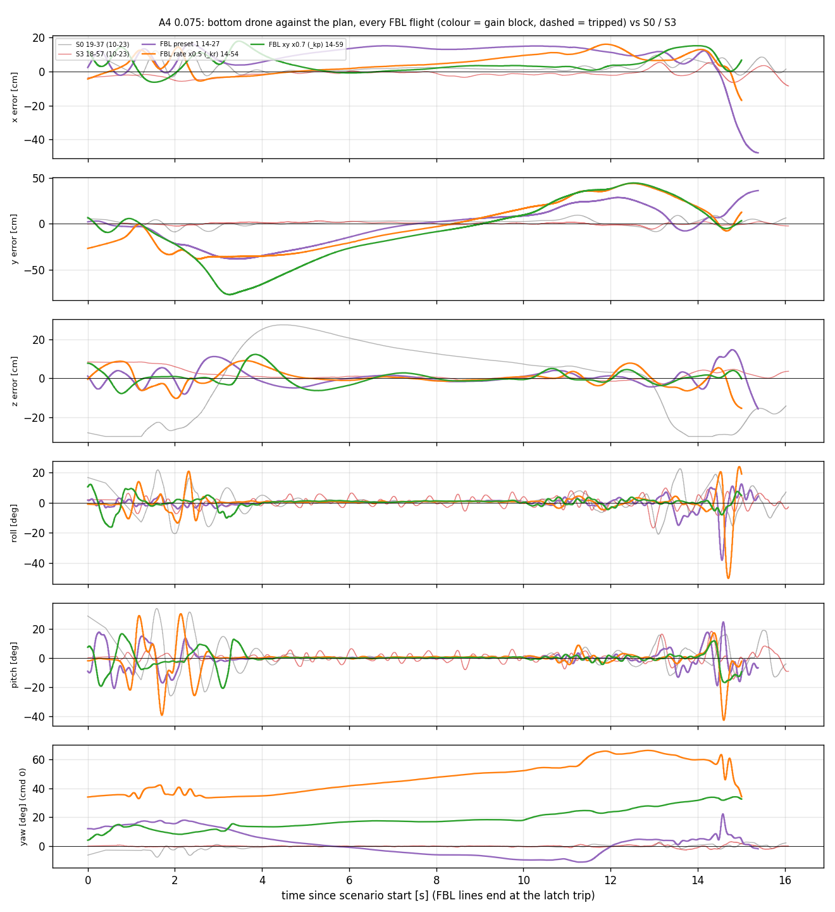
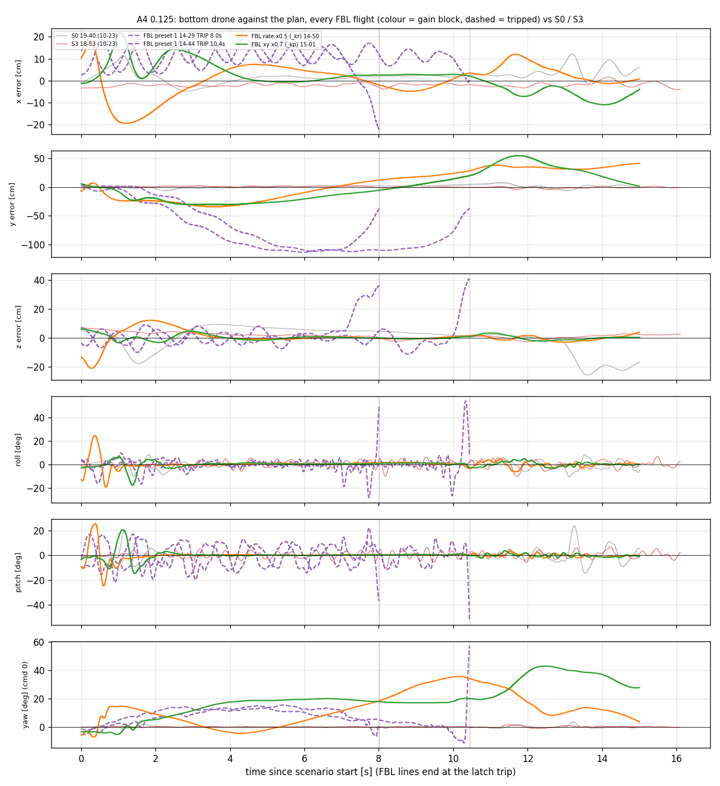
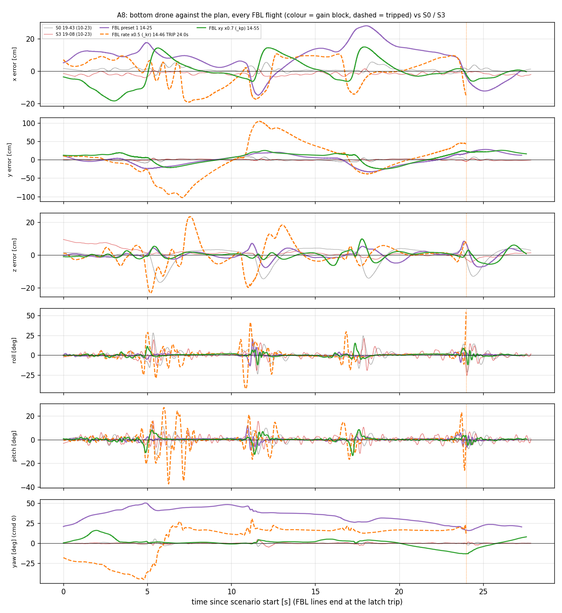
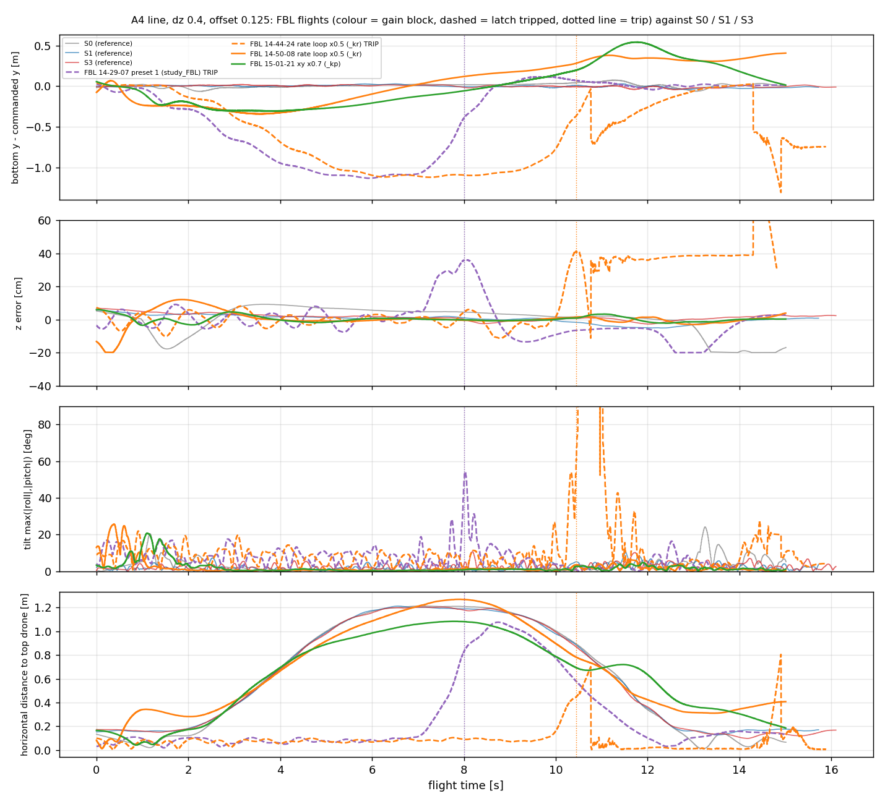
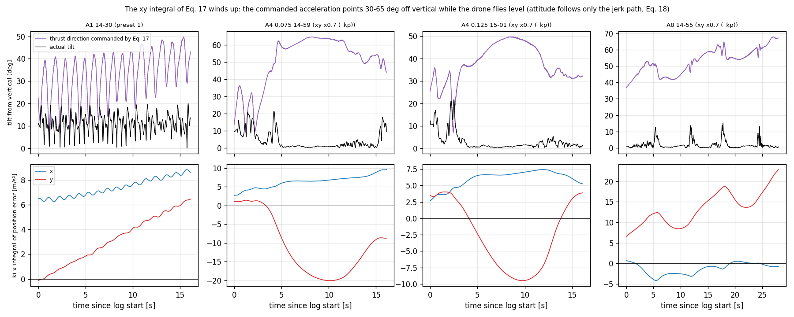
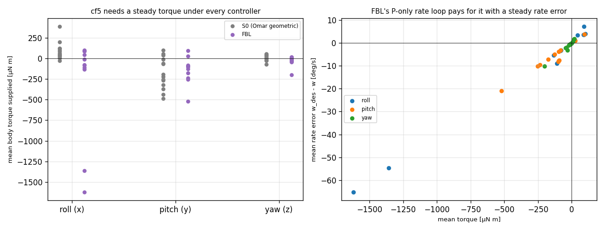
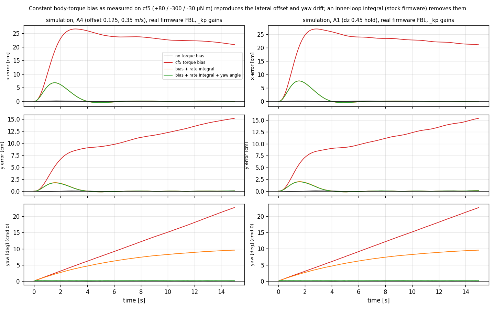
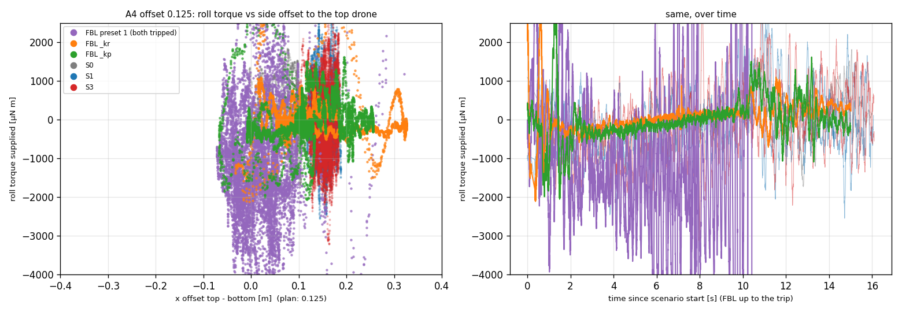

# FBL (S4) on Hardware — Review of the 2026-10-24 Flights

## Overview
- 12 FBL flights with complete uSD logs (15 flown), three gain blocks, unseen-block settings (A1 dz 0.45, A4 offset 0.075 / 0.125, A8 dz 0.4).
- **z:** in the S1–S3 range: best in A4 0.125 (`_kp` 1.8 cm), tied in A8 (2.5 vs S2 2.6), worse than S1 in A1 (4.3 vs 2.1).
- **x / y:** FBL does not follow the planned path. y error is 15–80 cm rms on A4 / A8, against 1–4 cm for S0–S3.
- **Yaw:** not held. It is already −18…+34° at log start and reaches up to 66° (commanded 0; S0–S3 mean within ±3°).
- **Stability:** the safety latch tripped in 3 of 12 flights: preset 1 2/5, `_kr` 1/3, `_kp` 0/4.
- **Main finding (§6–§7):** the control law is the authors' code, but the **inner loop is not the one they flew**. On hardware the authors sent thrust + body rates to the stock Crazyflie rate PID (integral, yaw-angle hold); our port closes the rate loop with P only (Eq. 19, as in their simulation). cf5 needs a slowly varying body torque (sign changes between flights, not a fixed bias). P-only can supply it only with a steady rate error, which produces a lateral offset (reproduced from the logs, corr 0.94–0.99 in 9 of 10 A4 / A8 flights) and a wound-up xy integral that couples into thrust. Yaw drifts because yaw has no feedback at all.
- **Not 1:1 today (§8):** inner loop (the stock rate PID is ~1.7× stiffer than preset 1, plus I and D), gains, residual (no NN), C_D, state source and rates, vehicle. Several hardware details are not published (§9).
- **Verdict: not ready for the comparative study.** First make the controller structure 1:1, then decide whether retuning is needed.

Notation: error = bottom drone (cf5) minus the plan (`ctrltarget`). Window = scenario start until landing begins; FBL flights only while FBL is active, cut at the trip. Reference = S0–S3 from the unseen block (2026-10-23) plus the 4 same-day S0 flights (morning, FBL off due to the init bug). Evidence levels: **V** = verified (code read or exact reconstruction), **S** = strong evidence (data + simulation), **H** = hypothesis, **U** = unknown / not published.

---

## 1. What flew

Gains identified from the logs (flown mass 0.0427 kg, recovered exactly from thrust; rate gains from torque vs rate error, position gains from the logged body rates; all 12 flights unambiguous, replay correlation 0.94–1.00). **The time-based assignment in the session doc was wrong for 2 flights:** 14:44 flew preset 1 (not `_kr`), 14:54 flew `_kr` (not `_kp`). [V]

| Gains | Change against preset 1 | Flights (complete logs) | Trips |
|---|---|---|---|
| preset 1 (0.25× authors', cd 0.55) | none | 14:25, 14:27, 14:29, 14:30, 14:44 | 2 (A4 0.125 ×2) |
| `_kr` | rate loop ×0.5 | 14:46, 14:50, 14:54 | 1 (A8) |
| `_kp` | xy position loop ×0.7 | 14:55, 14:57, 14:59, 15:01 | 0 |

---

## 2. All flights, all axes

| Cell | metric | S0–S3 (range of means) | FBL preset 1 | FBL `_kr` | FBL `_kp` |
|---|---|---|---|---|---|
| A1 | y rms [cm] | 1.2–3.4 | 4.2 | – | 7.3 |
| A1 | z rms [cm] | 2.1–20.5 | 4.3 | – | 6.5 |
| A4 0.075 | y rms [cm] | 1.4–3.8 | 19.6 | 25.6 | 33.4 |
| A4 0.075 | z rms [cm] | 3.5–17.8 | 4.4 | 4.3 | 3.6 |
| A4 0.125 | y rms [cm] | 1.2–3.0 | 79.8 (n=2, both trip) | 25.9 | 25.1 |
| A4 0.125 | z rms [cm] | 2.4–9.0 | 8.1 | 5.0 | 1.8 |
| A8 | y rms [cm] | 1.4–3.1 | 15.3 | 46.9 (trip) | 15.9 |
| A8 | z rms [cm] | 2.6–5.1 | 2.8 | 7.5 | 2.5 |
| all | yaw mean per flight [deg] (cmd 0) | −2.6…+0.2 | +2…+34 | +5…+47 | −5…+19 |
| all | max \|yaw\| per flight [deg] | – | 15–57 | 36–66 | 16–43 |

- n = 1 per cell in most cases; gain blocks are not comparable with each other yet.
- Roll / pitch: the plan needs < 1.1° of tilt; FBL tilt is 2–11° rms, in the S0–S3 range except in tripped flights.
- For reference, the paper's hardware result: Learned-FBL ≈ 5 cm RMSE, 10 cm z_max (stacked / static formations, 0.4 m, 0.4 m/s; whether RMSE is 3D or z is not stated).
- Full table: `experiments/results/fbl_hw_overview_2026-10-24/per_flight_errors.csv`.

---

## 3. Per scenario

**A1 (stacked hold, plan static)**

- x, y and z oscillate together at 0.8–1.0 Hz (±10 cm in xy, ±5–10 cm in z). S0 oscillates in x at 1.2–1.3 Hz with z unaffected.

**A4 offset 0.075**

- The y error has the same shape in all 3 flights and all gain blocks (−35…−75 cm, then +45 cm): systematic, not noise.

**A4 offset 0.125**

- Tripped flights (both preset 1): the y error builds to −110 cm, then the drone tips over (roll / pitch > 50°).
- Clean flights (`_kr` 14:50, `_kp` 15:01): z error ~0, but y error is −30 → +50 cm.

**A8**

---

## 4. "Getting out of the way": the bottom drone follows the top drone

- In the tripped A4 0.125 flights the bottom drone stays ~0.1 m under the top drone while the plan moves 1.2 m away, then trips.

---

## 5. Found in the logs
- **Yaw is not held** under FBL (all 12 flights); same drone and mocap under S0 the same day: yaw mean within ±2.3°. [V]
- **The xy integral of Eq. 17 winds up.** The logged desired attitude (`ctrlOmarIndi.rpyd`, built in the FBL branch from a_cmd − a_res + g) is correct: the integral state recovered from it satisfies dI/dt = position error exactly (corr 1.000, all 12 flights). The commanded acceleration points 33–66° off vertical on average (xy 9–52 m/s² rms) while the drone flies 1–11° tilted. [V] (An earlier version of this doc called this a logging bug; that was wrong.)

- **The wound-up command couples into thrust:** thrust = m (a_cmd − a_res + g) · z_b (Eq. 15) gets m a_cmd,xy · z_b,xy whenever the drone tilts; that term has 14–70 mN std on clean flights against a total thrust std of 28–88 mN (corr 0.4–0.75; reconstruction of the logged thrust within 3 mN). [V for the size, H that it causes the A1 xyz oscillation]
- The integral is already 3–13 m/s² at log start: it builds up during takeoff and the hover before the scenario. uSD logs start after takeoff. [V] Part of it may be the mismatch at FBL switch-on (0.15 m, climbing): a_cmd − a is never corrected in xy (only the jerk path acts), so the integral stores any switch-on offset. It cannot be separated, because the log starts too late. [H]
- The state the controller sees is not 500 Hz: EKF velocity changes every ~5.6 ms, attitude every ~5.9 ms, mocap every 9.9 ms (EKF prediction 100 Hz). [V]
- Plan feedforward (velocity, acceleration, jerk) reaches the setpoint on hardware (`crtp_commander_high_level.c` fills `setpoint->jerk`). [V]
- Desired yaw = 0 under FBL (`setpoint->mode.yaw = modeAbs`, `rpyd_z` = 0). [V]

---

## 6. Port vs authors' code vs paper hardware

| # | Element | Authors' code (bundle) | Paper hardware (Sec. 5.2) | Our port (flown 10-24) | Same? |
|---|---|---|---|---|---|
| 1 | Position law Eq. 17 / 18, integral, α-β-γ (β 0.4, γ 0.1 per update) | yes | same software "as in simulation" | yes (G3: 3000 cases vs `compute_fbl_command`) | **same** [V] |
| 2 | Thrust Eq. 15 on measured body z, Eq. 9 rates, Eq. 10 yaw rate | yes | yes | yes | **same** [V] |
| 3 | Rate → torque | Eq. 19, **P only** (kr 238 / 140) | **stock firmware rate PID**: FBL sends thrust + body rates, "rely on the high-frequency PID controller onboard" | Eq. 19, **P only** | **different** [V] |
| 4 | Integral on body rate | no | stock CF2.1 PID: roll/pitch kp 250, **ki 500**, kd 2.5 (D on the measurement); yaw kp 120, **ki 16.7** (`platform_defaults_cf2.h`). In physical units: CF2+upgrade 250 ≈ CF21BL 200 ≈ 2.5e-3 N m/(rad/s) = kr ≈ 103 1/s on our J (we flew 59.5 / 29.75); yaw 120 ≈ kr_z 15 (we flew 35) | no | **different** [V for firmware, U which firmware version / params they ran] |
| 5 | Yaw angle | not fed back (Eq. 10 is feedforward) | stock: yaw-rate command integrated into a yaw setpoint, attitude loop on it (`controller_pid.c`); the generic `manual` packet always sends yaw as a rate, legacy rpyt as rate (sign inverted) or angle, `cppmEmu` also has a rate mode; either way the yaw angle is held. The yaw-rate command is only integrated, not passed as feedforward. Pitch rate desired = −ω_y (rate PID uses −gyro.y) | not fed back | **different** [V for firmware, U which interface] |
| 6 | Thrust command | N, own motor allocation (sim) | stock interfaces take thrust as uint16; with battery compensation (Kconfig default) that is linear in force (F_motor = u/65535·THRUST_MAX, 0.18 N upgrade kit) | N, force-torque mode, same force-linear motor mapping | **can be made physically the same** [V]; their laptop N → uint16 map [U] |
| 7 | Residual torque | ROM + NN torque (sim) | not compensated, left to the onboard PID | 0, nothing handles it | **different** in effect (no PID) [V] |
| 8 | Residual force | ROM (z only, along the flow axis) + 9-neuron NN (3D) | ROM C_D 0.236 + **4-neuron force NN** (not in the bundle) | ROM only (z only) from a table, C_D 0.55 | **different** (no NN, no lateral residual, other C_D) [V]. C_D values are not comparable: bundle runtime ROM uses 0.3, our table constants (arm 0.05) make the ROM 15 % stronger per unit C_D; at A1 dz 0.45 ours predicts 2.86 m/s² vs theirs 1.06 (2.7×) |
| 9 | Gains | 56/38/48 (xy), 45/21.6/3 (z), rate 238/140, labelled "Deployed" in the code | not published | preset 1 = 0.25× (ki_z 12), `_kp` xy ×0.7 | **different** [V ours, U theirs] |
| 10 | Controller rate | 100 Hz (sim, paper Sec. 5.1) | commands at 400 Hz over the radio | 500 Hz onboard, but state updates only every ~5.6 ms | **different** [V]; α-β-γ constants are per update and see mostly zero innovations at 500 Hz |
| 11 | State p, v, R | noise-free (sim) | Vicon 120 Hz on the laptop; velocity estimate method not published | onboard EKF (mocap 100 Hz fused), effective ~100–180 Hz | **similar rate**, different source [U theirs] |
| 12 | Latency | none | Vicon → laptop → radio (not published) | mocap → PC → radio → EKF (not ~0; only controller → motors is onboard) | **different chain, similar order** [U sizes] |
| 13 | Peer state for the residual | simulator | Vicon, both drones on the laptop | radio broadcast ~100 Hz, velocity by differencing | **different** [V ours] |
| 14 | Takeoff / landing / limits | – | not published | Omar below 0.15 m, tilt latch 60°, body-rate limit 20 rad/s, thrust clamp | **ours only** [V] |
| 15 | Vehicle | 30 g CF (sim constants) | CF2.1 + thrust upgrade, 36 g, brushed | CF2.1 Brushless, 42.7 g; inertia unsettled (FBL 2.395e-5, Omar 1.657e-5 for the same drone) | **cannot be the same** [V] |
| 16 | Test cases | – | static and stacked formations, 0.3 / 0.4 m, 0.4 m/s | A1 stacked, A8 crossing, A4 side offset 0.075 / 0.125 (jet edge) | **different**; A4 is outside their tested regime [V] |

- The authors' code notes it itself: "the learned model predicts a small near-constant yaw torque bias that causes yaw drift" (yaw torque residual zeroed in simulation). [V]
- Sources: bundle `simulator_multi_python/Controllers/fbl_control.py`, `acceleration_estimator.py`, `KNODE/Training/downwash_residual.py`; paper Sec. 3.3 (Eqs. 17–19), 5.1, 5.2, App. A; firmware `controller_pid.c`, `crtp_commander_generic.c` (`manualDecoder`, `rate` flag), `crtp_commander_rpyt.c` (RATE mode), `platform_defaults_cf2.h`.

---

## 7. Cause chain for the observed behaviour

| Observation | Cause | Evidence |
|---|---|---|
| Yaw drift | no yaw-angle feedback (row 5) [V]. Two drivers: the yaw-rate error of the P-only loop, and Eq. 10's own commanded z rate when yaw ≠ desired and the drone tilts / oscillates | yaw budget (`review_fbl_yaw_budget.py`): rate error dominates in A8 / A4 `_kp` (15:01: +27 of +33°), the Eq. 10 command dominates in A1 (−36°, +69°) [V]; simulation 23° in 15 s, 0.2° with yaw-angle hold [S] |
| Steady lateral offset | slowly varying roll / pitch torque need (S0 means: roll −28…+387, pitch −488…+98 µN m, sign changes between flights; only pitch mostly negative) → steady rate error → jerk deficit → position error ≈ g · rate error / ki | log replay (`review_fbl_lateral_chain.py`): the rate error (< 0.3 Hz) through the Eq. 17/18 loop reproduces the y error, corr 0.94–0.99, rms ratio 0.67–1.04 in 9 of 10 A4 / A8 flights (14:54: 0.65); A1 not explained (its error is the 1 Hz oscillation) [S]; simulation 24 cm, 1.3 cm with a rate integral [S] |
| xy integral wind-up | steady position error that the jerk path does not remove → I grows linearly | exact reconstruction [V] |
| A1 coupled xyz oscillation 0.8–1.0 Hz | wound-up a_cmd,xy enters the thrust when the drone tilts | term size and correlation [V/H]; not reproduced in simulation yet (sim tilt < 1°) |
| A4 0.125 trips | drone sits in the top drone's jet (side offset 0.04–0.05 m instead of 0.125), roll torque oscillates ±3000 µN m; no torque residual, no rate integral (row 7) | data [S]; cause vs effect not separated [H] |
| Plan-shaped y error on A4 | partly the torque-bias offset rotating with yaw, partly unexplained | [H] |

**Simulation test (real firmware FBL via host bindings, `_kp` gains, 44 ms motor lag, NS2 v2 downwash, torque bias +80 / −300 / −30 µN m; inner-loop variants emulated in the wrapper, not in the C code)**. A mechanism test, not a stock-PID emulation: the rate integral uses FBL's kr as P (stock P is ~1.7× higher), no D, constant bias, starts in hover (no takeoff / switch-on).

| A4 0.125 (A1 same) | x rms | y rms | yaw after 15 s |
|---|---|---|---|
| no bias | 0.06 cm | 0.04 cm | −0.1° |
| **with cf5's torque bias** | **23.5 cm** | **11.6 cm** | **+22.7°** |
| + rate integral (ki/kp = 2, stock ratio) | 1.3 cm | 0.35 cm | +9.6° |
| + rate integral + yaw-angle hold (kp 6, stock) | 1.3 cm | 0.34 cm | +0.2° |

---

## 8. What 1:1 with the authors' hardware controller requires

**Status 2026-10-24 (evening): a, b, e (α-β-γ option), the network part of c and the preset-0 part of d done on the desk (`STOCK_INNER_LOOP_2026-10-24.md`); nothing flashed or flown.**

| # | Change | Possible? |
|---|---|---|
| a | **DONE (desk): `ctrlFbl.inner = 1`, bit-exact vs `controller_pid.c` rate mode; simulation Gate 2 passed with preset 1.** Send FBL's thrust + body rates (Eq. 15, 9, 10) into the **stock PID rate loop** instead of Eq. 19: roll / pitch in rate mode (`modeVelocity`), yaw as a rate integrated into a yaw setpoint, stock gains | yes, onboard in `controllerOmarFbl()` (`controller_omar_indi.c` l. 199–206): `attitudeControllerInit` once, PID reset and yaw setpoint = current yaw at switch-on; each tick ψ_sp += ω_z,des·dt, yaw attitude PID, `attitudeControllerCorrectRatePID(gyro.x, −gyro.y, gyro.z, ω_x,des, −ω_y,des, yaw)` in deg/s, legacy mode, yaw output negated. CF21BL defaults (200/400/2.5, yaw 120/16.7, yaw angle 6/1/0.35) ≈ the authors' CF2 gains in N m/(rad/s) within 4 %. Check in sim with the real stock PID first: it is ~1.7× stiffer than preset 1, and the 44 ms lag sim called stiffer gains unstable |
| b | **DONE with a (legacy uint16 thrust).** Thrust through the same path as theirs (uint16) | yes physically: T/(4·THRUST_MAX)·65535 is force-linear with battery compensation; only their laptop map is not published |
| c | **Firmware side DONE (`ctrlFbl.nn_en`, Gate 4 vs the bundle); weights need the data card + training; C_D stays 0.55.** Residual: ROM + a force NN like theirs (4 neurons) instead of ROM only; C_D identified on our vehicle (a 1:1 C_D value does not exist) | needs data like theirs (static + stacked, 0.4 m, 0.4 m/s, ~28 s, FBL without NN) and training |
| d | **Preset 0 = bundle values exactly; unstable in simulation above 27 ms motor lag (ours 44 ms) also with the stock loop.** Gains: their hardware gains | not published; the bundle values ("Deployed") are the only source |
| e | Rate 400 Hz, Vicon 120 Hz on a laptop, radio latency | not wanted (onboard is the study setup); keep 500 Hz onboard, document. Optional: run α-β-γ only on new EKF samples (**DONE: `ctrlFbl.abg_on_new`, default 0; no gain in simulation**) |
| f | Vehicle, test cases | cannot be the same; document |

Must stay ours (study setup): onboard execution, EKF state, handover to Omar below 0.15 m, tilt latch.

---

## 9. Open facts (ask the authors or settle by test)
- Which stock interface (crazyflie_ros `cmd_vel` = legacy rpyt in RATE mode is most likely, or `manual` / `cppmEmu`), signs for pitch and yaw rate, was ω_z sent as the yaw rate, which onboard controller, firmware version / Kconfig (upgrade kit, battery compensation) and rate-PID parameters.
- Vehicle values in their hardware controller (mass 0.036 or 0.03, inertia); C_D 0.236 identified with which ROM constants; NN weights / data.
- How FBL was started (from the ground or after takeoff with another controller), integral / estimator reset.
- Thrust → PWM map; did they compensate battery voltage.
- Hardware gains (position, integral; were the bundle "Deployed" values flown?).
- Velocity source (Vicon differencing / filter), the rate at which FBL and the α-β-γ filter ran (120 or 400 Hz).
- Takeoff / landing with FBL, anti-windup of the position integral.
- Is the hardware RMSE (5 cm) 3D or z.

## Questions:
- Implement row 8a (FBL → stock rate PID, our CF21BL rate gains) as the 1:1 inner loop?
- Gains for the first flights after that: the bundle's (56/38/48) or keep preset 1?

## Next Steps:
- [x] Independent review of this doc: `docs/fbl/HARDWARE_REVIEW_2026-10-24_independent_review.md` (corrections merged here).
- [x] 8a in the C port behind a parameter (old path bit-identical), host test against `controller_pid.c` rate mode, simulation with the real stock PID incl. torque (`STOCK_INNER_LOOP_2026-10-24.md`). [ ] Bench / hover (lab).
- [x] Inertia: 2.395e-5 (Busetto 2025, CF21BL) is the right value for cf5; 1.657e-5 is the CF2.0 identification (Omar's source). [ ] Start the uSD log before takeoff (flight card).
- [ ] Simulation of the A1 xyz oscillation (thrust coupling of the wound-up integral) and of the A4 0.125 jet edge (needs a torque / lateral downwash model; NS2 is z only).
- [ ] Correct the gain-block assignment in the session doc and meeting doc §5 (14:44 = preset 1, 14:54 = `_kr`).
- [ ] Only after that: gains (incl. cd), freeze, comparison flights with n like S0–S3.

Scripts: `experiments/analysis/fbl_hw_overview.py`, `fbl_replay_check.py`, `fbl_integral_windup.py`, `fbl_a4_roll_torque.py`, `review_fbl_thrust_coupling.py`, `review_fbl_yaw_budget.py`, `review_fbl_lateral_chain.py`, `experiments/fbl/stage3_port/torque_bias_sim.py`.
