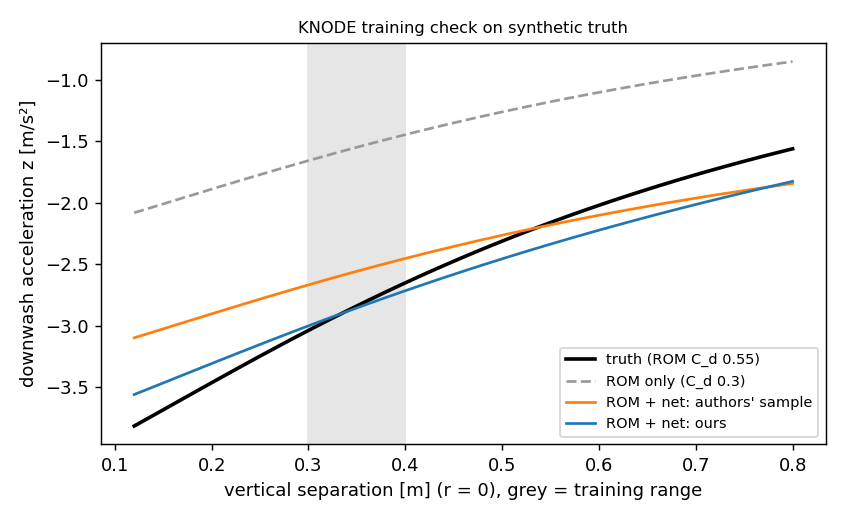

# FBL residual training — step 2: our own KNODE training script, checked on synthetic flights (2026-10-22)

Truth = bundle dynamics with ROM C_d 0.55 (black); the model under training uses the ROM with C_d 0.3 (dashed) plus the bundle's two 9-neuron nets; blue = ours after training on 17.7 s of nominal-controller flights (stacked and static top, dz 0.3 / 0.4 m, 0.4 m/s, grey range); orange = the authors' sample checkpoint (trained on their own, unknown truth).

| RMSE accel [m/s²] / ang. accel [rad/s²] | Nominal (no downwash) | ROM only | authors' sample | **ours** |
|---|---|---|---|---|
| stacked dz 0.2 (OOD) | 0.87 / 39.8 | 0.39 / 18.1 | 0.17 / 7.8 | **0.10** / 8.9 |
| stacked dz 0.3 (train) | 0.74 / 32.0 | 0.34 / 14.6 | 0.13 / 5.5 | **0.07** / 5.2 |
| stacked dz 0.4 (train) | 0.67 / 27.8 | 0.30 / 12.6 | 0.10 / 4.7 | **0.035** / 3.4 |
| stacked dz 0.5 (OOD) | 0.62 / 23.8 | 0.28 / 10.8 | 0.08 / 5.2 | **0.024** / 3.0 |
| static top dz 0.3 / 0.5 | 0.51 / 16.4 · 0.35 / 11.1 | 0.23 / 7.4 · 0.16 / 5.0 | 0.09 / 4.3 · 0.07 / 3.7 | **0.045 / 3.0 · 0.053 / 2.3** |

- **The pipeline works:** one-step loss 7e-5 → 8e-6 in 1500 Adam iterations (4.5 min on CPU), the learned residual follows the truth inside and outside the training range and beats the ROM alone by 3–10× in acceleration error.
- **Not a replication of the authors' checkpoint:** their sample network was trained on a different (unknown) truth, so it is only a reference; the check shows that our script recovers a *known* residual.
- Script = thesis loop (one-step RK4, Adam lr 2e-2, weight decay 2e-9, full batch, seed 123, best loss kept) around the bundle's `ODEFunc` (imported read-only), loss weights diag(1×10, 0.1×3) of the paper; no torchdiffeq needed (own RK4).
- **Found on the way:** rows with the neighbour exactly above (horizontal distance < 2 mm) make the backward pass NaN (degenerate flow frame, the runtime has the same singularity); they are dropped. The bundle's C_d is a module global, restored after each simulation.
- Limits: synthetic truth is the bundle's own ROM (the paper's truth also depends on vehicle attitudes), noise-free data, 30 g bundle vehicle, one seed; nothing here says anything yet about our platform or real data (step 3).

Code: `experiments/fbl/stage4_knode/` (`knode_train.py`, `knode_sim.py`, `validate_on_sim.py`), results `experiments/fbl/out/stage4/sim_check_v0/`.
