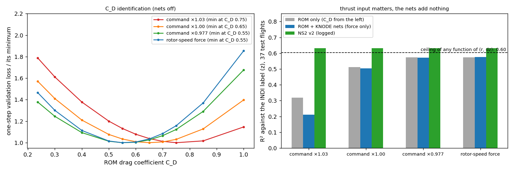

# FBL residual training — step 3: KNODE on our own flight logs (force only), C_D, thrust input (2026-10-22)

Train = 42 Omar-tree S0 flights of the NS2 collection (old bottom vehicle), validation 5 flights, **test = 37 pilot flights of other flights and another bottom vehicle** (S0/S1, NN off). Rows: neighbour above within 0.5 m, 100 Hz, one-step RK4, force-only (torque input 0, body-rate weight 0), the bundle's ODEFunc with our vehicle (0.0427 kg), 9-neuron nets. Label = logged INDI residual a_res (z), used for scoring only.

| thrust input | C_D* (min val. loss) | ROM only R² / bias | ROM + KNODE nets R² / bias | val. loss change by the nets |
|---|---|---|---|---|
| command × 1.03 | 0.75 | 0.32 / −0.43 | 0.21 / −0.64 | −14 % |
| command × 1.00 | 0.65 | 0.51 / −0.19 | 0.50 / −0.28 | −4.4 % |
| command × 0.977 (measured thrust 97.7 %) | 0.55 | 0.57 / +0.04 | 0.57 / +0.03 | −0.7 % |
| rotor-speed force (Σ k ω², deck rpm) | 0.55 | 0.57 / +0.04 | 0.58 / −0.04 | −3.5 % (lowest loss overall) |
| *reference: NS2 v2 (logged)* | | | 0.63 / +0.07 | |
| *ceiling of any function of (r, dz), fitted to the label* | | | 0.60 | |

- **Our logs are enough, no FBL lab flights are needed for the training:** the state-level residual (velocity change minus the thrust-based prediction) agrees with the independent INDI label at correlation 0.85–0.94 per A8 flight, same mean and spread.
- **C_D ≈ 0.55 for our platform** with calibrated thrust (0.65 with the raw command); the paper's 0.236 is for their 36 g vehicle and a hand-tuned procedure. Agrees with the Stage-2 closed-loop result (≈ 0.6). First flight value 0.55, bracket 0.43 / 0.65.
- **The thrust input is the sensitive part:** ±3 % on the thrust moves C_D by ±0.1 and the test R² from 0.57 to 0.51 / 0.32 — the residual (≈ 1.2 m/s²) is small against a few % of 9.81. With a wrong thrust the nets mostly learn the calibration (−14 % loss, worse test score). Use the rotor-speed force (best loss, no calibration) or the command × 0.977.
- **The KNODE nets add nothing measurable once the thrust is right** (loss −0.3 … −3.5 %, test R² unchanged): consistent with Stage 1; the ROM with the fitted C_D carries the effect. Any function of (r, dz) can reach at most R² 0.60 on this label (0.62 with relative velocity and own height), NS2 v2 0.63.
- Velocity-only loss and a 20 Hz step (stride 10) give the same picture (R² 0.57).
- Limits: one split and seed, 9 neurons only (the paper's hardware net has 4), label = INDI residual (IMU based), S0 and S1 test flights mixed, only strides 5 and 10 tried; the supervised fit of Stage 1 was not re-run on this split.

Code: `experiments/fbl/stage4_knode/` (`real_data.py`, `real_experiments.py`, `ceiling.py`, `plot_real.py`), results `experiments/fbl/out/stage4/real_v0/` (+ `ceiling.json`).

**Update 2026-10-25:** 4-neuron force net (the paper's hardware size) trained with the same split (`real_experiments.py --hidden-f 4 --tag s0977_h4`): C_D 0.55, validation loss −1.6 % vs ROM, test R² 0.572 (ROM 0.573); linked into the firmware as the FBL network (`STOCK_INNER_LOOP_2026-10-24.md` §3). Note: the `final_val` field in `results.json` is wrong (about 2× the ROM loss); recomputed directly, the numbers in the table above hold.
