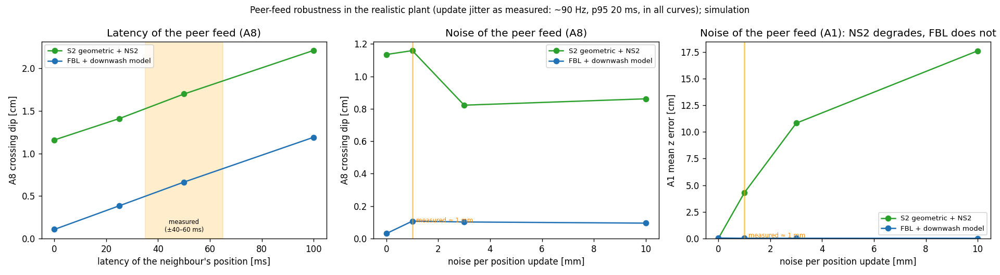
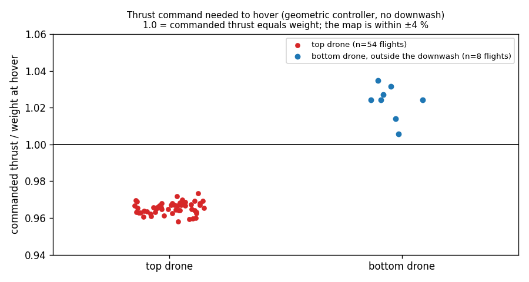
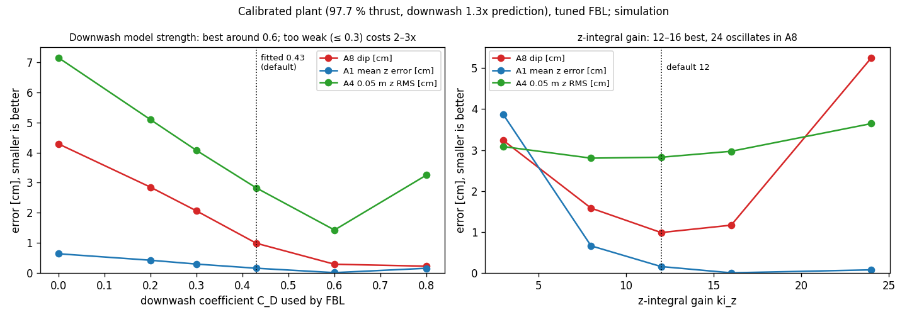
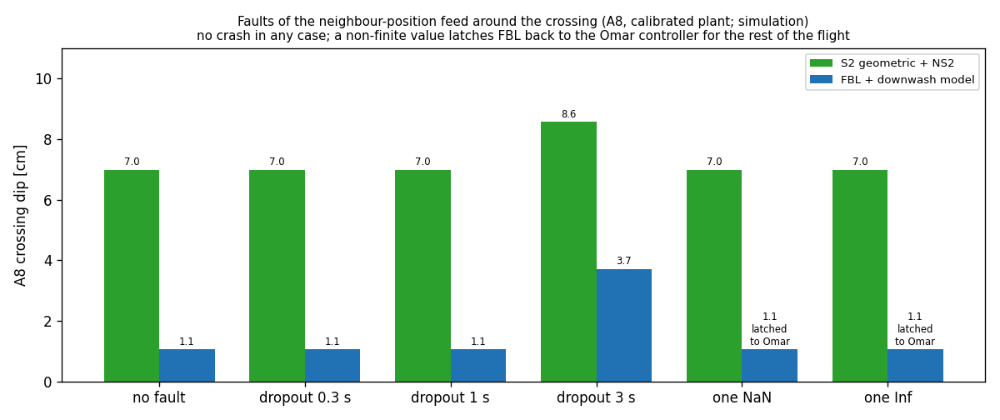
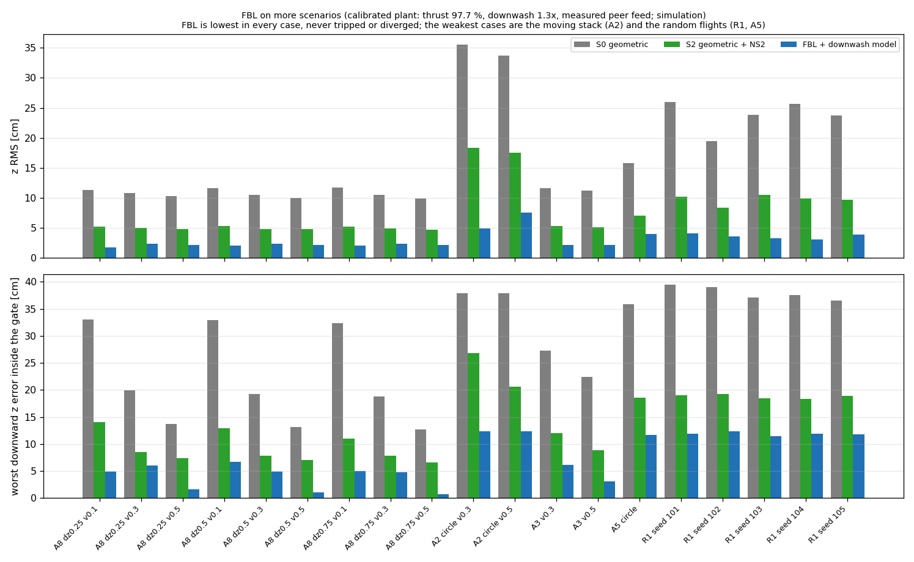
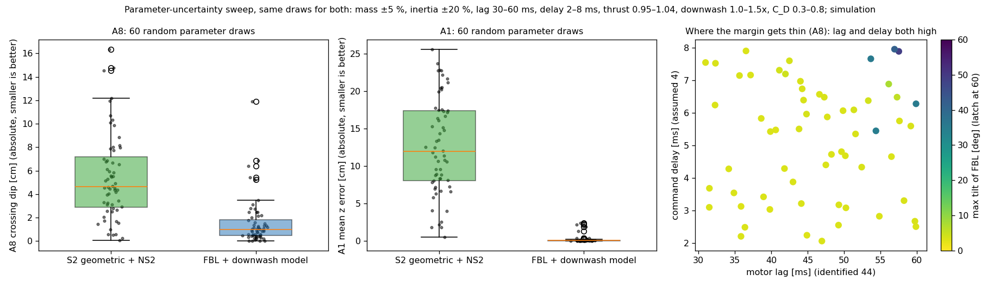

# FBL robustness at the desk (2026-10-21): peer feed and thrust map

## 1. Peer feed (neighbour position) — measured from our uSD logs, then swept in the plant

- **Measured** (cf5 logs, airborne): the neighbour's position updates at about **88 Hz** (median interval 9.9 ms, p5/p95 7.7 / 19.9 ms), about **1 mm** noise per update (upper bound, includes the neighbour's own motion). **Latency** is not resolvable: cross-correlating the received position with the neighbour's own log gives ±40–60 ms with changing sign (the merge alignment itself is only about that accurate), so it is swept 0–100 ms.
- **FBL is insensitive:** A8 dip grows only from 0.1 to 1.2 cm up to 100 ms latency (S2: 1.2 to 2.2 cm); noise up to 10 mm changes nothing for FBL.
- **S2 (NS2) is sensitive to noise in A1:** mean z error 0 → −4.3 cm at the measured 1 mm and −17.6 cm at 10 mm (the network takes the neighbour's velocity, differenced from noisy positions). This may be part of why S2 on the hardware is worse than in the ideal simulation (hypothesis, not proven).
- Script `peer_robustness.py` (plant option `peer=...` in `c_in_the_loop_real.py`; update intervals from `peer_intervals.npy`).

## 2. Thrust map — the "12 % shortfall" assumption was too pessimistic

- **Measured:** thrust command / weight at steady hover where no downwash acts (geometric controller, `mass 0.0427`): **top drone 0.965** (54 flights, 0.958–0.973), **bottom drone 1.023** (8 A8 flights outside the gate, 1.006–1.035). So the thrust map is within about ±4 %, not 12 % off; for the bottom drone 97.7 % of the command arrives (the top drone gets 3.6 % more than commanded, or its mass is smaller).
- **Consequence:** with the measured factor FBL's z error stays at 0.0–2 cm in the ideal-downwash plant (A1 2.1 cm RMS), against 4–5 cm with the assumed 12 %. The earlier stress plant (12 % shortfall) was harsher than reality and is superseded by the bottom row of `SIM_COMPARISON_2026-10-20.md`.
- Caveats: the ratio includes the integral part of the command; battery state differs between flights; the INDI strategies' thrust path is different (65–70 % arrives, `docs/tree_comparison_2026-10-19.md`) and is not covered here.
- Script `robustness_plots.py` (makes both figures and the simulation comparison figure).

## 3. Downwash coefficient C_D and z-integral gain (calibrated plant)

- **C_D:** error falls as C_D rises up to about 0.6 and stays flat to 0.8; with C_D ≤ 0.3 FBL loses a factor 2–3 (A8 dip 4.3 cm at 0 → 1.0 at 0.43 → 0.3 at 0.6). The best value is higher than the fitted 0.43 because the plant's downwash is 1.3× the NS2 prediction. **On the hardware try 0.43 first, then 0.6** (`ctrlFbl.cd`, no reflash).
- **ki_z:** 12–16 is best (A1 bias 0.2 → 0.0 cm), 24 oscillates in A8 (5.3 cm); default stays 12.
- **Not done:** propeller radius (45 mm assumed) — it is baked into the lookup table and needs a table rebuild; expected to act like a C_D/shape change.
- Scripts `cd_and_kiz.py`, `robustness_plots.py`.

## 4. Faults of the peer feed (A8, calibrated plant)

- **Dropouts:** 0.3 s and 1 s without neighbour updates around t = 8 s changed nothing (the crossing was not inside the gap, or the stale position still fits); a 3 s dropout that covers a crossing raises FBL's dip from 1.1 to 3.7 cm (S2: 7.0 to 8.6 cm). No crash.
- **One NaN / Inf position in the feed:** FBL falls back to the Omar controller and stays there until landing (latch, by design): no crash, z RMS 2.2 → 3.3 cm. The dip shown is the worst of the whole run and happened before the fault (it came after the second crossing). S2 is unaffected in the simulation.
- Script `peer_faults.py` (plant options `drop=(t0,t1)`, `nan_at=t` in `c_in_the_loop_real.py`).

## 5. More scenarios (calibrated plant): FBL against S0 and S2

- **19 cases:** A8 at dz 0.25 / 0.5 / 0.75 × 0.1 / 0.3 / 0.5 m/s, A2 circle (0.3, 0.5 m/s), A3 (0.3, 0.5 m/s), A5, R1 random waypoints (5 seeds). FBL has the lowest z RMS in every case (typically 2–4 cm against S2 5–10 cm and S0 10–35 cm), and never tripped or diverged.
- **Weakest cases for FBL:** the moving stack A2 (z RMS 4.9 / 7.5 cm, worst downward error −12 cm), A5 and the random flights R1 (3–4 cm, −12 cm). The slow A8 flights (0.1 m/s) are still its worst A8 cases (dip 5–7 cm), as for S0/S2.
- **Caveat:** the simulated S0 is harsher than the hardware on the stacked-moving cases (A2 z RMS 34–35 cm simulated against about 17–22 cm measured on 2026-10-16), so the absolute values there are pessimistic for all strategies; the ranking is what counts.
- Script `scenario_matrix.py`.

## 6. Parameter-uncertainty sweep (60 random draws, same for FBL and S2)

- **Draws:** plant mass ±5 %, inertia ±20 %, motor lag 30–60 ms, command delay 2–8 ms, thrust factor 0.95–1.04, downwash 1.0–1.5× the prediction, FBL's C_D 0.3–0.8; scenarios A8 (0.5 m/s) and A1.
- **No failures:** 0 of 120 FBL runs tripped or diverged (S2 also 0). FBL median z RMS 2.0 cm (A8) / 2.4 cm (A1), 90th percentile 3.1 / 3.5 cm, worst draw 7.3 / 7.0 cm; S2 median 4.7 / 11.8 cm, worst 13.6 / 25.2 cm. A1 mean z error of FBL: median 0.1 cm, worst 2.4 cm.
- **Where the margin gets thin:** 11 of 120 FBL runs reach a tilt above 8° (up to 49°, latch at 60°), all with motor lag ≥ 54 ms **and** command delay ≥ 5.5 ms at the same time. With the identified lag (44 ms) and the assumed delay (4 ms) the tilt stays below 4°. Correlation of FBL's z RMS with the parameters: lag 0.4, delay 0.2–0.3, mass 0.2–0.25 (more mass → worse), C_D −0.3 in A1; inertia and downwash scale hardly matter.
- **Meaning for the first flights:** if the logged tilt shows bursts above about 20° (see `FIRST_FLIGHT_CHECKLIST.md`), suspect a larger delay/lag than assumed (low battery, radio); the first knob would be a lower `ctrlFbl.kr_xy` / `kp_xy` (not simulated yet).
- Script `param_sweep.py`.
