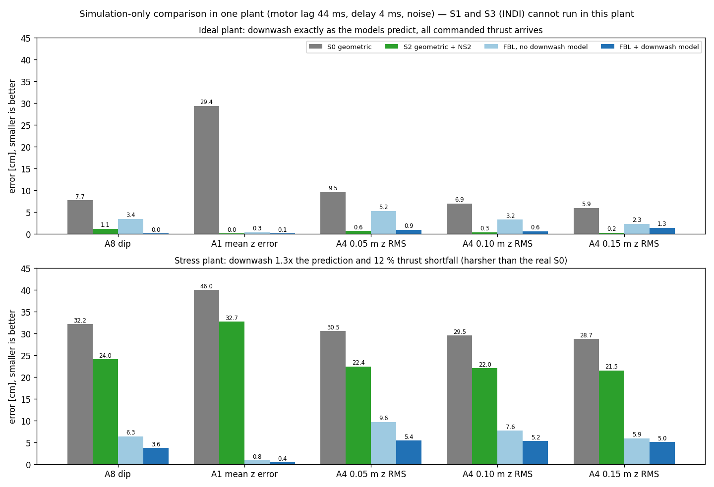

# FBL vs the controller tree — simulation only, one plant (2026-10-20)

- **Plant:** `c_in_the_loop_real.py` (motor lag 44 ms, delay 4 ms, noise; truth downwash = NS2 network). Controllers = the real firmware C code (Omar tree and FBL branch, tuned preset). A8 at 0.5 m/s, A1 dz 0.5, A4 line 0.5 m/s. Script `experiments/fbl/stage3_port/sim_compare.py`, data `out/stage3/sim_compare.json`.
- **S1 and S3 (INDI) are not in this plant:** they need the RPM-based plant of the two-drone harness, where INDI looks perfect (`docs/75` §3: no dip in the simulation, −9 to −22 cm on the hardware), so a simulation ranking of INDI would be meaningless anyway.
- **Ideal plant:** FBL beats S0 everywhere (A1 mean z error −29 → 0.1 cm, A8 dip −7.7 → 0.0, A4 9.5 → 0.9 cm). **S2 (geometric + NS2) is as good or better than FBL (A8 −1.1, A1 0.0, A4 0.6)** because here the NS2 prediction is exactly the plant's downwash (upper bound); FBL's physics model is only an approximation of it (fit R² 0.4 against NS2's 0.8).
- **Stress plant (downwash 1.3x, 12 % thrust shortfall for everyone):** S0 and S2 collapse (−32 / −24 cm dip), FBL stays at 3.6–5.4 cm. This mostly measures the z-integral gain (Omar 1.5, FBL 12), not the control structure, and is harsher than the real S0 (hardware −12.5 cm). Treat it as a robustness hint only.
- **Reading:** FBL is clearly better than the geometric S0; against S2 the simulation cannot separate them (S2 is flattered by its perfect model); whether FBL's physics model or NS2's network wins on the real downwash is exactly what the lab flights decide.
