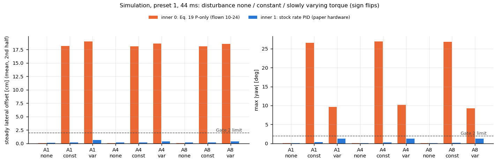
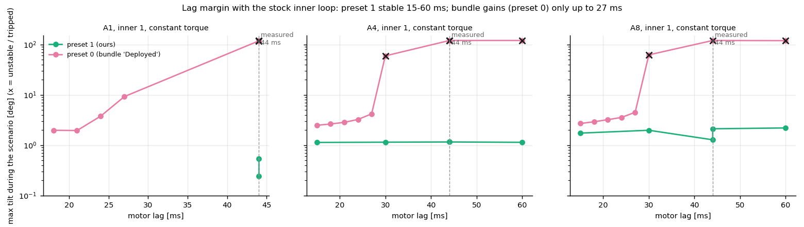

# FBL as the Authors Flew It: Stock Rate-PID Inner Loop + ROM + Trained Network — 2026-10-24/25

## Overview
- **Inner loop:** FBL's thrust + body rates (Eqs. 15, 9, 10) go into the stock Crazyflie rate PID, as on the paper's hardware (Sec. 5.2; Chee thesis l. 3441: "thrust and angular rate commands, which are passed to the PID controllers running in the Crazyflie firmware"). `ctrlFbl.inner`: **1 = default since 2026-10-25**; 0 = the Eq. 19 P-only loop flown on 10-24.
- **Residual:** physics model (ROM, C_D 0.55) **+ trained 4-neuron force network** (KNODE on our flights, the paper's hardware recipe), linked into the image. `ctrlFbl.nn_en`: **1 = default**; 0 = ROM only (as on 10-24).
- **Gates passed:** host bit-exact vs stock `controller_pid.c`; `inner 0` + S0–S3 bit-identical to the build before; firmware network = authors' `DownwashResidual` (also with the flight weights, and end to end in the firmware build); simulation (corrected peer feed): lateral offset and yaw drift removed.
- **Simulation (preset 1, 44 ms motor lag, cf5's torque need):** steady lateral offset 18 cm → 0.15 cm, max yaw 27° → 0.3°; stable 15–60 ms. Bundle gains (preset 0) unstable above 27 ms with either inner loop.
- **Ready for the lab:** image `study_tree_v2_fbl_stockinner_nn4_candidate.bin` (sha256 `b13bf8ec…`), crazyswarm2 branch `study_FBL_stock` (pushed), plan `docs/lab_sessions/fbl_stock_inner_session_plan.md`. Nothing flashed or flown.

Evidence levels: **V** verified, **S** strong (simulation / data), **H** hypothesis, **U** unknown.

---

## 1. Simulation: stock inner loop vs the flown one

| preset 1, 44 ms lag (A1 / A4 / A8) | steady xy offset [cm] inner 0 → 1 | max \|yaw\| [deg] inner 0 → 1 | tilt max [deg] inner 1 | handover tilt [deg] inner 1 |
|---|---|---|---|---|
| no disturbance | 0.06–0.07 → 0.13–0.17 | 0.08–0.11 → 0.03–0.04 | 0.8–2.1 | 0.3–1.2 |
| constant torque | 18.1–18.2 → 0.15–0.17 | 26.5–26.9 → 0.19–0.29 | 0.5–2.1 | 0.6–1.2 |
| slowly varying torque (sign flips) | 18.6–19.0 → 0.36–0.61 | 9.2–10.1 → 1.24–1.29 | 0.8–1.8 | 0.8–1.1 |

- Plant: real firmware controller via the host bindings, real mixer (`powerDistribution` → cap → force-linear uint16), 4 ms delay, motor lag, noise, takeoff from the ground under Omar with FBL switch-on at 0.15 m, NS2 v2 downwash truth (z only), FBL residual ROM C_D 0.55 + network. [S]
- **Gate 2 PASS** (stable everywhere; with torque: yaw < 2°, steady offset < 2 cm).
- **Network on vs off** (constant torque): z rms 0.60 / 0.72 / 1.27 vs 0.51 / 0.56 / 1.66 cm (A1 / A4 / A8); steady offset 0.15–0.17 vs 0.02–0.03 cm. The network predicts a small sideways force that the simulated downwash does not have (NS2 is z only), so the simulation cannot tell whether it helps; the flights can. [S]
- Same with the other inertia value in the plant (offset 0.13–0.18 cm, yaw ≤ 0.30°) and with the state held 4–8 ms like the EKF (0.16–0.21 cm).
- **Correction 2026-10-25:** the first simulation runs (and `torque_bias_sim.py`) did not enable the host peer feed (`oot_set_peer_count(1)`), so FBL ran without its downwash compensation there. Rerun with it: the lateral / yaw conclusions are identical (torque-bias simulation: 23.5 cm x and 22.7° yaw → 1.3 cm and 0.2° with the stock loop, unchanged); z is better now.
- Not reproduced in this plant: the A1 0.8–1.0 Hz xyz wobble and the A4 0.125 crashes (no sideways / torque downwash model). [H for their cause]

- Preset 1: stable for motor lag 15 / 30 / 44 / 60 ms (44 ms = measured rotor time constant of our drone, `docs/09_Simulation.md`). [S]
- Preset 0 (bundle gains 56/38/48, 45/21.6/3): stable up to 27 ms, unstable from 30 ms. The authors flew a thrust-upgraded CF2.1, whose rotor lag we measured at 71 ms: either their hardware gains were lower, or this simulation is too strict. **Flown in the lab to settle it** (plan block 2).

---

## 2. What `inner = 1` does (sign and unit table)

| Step (each 500 Hz tick, `fbl_inner_stock()` in `controller_omar_indi.c`) | Stock `controller_pid.c` in rate mode | Ours |
|---|---|---|
| yaw setpoint | `attitudeDesired.yaw = capAngle(yaw + attitudeRate.yaw · dt)`, `yawMaxDelta` | `yaw_sp = capAngle(yaw_sp + deg(ω_z,des) · dt)`, same clamp |
| yaw attitude PID → yaw rate desired | `CorrectAttitudePID` (6 / 1 / 0.35) | same call; roll / pitch attitude PIDs reset as stock |
| rate PID | `CorrectRatePID(gyro.x, −gyro.y, gyro.z, rate_roll, rate_pitch, yaw_rate)` deg/s | `(gyro.x, −gyro.y, gyro.z, deg(ω_x,des), −deg(ω_y,des), yaw_rate)` |
| output | `control->yaw = −yaw`, `controlModeLegacy` | same |
| thrust | uint16 per motor, force-linear with battery compensation | `T / (4 · THRUST_MAX) · 65535` (THRUST_MAX 0.2 N) |
| zero thrust | zero commands, reset all PIDs and the yaw setpoint | same |
| switch-on | stock resets on the ground (thrust 0) | in the air at 0.15 m: reset, yaw setpoint = current yaw, rate PIDs primed with the gyro (else the D term kicks); **only deviation** |

- Gains: stock CF21BL defaults (`pid_rate.*` 200 / 400 / 2.5, yaw 120 / 16.7; `pid_attitude.yaw_*` 6 / 1 / 0.35); equal to the authors' CF2 + upgrade defaults in N m/(rad/s) within 4 %. FBL's `kr_xy`, `kr_z`, `J` are unused with `inner 1`. [V]
- Logged torque (`ctrlOmarIndi.torque*`) = the torque the legacy commands produce (mixer inverse).

---

## 3. The trained network (physics model + learned correction)

- **Physics model (ROM):** jet-theory formula for the downward push below the top drone, scaled by C_D; z only. Does almost all the work (2.1–2.4 m/s² right under the top drone at dz 0.4–0.5).
- **Network:** Linear(2, 4) → tanh → Linear(4, 3) on (r0, z0), rotated into the world (the bundle's `ODEFunc` / `DownwashResidual` structure, the paper's hardware size), plus its analytic jerk. Learns the leftover, incl. small sideways parts (≤ 0.2 m/s²).
- **Training:** the KNODE loop of Chee's thesis App. B around the bundle's model (`stage4_knode/knode_train.py`), force-only, our vehicle, thrust input = command × 0.977, 42 S0 flights train / 5 validation / 37 test flights of another bottom vehicle (`real_experiments.py --hidden-f 4 --tag s0977_h4`). C_D found by the same training: 0.55.
- **Result:** validation loss −1.6 % vs ROM only (9-neuron version: −0.7 %); test R² 0.572 vs ROM 0.573 (unchanged); NS2 v2 0.631. The network is a small refinement, as on 10-22. Weights: `experiments/fbl/out/stage4/real_v0/knode_s0977_h4.pth` → `fbl_nn_weights.c` (`export_fbl_nn_weights.py`), linked into the image.
- **Checks:** C network vs the bundle on 3000 states with the exact flight weights: worst 0.013 (acc) / 0.045 (jerk) of the tolerance; in the firmware build, `nn_en 1` changes the residual by +0.05870 m/s² at r0 0.1, z0 0.45 = the bundle network's value exactly. [V]
- Differences to the paper's training: our data are S0 flights, theirs FBL flights (10-22 check: the source barely changes the fit); our gate (neighbour above, r0 < 0.6 m, fade from 1.2 m) also applies to the network (the bundle has no gate; ours avoids a constant bias far from the neighbour).
- Found on the way: the `final_val` field in `results.json` of `real_experiments.py` is wrong (it reports about twice the ROM loss); a direct recomputation reproduces the 10-22 doc's numbers, which were right.

---

## 4. Gates

| Gate | What | Result |
|---|---|---|
| 1a | `test_fbl_inner_stock.py`: FBL `inner 1` vs stock `controllerPid` (rate mode), 5 sequences × 3000 ticks incl. yaw across ±180° and a gyro-tracking case (86 % unsaturated) | **bit-exact** [V] |
| 1b | `test_fbl_inner0_identical.py` (peer feed active since 2026-10-25): S0, S1, S2, S3, FBL `inner 0` (preset 1 and 0, through the handover) vs the build before | **identical**, 6 of 6 [V] |
| 1c | `test_omar_ns2_off_identical.py` (logged flights) | **identical**, 4 of 4 [V] |
| 2 | `stock_inner_sim.py` (84 runs, peer feed fixed) | **PASS** preset 1; preset 0 unstable above 27 ms [S] |
| 3 | `make test test_law test_abg test_nn test_export test_trained`; firmware `fbl_law.*`, `fbl_residual.*` byte-identical to the C port | **ALL PASSED** [V] |
| 4 | network vs bundle: sample (9), random 4-neuron, **flight weights**; end to end in the firmware build | **PASS** [V] |
| 5 | ARM image `-Werror` (583 980 B, flash 57 %, RAM 76 %), `fbl_nn_weights` linked; `fbl_stock_inner_loop.patch` (9 files) applies after the series and reproduces the live tree | **done** [V] |

---

## 5. The other 1:1 items

| Item | How it was settled |
|---|---|
| α-β-γ rate | the bundle updates the estimator at every controller call with whatever velocity arrives (400 Hz control, ~120 Hz Vicon on their hardware) = our per-tick update with the EKF velocity → `abg_on_new 0` (default) matches the code; option 1 kept (no gain in simulation) [S] |
| Yaw command | bundle stores Eq. 10's full body rate incl. ω_z as `cmd_body_rates` (`fbl_control.py` l. 298) → integrated into the stock yaw setpoint, as the firmware does with a yaw-rate command [V] |
| Thrust conversion | their N → uint16 map is not published (paper, bundle, Chee thesis checked); ours converts the same newtons force-linearly with battery compensation (physically correct) [S] |
| Takeoff / landing | our call: Omar below 0.15 m for every strategy; FBL switches on in the air [V] |
| Error metric | paper: 3D position RMSE + z_max (l. 481) → added to `fbl_hw_overview.py`; 10-24 FBL flights: 3D RMSE 8–34 cm vs the paper's ~5 cm [V] |
| Inertia | 2.395e-5 (Busetto 2025, CF2.1 Brushless) is right for cf5; matters only for `inner 0` [S] |
| C_D | ours 0.55 (from our training); theirs 0.236 (hand-tuned, other ROM constants; ours is 15 % stronger per unit C_D) → flown against each other in the lab (plan block 3) |
| Firmware | official Bitcraze firmware + our additions; `inner 1` calls the official rate PID unchanged |
| More drones | stays onboard: ~10 µs per FBL step (budget 2 ms), a 4-neuron net adds a few dozen operations per neighbour; `FBL_MAX_NEIGHBOURS` 3 (up to 4 drones, raise for more); the limit with more drones is the radio peer feed, not the computation. The paper also argues the structure suits distributed control of larger swarms (Sec. 3.2) |
| Flight metadata | `run_formation` writes `controller_variant` (ctrlFbl / strategy params incl. live param sets, crazyswarm2 branch + commit) into every `meta.json`; the analysis scripts label new flights from it |

---

## 6. Still open
- Preset 0 on hardware; C_D 0.236 vs 0.55 on hardware; what the network adds on the real drone (lab plan blocks 2–4).
- Propeller radius of cf5 (the ROM assumes 45 mm; measure in the lab).
- A1 1 Hz wobble and A4 0.125 crashes: the reflight decides whether they are gone.
- Only the authors know: commander interface / firmware version (the structure is the same either way), their exact thrust map, their hardware gains, their network weights and training data. No email decided 2026-10-22.
- Cannot be the same: laptop + Vicon + radio vs onboard; vehicle (brushless, 42.7 g); A8 / A4 outside their test cases; ours-only safety layers (Omar below 0.15 m, tilt latch 60°, rate limit 20 rad/s, thrust clamp, residual gate).

Files: firmware patch `flying_drone_stack/firmware_patches/fbl_stock_inner_loop.patch`; host tests `flying_drone_stack/firmware_app/host/test_fbl_inner_stock.py`, `test_fbl_inner0_identical.py`; C tests `experiments/fbl/stage3_port/c/`; simulation `experiments/fbl/stage3_port/stock_inner_sim.py`, `stock_inner_plots.py`, `torque_bias_sim.py`; network export `export_fbl_nn_weights.py`; training `experiments/fbl/stage4_knode/real_experiments.py --hidden-f 4`; crazyswarm2 `run_formation.py` / `study_config.py` (controller variant), branch `study_FBL_stock`.
