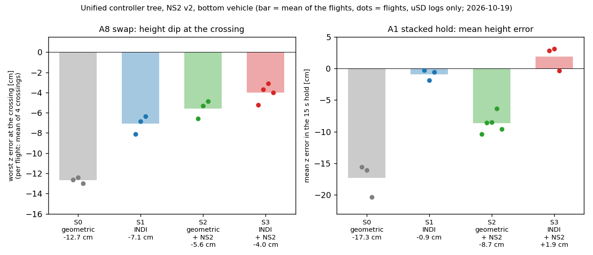

# Lab session 2026-10-19 — v2 image on both drones, new drone pair, first A8 round for S0–S3 (one flight each)

## 0. FINAL RESULTS (read this first; sections 1–16 below are the chronological record, the canonical write-up is `docs/tree_comparison_2026-10-19.md`)
New drone pair, `study_tree_v2.bin` (NS2 v2) on both, unified controller tree S0–S3, A8 (dz 0.5, 0.5 m/s peak) and A1 (dz 0.5, hold 15 s), uSD logs only, strategy and NS2 version verified from the logs.

| | S0 geometric | S1 INDI | S2 geometric + NS2 v2 | S3 INDI + NS2 v2 |
|---|---|---|---|---|
| A8 crossing dip (mean of the flights) | **−12.7 cm** (n=3) | **−7.1 cm** (n=3) | **−5.6 cm** (n=3) | **−4.0 cm** (n=4; −3.6 cm on the 3 fresh-battery flights) |
| A1 mean z error in the hold | **−17.3 cm** (n=3) | **−0.9 cm** (n=3) | **−8.7 cm** (n=5) | **+1.9 cm** (n=3) |



Coverage (complete uSD logs on both drones): A8 3 / 3 / 3 / 4 (+2 on a draining battery excluded), A1 3 / 3 / 5 / 3 for S0 / S1 / S2 / S3. Full per-flight and per-strategy tables: sections 11 (A8) and 16 (A1) below and `docs/tree_comparison_2026-10-19.md`. Findings of the day: uSD file counter at 100 resets the drones in the air (§12, fixed, rule: archive at ≥ 85 files); a false "NS2 off" from the old slope test on tilted geometric A1 flights (§14, corrected, full thrust model in `ns2_applied_check.py`); this comparison replaces the 2026-10-15 tree validation (NS2 v1, 0.4 m/s).

## 1. Setup
- New hardware pairing: the drone with the RPM deck (old top) is now the **bottom** (`cf5`, `radio://0/80/2M/E7E7E7BB02`), the new drone is the **top** (`cf_second`, `radio://0/80/2M/E7E7E7E7E9`). Addresses reassigned on the drones, yaml slots unchanged.
- `study_tree_v2.bin` (sha256 `3ae7304a31d0f01ea1287c6e4012cfab97ea5d1126bfde462664751572215795`) flashed on both; bench readback before launch: `rnn.ready 1`, `rnn.div 10`, mass 0.0427, Kpos 7/4 (controller 6 and `Kpos_Iz 0` are the power-on defaults; the yaml sets controller 9 at launch). uSD decks `usd.canLog 1` on both (`usd.bcUSD` flag missing in this firmware, harmless).
- Strategy per flight set by editing the cf5 lines of `crazyflies.yaml` (crazyswarm2 commits `868a276` S1, `f6b6077` S2, `d061d0d` S3; S0 was `4b65435`). **`main` now carries S3** — to be put back to S0 at the end of the session block.
- Flights: `run_formation --scenario A8 --dz 0.5 --height 0.5 --passes 4 --auto-center --yes` — defaults give **4.375 s per pass, peak 0.5 m/s, 19.5 s scenario** (the 2026-10-15 tree validation used 5.5 s per pass, peak 0.40 m/s; not an identical setting).

## 2. Data
Cards: cf_second = `THESIS1` (`thesis79–82`), cf5 = `THESIS2` (`thesis84–87`); neither reformatted. Raw copies `experiments/logs/usd_raw/*v2val*` (tag `v2val_A8_flightN`, N = 1…4 in flight order = S0, S1, S2, S3), merged bank (not committed, regenerate with `merge_training_bank.py --date 2026-10-19 --out experiments/logs/bank_v2val_2026-10-19 --only-tag-contains v2val --rpm deck`), summary `experiments/results/v2val_2026-10-19/v2val_summary.json` (generator `experiments/analysis/v2val_summary.py`). 4 of 4 flights merged, run tags match the radio metas.

## 3. Did each controller fly as intended? (from the logs, not the yaml)
| flight | INDI (a_rpm_f active) | NS2 term (slope of thrust residual on prediction) | verdict |
|---|---|---|---|
| 1 | off (0 %) | off (−0.01…) | S0 |
| 2 | **on (100 %)** | off | S1 |
| 3 | off | **on (−0.90)** | S2 |
| 4 | **on (100 %)** | **on (−0.97)** | S3 |
The top drone reads INDI off / NS2 off in all four (`tree_log_check.py`).

## 4. Is it NS2 v2? Yes.
The logged C prediction `rnn_pred_z` was compared with the reference forward pass of both weight sets on the logged relative state: S0 / S2 (geometric, clean reconstruction): RMS difference to **v2 0.024 m/s² (corr 0.998)** against 0.32 / 0.23 (corr 0.80 / 0.84) to v1. With INDI (S1, S3) the reconstruction is worse for both (v2 0.17 / 0.15, v1 0.32 / 0.29) but v2 still fits clearly better. The in-gate prediction is about −1.0 m/s² and the NS2 timing was not read in this analysis (`rnn.us_max` not logged to uSD; check on the bench/console).

## 5. A8 results, bottom vehicle (z error against the commanded z, crossings = zero crossings of y, ±0.75 s, relative to the steady offset)
| strategy | dips at the 4 crossings [cm] | mean dip | z RMS (steady) | steady offset | top z RMS | vbat start → min | motor max |
|---|---|---|---|---|---|---|---|
| S0 geometric | −11.8, −15.1, −12.1, −11.5 | **−12.6** | 3.95 cm | +2.0 cm | 0.31 cm | 3.81 → 3.71 V | 80 % |
| S1 INDI | −9.1, −7.7, −5.2, −10.4 | **−8.1** | 2.86 | +1.6 | 0.27 | 3.64 → 3.49 V | **100 %** |
| S2 geometric + NS2 v2 | −7.3, −9.3, −5.7, −4.1 | **−6.6** | 2.21 | +0.7 | 0.31 | 3.64 → 3.52 V | 79 % |
| S3 INDI + NS2 v2 | −2.6, −7.8, −1.9, −8.6 | **−5.2** | 2.37 | +1.2 | 0.35 | 3.56 → 3.35 V | **100 %** |
Same ordering as 2026-10-15 (S0 worst, S3 best; there −15.7 / −10.4 / −5.5 / −1.9 cm at the slower 0.40 m/s). Upward peaks ≤ 1.8 cm in all four. Gate time about 1.4–1.5 s per flight.

## 6. Caveats (read before using the numbers)
- **One flight per strategy, 4 crossings each**; S3's four dips alternate (−2.6, −7.8, −1.9, −8.6), so its mean is not stable. Needs the planned 3 flights each.
- **Batteries were low:** loaded start 3.56–3.64 V in S1–S3 (target ≥ 3.8 V resting), minimum 3.35 V in S3; the motors hit 100 % in S1 and S3. The INDI flights are therefore pessimistic and the later crossings of S3 probably lost headroom. S1 (and S3) must be re-flown on fresh batteries — as planned.
- **uSD write gaps:** 0.6–2.3 % of samples, longest single gap 0.85 s (top) / 1.4–1.5 s (bottom) in every file ("card cannot keep up"). A linearity test found no interpolated stretch inside a crossing window, but it is not conclusive for all flights. Cards were not reformatted.
- Speed differs from the 2026-10-15 validation, so the comparison with those numbers is by ordering only.

## 7. Open / next
Fresh batteries; 2 more flights per strategy (S1 and S3 first); read `rnn.us_max` for NS2 timing on the console or bench; put `main` yaml back to S0 afterwards; then freeze protocol v1.0 and tags.

## 8. Round 2 (same evening): 12 A8 flights in total, 3 per strategy (flights 5–12: S3 ×2, S2 ×2, S1 ×2, S0 ×2)
Same command and settings (dz 0.5, 0.5 m/s peak). Cards not reformatted: cf_second `thesis83–90`, cf5 `thesis88–95` (tags `v2val_A8_flight5…12`); all run tags match the metas, 12 of 12 merged. Strategy per flight checked in the log: INDI active matches S1/S3 in all 12; NS2 term on in S2/S3 (slope −0.87…−0.97), off in S0/S1. **NS2 v2 confirmed in every geometric NS2 flight** (S0/S2: logged vs v2 RMS 0.02–0.05 m/s², vs v1 0.22–0.32; INDI flights 0.14–0.17 vs 0.29–0.39). Card gaps: mean 0.6 % of samples per file, worst file 2.9 %.

| strategy | per-flight mean dip [cm] | mean | worst crossing | z RMS [cm] | lowest vbat [V] | motor max |
|---|---|---|---|---|---|---|
| S0 geometric | −12.6, −12.4, −13.0 | **−12.7** | −15.1 | 3.9–4.1 | 3.71–3.74 | 76–80 % |
| S1 INDI | −8.1, −6.9, −6.3 | **−7.1** | −10.5 | 2.5–2.9 | 3.44–3.49 | **100 %** |
| S2 geometric + NS2 v2 | −6.6, −5.3, −4.8 | **−5.6** | −9.3 | 1.4–2.2 | 3.42–3.52 | 79–81 % |
| S3 INDI + NS2 v2 | −5.2, −9.8, −13.3 | −9.5 | −17.0 | 2.4, 4.0, 6.1 | 3.35, 3.17, 3.13 | **100 %** |

- **S3 is NOT a valid result yet.** Its three flights were flown back to back on a draining battery (loaded start 3.56 → 3.40 → 3.35 V, minimum 3.17 / 3.13 V) and degrade monotonically (−5.2 → −9.8 → −13.3 cm, z RMS 2.4 → 6.1 cm). Voltage, not the controller, is the likely driver; S3 must be re-flown on fresh batteries (changed between flights).
- **S0, S2 reproducible** (spread ±0.3 / ±0.9 cm): NS2 v2 on the geometric controller halves the dip (−12.7 → −5.6 cm) and keeps the motors at ~80 %.
- **S1 INDI** halves the S0 dip as well in this data (−7.1), but its motors saturate (100 %) in all three flights, also at the higher start voltages (3.64–3.68 V loaded) — the headroom limit seen before is present here too (voltage contribution not separated).
- Ordering today S2 < S1 < S0 with S3 undecided; 2026-10-15 had S3 best (−1.9 cm at 0.40 m/s, one flight).
- Data: `experiments/results/v2val_2026-10-19/v2val_summary.json`, generator `experiments/analysis/v2val_summary.py`.

## 9. Next
Fresh batteries, change them between flights; S3 ×3 (and S1 ×3 for a fair INDI pair on the same footing); then A1 for the four strategies; yaml on `main` is S0 again.

## 10. Round 3: S3 repeated on a fresh battery per flight (flights 13–18)
6 S3 flights flown, **only 3 have a cf5 uSD log**: flight 13 (`thesis96`), 15 (`thesis98`), 16 (`thesis99`); flight 14 has an empty cf5 file (`thesis97`, 0 B), flights 17 and 18 have no cf5 file at all (card not full: 29 GB free; same unexplained empty/missing-file problem as before). The cf_second card has all six (`thesis91–96`). The radio CSVs of the bottom drone exist for all six; those of flights 14 (389 rows), 17 and 18 (650 rows) are shorter than the usual ~745 — not investigated (were they ended early?). The three usable flights are merged (INDI active 100 %, NS2 on, NS2 v2 fit RMS 0.14–0.18 as for the earlier S3 flights).

| S3 flight | dips at the 4 crossings [cm] | mean | z RMS | loaded vbat start → min | motor max |
|---|---|---|---|---|---|
| 13 (fresh battery) | −3.6, −4.4, −2.1, −4.6 | −3.7 | 1.87 cm | 3.54 → 3.27 V | 100 % |
| 15 (fresh battery) | −1.0, −2.5, −1.9, −6.9 | −3.1 | 1.89 | 3.63 → 3.35 | 100 % |
| 16 (fresh battery) | −3.7, −6.2, −1.5, −4.7 | −4.0 | 2.17 | 3.73 → 3.57 | 100 % |
| (round 1/2 for reference: 4, 5, 6 on draining battery) | | −5.2, −9.8, −13.3 | 2.4, 4.0, 6.1 | 3.56 → 3.35 / 3.40 → 3.17 / 3.35 → 3.13 | 100 % |

**Result:** with a fresh battery per flight S3 is stable (mean −3.6 cm, spread 0.5 cm between flights, z RMS about 2 cm); the degradation of round 2 (−5.2 → −13.3 cm) was the draining battery, as suspected. The motors still reach 100 % in every S3 flight.
**A8, dz 0.5, 0.5 m/s peak, mean dip per strategy:** S0 −12.7 cm (3 flights) · S1 −7.1 (3, start 3.64–3.68 V loaded) · S2 −5.6 (3) · **S3 −3.6 (3, fresh)**. The S1 flights started at about the same loaded voltage as the fresh S3 flights (3.64–3.68 vs 3.54–3.73 V), so S1 is not obviously disadvantaged; a repeat of S1 on a fresh battery per flight is still cleanest.
Open: why the cf5 card has no file for 3 of 6 flights; whether radio flights 14/17/18 ended early.

## 11. FINAL OVERVIEW of the A8 validation (supersedes the interim tables above)
**Rule for all analysis (user, 2026-10-19): only complete uSD logs of both drones are used; radio CSVs are not analysed.** Hence S3 flights 14, 17 and 18 (no bottom-drone uSD log) are not part of any table. Table generated by `experiments/analysis/v2val_overview.py` (copy: `experiments/results/v2val_2026-10-19/a8_overview.md`); figures for the meeting `docs/meetings/assets/2026-10-19/`.
Battery = loaded cell voltage logged on the bottom drone while airborne (resting voltage was not recorded). Dip = worst z error in ±0.75 s around a crossing relative to the steady offset. z mean = signed mean z error while airborne (t > 3 s).

| strat | flight | time | note | dips at the 4 crossings [cm] | mean dip | worst | z mean [cm] | z abs mean | z RMS | vbat start | mean | min [V] | motor max | tilt max |
|---|---|---|---|---|---|---|---|---|---|---|---|---|---|---|
| S0 | 1 | 17-39-47 |  | -11.8, -15.1, -12.1, -11.5 | -12.6 | -15.1 | -0.7 | 3.7 | 3.95 | 3.81 | 3.76 | 3.71 | 80 % | 25° |
| S0 | 11 | 18-07-12 |  | -12.3, -13.8, -12.1, -11.4 | -12.4 | -13.8 | -1.0 | 3.6 | 3.92 | 3.85 | 3.81 | 3.74 | 79 % | 26° |
| S0 | 12 | 18-08-34 |  | -14.2, -13.9, -11.3, -12.5 | -13.0 | -14.2 | -0.7 | 3.9 | 4.06 | 3.80 | 3.76 | 3.71 | 76 % | 22° |
| S1 | 2 | 17-41-56 |  | -9.1, -7.7, -5.2, -10.4 | -8.1 | -10.4 | -0.1 | 2.5 | 2.86 | 3.64 | 3.59 | 3.49 | 100 % | 23° |
| S1 | 9 | 18-03-26 |  | -3.1, -9.7, -6.4, -8.3 | -6.9 | -9.7 | +0.4 | 2.5 | 2.70 | 3.68 | 3.64 | 3.48 | 100 % | 25° |
| S1 | 10 | 18-04-46 |  | -3.0, -3.8, -10.5, -8.1 | -6.3 | -10.5 | -0.2 | 2.1 | 2.51 | 3.67 | 3.57 | 3.44 | 100 % | 25° |
| S2 | 3 | 17-43-47 |  | -7.3, -9.3, -5.7, -4.1 | -6.6 | -9.3 | -0.6 | 2.0 | 2.21 | 3.64 | 3.60 | 3.52 | 79 % | 26° |
| S2 | 7 | 17-59-16 |  | -6.6, -4.6, -5.1, -4.9 | -5.3 | -6.6 | -0.6 | 1.7 | 1.76 | 3.68 | 3.60 | 3.47 | 81 % | 20° |
| S2 | 8 | 18-00-40 |  | -6.2, -4.5, -4.1, -4.5 | -4.8 | -6.2 | -0.5 | 1.4 | 1.41 | 3.60 | 3.53 | 3.42 | 79 % | 20° |
| S3 | 4 | 17-45-31 |  | -2.6, -7.8, -1.9, -8.6 | -5.2 | -8.6 | -0.0 | 1.8 | 2.37 | 3.56 | 3.47 | 3.35 | 100 % | 24° |
| S3 | 5 | 17-55-03 | draining battery (3 back-to-back) | -12.3, -10.8, -6.9, -9.3 | -9.8 | -12.3 | -0.2 | 3.2 | 3.99 | 3.40 | 3.31 | 3.17 | 100 % | 26° |
| S3 | 6 | 17-56-35 | draining battery (3 back-to-back) | -6.0, -14.8, -17.0, -15.5 | -13.3 | -17.0 | +0.0 | 4.5 | 6.07 | 3.35 | 3.24 | 3.13 | 100 % | 29° |
| S3 | 13 | 18-18-35 | fresh battery per flight | -3.6, -4.4, -2.1, -4.6 | -3.7 | -4.6 | +0.5 | 1.6 | 1.87 | 3.54 | 3.42 | 3.27 | 100 % | 22° |
| S3 | 15 | 18-21-50 | fresh battery per flight | -1.0, -2.5, -1.9, -6.9 | -3.1 | -6.9 | +0.6 | 1.4 | 1.89 | 3.63 | 3.50 | 3.35 | 100 % | 22° |
| S3 | 16 | 18-23-19 | fresh battery per flight | -3.7, -6.2, -1.5, -4.7 | -4.0 | -6.2 | +0.4 | 1.7 | 2.17 | 3.73 | 3.71 | 3.57 | 100 % | 27° |

## Per strategy
| strat | flights | mean dip [cm] | per-flight mean dips | worst crossing | z mean [cm] | z RMS [cm] | vbat mean [V] | vbat min [V] | motor max |
|---|---|---|---|---|---|---|---|---|---|
| S0 | 1, 11, 12 | **-12.7** | -12.6, -12.4, -13.0 | -15.1 | -0.8 | 3.98 | 3.78 | 3.71 | 76–80 % |
| S1 | 2, 9, 10 | **-7.1** | -8.1, -6.9, -6.3 | -10.5 | +0.0 | 2.69 | 3.60 | 3.44 | 100–100 % |
| S2 | 3, 7, 8 | **-5.6** | -6.6, -5.3, -4.8 | -9.3 | -0.5 | 1.79 | 3.58 | 3.42 | 79–81 % |
| S3 all 6 uSD flights | 4, 5, 6, 13, 15, 16 | **-6.5** | -5.2, -9.8, -13.3, -3.7, -3.1, -4.0 | -17.0 | +0.2 | 3.06 | 3.44 | 3.13 | 100–100 % |
| S3 without the 2 draining-battery flights (4, 13, 15, 16) | 4, 13, 15, 16 | **-4.0** | -5.2, -3.7, -3.1, -4.0 | -8.6 | +0.4 | 2.08 | 3.53 | 3.27 | 100–100 % |
| S3 fresh battery only (13, 15, 16) | 13, 15, 16 | **-3.6** | -3.7, -3.1, -4.0 | -6.9 | +0.5 | 1.98 | 3.55 | 3.27 | 100–100 % |

## 12. A1 block and the end-of-flight resets — ROOT CAUSE FOUND: uSD file counter overflow (both cards held thesis00–thesis99)
**What was seen:** from A8 flight 17 on (bottom drone) and in all five A1 flights, one or both drones flipped / cut the motors at the start of the landing; no cf5 uSD file for A8 flights 17, 18 and for any A1 flight, no cf_second file for A1 flights 4 and 5; the radio logs end at z ≈ 0.5 m (bottom) / 1.0 m (top) instead of z = 0.02 m.

**Evidence chain**
1. `debug/lab_logs/debug.log` (A1 flight 5): `usd.logging 0` (end-of-flight broadcast) and the landing go_to at 643.72 → mocap loses both rigid bodies at 643.83 (the active markers are powered by the drones: `Dynamic check failed` / `ICP did not converge` for cf5 and cf_second) → both drones print the boot banner at 643.94. I.e. **both drones reset about 0.1–0.2 s after `usd.logging 0`**, in the air.
2. Both cards hold exactly `thesis00 … thesis99` (100 files each). Firmware `usddeck.c`: the file name is `thesis` + two counter digits; with all names taken the counter carries to `thesis:0` (an invalid FAT name), `f_open` fails, the write task unmounts the card, **deletes itself and sets its handle to 0**; at the next `usd.logging 0` the logging task calls `vTaskResume(xHandleWriteTask)` with that null handle → assert/reset.
3. The onset matches the file counts exactly: cf5 card: `thesis99` = A8 flight 16, flights 17, 18 and all A1 flights failed; cf_second card: `thesis99` = A1 flight 3, A1 flights 4, 5 failed (top drone landed normally in A1 flights 2 and 3, radio ends at z = 0.02).
4. The attitude excursions of A1 are not the cause (confirmed by the user's remark): the same reset happens at the end of A8 flights with a small attitude error.
This also explains earlier unexplained empty or missing uSD files in sessions where a card was close to 100 files (2026-10-16 note "cause of empty uSD files: not diagnosed").

**Separate event, A8 flight 14 (S3, 18-20-16):** the bottom radio log ends at t = 23.9 s with vbat 2.61 V (first sample already only 3.83 V against 4.0–4.1 V for the other fresh batteries) and z = 0.21 m: battery collapse in flight, not the file bug (its uSD file `thesis97` is 0 bytes).

**Data status (uSD rule):** A8: 15 of 18 flights complete on both drones (14, 17, 18 not usable). **A1: none of the 5 flights is usable** (no bottom log; the top drone has `thesis97–99` for flights 1–3, copied as `cf_second_v2val_A1_flight1…3`, but without the bottom drone they are not analysed). A1 must be flown again.

**Fix before any further flight (on both cards)**
```
mkdir /media/georg/THESIS1/_archive_2026-10-19_pre_overflow && mv /media/georg/THESIS1/thesis?? /media/georg/THESIS1/_archive_2026-10-19_pre_overflow/
mkdir /media/georg/THESIS2/_archive_2026-10-19_pre_overflow && mv /media/georg/THESIS2/thesis?? /media/georg/THESIS2/_archive_2026-10-19_pre_overflow/
```
(after all wanted files are copied — today's A8 and the cf_second A1 files are in `experiments/logs/usd_raw/`; moving keeps the old files on the card in the archive folder; the counter then restarts at `thesis00`). `copy_usd_log.py` now prints a warning at ≥ 85 files on the card. **Rule: check the file count on both cards before every block and archive at ≥ 85.**
Check after the crashes: propellers, motor mounts, the RPM deck and the markers of both drones.
Software follow-up (desk, optional): guard against the null handle / the counter overflow in `usddeck.c` (firmware patch, needs a reflash; the card hygiene rule above removes the trigger).

## 13. Clean-card test and first A1 block (S3, 3 flights) — the file-counter diagnosis is CONFIRMED
Both cards were archived first (backups with sha256 check in `~/Desktop/sd_backups/2026-10-19_THESIS{1,2}_*_pre_archive/`, files moved to `_archive_2026-10-19_pre_overflow/` on the cards, root empty). Then 3 A1 flights (S3, `run_formation --scenario A1 --dz 0.5 --hold 15.0 --height 0.5 --auto-center --yes`):
- both cards wrote **new files `thesis00`, `thesis01`, `thesis02`** for the three flights, all run tags match the metas;
- **no reset at landing**: radio logs of both drones end at z = 0.02–0.03 m after 41 s in flights 1 and 2 and for the top drone in flight 3; the uSD files are complete (15 s, ~7 400–7 800 rows);
- the bottom radio log of flight 3 stops at 13.5 s (z 0.62 m, 3.50 V) but its uSD file runs the full flight: a radio dropout, not a loss of the drone.
→ the earlier resets were the full file counter (thesis00–99); with an empty card the same procedure lands normally. The standing rule (count files before every block, archive at ≥ 85) stays.

**A1 S3, bottom vehicle, uSD only, hold window t = 2–15 s (`experiments/analysis/v2val_a1_summary.py`, `experiments/results/a1_2026-10-19/a1_summary.json`)**
| flight | z error mean ± std [cm] | z RMS | z drift over the hold [cm] | xy RMS | max roll/pitch | INDI active | NS2 v2 fit (RMS to v2 / v1) | loaded vbat start / min [V] | motors max |
|---|---|---|---|---|---|---|---|---|---|
| 1 | +2.9 ± 4.7 | 5.5 | −7.4 | 2.3 cm | 17.7° | 100 % | 0.08 / 0.49 | 3.47 / 3.35 | 100 % |
| 2 | +3.1 ± 3.7 | 4.8 | −8.5 | 2.0 | 20.8° | 100 % | 0.13 / 0.55 | 3.42 / 3.33 | 100 % |
| 3 | −0.3 ± 1.8 | 1.8 | −1.3 | 2.9 | 13.6° | 100 % | 0.07 / 0.39 | 3.35 / 3.20 | 100 % |
Top drone z RMS 0.3–0.5 cm; stack gap 0.47–0.50 m. NS2 v2 confirmed again (logged prediction matches v2, not v1). The loaded battery voltage is low in all three (3.2–3.5 V, motors at 100 %) and the z error drifts downwards over the hold in flights 1 and 2 (−7 to −8 cm), so these S3 numbers are battery-limited; the 2026-10-15 S3 values were +2.6 ± 3.9 cm. S2, S1, S0 A1 flights still to fly.

## 14. A1 block 2 (S2, 3 flights) — first read as "flew as S0": **that was WRONG, the flights were S2**
Yaml `b9ef7ff` (S2: `indi 0`, `rnn.en 1`) was on the lab PC (user checked lines 225 / 246). Copy and merge went normally (cf_second `thesis03–05`, cf5 `thesis03–05`, flights tagged `a1clean_flight4…6`, run tags match, no reset, all landed at z 0.02 m).
**Error and correction:** `tree_log_check.py` first reported "NS2 off" for these flights (slope of the thrust residual on the NS2 prediction −0.00 / −0.19 / −0.09) and I concluded they had flown as S0. That test ignored the x/y part of the thrust projection and the integral state; in the geometric A1 hold the drone tilts up to 41°, and the test is confounded (the known S0 A1 flight of 2026-10-15 gave +0.89, the known S2 A1 flight −0.36 "unclear"). The user judged from the behaviour that it was S2, and was right.
**Full model (`experiments/analysis/ns2_applied_check.py`, now also used by `tree_log_check.py`):** thrust = m · a_d · z_b with a_d rebuilt from the logged feed-forward, errors and gains, the integral term reconstructed from the logged z error, regression on the NS2 prediction. Validation: all 15 A8 flights of today (S0/S1 coefficient 0.00, S2/S3 −1.00, R² ≈ 1.00, integral coefficient 1.4–1.7 vs Kpos_Iz 1.5), the known S0 / S2 / S3 A1 flights of 2026-10-15 (0.00 / −0.98 / −1.00), the S3 A1 flights of today (−1.00). **Flights 4–6: coefficient −1.00 / −1.00 / −0.99, R² 0.98–0.99, INDI off → NS2 applied = S2.** All strategy labels so far (A8 and A1) were checked with the full model and stand; only this A1 block was mislabelled for a while (labels in the summary, in this doc and in the checklist are corrected).
The "yaml was not applied / defaults" hypotheses of the earlier messages are void. The launch check of the cf5 `Update parameter` lines stays as good practice; `lab_check_strategy.py` stays as a read-only yaml check.

| A1 (dz 0.5, hold 15 s, window 2–15 s, bottom vehicle, uSD only) | flights | z error mean ± std [cm] | z RMS | max roll/pitch | loaded vbat start / min | motors max |
|---|---|---|---|---|---|---|
| S2 (flights 4–6) | 3 | −10.4 ± 4.3, −8.5 ± 3.5, −8.5 ± 5.0 | 11.2, 9.2, 9.9 | 41–42° | 3.73–3.84 / 3.61–3.69 V | 90–92 % |
| S3 (flights 1–3) | 3 | +2.9 ± 4.7, +3.1 ± 3.7, −0.3 ± 1.8 | 5.5, 4.8, 1.8 | 14–21° | 3.35–3.47 / 3.20–3.35 V | 100 % |
(2026-10-15 values for comparison, NS2 v1: S2 −13.7 ± 3.8, S3 +2.6 ± 3.9 cm.) S1 and S0 A1 flights are still missing.

## 15. A1 block 3 (S2 again, 2 flights) and coverage status
Flights 19-34-18 and 19-35-40: cf_second `thesis06–07`, cf5 `thesis06–07` (tags `a1clean_flight7/8`), run tags match, both drones landed at z 0.02 m. Full thrust model on the bottom drone: INDI off, **NS2 applied (−1.00, R² 0.98–0.99) = S2**. 8 of 8 A1 flights of the clean-card tests merged (the 5 flights lost to the full cards are not in the bank).

**A1 (dz 0.5, hold 15 s, window 2–15 s, bottom vehicle, uSD only, NS2 fit v2 RMS 0.07–0.13 vs v1 0.39–0.55 everywhere)**
| strat | flight | z mean ± std [cm] | z RMS | z drift [cm] | xy RMS | max roll/pitch | loaded vbat start / mean / min [V] | motors max | top z RMS |
|---|---|---|---|---|---|---|---|---|---|
| S3 | 1 | +2.9 ± 4.7 | 5.5 | −7.4 | 2.3 | 18° | 3.47 / 3.44 / 3.35 | 100 % | 0.34 |
| S3 | 2 | +3.1 ± 3.7 | 4.8 | −8.5 | 2.0 | 21° | 3.42 / 3.40 / 3.33 | 100 % | 0.44 |
| S3 | 3 | −0.3 ± 1.8 | 1.8 | −1.3 | 2.9 | 14° | 3.35 / 3.33 / 3.20 | 100 % | 0.52 |
| S2 | 4 | −10.4 ± 4.3 | 11.2 | +4.7 | 8.5 | 42° | 3.73 / 3.76 / 3.67 | 90 % | 0.37 |
| S2 | 5 | −8.5 ± 3.5 | 9.2 | +0.4 | 8.9 | 41° | 3.84 / 3.77 / 3.69 | 91 % | 0.56 |
| S2 | 6 | −8.5 ± 5.0 | 9.9 | +6.8 | 9.2 | 41° | 3.75 / 3.71 / 3.61 | 92 % | 0.38 |
| S2 | 7 | −6.3 ± 8.8 | 10.8 | +18.4 | 8.5 | 40° | 3.59 / 3.51 / 3.35 | 98 % | 0.33 |
| S2 | 8 | −9.6 ± 3.7 | 10.3 | +3.6 | 8.3 | 39° | 3.57 / 3.46 / 3.36 | 100 % | 0.33 |
S2 (n = 5): z mean −8.7 cm, z RMS 9.9–11.2 cm, xy RMS about 8.7 cm and attitude excursions of about 40° as expected for the geometric controller in the stacked hold; flight 7 shows a large upward drift (+18 cm over the hold). S3 (n = 3): z mean +1.9 cm, z RMS 1.8–5.5 cm, xy RMS 2–3 cm, attitude ≤ 21°; the S3 flights had the lowest loaded battery (3.2–3.5 V, motors at 100 %).

**Coverage (uSD complete on both drones)**
| | S0 geometric | S1 INDI | S2 geometric + NS2 v2 | S3 INDI + NS2 v2 |
|---|---|---|---|---|
| A8 (dz 0.5, 0.5 m/s) | 3 | 3 | 3 | 4 (+2 on a draining battery, excluded) |
| A1 (dz 0.5, hold 15 s) | **0** | **0** | 5 | 3 |
Still to fly: **A1 for S0 and S1** (3 flights each). Optional: a repeat of S3 A1 on fresh batteries (the three S3 A1 flights ran at 3.2–3.5 V loaded).

## 16. A1 batch for S1 and S0 (6 flights) and FINAL COVERAGE — all four strategies done on A8 and A1
Cards: cf5 `thesis08–13`, cf_second `thesis08–13` (tags `a1clean_flight9…14`), all 12 run tags match the radio metas, all six flights landed at z 0.02–0.03 m on both drones, no resets. Full thrust model on the bottom drone: flights 9–11 INDI on / NS2 not applied (**S1**), flights 12–14 INDI off / NS2 not applied (**S0**); the top drone reads INDI off / NS2 off in all six. 14 of 14 A1 flights of the clean-card tests merged. The top radio log of flight 9 ends early (30.9 s, z 1.00) but its uSD file is complete, so it was a radio dropout. (S0 integral coefficient about 0 in the thrust model: the integral term sits at its clamp under the large z error of the geometric hold.)

**Final A1 overview (generated by `experiments/analysis/v2val_a1_overview.py`; copy `experiments/results/a1_2026-10-19/a1_overview.md`; figure `docs/meetings/assets/2026-10-19/A1_comparison.png`)**
z error = measured z minus commanded z (bottom vehicle). Battery = loaded cell voltage logged while airborne. Flights lost to the full cards (5) are not in the bank.

| strat | flight | z mean ± std [cm] | z RMS | drift over the hold | xy RMS | max roll/pitch | loaded vbat start / mean / min [V] | motors max | top z RMS | stack gap [m] |
|---|---|---|---|---|---|---|---|---|---|---|
| S0 | 12 | -15.6 ± 3.0 | 15.9 | +5.2 | 8.5 | 41° | 3.66 / 3.65 / 3.53 | 92 % | 0.33 | 0.66 |
| S0 | 13 | -16.1 ± 3.3 | 16.4 | +6.5 | 7.8 | 40° | 3.26 / 3.28 / 3.14 | 100 % | 0.33 | 0.66 |
| S0 | 14 | -20.3 ± 3.6 | 20.6 | +0.4 | 8.4 | 42° | 3.61 / 3.53 / 3.40 | 95 % | 0.44 | 0.71 |
| S1 | 9 | -0.2 ± 2.3 | 2.3 | +1.1 | 2.8 | 22° | 3.75 / 3.71 / 3.62 | 100 % | 0.44 | 0.51 |
| S1 | 10 | -1.8 ± 1.9 | 2.7 | +1.1 | 2.5 | 19° | 3.53 / 3.41 / 3.29 | 100 % | 0.29 | 0.52 |
| S1 | 11 | -0.6 ± 2.1 | 2.2 | +1.1 | 2.6 | 19° | 3.58 / 3.54 / 3.44 | 100 % | 0.39 | 0.51 |
| S2 | 4 | -10.4 ± 4.3 | 11.2 | +4.7 | 8.5 | 42° | 3.73 / 3.76 / 3.67 | 90 % | 0.37 | 0.61 |
| S2 | 5 | -8.5 ± 3.5 | 9.2 | +0.4 | 8.9 | 41° | 3.84 / 3.77 / 3.69 | 91 % | 0.56 | 0.59 |
| S2 | 6 | -8.5 ± 5.0 | 9.9 | +6.8 | 9.2 | 41° | 3.75 / 3.71 / 3.61 | 92 % | 0.38 | 0.59 |
| S2 | 7 | -6.3 ± 8.8 | 10.8 | +18.4 | 8.5 | 40° | 3.59 / 3.51 / 3.35 | 98 % | 0.33 | 0.57 |
| S2 | 8 | -9.6 ± 3.7 | 10.3 | +3.6 | 8.3 | 39° | 3.57 / 3.46 / 3.36 | 100 % | 0.33 | 0.60 |
| S3 | 1 | +2.9 ± 4.7 | 5.5 | -7.4 | 2.3 | 18° | 3.47 / 3.44 / 3.35 | 100 % | 0.34 | 0.47 |
| S3 | 2 | +3.1 ± 3.7 | 4.8 | -8.5 | 2.0 | 21° | 3.42 / 3.40 / 3.33 | 100 % | 0.44 | 0.47 |
| S3 | 3 | -0.3 ± 1.8 | 1.8 | -1.3 | 2.9 | 14° | 3.35 / 3.32 / 3.20 | 100 % | 0.52 | 0.50 |

## Per strategy
| strat | flights | z mean [cm] | spread of the flight means | z RMS [cm] | xy RMS [cm] | max roll/pitch | vbat mean / min [V] | motors max |
|---|---|---|---|---|---|---|---|---|
| S0 geometric | 3 (12, 13, 14) | **-17.3** | -20.3 … -15.6 | 17.6 | 8.2 | 42° | 3.49 / 3.14 | 92–100 % |
| S1 INDI | 3 (9, 10, 11) | **-0.9** | -1.8 … -0.2 | 2.4 | 2.6 | 22° | 3.56 / 3.29 | 100–100 % |
| S2 geometric + NS2 | 5 (4, 5, 6, 7, 8) | **-8.7** | -10.4 … -6.3 | 10.3 | 8.7 | 42° | 3.64 / 3.35 | 90–100 % |
| S3 INDI + NS2 | 3 (1, 2, 3) | **+1.9** | -0.3 … +3.1 | 4.1 | 2.4 | 21° | 3.39 / 3.20 | 100–100 % |

**Coverage (uSD complete on both drones, dz 0.5)**
| | S0 geometric | S1 INDI | S2 geometric + NS2 v2 | S3 INDI + NS2 v2 |
|---|---|---|---|---|
| A8 (0.5 m/s, 4 crossings) | 3 | 3 | 3 | 4 (+2 on a draining battery, excluded) |
| A1 (hold 15 s) | 3 | 3 | 5 | 3 |
Complete for the validation round. Remarks: S3 A1 ran at the lowest loaded battery voltage (3.2–3.5 V) and starts about +13 cm high at the beginning of the hold (takeoff overshoot, decays within ~4 s); S1 and S3 use the full motor range (100 %) in both scenarios.
