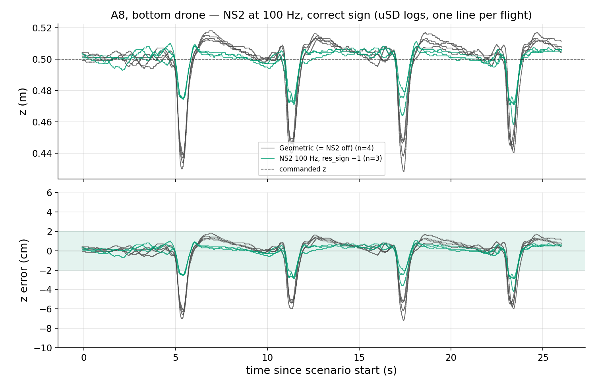
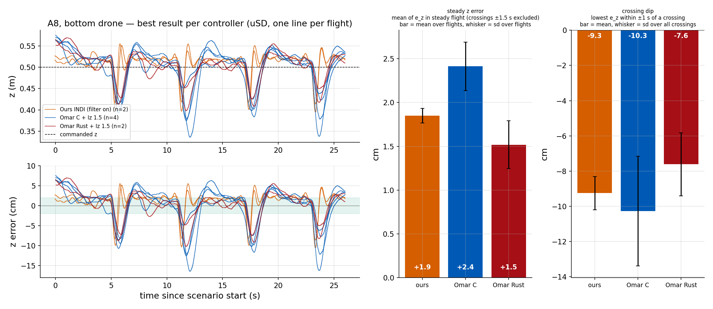
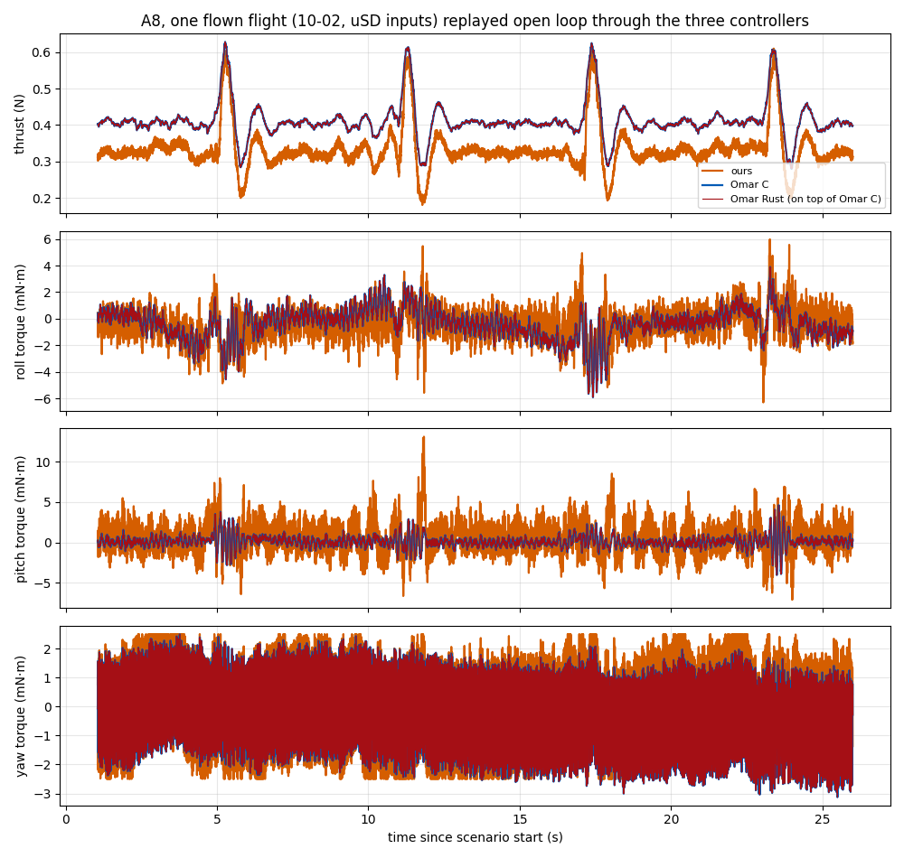
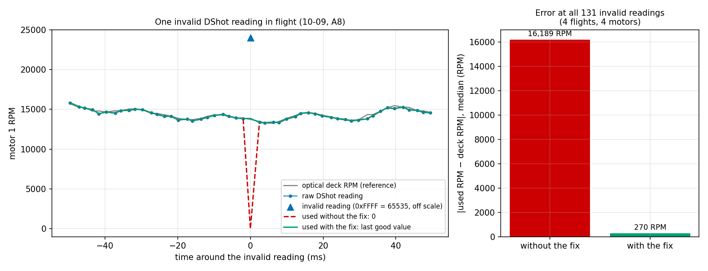
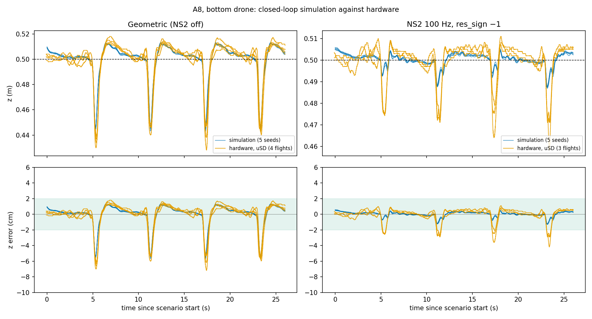

# Meeting Document — 2026-10-12

Deadline: 26 Feb 2027 (~19 weeks left)

## Overview
- **NS2 at 100 Hz:** works on the real drone, no crashes with the correct sign (`res_sign −1`). A8 crossing error −2.8 cm (geometric: −5.9 cm).
- **Constant z error of Omar's INDI:** fixed with a z integral of 1.5, the error drops from +13…+23 cm to +1.5…+2.6 cm. Best result of each controller compared on A8.
- **Replay of the same inputs:** Omar C and Omar Rust give the same output, ours is different.
- **RPM filter:** the fix for invalid readings works, changes nothing else and stays on.
- **NS2 simulation:** ready for the next session, matches the hardware within about 1 cm on A8.

Notation: `z` = measured height, `z_cmd` = commanded height, `e_z = z − z_cmd` (positive = too high). A8 = two drones swap sides (4 crossings). All A8 numbers are from the bottom drone (cf5), uSD logs only.

---

## 1. NS2 at 100 Hz in the lab, do the crashes still happen? DONE
- The network runs at 100 Hz without problems, no crashes (correct sign `res_sign −1`).
- A8, uSD logs:

| | z error steady (mean) | z error at crossings (mean) | z error at crossings (max) |
|---|---|---|---|
| Geometric (NS2 off) | +0.8 cm | −5.9 cm | 7.2 cm |
| NS2 100 Hz, `res_sign −1` | +0.3 cm | −2.8 cm | 4.2 cm |

## 2. Constant z error of Omar C/Rust fixed, compared with our INDI DONE
- Cause: the thrust the drone delivers is about 14% lower than commanded.
- Fix: z integral of 1.5. The error drops from +13…+23 cm to +1.5…+2.6 cm.
- Best result of each controller, A8, uSD:

| | steady z error | crossing dip (mean) | crossing dip (max) |
|---|---|---|---|
| Ours INDI | +1.9 cm | −9.3 cm | 10.5 cm |
| Omar C + Iz 1.5 | +2.4 cm | −10.3 cm | 16.4 cm |
| Omar Rust + Iz 1.5 | +1.5 cm | −7.6 cm | 10.2 cm |

- Steady z error: mean z error between the crossings (positive = too high).
- Crossing dip: lowest z error within ±1 s of a crossing (negative = too low).

## 3. Replay the same inputs through all controllers DONE
- One logged A8 flight, fed into all three controllers (open loop). A1 cannot be used, the motors were saturated.
- Omar C and Omar Rust give the same output (differences 1e-7 and 1e-9). Ours is different.

| A8, same inputs | ours | Omar C = Omar Rust | RMS difference ours vs Omar | correlation |
|---|---|---|---|---|
| thrust (mean) | 0.333 N | 0.412 N | 0.080 N | 0.97 |
| roll torque (RMS) | 1.26 mN·m | 1.22 mN·m | 1.3 mN·m | 0.39 |
| pitch torque (RMS) | 2.02 mN·m | 0.73 mN·m | 1.8 mN·m | 0.40 |
| yaw torque (RMS) | 1.49 mN·m | 1.36 mN·m | 1.1 mN·m | 0.69 |

- Thrust: same shape and same peaks at the crossings, ours 19% lower.
- Torques: different control laws, the pitch torque is 2.8× larger for ours.

## 4. RPM filter in the real loop DONE
- Acts for our INDI and Omar Rust, not for Omar C (it uses the optical deck).
- The DShot RPM reading is sometimes invalid (0xFFFF, about 0.06% of the samples). Before, the controller used 0 RPM for that motor, now it keeps the last good value.

- Median RPM error at the 131 invalid readings: 16,189 without the fix, 270 with it.
- Filter on vs off on the same day (our INDI, A8): no measurable difference in position or attitude error.
- The filter stays on.

## 5. Simulation with NS2 for the next session DONE
- A8, simulation (5 seeds) against hardware, geometric and NS2 `res_sign −1`:

- Crossing error: simulation −5.9 / −2.3 cm, hardware −5.9 / −2.8 cm (geometric / NS2).
- Limits: no A1, Omar's dips are not reproduced, our INDI does not run in it.
- Run: `python3 experiments/analysis/sim_showcase.py simulate`, then `~/.pyenv/versions/flying_robots/bin/python experiments/analysis/sim_showcase_finalize.py`.

---

## Questions:
- **Comparative study, decisions needed**
  - NS2 weights: keep the current network or retrain? Retraining with the unused flights gives no gain (R² 0.934 vs 0.944), and the training data is thin at dz 0.75
  - Pure INDI: ours or Omar C + Iz 1.5 (both go into the shakedown)
  - tiers 2 and 3 (more settings, only if time is left)
- **FBL controller follow-up** (authors sent a standalone code bundle on 2026-10-09; analysis: `docs/73_FBL_Bundle_Analysis.md`)
  - **What we have**
    - inference side of the paper: downwash model (physics + two tiny networks, 114 parameters) with analytic derivatives
    - the control mapping (thrust, body rates, torque), an acceleration estimator, a sample *simulation* checkpoint, a small example
    - verified: example runs, derivatives and control mapping are correct, closed loop behaves as in the paper (at ≥ 400 Hz control rate)
  - **What is missing**
    - training code and data; the hardware checkpoint (force-only net, C_D 0.236); hardware gains / control rate; licence
    - everything is tied to a 30 g Crazyflie 2.x (ours: 41 g brushless) → needs re-identification, retraining and a port into our firmware (≈ 4–6 weeks estimate; ≈ 2–3 weeks physics-model-only)
  - **Questions to the authors**
    1. Under which licence may we use and adapt the code in the thesis, and how should we cite it?
    2. Could you share the hardware checkpoint (force-only net, C_D 0.236), the hardware gains (position / velocity / integral, rate loop), the α-β-γ coefficients and the control rate? (The rate gain 238 s⁻¹ is unstable at 100 Hz in our tests, stable at ≥ 400 Hz.)
    3. Is the training script (KNODE loss, ODE solver, data format) available, even roughly? Which data / trajectories were used (28 s at 0.4 m, 0.4 m/s)?
    4. The code has `C_d_GT = 0.55`, the paper says 0.7 for the simulated plant — which produced the sample checkpoint? Is the mass 0.03 kg also what the hardware controller used (paper: 36 g)?
    5. How is the near-aligned case (horizontal offset → 0; the residual jerk becomes singular) handled on hardware?
    6. How was yaw regulated in the experiments (the wrapper zeroes the yaw residual because of drift; no yaw-angle feedback)?
    7. Two small points: the integral uses `dt = t − prev_t` starting at 0 (large first step), and `flatness_utils._vee_skew` returns −ω (opposite sign) — known?
    8. Is a full repository release planned, and roughly when?
  - **Decision for us (with supervisor):** how Strategy 3 enters the thesis — late tier of the study (onboard port, Dec+), simulation-only comparison + the authors' reported numbers, or documented as limited

## Next Steps:
- **Shakedown in the lab** (every scenario once with every controller, before the real data collection)
  - flash the new firmware with the larger uSD logging on both drones and check the logging
  - fly the 31 shakedown flights, then freeze the protocol
- **FBL controller follow-up**
  - send the eight questions to the authors (via the supervisor)
  - depending on the answers: decide scope of Strategy 3 (see above); no firmware work before the comparative-study protocol is frozen and the shakedown is done
