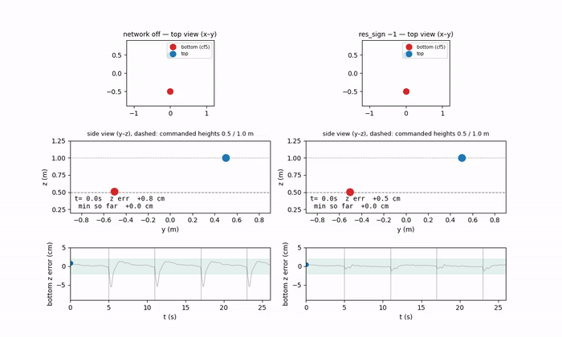

# Meeting Document — 2026-10-12

Deadline: 26 Feb 2027 (~19 weeks left)

## Overview
- **NS2 at 100 Hz:** works now on the real drone, no crashes 
- **Constant z error of Omar's INDI:** fixed with a z integral of 1.5, the error drops from +13…+23 cm to +1.5…+2.6 cm.
- **Replay of the same inputs:** Omar C and Omar Rust give the same output, ours is different.
- **RPM filter:** the fix for invalid readings works
- **NS2 simulation:** top-drone artifact fixed; network off and `res_sign +1` match the hardware within 0.4 cm on A8, `res_sign −1` does not (simulation −1.0 cm, hardware −3.2 cm), so the simulation overstates the NS2 benefit.

Notation: `z` = measured height, `z_cmd` = commanded height, `e_z = z − z_cmd` (positive = too high). A8 = two drones swap sides (4 crossings). All A8 numbers are from the bottom drone (cf5), uSD logs only.

---

## 1. NS2 at 100 Hz works
| | z error steady (mean) | z error at crossings (mean) | z error at crossings (max) |
|---|---|---|---|
| Geometric (NS2 off) | +0.8 cm | −5.9 cm | 7.2 cm |
| NS2 100 Hz | +0.3 cm | −2.8 cm | 4.2 cm |

## 2. Constant z error of Omar C/Rust fixed, compared with our INDI DONE
- Best result of each controller, A8, uSD:

| | steady z error | crossing dip (mean) | crossing dip (max) |
|---|---|---|---|
| Ours INDI | +1.9 cm | −9.3 cm | 10.5 cm |
| Omar C + Iz 1.5 | +2.4 cm | −10.3 cm | 16.4 cm |
| Omar Rust + Iz 1.5 | +1.5 cm | −7.6 cm | 10.2 cm |

- Steady z error: mean z error between the crossings (positive = too high).
- Crossing dip: lowest z error within ±1 s of a crossing (negative = too low).

## 3. Replay the same inputs through all indi variants
- One logged A8 flight, fed into all three controllers
- Omar C and Omar Rust give the same output (differences 1e-7 and 1e-9). Ours is different.

| A8, same inputs | ours | Omar C = Omar Rust | RMS difference ours vs Omar | correlation |
|---|---|---|---|---|
| thrust (mean) | 0.333 N | 0.412 N | 0.080 N | 0.97 |
| roll torque (RMS) | 1.26 mN·m | 1.22 mN·m | 1.3 mN·m | 0.39 |
| pitch torque (RMS) | 2.02 mN·m | 0.73 mN·m | 1.8 mN·m | 0.40 |
| yaw torque (RMS) | 1.49 mN·m | 1.36 mN·m | 1.1 mN·m | 0.69 |

- Thrust: same shape and same peaks at the crossings, ours 19% lower.
- Torques: different control laws, the pitch torque is 2.8× larger for ours.

### Control laws: ours vs Omar C (why the outputs differ)

**Position loop** (both: $a_d = a_{ref} + g\hat z + K_P e_p + K_D e_v$, thrust $T = m\,(F\cdot b_z)$):

$$\text{ours: } F_d = a_d + s\,a_{res},\quad s=+1,\quad a_{res}=a_{meas}-a_{model}$$

$$\text{Omar C: } F_d = a_d + (a_{model}-a_{meas}) = a_d - a_{res}$$

**Attitude loop** (both are the same incremental INDI form, $e_R = \tfrac12 (R_d^T R - R^T R_d)^\vee$ in both):

$$\tau = \tau_{rpm,f} + J\,(\alpha_{ref}-\alpha_f)$$

$$\text{ours: } \alpha_{ref} = \alpha_{des} - k_R\,e_R - k_\omega\,e_\omega$$

$$\text{Omar C: } J\,\alpha_{ref} = \tau_{Lee} = -K_R e_R - K_\omega e_\omega - K_I\!\int\! e_R + \omega\times J\omega - J(\hat\omega\,\omega_r - R^T R_d\,\dot\omega_d)$$

| | ours | Omar C |
|---|---|---|
| sign of the residual force | adds `a_meas − a_model` (`res_sign +1`, the flight-proven sign; with `−1` hover diverged on 2026-09-09, cause not isolated) | subtracts it (textbook sign) |
| position gains P / D | 64 xy, 48 z / 5 xy, 7 z | 7 / 4 |
| position integral | none (`ki_z 0`) | z only, 1.5 |
| mass | 0.041 kg | 0.0427 kg |
| residual force: model, measurement | per-motor `kₜ`, body accelerometer | one force constant (4.5 % higher), estimator acceleration |
| residual force: filter | clamp 10 m/s² + 80 Hz on both sides | 30 Hz on both sides, no clamp |
| attitude gains | `k_R` 2400 s⁻², `k_ω` 170 s⁻¹ | `K_R` 0.007 N·m (≈ 420 s⁻²), `K_ω` 0.00115 N·m·s (≈ 69 s⁻¹): ours 5.7× / 2.5× stiffer |
| attitude reference | only $\alpha_{des} - k_R e_R - k_\omega e_\omega$ | full Lee moment (gyroscopic term, integral, rate feed-forward) |
| inertia J | 23.95 / 23.95 / 32.35 e-6 kg·m² | 16.57 / 16.66 / 29.26 e-6 kg·m² (Crazyflie 2.0 values) |
| angular-acceleration filter | Butterworth 206 Hz | Butterworth 30 Hz |
| filter on the reference | same filter on reference, measurement and RPM torque | only measurement and RPM torque, not the reference |
| torque limits | 45 mN·m roll/pitch, 2.5 mN·m yaw | none |
| loop rate | 1 kHz | 500 Hz |

- Thrust: about one third of the 19% lower level is the mass (replay with Omar's mass: RMS difference 0.080 → 0.052 N). The rest comes from the opposite residual sign, the position gains and the filtering, not separated one by one.
- Torques: the attitude gains, the reference terms and the filters differ; which of them causes the larger pitch torque was not isolated.

## 4. RPM filter in the real loop DONE
- Acts for our INDI and Omar Rust, not for Omar C (it uses the optical deck).
- The DShot RPM reading is sometimes invalid (0xFFFF, about 0.06% of the samples). Before, the controller used 0 RPM for that motor, now it keeps the last good value.

- Median RPM error at the 131 invalid readings: 16,189 without the fix, 270 with it.
- Filter on vs off on the same day (our INDI, A8): no measurable difference in position or attitude error.
- The filter stays on.

## 5. Simulation with NS2 for the next session
- A8, simulation (5 seeds) against hardware, geometric and NS2:

Animation of one simulated A8 flight, network off (left) and NS2 `res_sign −1` (right), real time, 26 s ([mp4](assets/2026-10-12/a8_ns2_off_vs_minus1.mp4)):

- Crossing error: **simulation** −5.5 / −1.0 cm, **hardware** −5.9 / −3.2 cm (geometric / NS2); the simulation overstates the NS2 benefit

---

## Questions:
- **FBL controller follow-up**
  - **What we have**
    - inference side of the paper: downwash model (physics + two tiny networks, 114 parameters) with analytic derivatives
    - the control mapping (thrust, body rates, torque), an acceleration estimator, a sample *simulation* checkpoint, a small example
    - verified: example runs, derivatives and control mapping are correct, closed loop behaves as in the paper
  - **What is missing**
    - training code and data; the hardware checkpoint (force-only net); hardware gains / control rate; licence
    - everything is tied to a 30 g Crazyflie 2.x (ours: 41 g brushless) → needs re-identification, retraining and a port into our firmware (≈ 4–6 weeks estimate; ≈ 2–3 weeks physics-model-only)
  - **Questions to the authors**
    2. Could you share the hardware checkpoint (force-only net), the hardware gains (position / velocity / integral, rate loop), the α-β-γ coefficients and the control rate?
    3. Is the training script (KNODE loss, ODE solver, data format) available? Which data / trajectories were used (28 s at 0.4 m, 0.4 m/s)?
    4. The code has `C_d_GT = 0.55`, the paper says 0.7 for the simulated plant — which produced the sample checkpoint? Is the mass 0.03 kg also what the hardware controller used (paper: 36 g)?
    5. How is the near-aligned case (horizontal offset → 0; the residual jerk becomes singular) handled on hardware?
    6. How was yaw regulated in the experiments (the wrapper zeroes the yaw residual because of drift; no yaw-angle feedback)?
    8. Is a full repository release planned, and roughly when?

## Next Steps:
- **Finalize NS2 and INDI and start data collection on 2 drone scenarios**
- **FBL controller follow-up questions/missing parts**
