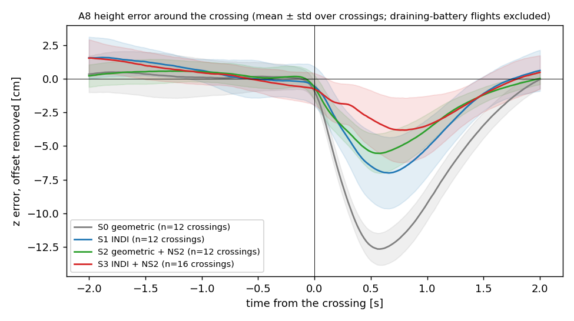
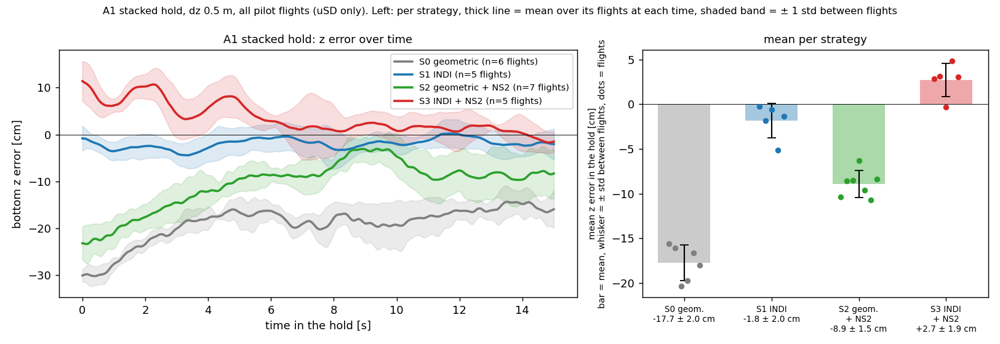
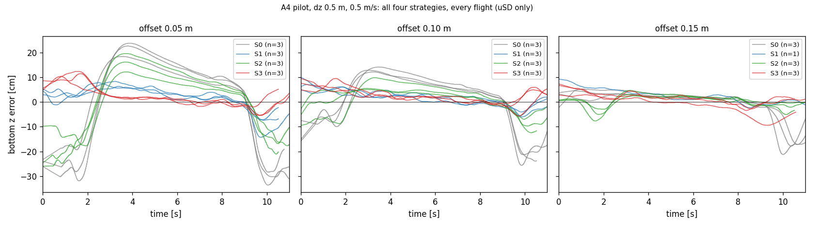

# Meeting Document — 2026-10-22

Deadline: 26 Feb 2027 (~18 weeks left)

## Overview
- **Unified controller tree:** one controller with two switches (INDI on/off, NS2 on/off) gives four strategies, validated on both drones: S0 geometric, S1 INDI, S2 geometric + NS2, S3 INDI + NS2.
- **Comparison of unified control strategeis (A8 swap, A1 hold, A4 offset line):** S0 is the worst in all three scenarios; S3 is the best or within the spread of the best in all three; S1 (INDI alone) is excellent in A1 and A4 but weaker than S2 in the A8 crossing.
- **A8 crossing dip:** −12.5 → −8.4 → −5.6 → −3.8 cm for S0 → S1 → S2 → S3.
- **A1 hold, mean z error:** −17.7, −1.8, −8.9, +2.7 cm for S0 → S1 → S2 → S3.
- **A4 (new):** the geometric controllers depend strongly on how far the drones are offset sideways, INDI hardly at all; NS2 cuts the geometric error by a third to two thirds.
- **NS2:** the neural network, retrained on 73 flights runs in C at 526 µs per evaluation.
- **Data:** 76 pilot flights in the tables (17 x A8,23 x A1, 36 x A4) - (A8 swap, A1 hold, A4 offset line)

Notation: `z` = measured height, `z_cmd` = commanded height, `e_z = z − z_cmd` (positive = too high). A8 = two drones swap sides (4 crossings), A1 = stacked hold (15 s), A4 = bottom drone shuttles along a line beside the stack (offset 0.05 / 0.10 / 0.15 m). Bottom vehicle, dz 0.5 m, 0.5 m/s, uSD logs only, n = flights.

---

## 1. The four strategies comparison
| | INDI | NS2 | A8 crossing dip, mean | A1 mean z error | A4 z RMS, offset 0.05 m | A4 z RMS, offset 0.10 m | A4 z RMS, offset 0.15 m |
|---|---|---|---|---|---|---|---|
| S0 geometric | off | off | −12.5 cm (n=4) | −17.7 cm (n=6) | 17.2 cm (n=3) | 10.5 cm (n=3) | 6.2 cm (n=3) |
| S1 INDI | on | off | −8.4 cm (n=4) | −1.8 cm (n=5) | 5.0 cm (n=3) | 2.8 cm (n=3) | 2.4 cm (n=3) |
| S2 geometric + NS2 | off | on | −5.6 cm (n=4) | −8.9 cm (n=7) | 11.7 cm (n=3) | 5.0 cm (n=3) | 2.3 cm (n=3) |
| S3 INDI + NS2 | on | on | −3.8 cm (n=5) | +2.7 cm (n=5) | 3.8 cm (n=3) | 3.2 cm (n=3) | 2.7 cm (n=3) |

*A8 crossing dip = lowest z error of a crossing relative to the flight's steady offset (negative = too low), averaged over the 4 crossings of a flight and then over the flights, so it is a **mean of the per-crossing minima**, not the single worst value (worst single crossing: S0 −15.1, S1 −13.9, S2 −9.3, S3 −8.6 cm). A1 = mean z error over the hold. A4 = z RMS over the flight; n = flights.*

- Bars = mean over flights, black whisker = ± std between flights, dots = single flights; A8 also grey whisker = ± std between all crossings (value in brackets).

## 2. A8: crossing of the two drones
| | crossing dip (mean) | std between crossings | std between flights | worst crossing | z RMS |
|---|---|---|---|---|---|
| S0 geometric | −12.5 cm | 1.3 (n=16) | 0.4 | −15.1 cm | 3.8 cm |
| S1 INDI | −8.4 cm | 3.4 (n=16) | 2.8 | −13.9 cm | 3.1 cm |
| S2 geometric + NS2 | −5.6 cm | 1.5 (n=16) | 0.7 | −9.3 cm | 1.8 cm |
| S3 INDI + NS2 | −3.8 cm | 2.3 (n=20) | 0.9 | −8.6 cm | 2.1 cm |

- **How the profile plot is made:** all A8 flights of a strategy, 4 crossings each. Thick line = mean over all crossings (n flights × 4), shaded = ± 1 std between crossings (all crossings pooled, so flight-to-flight differences are included).
- **Table:** crossing dip = lowest point of a crossing relative to the flight's steady offset; mean = over all crossings (equal to the mean over flights). **Std between crossings** = spread of all single crossings of the strategy (n = flights × 4, includes the differences between flights, same as the shaded band in the plot); **std between flights** = spread of the per-flight means (n = 4–5, the whisker in the bar plot of section 1).

## 3. A1: stacked hold
| | z error mean | std between flights | z RMS |
|---|---|---|---|
| S0 geometric | −17.7 cm | 2.0 | 18.0 cm |
| S1 INDI | −1.8 cm | 2.0 | 3.2 cm |
| S2 geometric + NS2 | −8.9 cm | 1.5 | 10.3 cm |
| S3 INDI + NS2 | +2.7 cm | 1.9 | 5.0 cm |

- **How the plot is made:** left: z error of every flight over the 15 s hold (window 0–15 s of the flight, time zero = start of the hold); thick line = mean over the strategy's flights at each time, shaded = ± 1 std between flights. Right: mean z error of each flight (dots), bar = mean over flights, whisker = std between flights.

### A1 videos: one flight per strategy (static camera, synchronised at takeoff)
<video src="assets/2026-10-22/A1_grid.mp4" controls loop muted playsinline width="70%" style="width:70%;height:auto;"></video>

If the video does not play here: [open A1_grid.mp4](assets/2026-10-22/A1_grid.mp4)

<video src="assets/2026-10-22/A1_overlay.mp4" controls loop muted playsinline width="70%" style="width:70%;height:auto;"></video>

If the video does not play here: [open A1_overlay.mp4](assets/2026-10-22/A1_overlay.mp4)

## 4. A4: bottom drone flies with position offset relative to top drone (.05/.10/.15cm)
z RMS in cm, mean ± std over flights (n):
| offset | S0 geometric | S1 INDI | S2 geometric + NS2 | S3 INDI + NS2 |
|---|---|---|---|---|
| 0.05 m | 17.2 ± 1.2 (n=3) | 5.0 ± 0.5 (n=3) | 11.7 ± 1.7 (n=3) | 3.8 ± 0.8 (n=3) |
| 0.10 m | 10.5 ± 1.1 (n=3) | 2.8 ± 0.1 (n=3) | 5.0 ± 1.5 (n=3) | 3.2 ± 0.5 (n=3) |
| 0.15 m | 6.2 ± 1.5 (n=3) | 2.4 ± 0.6 (n=3) | 2.3 ± 0.9 (n=3) | 2.7 ± 1.1 (n=3) |

- The closer the bottom drone passes to the upper one, the larger the error for the geometric controllers (S0 17 cm RMS at 0.05 m); NS2 cuts it by a third to two thirds (S2 against S0).
- INDI keeps the error at 3–5 cm at every offset; at 0.15 m all strategies except S0 are at 2–3 cm.

## 5. NS2: training data
- All 73 flights together, flown with the geometric controller

| Scenario | What it is | Settings covered | Flights | Flight time | Time in the NS2 gate |
|---|---|---|---|---|---|
| A8 | two drones swap sides (crossing) | dz 0.25 / 0.5 / 0.75 m × peak speed 0.1–0.5 m/s | 17 | 11.3 min | 63 s |
| A2 | stacked circle, radius 0.40 m | dz 0.5 m × speed 0.1–0.5 m/s | 8 | 3.0 min | 183 s |
| A3 | static top drone, bottom shuttles under it | dz 0.5 m × speed 0.1–0.5 m/s | 12 | 7.1 min | 75 s |
| A1 | stacked hold | dz 0.25 / 0.375 / 0.5 / 0.625 / 0.75 m | 12 | 2.9 min | 173 s |
| R1 | random waypoints, stack-biased | 9 seeds, bias 0.7, dz 0.25–0.75 m | 9 | 7.5 min | 314 s |
| A4 | bottom offset sideways, shuttles along a line | offset 0–0.15 m, dz 0.25–0.75 m, speed 0.3–0.5 m/s | 5 | 1.6 min | 39 s |
| A9 | nine A4 settings chained in one flight | dz 0.25 / 0.5 / 0.75 × offset 0 / 0.1 / 0.15 m | 3 | 8.8 min | 254 s |
| A5 | reverse circle (stacked, counter-moving) | circle radius 0.40 m | 3 | 0.9 min | 17 s |
| A6 | high-risk setting (single flight) | 1 flight | 1 | 0.4 min | 5 s |
| A7 | upper drone descends through the lower one | gap 1.1 → 0.1 m | 3 | 0.6 min | 38 s |
| **all** | | | **73** | **44.2 min** | **1162 s** |

---

## Questions:
- Data Collection coverage for NS2: Is it enough data / diverse enough?

## Next Steps:
- Fix/Close any eventual remaining issues
- Finalize unified c controller tree (geometric, indi, geom+ns2, indi+ns2)
- Comparative Study: Start/Continue
- Wait for fbl controller follow up, prepare as much as possible with temporary train script (switch out train script once fbl authors answer)
