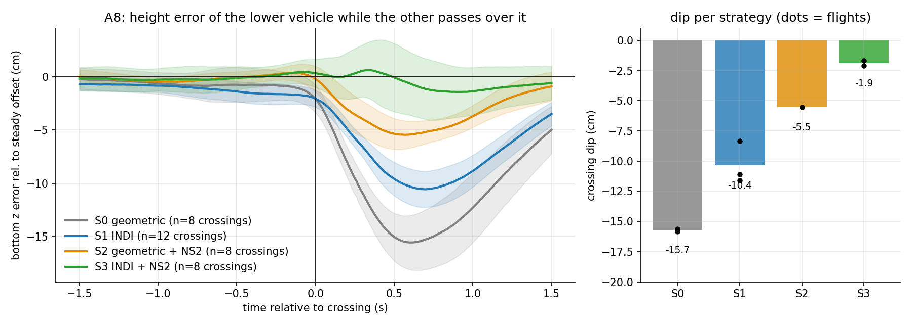
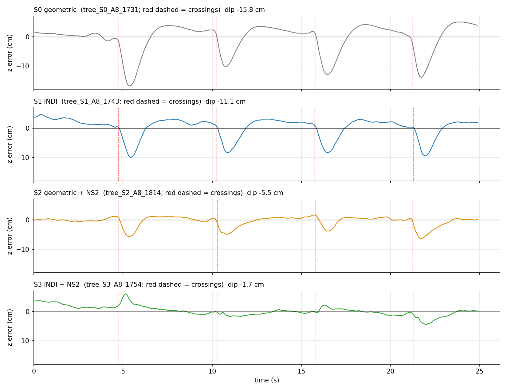
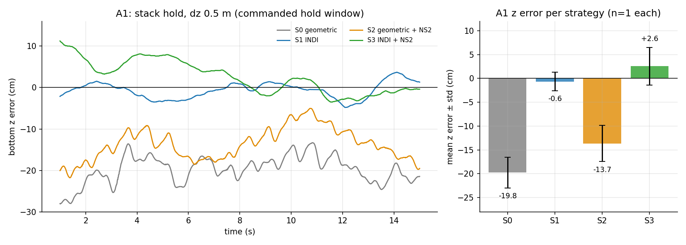
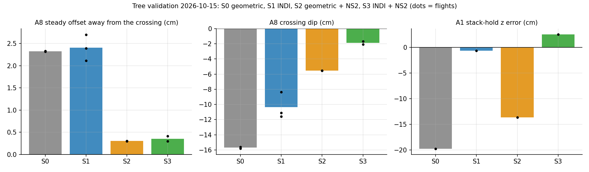

# Meeting — date open (prepared 2026-10-22)

## 1. Summary
- unified controller tree (one controller, three switches) validated on both drones: S0 geometric, S1 INDI, S2 geometric + NS2, S3 INDI + NS2
- A8 crossing dip shrinks stepwise: −15.7 → −10.4 → −5.5 → −1.9 cm; A1 stack hold: INDI strategies hold within 3 cm
- NS2 ported to C: 526 µs per evaluation (26 % of the 2 ms slot), 0 % clamped in flight
- NS2 retrained: 65 flights on the geometric controller collected (47 usable, 900 s in the gate) + the 26 earlier flights; leave-one-flight-out 69/73 folds pass, new flights better than v1 on 47/47; ns2_v2 released
- S3 stays two plain switches (INDI on, NS2 on): on our hardware only about 65–70 % of the thrust INDI commands arrives at the crossings, so INDI alone removes about a third of the dip, NS2 two thirds, and together they complement each other (−1.9 cm against −10.6 cm for INDI alone); an alternative combination was tested in simulation and dropped
- next: flash v2, re-validate S2/S3, then the 2-drone comparative study

## 2. Results (bottom vehicle, outliers excluded, n = flights)
| Strategy | A8 crossing dip | A8 offset away from crossing | A1 z error (mean ± std) |
|---|---|---|---|
| S0 geometric | −15.7 cm (n=2) | +1.8 cm | −19.8 ± 3.2 cm |
| S1 INDI | −10.4 cm (n=3) | +2.1 cm | −0.6 ± 1.9 cm |
| S2 geometric + NS2 | −5.5 cm (n=2) | +0.2 cm | −13.7 ± 3.8 cm |
| S3 INDI + NS2 | −1.9 cm (n=2) | +0.3 cm | +2.6 ± 3.9 cm |
- offset check: INDI itself adds none; NS2 sits ≈ 1.7 cm lower (ground-effect input); dips are relative to each flight's own offset
- A1: all flights clean; geometric large z error and attitude excursions expected
- S3: small upward overshoot after crossings (up to +5.7 cm), see the note under Summary
- trend only: n = 1–3 per cell, same session

## 3. Figures

## Questions:
- **NS2 execution context: should the network run in its own loop (queue to the control loop)?**
  - **Today:** inside the controller call, every 10th step (100 Hz), 526 µs worst case = 26 % of the 2 ms controller slot, motor command of that step delayed by the same amount
  - **Your idea:** a low-priority task computes the network and hands the last value to the control loop through a queue, so the control path never waits and more neighbours do not slow it
  - **Not found:** in the repositories I have (our firmware, IMRC firmware, NA-INDI, Neural-Swarm, crazyswarm2) the network runs inside the controller; which repository or file did you mean?
  - **Estimate:** with 2 or 3 neighbours about 0.7 – 0.9 ms; plan: keep inline for the two-drone study, measure with injected neighbours before the three-vehicle phase
  - **Question:** keep inline for now, or do you want the parallel task already for the two-drone study?

## Next steps:
- **Lab:** flash the new image (ns2_v2 + S3 switch), bench and hover check of all four strategies, re-validate S2 / S3 on A8 and A1 (S3 A and B if wanted)
- **Then:** freeze the study protocol, 2-drone comparative study (tier 1); 3 vehicles after that
- **Hardware:** replace the slightly bent bottom drone with a new one; NS2 stays frozen (no recollection)
- **FBL:** waiting for the authors' answer
