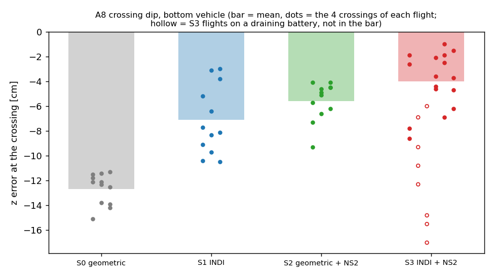

# Meeting — date open (prepared 2026-10-22)

## 1. Summary
- unified controller tree (one controller, three switches) validated on both drones: S0 geometric, S1 INDI, S2 geometric + NS2, S3 INDI + NS2
- **first unified comparison with the retrained NS2 v2 (2026-10-19, new drone pair, 0.5 m/s):** A8 crossing dip −12.7 → −7.1 → −5.6 → −4.0 cm for S0 → S1 → S2 → S3 (3–4 flights each, uSD logs only; S3 −3.6 cm on the 3 fresh-battery flights)
- A1 stacked hold, same session: mean z error S0 −17.3 → S2 −8.7 (NS2 halves the sag); S1 −0.9 and S3 +1.9 cm (INDI holds within 2 cm)
- this replaces the first tree validation of 2026-10-15 (NS2 v1, slower A8, fewer flights); full tables: `docs/tree_comparison_2026-10-19.md`
- NS2 ported to C: 526 µs per evaluation (26 % of the 2 ms slot), 0 % clamped in flight
- NS2 retrained: 65 flights on the geometric controller collected (47 usable, 900 s in the gate) + the 26 earlier flights; leave-one-flight-out 69/73 folds pass, new flights better than v1 on 47/47; ns2_v2 released
- S3 stays two plain switches (INDI on, NS2 on): on our hardware only about 65–70 % of the thrust INDI commands arrives at the crossings, so INDI alone removes about 45 % of the dip and NS2 about 55 %, and together they complement each other (about 70 %: −4.0 cm against −12.7 cm geometric, −7.1 cm for INDI alone; 2026-10-19); an alternative combination was tested in simulation and dropped
- next: freeze the study protocol, then the 2-drone comparative study (tier 1)

## 2. Results (A8, bottom vehicle, dz 0.5 m, peak 0.5 m/s, 4 crossings per flight, uSD logs only)
| Strategy | A8 crossing dip (flights) | worst crossing | z RMS | z mean | motors max |
|---|---|---|---|---|---|
| S0 geometric | −12.7 cm (n=3) | −15.1 | 4.0 cm | −0.8 cm | 76–80 % |
| S1 INDI | −7.1 cm (n=3) | −10.5 | 2.7 cm | 0.0 cm | 100 % |
| S2 geometric + NS2 v2 | −5.6 cm (n=3) | −9.3 | 1.8 cm | −0.5 cm | 79–81 % |
| S3 INDI + NS2 v2 | −4.0 cm (n=4) | −8.6 | 2.1 cm | +0.4 cm | 100 % |
- S3: 2 further flights on a draining battery were excluded (−9.8, −13.3 cm; battery down to 3.13 V); fresh battery per flight only: −3.6 cm (n=3)
- only the INDI strategies use the full motor range (100 %); loaded battery minimum 3.3–3.7 V in all strategies
- logs checked: INDI and NS2 active exactly where intended in all flights; the logged NS2 output matches the v2 weights, not v1
- trend only: n = 3–4 per cell, one session; 3 further S3 flights have no bottom-drone uSD log and are not used

A1 stacked hold (dz 0.5 m, hold 15 s, window 2–15 s, bottom vehicle, uSD only)
| Strategy | z error mean (flights) | spread of the flight means | z RMS | xy RMS | max roll/pitch | motors max |
|---|---|---|---|---|---|---|
| S0 geometric | −17.3 cm (n=3) | −20.3 … −15.6 | 17.6 cm | 8.2 cm | 42° | 92–100 % |
| S1 INDI | −0.9 cm (n=3) | −1.8 … −0.2 | 2.4 cm | 2.6 cm | 22° | 100 % |
| S2 geometric + NS2 v2 | −8.7 cm (n=5) | −10.4 … −6.3 | 10.3 cm | 8.7 cm | 42° | 90–100 % |
| S3 INDI + NS2 v2 | +1.9 cm (n=3) | −0.3 … +3.1 | 4.1 cm | 2.4 cm | 21° | 100 % |
- geometric strategies sag in the hold and tilt up to 42°; NS2 halves the sag (−17.3 → −8.7 cm); INDI holds within 2 cm; INDI + NS2 starts about +13 cm high (takeoff overshoot, gone after ~4 s) and runs at the lowest battery voltage (3.2–3.5 V)
- 5 further A1 flights were lost to full uSD cards (file counter 100, fixed by archiving; the drones reset at landing) and are not used

## 3. Figures

## Questions:
- **NS2 execution context: should the network run in its own loop (queue to the control loop)?**
  - **Today:** inside the controller call, every 10th step (100 Hz), 526 µs worst case = 26 % of the 2 ms controller slot, motor command of that step delayed by the same amount
  - **Your idea:** a low-priority task computes the network and hands the last value to the control loop through a queue, so the control path never waits and more neighbours do not slow it
  - **Not found:** in the repositories I have (our firmware, IMRC firmware, NA-INDI, Neural-Swarm, crazyswarm2) the network runs inside the controller; which repository or file did you mean?
  - **Estimate:** with 2 or 3 neighbours about 0.7 – 0.9 ms; plan: keep inline for the two-drone study, measure with injected neighbours before the three-vehicle phase
  - **Question:** keep inline for now, or do you want the parallel task already for the two-drone study?

## Next steps:
- **Lab:** done: v2 image flashed, A8 and A1 for all four strategies; found and fixed the uSD file-counter reset (cards at 100 files)
- **Then:** freeze the study protocol, 2-drone comparative study (tier 1); 3 vehicles after that
- **Hardware:** replace the slightly bent bottom drone with a new one; NS2 stays frozen (no recollection)
- **FBL:** waiting for the authors' answer
