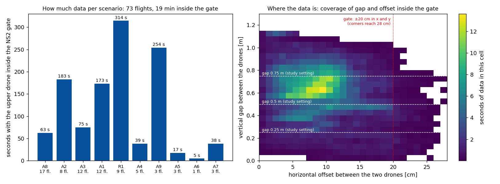

# Meeting Document — 2026-10-22 (date open)

Deadline: 26 Feb 2027 (~18 weeks left)

## Overview
- **Unified controller tree:** one controller with two switches (INDI on/off, NS2 on/off) gives four strategies, validated on both drones: S0 geometric, S1 INDI, S2 geometric + NS2, S3 INDI + NS2.
- **Comparison (pilot flights of 2026-10-19/20, A8 swap, A1 hold, A4 offset line):** S0 is the worst in all three scenarios; S3 is the best or within the spread of the best in all three; S1 (INDI alone) is excellent in A1 and A4 but weaker than S2 in the A8 crossing.
- **A8 crossing dip:** −12.5 → −8.4 → −5.6 → −3.8 cm for S0 → S1 → S2 → S3.
- **A1 hold, mean z error:** −17.7, −1.8, −8.9, +2.7 cm.
- **A4 (new):** the geometric controllers depend strongly on how far the drones are offset sideways, INDI hardly at all; NS2 cuts the geometric error by a third to two thirds.
- **NS2:** the neural network, retrained on 73 flights (about 19 min inside the gate, see section 5), runs in C at 526 µs per evaluation.
- **INDI is battery-sensitive:** the S1 flights on low batteries (3.4 V loaded) were clearly worse.
- **Data:** 76 pilot flights in the tables (A8 17, A1 23, A4 36), each with complete uSD logs of both drones; strategy of every flight checked from the logs. A bug found on the way (uSD card full at 100 files made the drones reset at landing) is fixed.

Notation: `z` = measured height, `z_cmd` = commanded height, `e_z = z − z_cmd` (positive = too high). A8 = two drones swap sides (4 crossings), A1 = stacked hold (15 s), A4 = bottom drone shuttles along a line beside the stack (offset 0.05 / 0.10 / 0.15 m). Bottom vehicle, dz 0.5 m, 0.5 m/s, uSD logs only, n = flights.

---

## 1. The four strategies at a glance
| | INDI | NS2 | A8 crossing dip | A1 mean z error | A4 z RMS, offset 0.05 m |
|---|---|---|---|---|---|
| S0 geometric | off | off | −12.5 cm (n=4) | −17.7 cm (n=6) | 17.2 cm (n=3) |
| S1 INDI | on | off | −8.4 cm (n=4) | −1.8 cm (n=5) | 5.0 cm (n=3) |
| S2 geometric + NS2 | off | on | −5.6 cm (n=4) | −8.9 cm (n=7) | 11.7 cm (n=3) |
| S3 INDI + NS2 | on | on | −3.8 cm (n=5) | +2.7 cm (n=5) | 3.8 cm (n=3) |

- Pilot data: n = 3–7 per cell, one lab, two drones. Bars = mean over flights, whisker = ± std between flights, dots = single flights (A4: whiskers only).
- S3 A8: two further flights on a draining battery are excluded.
- Full tables: `docs/tree_comparison_2026-10-19.md` (§9), per-flight tables `docs/lab_sessions/2026-10-20.md`.

## 2. A8: crossing of the two drones
| | crossing dip (mean) | std between flights | worst crossing | z RMS | motors max |
|---|---|---|---|---|---|
| S0 geometric | −12.5 cm | 0.4 | −15.1 cm | 3.8 cm | 76–80 % |
| S1 INDI | −8.4 cm | 2.8 | −13.9 cm | 3.1 cm | 100 % |
| S2 geometric + NS2 | −5.6 cm | 0.7 | −9.3 cm | 1.8 cm | 79–82 % |
| S3 INDI + NS2 | −3.8 cm | 0.9 | −8.6 cm | 2.1 cm | 100 % |

- **How the profile plot is made:** all A8 flights of a strategy, 4 crossings each; for every crossing the z error from −2 to +2 s around the zero-crossing of y, steady offset of that flight removed. Thick line = mean over all crossings (n flights × 4), shaded = ± 1 std between crossings.
- **Table and bars:** crossing dip = lowest point of a crossing, averaged per flight; mean = over flights, std = between flights (bars: whiskers = std, dots = flights).
- S1 has the largest spread: its fourth flight ran at 3.4 V loaded and dipped −12.4 cm; the other three −6.3 … −8.1 cm.
- Only the INDI strategies use the full motor range (100 %).

## 3. A1: stacked hold
| | z error mean | std between flights | z RMS | motors max |
|---|---|---|---|---|
| S0 geometric | −17.7 cm | 2.0 | 18.0 cm | 89–100 % |
| S1 INDI | −1.8 cm | 2.0 | 3.2 cm | 100 % |
| S2 geometric + NS2 | −8.9 cm | 1.5 | 10.3 cm | 90–100 % |
| S3 INDI + NS2 | +2.7 cm | 1.9 | 5.0 cm | 100 % |

- **How the plot is made:** left: z error of every flight over the 15 s hold (window 2–15 s of the flight, time zero = start of the hold); thick line = mean over the strategy's flights at each time, shaded = ± 1 std between flights. Right: mean z error of each flight (dots), bar = mean over flights, whisker = std between flights.
- Geometric strategies sag in the hold and tilt up to 42°; NS2 halves the sag.
- S3 starts about +13 cm high (takeoff overshoot, gone after ~4 s).

### A1 videos: one flight per strategy (static camera, synchronised at takeoff)
<video src="assets/2026-10-22/A1_grid.mp4" controls loop muted playsinline width="80%" style="width:80%;height:auto;"></video>

2×2: S0 geometric and S1 INDI on top, S2 geometric + NS2 and S3 INDI + NS2 below; time since takeoff in each tile. Single clips: [S0](assets/2026-10-22/A1_S0.mp4), [S1](assets/2026-10-22/A1_S1.mp4), [S2](assets/2026-10-22/A1_S2.mp4), [S3](assets/2026-10-22/A1_S3.mp4).

<video src="assets/2026-10-22/A1_overlay.mp4" controls loop muted playsinline width="80%" style="width:80%;height:auto;"></video>

Overlay: the four flights in one frame, one colour per strategy (S0 white, S1 blue, S2 green, S3 red), trails fade after about 1 s; the stack is seen from the front.
- **What the videos show:** in the hold the bottom drone sits lowest and most tilted with S0, higher with S2, and near the commanded height with S1 and S3; the top drone stays at the top in all four.
- **Their numbers (mean z error of the video flights):** S0 −16.6 / −18.0 cm (two flights), S1 −1.4, S2 −8.4, S3 +3.0 cm; hold 20 s, max roll/pitch 42° / 40° / 29° / 40° / 25°.
- Made by `experiments/analysis/a1_videos.py` and `a1_overlay.py` from the camera files (not in the repo).

## 4. A4: bottom drone shuttles beside the stack (new)
z RMS in cm, mean ± std over flights (n):
| offset | S0 geometric | S1 INDI | S2 geometric + NS2 | S3 INDI + NS2 |
|---|---|---|---|---|
| 0.05 m | 17.2 ± 1.2 (n=3) | 5.0 ± 0.5 (n=3) | 11.7 ± 1.7 (n=3) | 3.8 ± 0.8 (n=3) |
| 0.10 m | 10.5 ± 1.1 (n=3) | 2.8 ± 0.1 (n=3) | 5.0 ± 1.5 (n=3) | 3.2 ± 0.5 (n=3) |
| 0.15 m | 6.2 ± 1.5 (n=3) | 2.4 ± 0.6 (n=3) | 2.3 ± 0.9 (n=3) | 2.7 ± 1.1 (n=3) |

- The closer the bottom drone passes to the upper one, the larger the error for the geometric controllers (S0 17 cm RMS at 0.05 m); NS2 cuts it by a third to two thirds (S2 against S0).
- INDI keeps the error at 3–5 cm at every offset; at 0.15 m all strategies except S0 are at 2–3 cm.
- Offset 0.0 was dropped (it repeats A1 and A8).

## 5. NS2: training data
- All 73 flights together, flown with the geometric controller, labels from the deck RPM.
- **The gate (our own implementation, `ns2_residual.c` in our firmware):** the network only acts, and only trains on data, when a neighbour is above and close: |dx| < 0.2 m, |dy| < 0.2 m, |relative vx| < 1.5 m/s. Outside, its output is zero. Why: the downwash only matters when the other drone is right above; the reference (Neural-Swarm) also filters by a horizontal distance, the values here are ours. Crazyswarm2 / the simulator have no such gate.

| Scenario | What it is | Settings covered | Flights | Flight time | Time in the NS2 gate |
|---|---|---|---|---|---|
| A8 | two drones swap sides (crossing) | dz 0.25 / 0.5 / 0.75 m × peak speed 0.1–0.5 m/s | 17 | 11.3 min | 63 s |
| A2 | stacked circle, radius 0.40 m | dz 0.5 m × speed 0.1–0.5 m/s | 8 | 3.0 min | 183 s |
| A3 | static top drone, bottom shuttles under it | dz 0.5 m × speed 0.1–0.5 m/s | 12 | 7.1 min | 75 s |
| A1 | stacked hold | dz 0.25 / 0.375 / 0.5 / 0.625 / 0.75 m | 12 | 2.9 min | 173 s |
| R1 | random waypoints, stack-biased | 9 seeds, bias 0.7, dz 0.25–0.75 m | 9 | 7.5 min | 314 s |
| A4 | bottom offset sideways, shuttles along a line | offset 0–0.15 m, dz 0.25–0.75 m, speed 0.3–0.5 m/s | 5 | 1.6 min | 39 s |
| A9 | nine A4 settings chained in one flight | dz 0.25 / 0.5 / 0.75 × offset 0 / 0.1 / 0.15 m | 3 | 8.8 min | 254 s |
| A5 | reverse circle (stacked, counter-moving) | circle radius 0.40 m | 3 | 0.9 min | 17 s |
| A6 | high-risk setting (single flight) | 1 flight | 1 | 0.4 min | 5 s |
| A7 | upper drone descends through the lower one | gap 1.1 → 0.1 m | 3 | 0.6 min | 38 s |
| **all** | | | **73** | **44.2 min** | **1162 s** |

- **Left:** seconds inside the gate per scenario. R1, A9, A2, A1 give most of it.
- **Right:** seconds of data per cell, horizontal offset (x) against vertical gap (y). Dashed lines = study gaps 0.25 / 0.5 / 0.75 m; red dotted = gate edge (±20 cm in x and y, corners reach 28 cm).
- Vertical gap in the gate: median 0.62 m; horizontal offset: median 0.09 m.
- Leave-one-flight-out: 69 of 73 flights pass.

---

## Questions:
- **NS2 execution context:** today inline in the controller, 100 Hz, 526 µs = 26 % of the 2 ms slot. Your idea: separate low-priority task + queue. I did not find it in any repo — which one did you mean?
- **Decision:** keep inline for the two-drone study, or parallel task now?

## Next Steps:
- **Study:** freeze protocol, start tier-1 two-drone study, then three vehicles
- **Hardware:** new drone pair, NS2 frozen
- **FBL (part of the study):** desk part done, waiting for the authors' training script and gains
