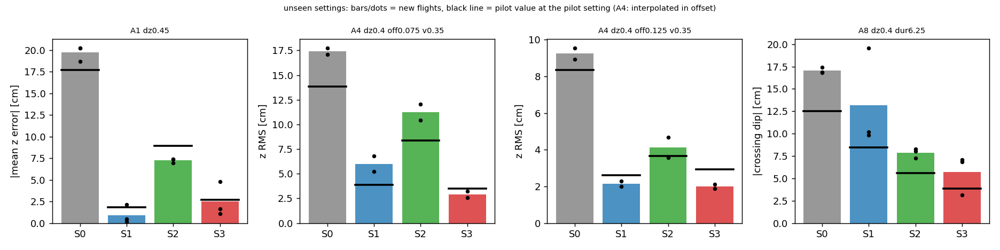
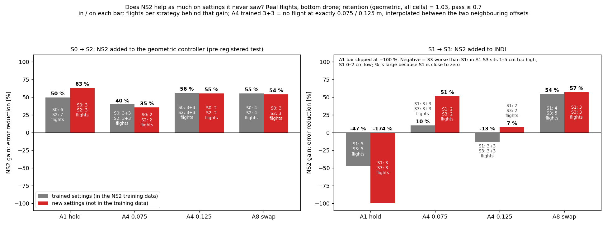
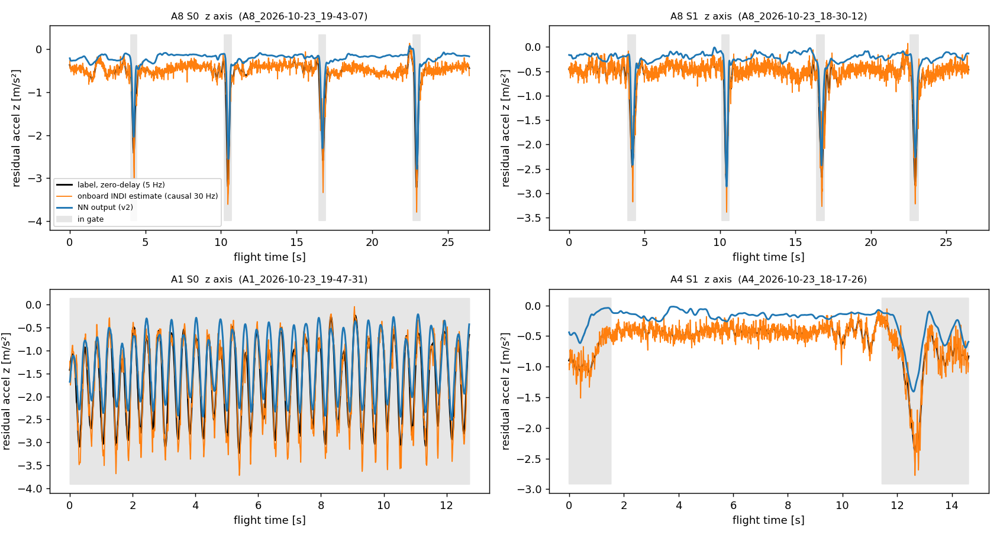
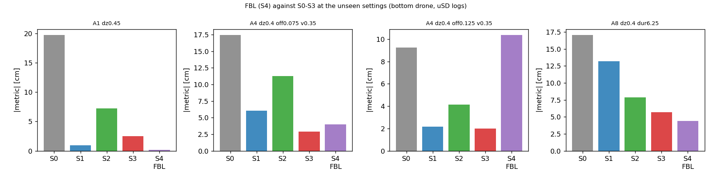
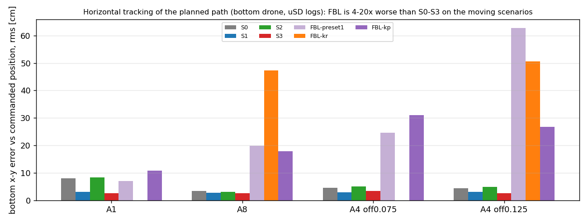
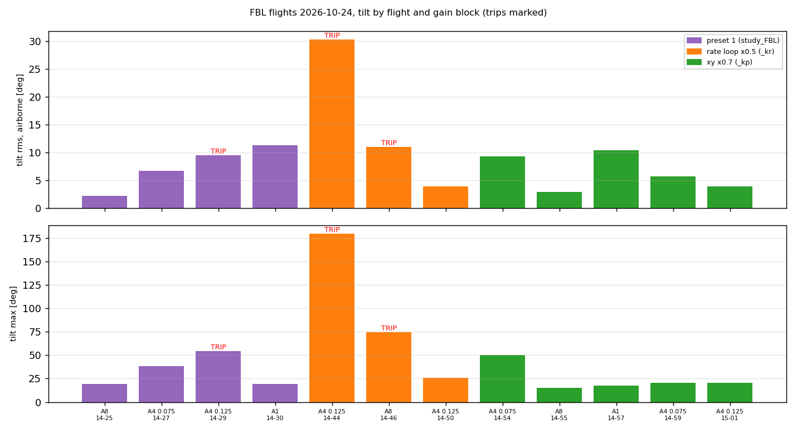
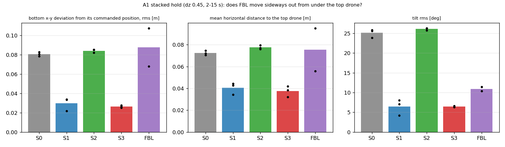
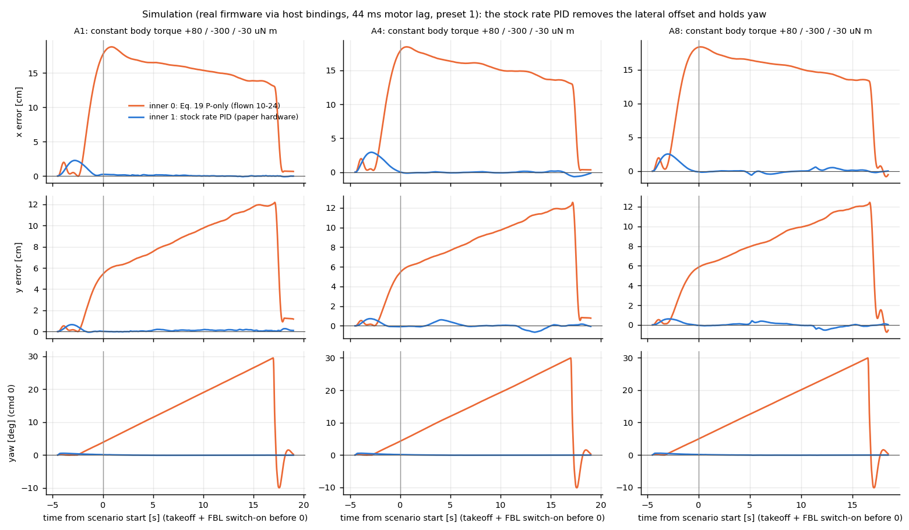

# Meeting Document — 2026-10-29

Deadline: 26 Feb 2027 (~17 weeks left)

## Overview
- **Feedback from last meeting:** (a) NS2 is trained on the cases it is tested on, (b) equal weights on "boring" near-zero data can overfit, (c) compare NN output with the INDI output.
- **NN vs INDI (37 pilot flights, NN off):** NN follows the zero-delay INDI label closely (corr 0.9–0.96, lag within ±10 ms) in A8, A1 geometric and A4; weakest in A1 under INDI. Same magnitude after removing a label bias of the new bottom drone (≈ −0.3 to −0.45 m/s², present also far from the neighbour); without that, the NN reads 20–30 % low.
- **Training on test cases:** with the pilot settings held out, the prediction error on them rises 3 % (A1), 0 % (A8), 22 % (A4, whole family removed).
- **Boring data:** 54 % of the training rows have a residual below 0.3 m/s² (86 % of them outside the gate); down-weighting them: pooled at most 2 % (within the seed spread), A4 about 10 % better, A1 worse at unseen settings.
- **Logging:** the INDI estimate is now logged under all four strategies (firmware patch, byte-identical control), flashed 2026-10-23 and checked in flight.
- **Flight confirmation (40 flights, unseen settings):** retention 1.03 (95 % CI 0.93–1.17, pass ≥ 0.7) → no material overfit between the trained settings.

Notation: `a_res` = measured residual acceleration (accelerometer minus rotor-speed model), NN = NS2 v2 output, label = `a_res` smoothed offline with a zero-delay filter (5 Hz), gate = NS2 gate (|dx|,|dy| < 0.2 m, |dvx| < 1.5 m/s, neighbour above).

---

## 1. Is the network predicting the INDI signal?

- Black = zero-delay label, orange = onboard INDI estimate (causal 30 Hz), blue = NN output, grey = in gate. Bottom drone, flights without the NN applied (S0 geometric, S1 INDI), other bottom vehicle than in training.

| cell (z axis, in gate) | flights | corr | label lag behind NN | slope label / NN |
|---|---|---|---|---|
| A8 S0 / S1 | 4 / 4 | 0.93 / 0.96 | 0 / 0 ms | 0.85 / 1.01 |
| A1 S0 | 6 | 0.93 | −10 ms | 1.17 |
| A1 S1 | 5 | 0.71 | −44 ms | 0.54 (NN level 13 % low) |
| A4 S0 / S1 | 9 / 9 | 0.92 / 0.88 | 0 / −8 ms | 0.98 / 1.02 |

- The NN is in phase with the zero-delay label, not faster; the onboard causal INDI estimate lags it by 0–8 ms and is much noisier.
- The NN predicts the z component only.
- Rebuilt INDI estimate vs the onboard-logged one (39 INDI flights): RMS 0.03 m/s², corr 0.996.
- Mean level: in the gate the NN is 20–30 % below the label; far from the neighbour the label is still ≈ −0.3 to −0.45 m/s² (NN ≈ −0.1), a bias of the new bottom drone, not downwash. After removing it NN / label = 0.93–1.10 (A4, A8).

---

## 2. Training on the cases we test (feedback a) and boring data (feedback b)

- Same network type as v2 (40 epochs), 3 seeds each (bars = mean, dots = seeds), scored on the 37 pilot flights. Held out = trained on 59 of the 73 flights without A8 dz 0.5 at 0.5 m/s, A1 dz 0.5, all A4 and A9. Boring weight = rows with |a_res| < 0.3 m/s² count with weight 0.2 or 0.05.

| in-gate RMSE [m/s²] | all | A1 hold | A4 offset | A8 swap |
|---|---|---|---|---|
| trained with the pilot settings (v2 recipe) | 0.435 ± 0.017 | 0.414 | 0.446 | 0.635 |
| pilot settings held out | 0.464 ± 0.018 | 0.426 | 0.545 | 0.619 |
| all data, boring weight 0.05 | 0.426 ± 0.014 | 0.415 | 0.403 | 0.630 |
| held out, boring weight 0.05 | 0.479 ± 0.034 | 0.442 | 0.553 | 0.628 |

- Overlap matters little for A1 (+3 %) and A8 (none), clearly for A4 (+22 %, all 8 A4/A9 flights removed = pessimistic case).
- Down-weighting boring rows: no uniform gain (A4 about 10 % better in 3/3 seeds, A1 worse at unseen settings), no v3 retrain needed; 86 % of the boring rows lie outside the gate. The v2 recipe is reproducible (seed 0 gives exactly v2; v2 is one seed, spread ±0.02–0.03).
- Limits: offline error only, causal label noise floor ≈ 0.115 m/s², one architecture, Huber loss; hard subsampling and coverage-based weighting not tested.

---

## 3. Logging of the INDI output under every strategy
- NN output was already logged on all strategies; the INDI estimate was zero under S0/S2 (filters only ran with INDI on).
- Patch: estimate runs whenever the RPM deck is present, applied to the control only with INDI on.
- Checks: replay byte-identical in 4 of 4 cases; estimate with INDI off equals the INDI-on estimate exactly; ARM image (flash 56 %, RAM 76 %) flashed 2026-10-23; in flight the onboard estimate equals the offline rebuild in all four strategies (corr 0.96–1.00).

---

## 4. Flight confirmation: unseen settings (2026-10-23)
- 40 flights, S0–S3, settings between the trained ones: A8 dz 0.4 at 0.35 m/s, A1 dz 0.45, A4 offsets 0.075 / 0.125; ns2_v2 unchanged.
- Trained A4 offsets: 0.10 and 0.15 (0.05 was flown in the pilot only, after v2 was frozen), so the seen reference of A4 0.075 is half unseen.
- Gain of NS2 = error reduction against its base: S0 → S2 (geometric) and S1 → S3 (INDI); seen = pilot settings (in the training data), unseen = new settings.
- Pre-registered rule: retention R = gain unseen / gain seen, pooled over the cells, geometric pair; R ≥ 0.7 = no material overfit.

| Cell (unseen) | metric | S0 | S1 | S2 | S3 | n per strategy |
|---|---|---|---|---|---|---|
| A1 dz 0.45 | mean z error [cm] | -19.7 ± 0.9 | -0.9 ± 1.1 | -7.3 ± 0.2 | 2.5 ± 2.0 | 3 |
| A4 offset 0.075 | z RMS [cm] | 17.4 ± 0.5 | 6.0 ± 1.1 | 11.3 ± 1.1 | 2.9 ± 0.5 | 2 |
| A4 offset 0.125 | z RMS [cm] | 9.2 ± 0.4 | 2.2 ± 0.2 | 4.1 ± 0.8 | 2.0 ± 0.2 | 2 |
| A8 dz 0.4 | crossing dip [cm] | -17.0 ± 0.3 | -13.2 ± 5.5 | -7.9 ± 0.6 | -5.7 ± 2.2 | 3 |

Mean ± std over flights, bottom drone, uSD logs only; 40 flights.

**S0 → S2 (geometric + NS2)**

| Cell | seen | unseen | R |
|---|---|---|---|
| A1 | 50 % | 63 % | 1.27 |
| A4 offset 0.075 | 40 % | 35 % | 0.89 |
| A4 offset 0.125 | 56 % | 55 % | 0.98 |
| A8 | 55 % | 54 % | 0.97 |
| **pooled** | | | **1.03 → no material overfit** (95 % CI 0.93–1.17; leave one flight out 0.99–1.06; A4 0.075 with trained offsets only as reference 0.68, pooled 0.98) |

**S1 → S3 (INDI + NS2)**

| Cell | seen | unseen |
|---|---|---|
| A1 | −47 % | −174 % (S1 already at −0.9 cm, nothing left to gain) |
| A4 offset 0.075 | 10 % | 51 % |
| A4 offset 0.125 | −13 % | 7 % |
| A8 | 54 % | 57 % |

- Geometric: NS2 helps on unseen settings as much as on seen ones (this carries the verdict). INDI: it helps in A8 and A4 0.075, not in A1 and at A4 0.125; the INDI bases are negative or near zero in 2 of 4 cells, so INDI retention cannot be read either way (A8 seen 54 % without, 28 % with the 2 drained S3 flights).

- NN vs INDI at the unseen settings: correlation 0.93–0.95 under S0 (in gate), weaker under INDI (A1 0.84, A4 0.68); onboard INDI log equals the offline rebuild in all four strategies (corr 0.96–1.00).
- Caveats: A1 dz 0.45 is close to a trained dz; unseen cells are easier or harder than the pilot cells, so the gain is relative.

**Limits of this test (for discussion):**
- Unseen = between trained settings (interpolation), not extrapolation; A1 dz 0.45 is 0.05 m from a trained dz.
- 2–3 flights per cell; the bootstrap CI covers flight-to-flight spread only, not session effects; block order S1, S3, S2, S0 not randomised (battery and drift can differ between blocks; S1 A4 packs at 3.2–3.3 V); seen reference from a different session.
- Claim: no evidence of overfitting at settings between the trained ones; not a proof of generalisation beyond them.

**If it should be stronger (not done):**
- Strict version: network trained without the pilot settings, flown on exactly those settings.
- Settings outside the trained range (extrapolation), more flights per cell, randomised block order.

---

## 5. FBL (Strategy 3) on hardware — first flights (2026-10-24)
- Init bug fixed on the way (yaml params are written alphabetically, the controller switch came last and reset the FBL settings; the first 4 "FBL" flights were S0). Image with the fix on both drones; FBL ran in 12 flights with complete logs (unseen-block settings, n = 1–4 per cell).

| Cell | S0 | S1 | S2 | S3 | **FBL** |
|---|---|---|---|---|---|
| A1 mean z error [cm] | −19.7 | −0.9 | −7.3 | +2.5 | **+0.2** (n=2) |
| A8 dip [cm] | −17.0 | −13.2 | −7.9 | −5.7 | **−4.4** (n=3) |
| A4 0.075 z RMS [cm] | 17.4 | 6.0 | 11.3 | 2.9 | **4.0** (n=3) |
| A4 0.125 z RMS [cm] | 9.2 | 2.2 | 4.1 | 2.0 | **10.4** (n=4, 2 trips) |

- z tracking: best of all strategies in A1 and A8. Horizontal path tracking: 6–10× worse than S0–S3 on the moving scenarios:

- Safety latch tripped in 3 of 12 flights (A4 0.125 ×2, A8 ×1), none with the xy-position-×0.7 gains (`_kp`, 4 of 4 clean; gain blocks identified from the logs: preset 1 2 trips of 5, `_kr` 1 of 3):

- A1 stacked hold: FBL moves sideways like S0/S2, INDI stays under the top drone:

- Gains: preset 1 (0.25× the authors') with xy position loop ×0.7, cd 0.55 (provisional; the authors' gains are unstable with our 44 ms motor lag in simulation, kept as preset 0). Open: horizontal tracking, A4 0.125, cd on hardware.

---

## 6. FBL rework: back to the controller the authors flew (2026-10-24/25)
- **Cause of the 10-24 problems:** the control law was the authors' code, but our inner loop (P-only rate loop, Eq. 19) was not what they flew: on hardware they sent thrust + body rates to the stock Crazyflie rate PID (integral, yaw-angle hold). Our drone needs a small steady body torque; a P-only loop turns it into yaw drift (up to 66°) and a sideways offset (y 15–80 cm rms).
- **Now:** FBL = the authors' structure: their control law (tested against their code), the stock rate PID (bit-exact against the firmware), physics model + trained 4-neuron network (their training method, our flights), FBL flies the whole flight (takeoff to landing, like S0–S3), no extra safety limits. S0–S3 unchanged (bit-identical).

| Simulation, cf5's torque need, our gains, 44 ms motor lag | flown 10-24 | authors' structure |
|---|---|---|
| steady sideways offset [cm] | 18.1 | 0.15 |
| max yaw [deg] | 26.9 | 0.11 |

- **Still different from the authors:** gains (theirs are unpublished; their code gains are unstable in our simulation, so both are flown), C_D (ours 0.55 from training, theirs 0.236; both flown), network weights trained by us (theirs unpublished), onboard instead of laptop + Vicon, a gate on the downwash term (only for a neighbour above and within 0.6 m).
- **Next lab (2026-10-26):** refly the 10-24 cells; validation = the paper's own hardware test (two drones stacked on a straight line, dz 0.4 / 0.3, without model / physics model / physics model + network, 5 flights each) against the paper's Fig. 3.

---

## Questions:
- Flight confirmation at unseen settings is done (retention 1.03): is that sufficient, or do you also want a network trained without the pilot settings?
- Keep ns2_v2 for the study?
- A4: re-fly S2/S3 on offsets/speeds outside the training data?

## Next Steps:
- Logging image flashed and checked; NN and INDI output are now logged on all study flights.
- Depending on the answer: strict check with a network trained without the pilot settings (not planned).
- Comparative study: start/continue (protocol v1.0, tier 1, two drones).
- FBL: reflight of the rebuilt controller (lab 2026-10-26: both gain sets, C_D 0.236 vs 0.55, validation against the paper's hardware test), then freeze the gains and fly the FBL comparison cells (n like S0–S3).
