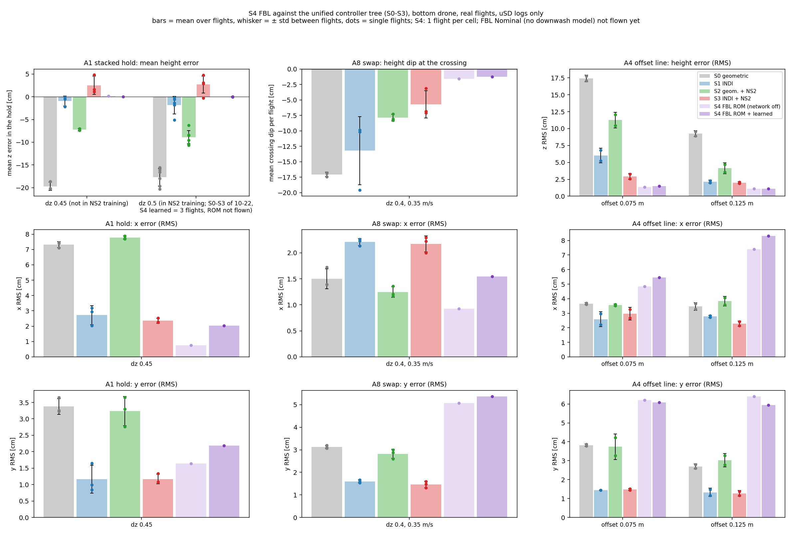
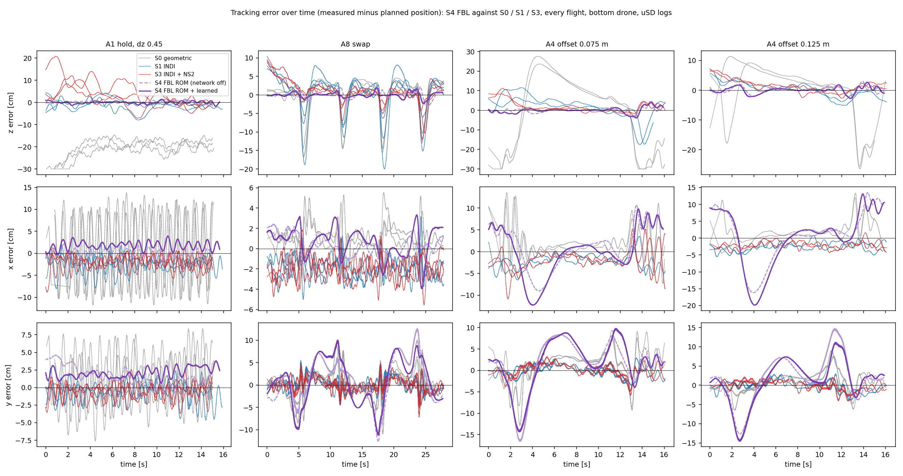
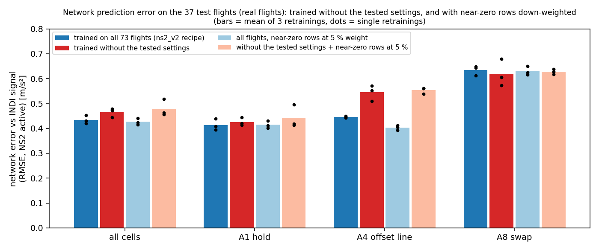

# Meeting Document — 2026-10-29

Deadline: 26 Feb 2027 (~17 weeks left)

## Overview
- **Topic 1 — FBL controller (S4) - (caution limited flight data):** Flies on our drones as the authors built it (their control law, stock inner loop, physics downwash model + learned network + our data)
- **FBL height:** smallest height error of all strategies, with and without the network
- **FBL sideways:** worse than the INDI strategies when the drone moves (A8, A4)
- **Topic 2 — NS2 (feedback from last meeting):**
  - **(a) trained on the tested settings:** on new settings NS2 helps as much as before → no overfitting.
  - **(b) mostly near-zero training samples:** they do not pull the network towards zero; down-weighting them does not help
  - **(c) network vs INDI:** same shape, timing and size with geometric control; weaker under INDI. The INDI signal is now logged on every strategy.
- **Data:** Sections 1–5 = real flights; section 6 = test networks trained on the computer and recorded flight data used as input

**Notation**
- `error = measured − planned position` (z positive = too high); bottom drone; n = flights.
- A8 = drones swap sides (4 crossings), A1 = stacked hold (15 s), A4 = bottom drone shuttles along a 1.2 m line beside the stack (offset 0.075 / 0.125 m). In A8 and A4 the drone moves along y; x is across the motion.
- **INDI signal** = measured acceleration minus what the rotors should produce = the push from the neighbour's downwash. INDI measures it; NS2 predicts it from the neighbour's position.
- **Trained settings** = the settings of last meeting (flown 2026-10-19/20); in the NS2 training data, but different flights (A4 offset 0.05 not in training). **New settings** = not in the training data, between trained ones: A8 dz 0.4 at 0.35 m/s, A1 dz 0.45, A4 dz 0.4 at 0.35 m/s.
- FBL variants: **Nominal** = no downwash model; **ROM** = physics downwash model; **ROM + learned** = physics model + 4-neuron network.

---

# Topic 1 — FBL controller (S4)

## 1. FBL against the four strategies: z position error
| strategy | INDI | NS2 | A1 hold dz 0.45 (new): mean z error | A1 hold dz 0.5 (trained): mean z error | A8 swap (new): crossing dip | A4 offset 0.075 m (new): z RMS | A4 offset 0.125 m (new): z RMS |
|---|---|---|---|---|---|---|---|
| S0 geometric | off | off | −19.7 ± 0.9 cm (n=3) | −17.7 ± 2.0 cm (n=6) | −17.0 ± 0.3 cm (n=3) | 17.4 ± 0.5 cm (n=2) | 9.2 ± 0.4 cm (n=2) |
| S1 INDI | on | off | −0.9 ± 1.1 cm (n=3) | −1.8 ± 2.0 cm (n=5) | −13.2 ± 5.5 cm (n=3) | 6.0 ± 1.1 cm (n=2) | 2.2 ± 0.2 cm (n=2) |
| S2 geometric + NS2 | off | on | −7.3 ± 0.2 cm (n=3) | −8.9 ± 1.5 cm (n=7) | −7.9 ± 0.6 cm (n=3) | 11.3 ± 1.1 cm (n=2) | 4.1 ± 0.8 cm (n=2) |
| S3 INDI + NS2 | on | on | +2.5 ± 2.0 cm (n=3) | +2.7 ± 1.9 cm (n=5) | −5.7 ± 2.2 cm (n=3) | 2.9 ± 0.5 cm (n=2) | 2.0 ± 0.2 cm (n=2) |
| **S4 FBL Nominal** | – | – | not flown | not flown | not flown | not flown | not flown |
| **S4 FBL ROM** | – | own model | **+0.2 cm (n=1)** | not flown | **−1.6 cm (n=1)** | **1.3 cm (n=1)** | **1.1 cm (n=1)** |
| **S4 FBL ROM + learned** | – | own model + network | **−0.0 cm (n=1)** | **−0.0 ± 0.1 cm (n=3)** | **−1.2 cm (n=1)** | **1.5 cm (n=1)** | **1.1 cm (n=1)** |

*Mean ± std between flights. Mean z error = average over the hold (0–15 s). Crossing dip = how far the drone sinks at a crossing, average of the 4 crossings. z RMS = over the whole flight. FBL has its own downwash compensation instead of INDI / NS2. S0–S3 flown 2026-10-23 (new settings) and 2026-10-19/20 (dz 0.5, last meeting's values), S4 2026-10-26.*

- **Height:** both FBL variants have the smallest error (one flight each; more needed to confirm).
- **Caution:** FBL's height integral is 8× stronger than in S0–S3 (ki_z 12 against Kpos_Iz 1.5, same units) and has no limit, and an integral pulls any steady height offset to zero. So the near-zero A1 mean z error is at least partly the integral, not only the downwash model. The Nominal flights (same gains, no downwash model) will show how much the model itself adds.
- **Network:** ROM and ROM + learned differ by ≤ 0.4 cm → too close to tell apart yet.

## 2. FBL against the four strategies: x/y position error
| strategy (new settings) | axis | A1 hold | A8 swap | A4 offset 0.075 m | A4 offset 0.125 m |
|---|---|---|---|---|---|
| S0 geometric | x | 7.3 ± 0.2 (n=3) | 1.5 ± 0.2 (n=3) | 3.7 ± 0.1 (n=2) | 3.5 ± 0.3 (n=2) |
| | y | 3.4 ± 0.2 (n=3) | 3.1 ± 0.1 (n=3) | 3.8 ± 0.1 (n=2) | 2.7 ± 0.1 (n=2) |
| S1 INDI | x | 2.7 ± 0.6 (n=3) | 2.2 ± 0.1 (n=3) | 2.6 ± 0.5 (n=2) | 2.8 ± 0.1 (n=2) |
| | y | 1.2 ± 0.4 (n=3) | 1.6 ± 0.1 (n=3) | 1.4 ± 0.0 (n=2) | 1.3 ± 0.2 (n=2) |
| S2 geometric + NS2 | x | 7.8 ± 0.1 (n=3) | 1.2 ± 0.1 (n=3) | 3.6 ± 0.1 (n=2) | 3.8 ± 0.3 (n=2) |
| | y | 3.2 ± 0.4 (n=3) | 2.8 ± 0.2 (n=3) | 3.7 ± 0.7 (n=2) | 3.0 ± 0.3 (n=2) |
| S3 INDI + NS2 | x | 2.4 ± 0.2 (n=3) | 2.2 ± 0.2 (n=3) | 3.0 ± 0.4 (n=2) | 2.3 ± 0.2 (n=2) |
| | y | 1.2 ± 0.1 (n=3) | 1.5 ± 0.1 (n=3) | 1.5 ± 0.1 (n=2) | 1.3 ± 0.2 (n=2) |
| **S4 FBL ROM** | x | **0.8 (n=1)** | **0.9 (n=1)** | **4.8 (n=1)** | **7.4 (n=1)** |
| | y | **1.6 (n=1)** | **5.1 (n=1)** | **6.2 (n=1)** | **6.4 (n=1)** |
| **S4 FBL ROM + learned** | x | **2.0 (n=1)** | **1.5 (n=1)** | **5.5 (n=1)** | **8.3 (n=1)** |
| | y | **2.2 (n=1)** | **5.4 (n=1)** | **6.1 (n=1)** | **5.9 (n=1)** |

*RMS of the x and y error over the flight [cm]; mean ± std between flights.*

- **Plot:** bars = mean, whisker = ± std between flights, dots = flights; light / dark purple = ROM / ROM + learned; A1 right group = dz 0.5.
- **Hold (A1):** FBL as good as S1 / S3 in x, slightly worse in y (1.6–2.2 against 1.2 cm).
- **Moving (A8, A4):** FBL worse along the motion (y: 5–6 against 1.3–1.6 cm); in A4 also across it (x: 5–8 against 2.3–3.0 cm).

## 3. Tracking over time (real flights)

- **Plot:** every flight at the new settings; thin lines S0 (grey), S1 (blue), S3 (red); FBL ROM dashed, ROM + learned solid purple; rows = z, x, y error.
- **z:** FBL within ± 4 cm in every flight.
- **x / y:** FBL shows slow swings: A4 up to 14–17 cm in y at the first move (≈ 3 s) and 11–20 cm in x; A8 up to 11–13 cm in y at the crossings. Cause not analysed yet; first suspect: our position gains (below).
- **Gains:** the authors' code gains flipped the drone at takeoff in both attempts (2 of 2, A1 and A8). Our gains flew every flight: position loop 0.25× theirs (in simulation, anything stronger was unstable with our 44 ms motor lag), height integral raised 3 → 12 (in simulation it absorbs a thrust-model error, which the authors' 3 did not). They may need slightly different x / y gains to reduce the sideways error.

| FBL position-loop gains | kp (x, y / z) | kv (x, y / z) | ki (x, y / z) | result |
|---|---|---|---|---|
| authors' code (their paper gives none) | 56 / 45 | 38 / 21.6 | 48 / 3 | flipped at takeoff (2 of 2) |
| ours (all flights above) | 14 / 11.25 | 9.5 / 5.4 | 12 / 12 | flies; z very good, x / y swings |

- **Limits:** one flight per cell (A1 dz 0.5: three), one session; Nominal not flown (session ended with a power fault on the bottom drone)

---

# Topic 2 — NS2 feedback from last meeting

Only one network was flown: ns2 (trained on 73 flights).

| concern | how it was checked | data | answer |
|---|---|---|---|
| (a) tested on the trained settings → may only remember them | flew new settings, NS2 off and on, compared NS2's benefit (section 4) | real flights | same benefit → no overfitting |
| (a) second view | trained test networks without the tested settings, checked their predictions (section 6) | computer, recorded flights | only a little worse (most in A4) |
| (b) mostly near-zero samples → may learn "predict zero" | checked the network is not shrunk towards zero (section 5); trained test networks with near-zero samples at 5 % weight (section 6) | real flights + computer | no shrinking; no uniform gain |
| (c) does the network predict what INDI measures? | laid the network's prediction over the INDI signal in every flight log (section 5) | real flights | same shape, timing, size with geometric control; weaker under INDI |

## 4. Does NS2 help on settings it never saw? (feedback a, real flights)
**How:** on 2026-10-23 we flew the new settings with NS2 off (S0) and on (S2), ns2 on the drone, and compared NS2's error reduction with the one at the trained settings. If NS2 only remembered its training cases, the reduction would shrink.

| NS2 gain = error reduction S0 → S2 | A1 hold | A4 offset 0.075 m | A4 offset 0.125 m | A8 swap |
|---|---|---|---|---|
| at the trained settings (2026-10-19/20) | 50 % | 40 % | 56 % | 55 % |
| at the new settings (2026-10-23) | 63 % | 35 % | 55 % | 54 % |
| **retention = new / trained** | 1.27 | 0.89 | 0.98 | 0.97 | 

*Gain 50 % = S2 has half the error of S0 (metrics of section 1). Retention 1 = same benefit on new settings.*

- **Plot:** grey = trained settings, red = new settings; left S0 → S2, right S1 → S3; on each bar = flights per strategy behind that gain (76 flights at the trained settings, 40 at the new).
- **Limits:** new settings lie between trained ones, not outside.

## 5. Does the network predict the INDI signal? (feedback c, real flights)
**How:** in S0 and S1 flights ns2 runs on the drone and its prediction is logged but not used. The same log has the INDI signal. We laid the two curves on top of each other and measured shape, delay and size. The INDI signal is smoothed on the computer without delay (= reference).

| cell (z axis, NS2 active) | controller | flights | correlation (1 = same shape) | network behind the reference [ms] (0 = in phase) | size ratio reference / network (1 = same size) |
|---|---|---|---|---|---|
| A1 hold | geometric (S0) | 6 | 0.93 | 10 | 1.17 |
| A4 offset line | geometric (S0) | 9 | 0.92 | 0 | 0.98 |
| A8 swap | geometric (S0) | 4 | 0.93 | 0 | 0.85 |
| A1 hold | INDI (S1) | 5 | 0.71 | 44 | 0.54 |
| A4 offset line | INDI (S1) | 9 | 0.88 | 8 | 1.02 |
| A8 swap | INDI (S1) | 4 | 0.96 | 0 | 1.01 |

*Flights at the trained settings. Size ratio 0.85 = reference swings 15 % less than the network. At the new settings: correlation 0.93–0.95 with geometric control, 0.84 (A1) and 0.68 (A4) with INDI.*

- **Plot:** black = reference, orange = INDI signal as INDI computes it in real time, blue = network, grey band = NS2 active. (For these flights the orange curve was re-computed with INDI's own firmware code from the logged sensor data; since 2026-10-23 it is logged onboard and matches.)
- **Shape and timing:** with geometric control the network is in phase with the reference; INDI's own signal is filtered and a few ms late, so the network is 0–8 ms ahead of it. z only.

## 6. What if the network had been trained differently? (feedback a and b, computer only, not flown)
**How:** instead of flashing a network for every idea, we trained test versions on the computer from the same 73 flights (each 3×), fed them the recorded data of 37 real flights at the trained settings (never used for training), and compared their predictions with what INDI measured.

| prediction error in m/s² (RMSE, NS2 active) | all cells | A1 hold | A4 offset line | A8 swap |
|---|---|---|---|---|
| trained on all 73 flights (ns2)| 0.435 ± 0.017 | 0.414 | 0.446 | 0.635 |
| trained without the tested settings | 0.464 ± 0.018 | 0.426 | 0.545 | 0.619 |
| all 73 flights, near-zero samples at 5 % weight | 0.426 ± 0.014 | 0.415 | 0.403 | 0.630 |
| without the tested settings, near-zero samples at 5 % weight | 0.479 ± 0.034 | 0.442 | 0.553 | 0.628 |

*Lower = better; ± = spread of the 3 trainings; for scale, the reference is ≈ 1.5–1.8 m/s² RMS. Without the tested settings = 59 of 73 flights (A8 dz 0.5 at 0.5 m/s, A1 dz 0.5, all A4 and A9 removed). Near-zero samples = |INDI signal| < 0.3 m/s² (54 % of the data), counted at 5 % instead of 100 %.*

- **Plot:** bars = mean of the 3 trainings, dots = single trainings.
- **(a) Tested settings:** removing them costs little in A1 (+3 %) and A8 (none), more in A4 (+22 %; worst case, the whole A4 family removed).
- **(b) Near-zero samples:** 86 % come from moments with no neighbour above, where zero is the right answer. No shrinking towards zero (section 5). Down-weighting helps A4 (about 10 %) but hurts A1 at the new settings.

---

## Questions:
- **NS2 check:** is the way we checked it enough (new settings flown with ns2 + test networks on the computer)? What is missing, e.g. a network trained without the tested settings and flown, more flights per cell, or settings outside the trained range?
- **In / out of distribution:** should settings between trained ones (our "new settings") count as in distribution? What would truly out of distribution be: dz, speed or offset outside the trained range, other scenarios, three drones?
- **FBL gains:** how far may we tune them, given that the authors' code gains flip our drone? Which height integral should FBL use: now 8× S0–S3, likely a main reason for its low z error?

## Next Steps:
- **FBL data:** repair or replace the bottom drone, then more flights per cell
- **FBL gains:** tune x / y a little to reduce the sideways error
- **FBL paper reproduction:** Nominal, ROM, ROM + learned in and out of distribution (A1 dz 0.5 / 0.2, A2 line dz 0.4 / 0.3), 3–5 flights each; compare with the paper's numbers.
- **Eventual follow up on NS2 analysis**
