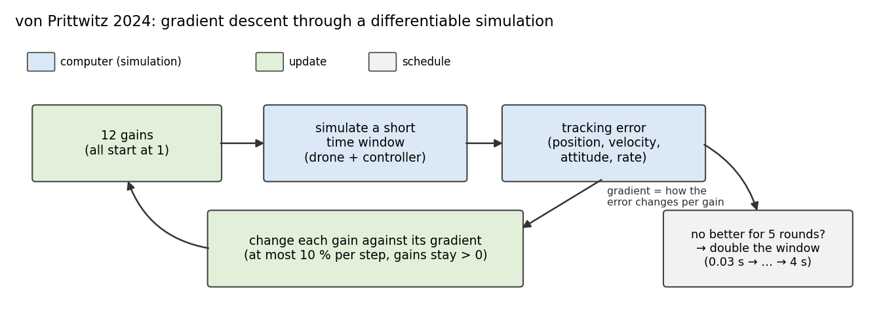
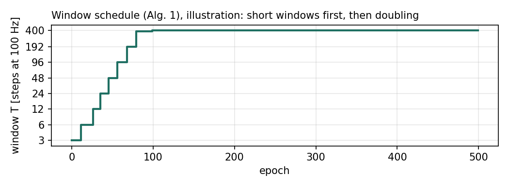
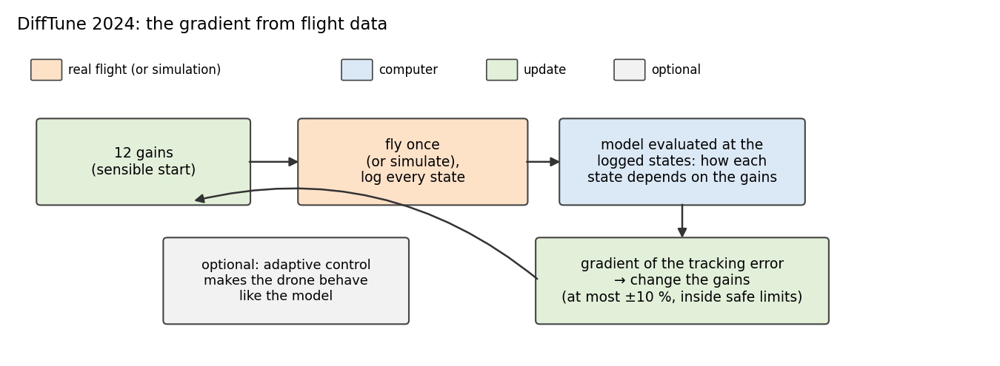
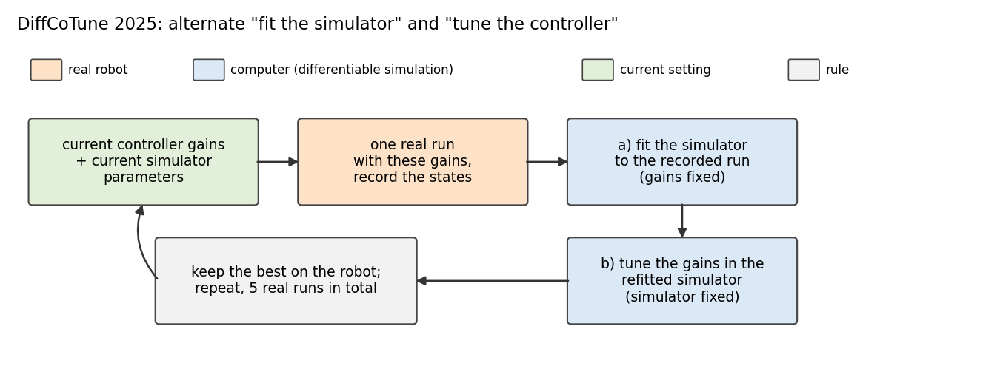
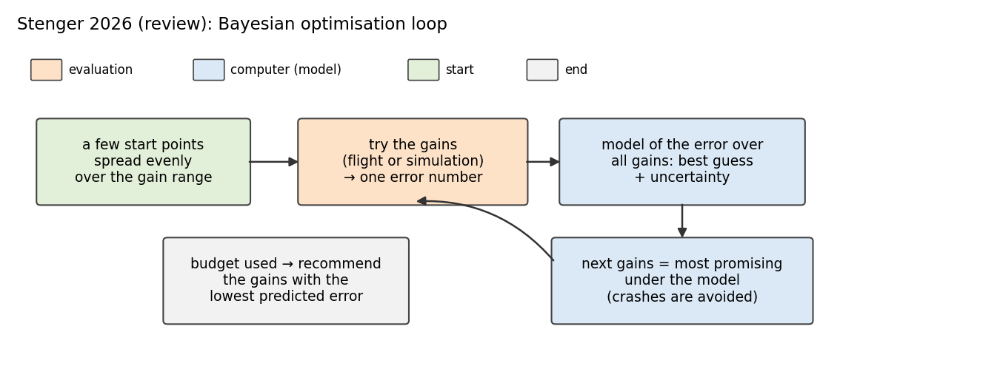
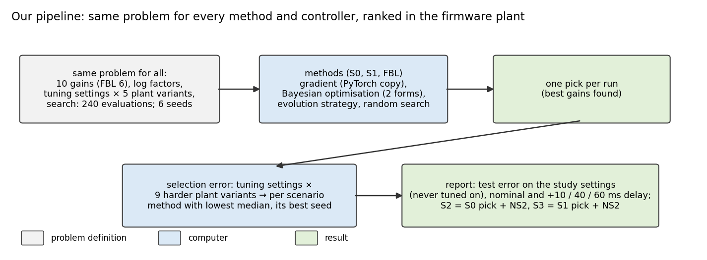
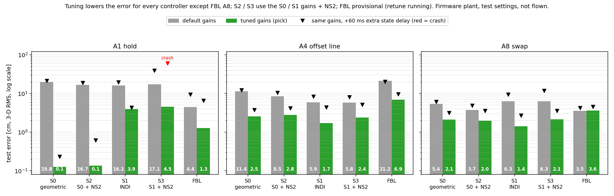
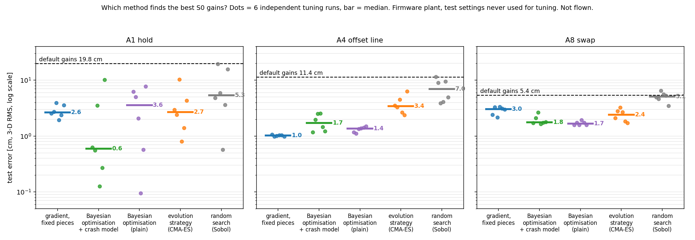
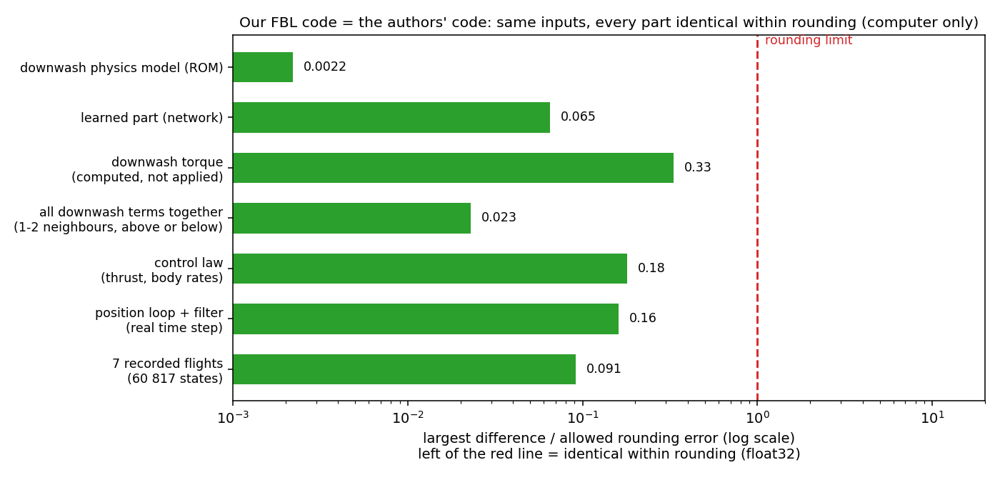

# Meeting Document — 2026-11-05 (updated 2026-11-09)

Deadline: 26 Feb 2027 (~15 weeks left)

## Overview
- **Topic 1 — Auto-tuning (computer only, nothing flown):** four papers, five methods, all controllers
  - **Done:** S0, S1, FBL tuned with all five methods (6 seeds); S2 = S0 gains + NS2, S3 = S1 gains + NS2
  - **Result:** tuning lowers the error everywhere (A1: S0 19.8 → 0.1 cm, S1 16.1 → 3.9, FBL 4.4 → 1.3) except FBL A8; no method is significantly best
  - **Concern:** with tuned gains NS2 adds little
  - **Running:** FBL is retuned with the same inertia as S0–S3; FBL numbers will change; then validation flights
- **Topic 2 — FBL (S4): is our code the authors' code?**
  - **Result:** our FBL code = the authors' code within rounding, same inputs incl. 7 recorded flights (section 8)

**Notation**
- **Gains** = 10 position / attitude parameters (FBL: 6), one set per controller and scenario; **seed** = one repeat of a whole tuning run.
- **Firmware plant** = real firmware controller + our calibrated drone and downwash model, on the computer.
- **Test error** = 3-D RMS position error [cm] on the study settings (the flight settings of the comparative study, never used for tuning);
- **Methods:** gradient (fixed 1.5 s pieces or growing window), Bayesian optimisation (plain, + crash model, + prior), evolution strategy (CMA-ES), random search (Sobol).

---

# Topic 1 — Auto-tuning

## 1. The four papers in one table
| paper | what it tunes | differentiable model? | real flights? | used by us |
|---|---|---|---|---|
| von Prittwitz 2024 | 12 geometric-controller gains | yes | no | yes (gradient) |
| DiffTune 2024 | 12 geometric-controller gains | yes | yes, its main idea (10 flights) | simulation form; flight form planned |
| DiffCoTune 2025 | controller **and** simulator parameters | yes | yes, 5 rollouts | planned (needs flights) |
| Stenger 2026 (Bayesian optimisation review) | any, typically < 10 | no (black box) | optional | yes (Bayesian optimisation + crash model) |

## 2. von Prittwitz 2024: gradient through a differentiable simulation

- **Idea:** gradient of the tracking error with respect to the gains, short windows first (long ones blow up with bad gains).
- **We use:** a PyTorch copy of S0 / S1 / FBL, in two forms: fixed 1.5 s pieces, and their growing window.

## 3. DiffTune 2024: gradient from flight data

- **Idea:** the same gradient, but computed from a real flight: fly once, log the states, evaluate the model along the logged flight, update the gains. After 10 flights the error was 3.5× lower than with the start gains. Warning from the paper: gains tuned longer in simulation only **crashed** their real drone on 2 of 3 trajectories.
- **We use:** so far only the simulation version (the same gradient, computed in our simulator); the real-flight version needs lab flights.

## 4. DiffCoTune 2025: alternate "fit the simulator" and "tune the controller"

- **Idea:** after each real rollout refit the simulator, then retune;
- **We use:** not yet (needs flights; lab plan ready, 36 flights).

## 5. Stenger 2026: Bayesian optimisation for controller tuning

- **We use:** Bayesian optimisation + crash model, and the review's rules (random-search baseline, many seeds, tests across seeds).

## 6. Our pipeline: one problem, five methods

*Same for every method and controller: 6 seeds, 240 evaluations per search run. Pick rule fixed in advance: lowest median selection error, then the best seed.*

## 7. Result: default vs tuned gains, all controllers

| controller | A1 hold | A4 offset line | A8 swap |
|---|---|---|---|
| S0 (geometric) | 19.8 → **0.13** | 11.4 → **2.5** | 5.4 → **2.1** |
| S1 (INDI) | 16.1 → **3.9** | 5.9 → **1.7** | 6.3 → **1.4** |
| S2 (S0 gains + NS2) | 16.7 → **0.14** | 8.5 → **2.8** | 3.7 → **2.0** |
| S3 (S1 gains + NS2) | 17.1 → **4.5** | 5.8 → **2.4** | 6.3 → **2.1** |
| FBL (provisional) | 4.4 → **1.3** | 21.2 → **6.9** | 3.5 → 3.6 |

*Test error in cm, default → tuned pick*

- **Tuning helps everywhere**, except FBL A8 (defaults already good).
- **No method is significantly best** for any controller

### 7.1 Method comparison (test error, median over 6 seeds, nominal)
| method | S0 A1 / A4 / A8 | S1 A1 / A4 / A8 | FBL A1 / A4 / A8 (provisional) |
|---|---|---|---|
| default gains | 19.8 / 11.4 / 5.4 | 16.1 / 5.9 / 6.3 | 4.4 / 21.2 / 3.5 |
| gradient, fixed pieces | 2.6 / **1.0** / 3.0 | 11.9 / 2.3 / 1.9 | 3.0 / 9.6 / 3.6 |
| Bayesian optimisation + crash model | **0.6** / 1.7 / 1.8 | **0.7** / 1.8 / 1.3 | 0.9 / 7.9 / 2.6 |
| Bayesian optimisation (plain) | 3.6 / 1.4 / **1.7** | 0.8 / **1.5** / **1.1** | 0.9 / 8.4 / 2.6 |
| evolution strategy (CMA-ES) | 2.7 / 3.4 / 2.4 | 2.2 / 2.1 / 1.4 | **0.8** / **7.2** / **2.4** |
| random search (Sobol) | 5.3 / 7.0 / 5.1 | 6.1 / 3.3 / 2.7 | 0.9 / 8.5 / 2.7 |

- **Plot (S0):** dots = 6 seeds, bar = median; random search weakest.

### 7.2 What NS2 adds with the same tuned gains
| pair | A1 | A4 | A8 |
|---|---|---|---|
| S0 → S2 | 0.13 → 0.14 | 2.5 → 2.8 | **2.1 → 2.0** |
| S1 → S3 | 3.9 → 4.5 | 1.7 → 2.4 | 1.4 → 2.1 |

*Test error in cm, nominal, paired over 5 noise seeds.*

- **With tuned gains NS2 helps only S0 on A8;** with default gains it helps S0 everywhere (A8 5.4 → 3.7 cm) → tuned gains already remove most of what NS2 corrects.
- **S1 → S3 does not help in the plant, even with default gains,** but it did on hardware (A8 dip −7.1 → −4.0 cm, S0 → S2 −12.7 → −5.6).

### 7.3 Resulting gains per controller and scenario
| gains (S0, S1) | position P (xy / z) | position D (xy / z) | height integral (z) | attitude P (xy / z) | rate P (xy / z) | attitude integral (xy) |
|---|---|---|---|---|---|---|
| **default (hand-tuned, Omar C tree)** | 7.0 / 7.0 | 4.0 / 4.0 | 1.5 | 0.0070 / 0.0080 | 0.00115 / 0.0020 | 0.030 |
| S0 A1 | 1.75 / 9.28 | 1.00 / 5.23 | 6.00 | 0.0083 / 0.0020 | 0.00086 / 0.0005 | 0.120 |
| S0 A4 | 7.37 / 28.0 | 3.00 / 8.42 | 6.00 | 0.0105 / 0.0025 | 0.00129 / 0.00057 | 0.120 |
| S0 A8 | 1.75 / 12.7 | 11.9 / 8.14 | 5.27 | 0.0063 / 0.0022 | 0.00156 / 0.0005 | 0.003 |
| S1 A1 | 15.2 / 3.04 | 11.0 / 9.44 | 3.23 | 0.0062 / 0.0052 | 0.00114 / 0.00060 | 0.087 |
| S1 A4 | 3.32 / 16.0 | 4.86 / 11.6 | 4.39 | 0.0102 / 0.0045 | 0.00132 / 0.00276 | 0.115 |
| S1 A8 | 10.6 / 18.9 | 14.0 / 7.21 | 3.04 | 0.0152 / 0.0028 | 0.00131 / 0.00122 | 0.005 |
| *von Prittwitz 2024, auto-tuned (reference)* | 2.56, 2.48 / 1.01 | 9.51, 11.3 / 1.01 | – | 0.0265, 0.0738 / 0.0001 | 0.0026, 0.0020 / 1e-5 | – |
| *von Prittwitz 2024, hand-tuned (reference)* | 9 / 9 | 7 / 7 | – | 0.0055 / 0.0055 | 0.0013 / 0.0013 | – |

*S2 / S3 use the S0 / S1 gains. Search range: 0.25–4× the default (attitude P and rate P 0.25–3×, integrals 0.1–4×).*

| gains (FBL, provisional) | position P (xy / z) | velocity P (xy / z) | position integral (xy / z) |
|---|---|---|---|
| **default (preset 1, flown 2026-10-26)** | 14.0 / 11.25 | 9.50 / 5.40 | 12.0 / 12.0 |
| FBL A1 | 8.83 / 28.9 | 12.4 / 12.0 | 5.76 / 3.62 |
| FBL A4 | 16.7 / 16.4 | 4.88 / 7.30 | 8.16 / 3.00 |
| FBL A8 | 13.8 / 14.6 | 7.49 / 6.37 | 9.98 / 8.85 |

- **Every scenario gets clearly different gains;** there is no single tuned set.
- **S0 picks: many gains end at the edge of the search range** (A1 6 of 10, A4 3, A8 3; S1 picks: none) → for S0 the best gains may lie outside the range.

---

# Topic 2 — FBL (S4): our code = the authors' code

## 8. Same inputs, same outputs (computer only)
- **Why:** the authors' gains come from their simulation (the gain file sits in their simulator folder, `simulator_multi_python/Controllers/fbl_control.py`) → flying them cannot validate our code, so we check directly that our code is equivalent to the authors' code.
- **How:** the same inputs (state, path, neighbour, gains, mass, network weights) into the authors' unchanged code and into our drone code → compare thrust and body rates.

*Bar = worst difference / allowed float32 rounding error, over random inputs and over the 7 recorded flights of 2026-10-26. Not shown: the torque of the law (not used in flight; the stock rate PID flies) and 17–20 random points near ±90° pitch. Source: `docs/fbl/EQUIVALENCE_CHECK_2026-11-02.md` F10.*

- **Result:** every part identical to the authors' code within float32 rounding (all bars left of the red line).
- **Still different = only our numbers** (gains, mass, C_D, our network weights, ...).

---

## Questions:
- **One gain set per family:** S2 = S0 gains + NS2, S3 = S1 gains + NS2, or should s2 and s3 so both controller with ns2 be specifcally tunes seperately?
- **NS2 on tuned gains:** tuned gains already remove most of what NS2 corrects. Is this then still the right comparison?
- **INDI vs Geometric:** With preivous manual gains from Omar position loop gains were shared for geometric and indi but now with automatic tuned gains it might differ. Should we then use automatically tuned gains or constraint the position gains to be shared and then autotune indis attitude gains only?
- **FBL check:** is the code comparison of section 8 (authors' code vs our code, same inputs, incl. real flight data) enough to call our FBL "the authors' controller with our numbers"?
- **Which autotuning method should we choose**: Which gains from which auto tuning method shall we use as the finalized fair fains across controllers?

## Next Steps:
- **Tuning:** FBL retuned with correct inertia
- **Validation flights of the tuned picks** (S0, S1, S2, S3, FBL)
- **Flight-based methods:** Continue with DiffTune and/or DiffCoTune methods in lab
- **Follow up** Eventual follow ups and feedback and correct regarding auto tuning topic

