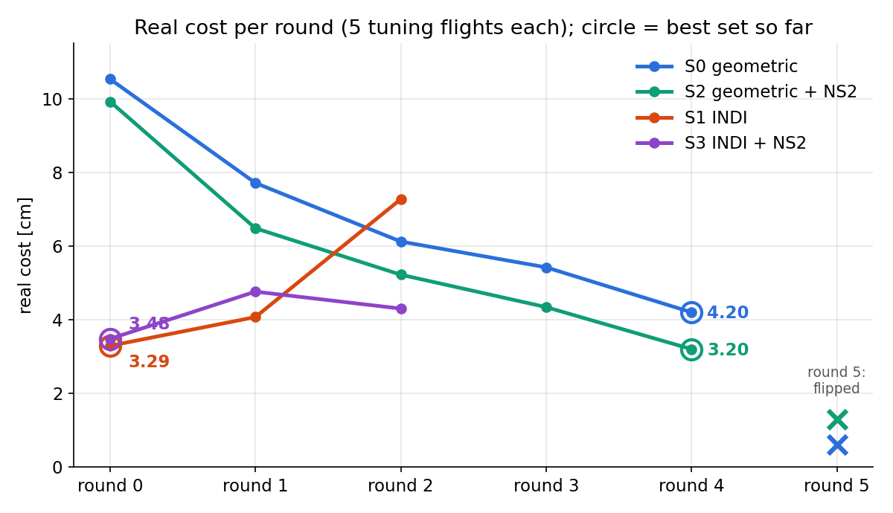
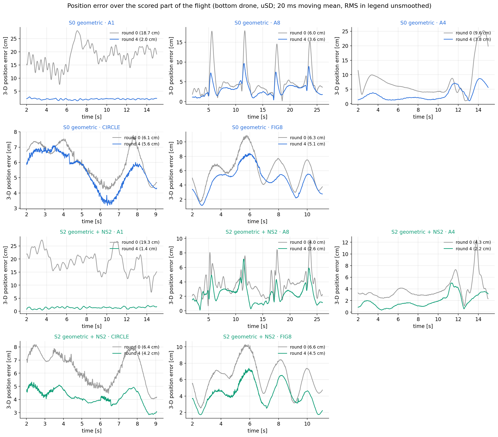
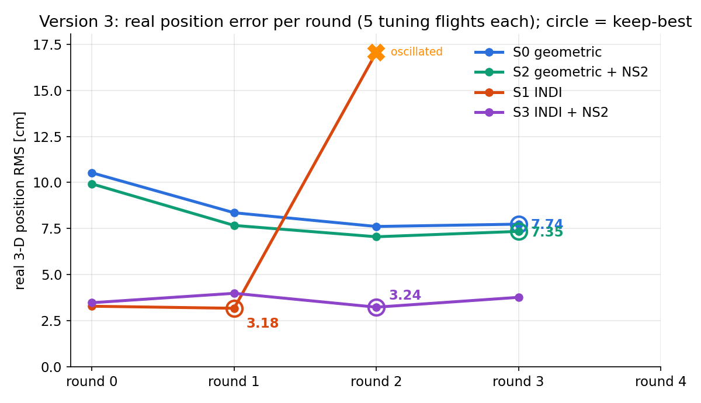
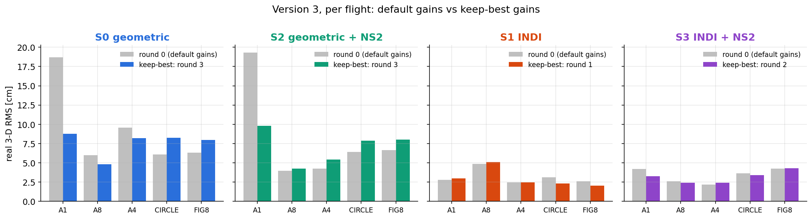
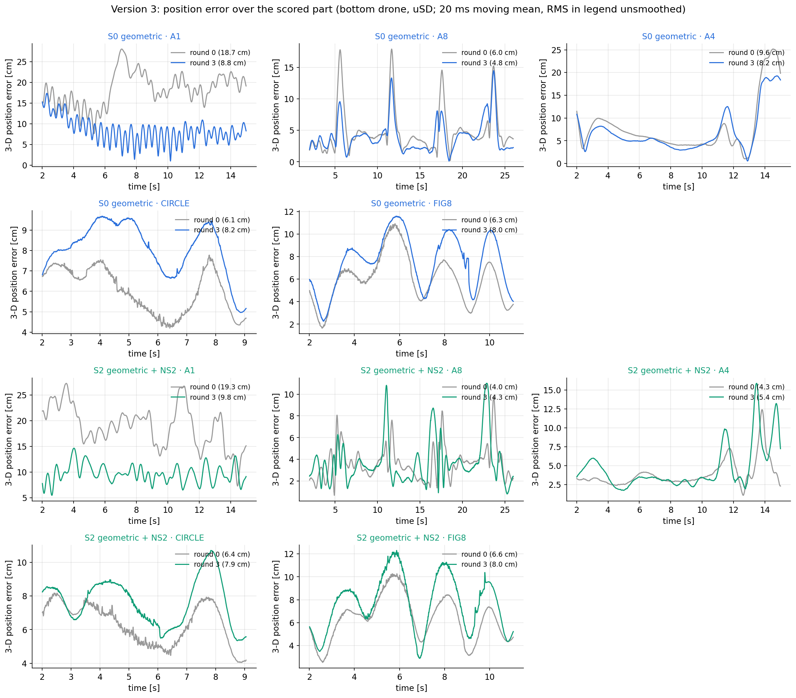
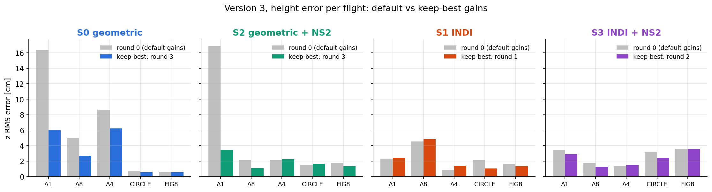
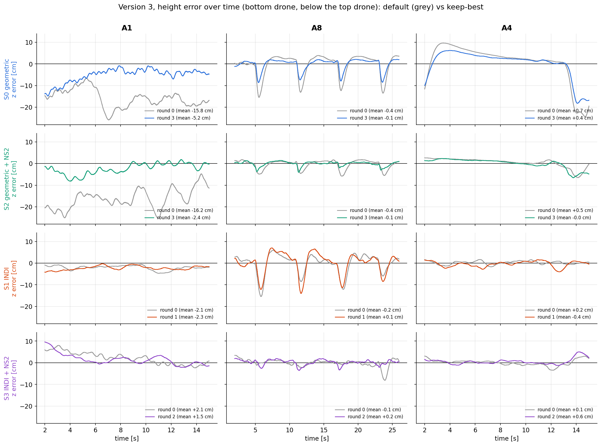

# Meeting Document — 2026-11-26

Deadline: 26 Feb 2027, 13 weeks left

## Overview
- **Auto-tuning with real flights (DiffCoTune) for S0–S3:** one gain set per controller, tuned over 5 scenarios. Each round: 5 real flights, then fit the simulator, then retune the gains.
  - **S0 geometric:** 10.53 → **4.20 cm** after round 4, final
  - **S2 geometric + NS2:** 9.92 → **3.20 cm** after round 4, final
  - **S1 INDI:** the default gains are still best at 3.29 cm. Round 1: 4.07 cm. Round 2: 7.27 cm with a heavy attitude oscillation
  - **S3 INDI + NS2:** the default gains are still best at 3.48 cm. Round 1: 4.76 cm. Round 2: 4.30 cm.
- **Limit found:** S0 and S2 flipped in round 5, and S1 oscillated in round 2.

**Notation**
- **Cost in this document:** real 3-D RMS position error of the bottom drone in cm, over the 5 tuning flights: A1 hold, A8 swap, A4 offset line, CIRCLE and FIG8.
- **Round 0:** the default gains for all four controllers.
- **Keep-best:** the final set is the best flown set, not the last one.
- **Gains:** 10 parameters: position P, D and I, attitude P and I, rate P. x and y are always equal. At most ±25 % change per round.

---

## 1. Result: real cost per round

| | round 0 | round 1 | round 2 | round 3 | round 4 | round 5 | final |
|---|---|---|---|---|---|---|---|
| S0 geometric | 10.53 | 7.71 | 6.12 | 5.42 | **4.20** | flipped | round 4 |
| S2 geometric + NS2 | 9.92 | 6.48 | 5.22 | 4.34 | **3.20** | flipped | round 4 |
| S1 INDI | **3.29** | 4.07 | 7.27, oscillated | | | | open |
| S3 INDI + NS2 | **3.48** | 4.76 | 4.30 | | | | open |

*Cost in cm.*

- **Geometric, S0 and S2: −60 % and −68 %**, better every round until round 5.
- **INDI, S1 and S3:** Rounds 1 and 2 did not beat round 0.

## 2. Per flight: default vs tuned

| | A1 | A8 | A4 | CIRCLE | FIG8 |
|---|---|---|---|---|---|
| S0 round 0 → 4 | 18.70 → **2.02** | 6.01 → **3.60** | 9.57 → **3.76** | 6.08 → **5.56** | 6.30 → **5.09** |
| S2 round 0 → 4 | 19.31 → **1.40** | 3.97 → **2.64** | 4.26 → **2.18** | 6.44 → **4.20** | 6.64 → **4.46** |
| S1 round 0 → 1 → 2 | 2.81 → 5.95 → **2.77** | 4.84 → 5.37 → 4.93 | 2.47 → 2.55 → 7.68 | 3.13 → **2.83** → 6.34 | 2.62 → **2.07** → 11.52 |
| S3 round 0 → 1 → 2 | 4.21 → 8.03 → 6.66 | 2.59 → 2.92 → 2.63 | 2.19 → 2.48 → 2.98 | 3.65 → 4.03 → 3.94 | 4.25 → **4.23** → **4.06** |

*Real 3-D RMS in cm, one flight per cell.*

- **A1 hold:** 18.7 → 2.0 cm for S0 and 19.3 → 1.4 cm for S2.
- **A8 swap:** the error peaks at the crossings are about halved.

## 3. Height error: downwash

| | A1 | A8 | A4 | CIRCLE | FIG8 | A1 mean height error |
|---|---|---|---|---|---|---|
| S0 round 0 → 4 | 16.4 → **0.6** | 5.0 → **2.3** | 8.7 → **2.4** | 0.7 → **0.3** | 0.6 → **0.3** | −15.8 → **−0.2** |
| S2 round 0 → 4 | 16.9 → **0.4** | 2.1 → **1.5** | 2.1 → **0.5** | 1.6 → 1.6 | 1.8 → 1.7 | −16.2 → **−0.1** |
| S1 round 0 → 1 → 2 | 2.3 → 5.8 → 2.4 | 4.5 → 5.1 → **4.2** | 0.8 → 2.2 → 7.3 | 2.1 → **1.8** → 3.4 | 1.6 → **1.0** → 5.1 | −2.1 → −5.6 → **−1.1** |
| S3 round 0 → 1 → 2 | 3.4 → 7.9 → 6.2 | 1.7 → 2.2 → 1.9 | 1.4 → **1.1** → **1.1** | 3.2 → **3.0** → **3.0** | 3.6 → 3.7 → **3.5** | +2.1 → +7.4 → +4.9 |

*Height RMS in cm. Last column: mean height error in A1, negative means too low. Plots show S1 and S3 round 0 vs round 2.*

- **Geometric: the A1 sag of about 16 cm under the top drone is gone after tuning.** The A8 crossing dips of S0 shrink from −15 to −7 cm.
- **INDI: A1 is worse in round 1.** S1 flies too low, S3 too high. S3 is still 4.9 cm too high in round 2.
- **S1 round 2: the height error grows in the moving flights** A4, CIRCLE and FIG8, because of the oscillation.

## 4. Gains
*Flown gains per round, x equal to y. Round 0 is the default, the same for all controllers. KR/Kw is attitude P divided by rate P.*

**S0 geometric**

| round | position P xy / z | position D xy / z | position I z | attitude P xy / z | rate P xy / z | attitude I xy | KR/Kw |
|---|---|---|---|---|---|---|---|
| 0, default | 7.0 / 7.0 | 4.0 / 4.0 | 1.5 | 0.0070 / 0.0080 | 0.00115 / 0.0020 | 0.030 | 6.1 |
| 1 | 6.91 / 7.41 | 3.96 / 5.00 | 1.88 | 0.0084 / 0.0072 | 0.00121 / 0.0017 | 0.027 | 7.0 |
| 2 | 6.86 / 9.01 | 4.73 / 6.14 | 2.34 | 0.0105 / 0.0059 | 0.00102 / 0.0014 | 0.031 | 10.3 |
| 3 | 7.08 / 8.74 | 5.91 / 7.67 | 2.93 | 0.0115 / 0.0059 | 0.00093 / 0.0013 | 0.038 | 12.4 |
| **4, final** | 8.85 / 10.9 | 7.39 / 9.50 | 3.66 | 0.0144 / 0.0073 | 0.00114 / 0.0016 | 0.048 | 12.7 |
| 5, flipped | 11.1 / 13.7 | 9.24 / 11.5 | 4.58 | 0.0178 / 0.0091 | 0.00113 / 0.0020 | 0.060 | 15.7 |

**S2 geometric + NS2**

| round | position P xy / z | position D xy / z | position I z | attitude P xy / z | rate P xy / z | attitude I xy | KR/Kw |
|---|---|---|---|---|---|---|---|
| 0, default | 7.0 / 7.0 | 4.0 / 4.0 | 1.5 | 0.0070 / 0.0080 | 0.00115 / 0.0020 | 0.030 | 6.1 |
| 1 | 8.20 / 6.09 | 3.29 / 4.05 | 1.88 | 0.0088 / 0.0082 | 0.00126 / 0.0019 | 0.027 | 6.9 |
| 2 | 7.47 / 4.95 | 4.07 / 4.19 | 2.34 | 0.0109 / 0.0087 | 0.00103 / 0.0017 | 0.033 | 10.6 |
| 3 | 9.34 / 5.23 | 5.09 / 3.40 | 2.84 | 0.0123 / 0.0069 | 0.00103 / 0.0016 | 0.041 | 12.0 |
| **4, final** | 11.7 / 6.53 | 6.36 / 4.25 | 3.31 | 0.0148 / 0.0056 | 0.00123 / 0.0012 | 0.051 | 12.0 |
| 5, flipped | 14.6 / 8.17 | 7.95 / 5.29 | 4.05 | 0.0185 / 0.0062 | 0.00126 / 0.0016 | 0.064 | 14.6 |

**S1 INDI**, best so far: round 0

| round | position P xy / z | position D xy / z | position I z | attitude P xy / z | rate P xy / z | attitude I xy | KR/Kw |
|---|---|---|---|---|---|---|---|
| 0, default | 7.0 / 7.0 | 4.0 / 4.0 | 1.5 | 0.0070 / 0.0080 | 0.00115 / 0.0020 | 0.030 | 6.1 |
| 1 | 8.75 / 5.60 | 5.00 / 5.00 | 1.88 | 0.0088 / 0.0072 | 0.00132 / 0.0021 | 0.038 | 6.6 |
| 2, oscillated | 10.9 / 5.74 | 6.25 / 6.25 | 2.29 | 0.0109 / 0.0090 | 0.00138 / 0.0022 | 0.047 | 7.9 |

**S3 INDI + NS2**, best so far: round 0

| round | position P xy / z | position D xy / z | position I z | attitude P xy / z | rate P xy / z | attitude I xy | KR/Kw |
|---|---|---|---|---|---|---|---|
| 0, default | 7.0 / 7.0 | 4.0 / 4.0 | 1.5 | 0.0070 / 0.0080 | 0.00115 / 0.0020 | 0.030 | 6.1 |
| 1 | 6.52 / 6.63 | 4.23 / 3.84 | 1.45 | 0.0074 / 0.0083 | 0.00107 / 0.0019 | 0.032 | 6.9 |
| 2 | 6.63 / 6.74 | 4.16 / 3.90 | 1.48 | 0.0073 / 0.0084 | 0.00109 / 0.0020 | 0.031 | 6.7 |

---

## Version 3 overview, 24 Nov
- **Auto-tuning with real flights, version 3:** position + attitude cost, angular rate in the simulator fit, RPM delay fitted for INDI, ±10 % step per round. Round 0 reuses the round 0 flights from above.
  - **S0 geometric:** 10.53 → **7.74 cm** after round 3, round 4 gains ready
  - **S2 geometric + NS2:** 9.92 → **7.35 cm** after round 3, round 4 gains ready
  - **S1 INDI:** best is round 1 at 3.18 cm. Round 2 oscillated at about 3–4 Hz, 17.05 cm. S1 is paused.
  - **S3 INDI + NS2:** best is round 2 at 3.24 cm. Round 3: 3.77 cm. Round 4 gains ready.
- **S1 paused:** on the real drone the attitude responds with only about 0.55 of the torque INDI calculates from the motor RPM. In the simulator this ratio is 1.0, so the simulator does not see the oscillation. Fix in progress.

**Notation**
- **Cost in version 3:** position error plus attitude error. Keep-best uses this cost. Tables show the 3-D position RMS in cm and the attitude error in degrees, mean of the 5 tuning flights, uSD logs only.
- **Gains:** at most ±10 % change per round.

## 5. Version 3 result: real cost per round

| | round 0 | round 1 | round 2 | round 3 | round 4 | keep-best |
|---|---|---|---|---|---|---|
| S0 geometric | 10.53 / 13.6° | 8.36 / 12.8° | 7.61 / 10.8° | **7.74 / 10.6°** | gains ready | round 3 |
| S2 geometric + NS2 | 9.92 / 15.2° | 7.67 / 13.3° | 7.06 / 11.2° | **7.35 / 10.2°** | gains ready | round 3 |
| S1 INDI | 3.29 / 3.9° | **3.18 / 4.0°** | 17.05 / 18.1°, oscillated | paused | | round 1 |
| S3 INDI + NS2 | 3.48 / 5.2° | 3.99 / 3.6° | **3.24 / 3.6°** | 3.77 / 4.3° | gains ready | round 2 |

*Position RMS in cm / attitude error. Keep-best by the total cost, so S0 and S2 round 3 win on attitude while round 2 has the lower position error.*

- **Geometric, S0 and S2: −26 % position error and −22 % to −33 % attitude error after 3 rounds.** Smaller steps than version 1, so slower.
- **INDI: S3 improves slightly, S1 oscillated in round 2.**

## 6. Version 3 per flight: default vs tuned

| | A1 | A8 | A4 | CIRCLE | FIG8 |
|---|---|---|---|---|---|
| S0 round 0 → 3 | 18.70 → **8.77** | 6.01 → **4.83** | 9.57 → **8.23** | 6.08 → 8.25 | 6.30 → 7.98 |
| S2 round 0 → 3 | 19.31 → **9.80** | 3.97 → 4.25 | 4.26 → 5.45 | 6.44 → 7.85 | 6.64 → 8.03 |
| S1 round 0 → 1 → 2 | 2.81 → 2.99 → 3.05 | 4.84 → 5.08 → 17.81 | 2.47 → 2.47 → 8.56 | 3.13 → **2.33** → 23.22 | 2.62 → **2.06** → 22.69 |
| S3 round 0 → 1 → 2 → 3 | 4.21 → **2.88** → **3.24** → 4.37 | 2.59 → 5.03 → **2.42** → 3.06 | 2.19 → 2.58 → 2.42 → 2.67 | 3.65 → 4.38 → **3.42** → 3.82 | 4.25 → 4.49 → 4.30 → 4.57 |

*Real 3-D RMS in cm, one flight per cell.*

- **A1 hold:** 18.7 → 8.8 cm for S0 and 19.3 → 9.8 cm for S2.
- **CIRCLE and FIG8 get worse for S0 and S2,** by 1.4–2.2 cm. Cause not checked yet.

## 7. Version 3 height error: downwash

| | A1 | A8 | A4 | CIRCLE | FIG8 | A1 mean height error |
|---|---|---|---|---|---|---|
| S0 round 0 → 3 | 16.4 → **6.0** | 5.0 → **2.7** | 8.7 → **6.2** | 0.7 → **0.5** | 0.6 → 0.6 | −15.8 → **−5.2** |
| S2 round 0 → 3 | 16.9 → **3.4** | 2.1 → **1.1** | 2.1 → 2.2 | 1.6 → 1.6 | 1.8 → **1.3** | −16.2 → **−2.4** |
| S1 round 0 → 1 → 2 | 2.3 → 2.5 → 2.8 | 4.5 → 4.8 → 17.7 | 0.8 → 1.4 → 8.4 | 2.1 → **1.0** → 22.5 | 1.6 → **1.3** → 22.1 | −2.1 → −2.3 → +0.0 |
| S3 round 0 → 1 → 2 → 3 | 3.4 → **2.5** → **2.9** → 3.8 | 1.7 → 4.6 → **1.2** → 2.4 | 1.4 → **1.0** → 1.5 → 1.8 | 3.2 → 3.5 → **2.4** → **2.8** | 3.6 → 3.7 → **3.5** → 3.6 | +2.1 → −0.4 → +1.5 → +2.9 |

*Height RMS in cm over the scored part of the flight. Last column: mean height error in A1, negative means too low. Plots show round 0 vs keep-best.*

- **Geometric: the A1 sag of about 16 cm shrinks to 5.2 cm for S0 and 2.4 cm for S2.** The A8 crossing dips of S0 shrink from about −15 to −8 cm.
- **INDI: height error stays small,** except S1 round 2 because of the oscillation.

## 8. Version 3 gains
*Flown and tuned gains per round, x equal to y. Round 0 is the default, the same for all controllers. KR/Kw is attitude P divided by rate P.*

**S0 geometric**

| round | position P xy / z | position D xy / z | position I z | attitude P xy / z | rate P xy / z | attitude I xy | KR/Kw |
|---|---|---|---|---|---|---|---|
| 0, default | 7.0 / 7.0 | 4.0 / 4.0 | 1.5 | 0.0070 / 0.0080 | 0.00115 / 0.0020 | 0.030 | 6.1 |
| 1 | 6.30 / 7.70 | 3.60 / 4.40 | 1.64 | 0.0075 / 0.0077 | 0.00127 / 0.0019 | 0.027 | 5.9 |
| 2 | 5.67 / 8.47 | 3.56 / 4.82 | 1.80 | 0.0082 / 0.0078 | 0.00123 / 0.0019 | 0.026 | 6.7 |
| **3, keep-best** | 5.24 / 9.32 | 3.76 / 5.31 | 1.87 | 0.0088 / 0.0074 | 0.00122 / 0.0017 | 0.027 | 7.2 |
| 4, tuned, flies next | 4.71 / 10.2 | 3.90 / 5.65 | 2.06 | 0.0090 / 0.0071 | 0.00124 / 0.0016 | 0.028 | 7.3 |

**S2 geometric + NS2**

| round | position P xy / z | position D xy / z | position I z | attitude P xy / z | rate P xy / z | attitude I xy | KR/Kw |
|---|---|---|---|---|---|---|---|
| 0, default | 7.0 / 7.0 | 4.0 / 4.0 | 1.5 | 0.0070 / 0.0080 | 0.00115 / 0.0020 | 0.030 | 6.1 |
| 1 | 6.59 / 7.66 | 3.60 / 4.18 | 1.65 | 0.0076 / 0.0072 | 0.00127 / 0.0021 | 0.028 | 6.0 |
| 2 | 6.69 / 6.89 | 3.24 / 3.76 | 1.82 | 0.0082 / 0.0065 | 0.00139 / 0.0023 | 0.025 | 5.9 |
| **3, keep-best** | 6.32 / 6.20 | 2.92 / 4.13 | 2.00 | 0.0090 / 0.0058 | 0.00152 / 0.0021 | 0.022 | 5.9 |
| 4, tuned, flies next | 6.95 / 6.07 | 2.62 / 4.55 | 2.20 | 0.0098 / 0.0052 | 0.00162 / 0.0019 | 0.022 | 6.0 |

**S1 INDI**, paused

| round | position P xy / z | position D xy / z | position I z | attitude P xy / z | rate P xy / z | attitude I xy | KR/Kw |
|---|---|---|---|---|---|---|---|
| 0, default | 7.0 / 7.0 | 4.0 / 4.0 | 1.5 | 0.0070 / 0.0080 | 0.00115 / 0.0020 | 0.030 | 6.1 |
| **1, keep-best** | 7.70 / 6.30 | 4.40 / 3.60 | 1.65 | 0.0077 / 0.0088 | 0.00118 / 0.0022 | 0.033 | 6.5 |
| 2, oscillated | 8.19 / 5.67 | 4.84 / 3.96 | 1.82 | 0.0085 / 0.0097 | 0.00106 / 0.0024 | 0.036 | 8.0 |
| 3, tuned, not flown | 8.31 / 6.24 | 5.32 / 3.56 | 2.00 | 0.0078 / 0.0087 | 0.00095 / 0.0022 | 0.040 | 8.2 |

**S3 INDI + NS2**

| round | position P xy / z | position D xy / z | position I z | attitude P xy / z | rate P xy / z | attitude I xy | KR/Kw |
|---|---|---|---|---|---|---|---|
| 0, default | 7.0 / 7.0 | 4.0 / 4.0 | 1.5 | 0.0070 / 0.0080 | 0.00115 / 0.0020 | 0.030 | 6.1 |
| 1 | 6.93 / 6.93 | 4.04 / 3.96 | 1.49 | 0.0071 / 0.0079 | 0.00114 / 0.0020 | 0.030 | 6.2 |
| **2, keep-best** | 6.95 / 7.19 | 4.04 / 3.95 | 1.37 | 0.0071 / 0.0078 | 0.00116 / 0.0020 | 0.030 | 6.1 |
| 3 | 6.33 / 7.55 | 4.45 / 4.31 | 1.35 | 0.0075 / 0.0086 | 0.00105 / 0.0019 | 0.033 | 7.2 |
| 4, tuned, flies next | 6.33 / 7.93 | 4.45 / 4.28 | 1.41 | 0.0073 / 0.0083 | 0.00105 / 0.0018 | 0.034 | 6.9 |

---

## Simulator: what must match the real drone
Each part of the loop (controller → motors → drone → sensors → estimate) is measured in the real uSD logs and set in the simulator. One simulator for all four controllers.

| Part | Real value (measured) | Status |
|---|---|---|
| Motor force per command | linear; simulator was 1.75× too strong | done |
| Motor lag | 30 ms, same up and down | done |
| Per-motor thrust differences | 0.96–1.04 | done |
| Battery compensation in firmware | added | done |
| Drone mass | 41.1 g (weighed 41.0 g; code had 42.7 g) | done |
| Drone inertia, roll and pitch | 1.8× the firmware value | done |
| Rotor reaction torque (yaw) | causes a 29 Hz yaw oscillation on INDI | done |
| Downwash force between drones | refitted | done |
| Downwash tilt torque | refitted, 3× smaller | done |
| Gyro filters | 5 ms | done |
| Gyro noise | 1.9 °/s | done |
| RPM measurement delay | 3.8 ms | done |
| RPM measurement noise | per motor | done |
| Attitude estimate delay | 5 ms | done |
| Controller code and parameters | identical to the flown firmware | done |
| Battery voltage sag | negligible | checked |
| Other aerodynamic torques | real = simulator within 4 % | checked |
| Motor force at low command | real higher than the firmware curve | in progress |
| Yaw oscillation | size matches; 33.7 Hz vs real 29.1 Hz | in progress |
| Accelerometer filter | 30 Hz in firmware, missing in simulator | in progress |
| Position estimate | motion capture at 45 Hz | not yet in the simulator |
| Accelerometer noise | simulator 2× too high | not yet fixed |
| Gyro chip internal filter | assumed | not checked |
| Snap feed-forward in closed loop | – | not checked |

- **Test:** 16 real flown gain sets from all three versions, 5 scenarios each. Calm sets must stay calm, oscillating sets must oscillate. Geometric sets must rank as on the real drone.
- **Geometric (S0, S2):** passes. No crashes, gain sets ranked as on the real drone.
- **INDI (S1, S3):** calm sets calm. With the low-command motor force, the simulator frequency matches the real one (3.4 Hz), but the oscillation dies out too fast, so the bad sets are not flagged yet.

---

## Next Steps:
- **Fit the simulator and close the sim-to-real gap for INDI (S1, S3):** the simulator does not yet reproduce the real INDI behaviour. Geometric (S0, S2) already matches for both.
- **Once that is done, redo the auto-tuning** for all controllers S0–S3 on the corrected simulator.
