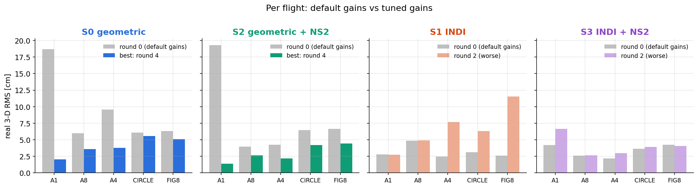
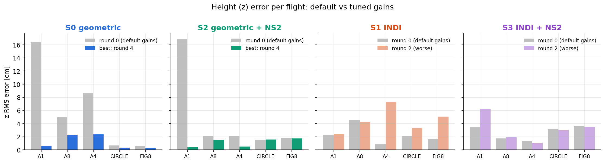
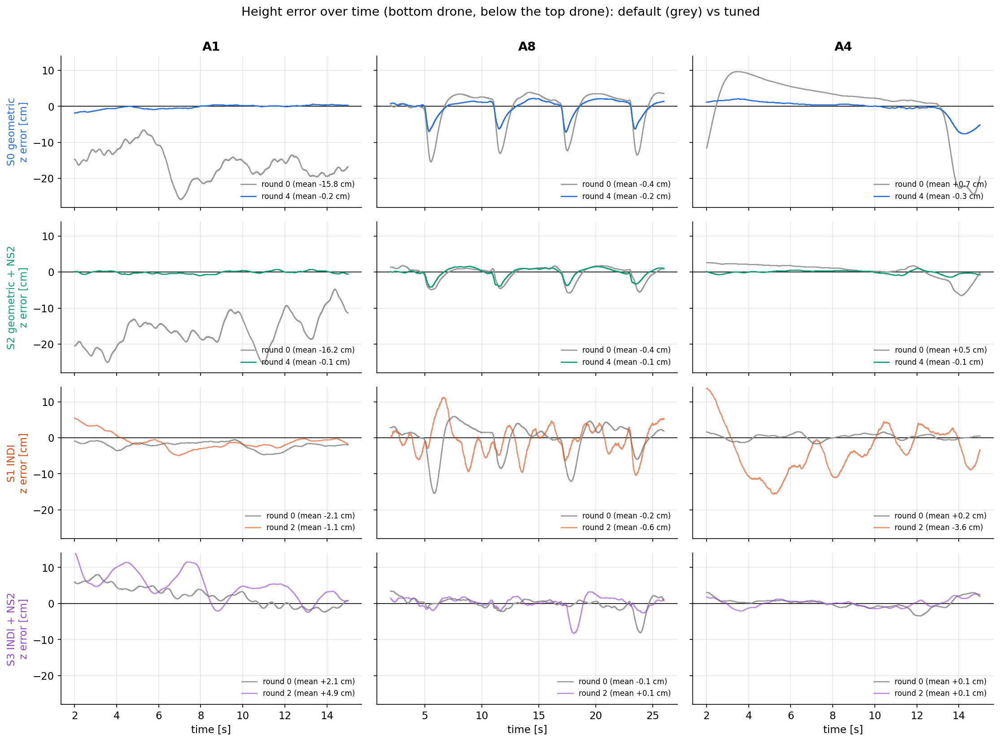
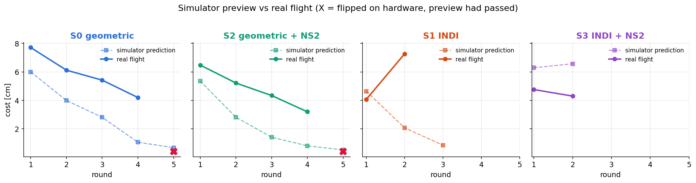
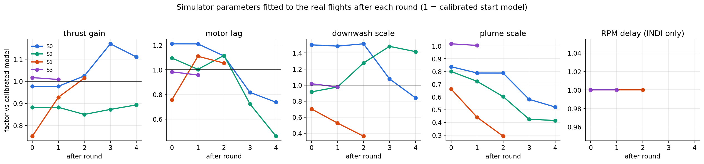
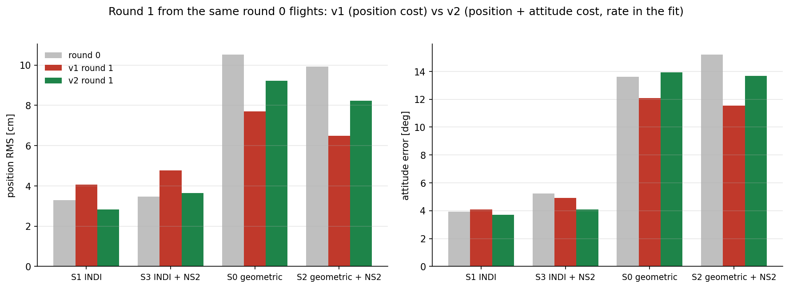

# Meeting Document — 2026-11-26

Deadline: 26 Feb 2027 (~13 weeks left)

## Overview
- **Auto-tuning with real flights (DiffCoTune), S0–S3:** one gain set per controller, tuned over 5 scenarios, each round = 5 real flights → fit the simulator → retune
  - **S0 geometric:** 10.53 → **4.20 cm** (round 4, final)
  - **S2 geometric + NS2:** 9.92 → **3.20 cm** (round 4, final)
  - **S1 INDI:** best still the default set, 3.29 cm (round 1: 4.07, round 2: 7.27 with a ~4 Hz attitude oscillation)
  - **S3 INDI + NS2:** best still the default set, 3.48 cm (round 1: 4.76, round 2: 4.30)
- **Limit found:** round 5 flipped on hardware for S0 and S2 (attitude gain ratio KR/Kw ≈ 15), S1 round 2 oscillated (tilt up to 61°); the simulator preview had passed all three
- **Protocol change (23 Nov):** cost = position + attitude error, simulator fit adds angular rate, RPM delay fitted for INDI. First try at ±25 % step (23 Nov evening): S1 round 2 again reached the oscillating gains → step limit now ±10 % (as DiffTune). All results below are the old protocol (position-only cost)
- **Lab fixes (done):** uSD logging was silently dead since a lab-PC ROS reinstall (fixed in crazyswarm2); Omar C INDI now reads DShot RPM like the Rust code (new image on both drones)

**Notation**
- **Cost (all data in this doc)** = real 3-D RMS position error [cm] of the bottom drone, RMS over the 5 tuning flights (A1 hold, A8 swap, A4 offset line, CIRCLE, FIG8), uSD logs only.
- **Cost from 23 Nov (new protocol)** = position error + attitude error; the 3-D position RMS is still reported.
- **Round 0** = default gains (Omar C tree), the same for all four controllers. **Keep-best** = the final set is the best flown set, not the last one.
- **Gains** = 10 parameters (position P/D/I, attitude P/I, rate P); x and y always equal; at most ±25 % change per round.

---

## 1. Result: real cost per round

| | round 0 | round 1 | round 2 | round 3 | round 4 | round 5 | final |
|---|---|---|---|---|---|---|---|
| S0 geometric | 10.53 | 7.71 | 6.12 | 5.42 | **4.20** | flipped | round 4 |
| S2 geometric + NS2 | 9.92 | 6.48 | 5.22 | 4.34 | **3.20** | flipped | round 4 |
| S1 INDI | **3.29** | 4.07 | 7.27 (oscillated) | | | | open |
| S3 INDI + NS2 | **3.48** | 4.76 | 4.30 | | | | open |

*Cost in cm.*

- **Geometric (S0, S2): −60 % and −68 %**, better every round until round 5.
- **INDI (S1, S3): already good with default gains;** rounds 1–2 did not beat round 0.

## 2. Per flight: default vs tuned

| | A1 | A8 | A4 | CIRCLE | FIG8 |
|---|---|---|---|---|---|
| S0 round 0 → 4 | 18.70 → **2.02** | 6.01 → **3.60** | 9.57 → **3.76** | 6.08 → **5.56** | 6.30 → **5.09** |
| S2 round 0 → 4 | 19.31 → **1.40** | 3.97 → **2.64** | 4.26 → **2.18** | 6.44 → **4.20** | 6.64 → **4.46** |
| S1 round 0 → 1 → 2 | 2.81 → 5.95 → **2.77** | 4.84 → 5.37 → 4.93 | 2.47 → 2.55 → 7.68 | 3.13 → **2.83** → 6.34 | 2.62 → **2.07** → 11.52 |
| S3 round 0 → 1 → 2 | 4.21 → 8.03 → 6.66 | 2.59 → 2.92 → 2.63 | 2.19 → 2.48 → 2.98 | 3.65 → 4.03 → 3.94 | 4.25 → **4.23** → **4.06** |

*Real 3-D RMS in cm, one flight per cell.*

- **A1 hold:** 3-D error 18.7 → 2.0 cm (S0) and 19.3 → 1.4 cm (S2).
- **A8 swap:** the crossing peaks are roughly halved.

## 3. Height (z) error: downwash

| | A1 | A8 | A4 | CIRCLE | FIG8 | A1 mean z error |
|---|---|---|---|---|---|---|
| S0 round 0 → 4 | 16.4 → **0.6** | 5.0 → **2.3** | 8.7 → **2.4** | 0.7 → **0.3** | 0.6 → **0.3** | −15.8 → **−0.2** |
| S2 round 0 → 4 | 16.9 → **0.4** | 2.1 → **1.5** | 2.1 → **0.5** | 1.6 → 1.6 | 1.8 → 1.7 | −16.2 → **−0.1** |
| S1 round 0 → 1 → 2 | 2.3 → 5.8 → 2.4 | 4.5 → 5.1 → **4.2** | 0.8 → 2.2 → 7.3 | 2.1 → **1.8** → 3.4 | 1.6 → **1.0** → 5.1 | −2.1 → −5.6 → **−1.1** |
| S3 round 0 → 1 → 2 | 3.4 → 7.9 → 6.2 | 1.7 → 2.2 → 1.9 | 1.4 → **1.1** → **1.1** | 3.2 → **3.0** → **3.0** | 3.6 → 3.7 → **3.5** | +2.1 → +7.4 → +4.9 |

*z RMS in cm over the scored part of the flight; last column = A1 mean z error (negative = too low). Plots: S1/S3 round 0 vs round 2.*

- **Geometric (S0, S2): the A1 sag under the top drone (≈ −16 cm) is gone after tuning;** A8 crossing dips S0 −15 → −7 cm.
- **INDI: A1 worse in round 1** (S1 too low, S3 too high); S3 round 2 still too high (+4.9 cm). **S1 round 2: z error up in the moving flights** (A4, CIRCLE, FIG8) because of the oscillation.

## 4. Gains
*Flown gains per round (x = y). Round 0 = default, the same for all controllers.*

**S0 geometric**

| round | pos P xy / z | pos D xy / z | pos I z | att P xy / z | rate P xy / z | att I xy | KR/Kw |
|---|---|---|---|---|---|---|---|
| 0 (default) | 7.0 / 7.0 | 4.0 / 4.0 | 1.5 | 0.0070 / 0.0080 | 0.00115 / 0.0020 | 0.030 | 6.1 |
| 1 | 6.91 / 7.41 | 3.96 / 5.00 | 1.88 | 0.0084 / 0.0072 | 0.00121 / 0.0017 | 0.027 | 7.0 |
| 2 | 6.86 / 9.01 | 4.73 / 6.14 | 2.34 | 0.0105 / 0.0059 | 0.00102 / 0.0014 | 0.031 | 10.3 |
| 3 | 7.08 / 8.74 | 5.91 / 7.67 | 2.93 | 0.0115 / 0.0059 | 0.00093 / 0.0013 | 0.038 | 12.4 |
| **4 (final)** | 8.85 / 10.9 | 7.39 / 9.50 | 3.66 | 0.0144 / 0.0073 | 0.00114 / 0.0016 | 0.048 | 12.7 |
| 5 (flipped) | 11.1 / 13.7 | 9.24 / 11.5 | 4.58 | 0.0178 / 0.0091 | 0.00113 / 0.0020 | 0.060 | 15.7 |

**S2 geometric + NS2**

| round | pos P xy / z | pos D xy / z | pos I z | att P xy / z | rate P xy / z | att I xy | KR/Kw |
|---|---|---|---|---|---|---|---|
| 0 (default) | 7.0 / 7.0 | 4.0 / 4.0 | 1.5 | 0.0070 / 0.0080 | 0.00115 / 0.0020 | 0.030 | 6.1 |
| 1 | 8.20 / 6.09 | 3.29 / 4.05 | 1.88 | 0.0088 / 0.0082 | 0.00126 / 0.0019 | 0.027 | 6.9 |
| 2 | 7.47 / 4.95 | 4.07 / 4.19 | 2.34 | 0.0109 / 0.0087 | 0.00103 / 0.0017 | 0.033 | 10.6 |
| 3 | 9.34 / 5.23 | 5.09 / 3.40 | 2.84 | 0.0123 / 0.0069 | 0.00103 / 0.0016 | 0.041 | 12.0 |
| **4 (final)** | 11.7 / 6.53 | 6.36 / 4.25 | 3.31 | 0.0148 / 0.0056 | 0.00123 / 0.0012 | 0.051 | 12.0 |
| 5 (flipped) | 14.6 / 8.17 | 7.95 / 5.29 | 4.05 | 0.0185 / 0.0062 | 0.00126 / 0.0016 | 0.064 | 14.6 |

**S1 INDI** (best: round 0)

| round | pos P xy / z | pos D xy / z | pos I z | att P xy / z | rate P xy / z | att I xy | KR/Kw |
|---|---|---|---|---|---|---|---|
| 0 (default) | 7.0 / 7.0 | 4.0 / 4.0 | 1.5 | 0.0070 / 0.0080 | 0.00115 / 0.0020 | 0.030 | 6.1 |
| 1 | 8.75 / 5.60 | 5.00 / 5.00 | 1.88 | 0.0088 / 0.0072 | 0.00132 / 0.0021 | 0.038 | 6.6 |
| 2 (oscillated) | 10.9 / 5.74 | 6.25 / 6.25 | 2.29 | 0.0109 / 0.0090 | 0.00138 / 0.0022 | 0.047 | 7.9 |

**S3 INDI + NS2** (best: round 0)

| round | pos P xy / z | pos D xy / z | pos I z | att P xy / z | rate P xy / z | att I xy | KR/Kw |
|---|---|---|---|---|---|---|---|
| 0 (default) | 7.0 / 7.0 | 4.0 / 4.0 | 1.5 | 0.0070 / 0.0080 | 0.00115 / 0.0020 | 0.030 | 6.1 |
| 1 | 6.52 / 6.63 | 4.23 / 3.84 | 1.45 | 0.0074 / 0.0083 | 0.00107 / 0.0019 | 0.032 | 6.9 |
| 2 | 6.63 / 6.74 | 4.16 / 3.90 | 1.48 | 0.0073 / 0.0084 | 0.00109 / 0.0020 | 0.031 | 6.7 |

## 5. Simulator vs real

- **The simulator gets the trend right but is too optimistic** (S0 round 4: predicted 1.06, real 4.20 cm).
- **It does not see the instabilities** (S0/S2 round 5 flipped, S1 round 2 oscillated: predicted 2.07, real 7.27 cm).
- **S1:** round 1 predicted 4.64, real 4.07 (close). **S3:** round 1 predicted 6.29, real 4.76; round 2 predicted 6.57, real 4.30; for INDI the simulator overpredicts A1 (≈ 18 cm vs 4–8 cm real).

### 5.1 Fitted simulator parameters

| after round | thrust gain | motor lag | downwash scale | plume scale | RPM delay |
|---|---|---|---|---|---|
| S0: 0 → 4 | 0.98 → 1.11 | 1.21 → 0.74 | 1.50 → 0.84 | 0.84 → 0.52 | – |
| S2: 0 → 4 | 0.88 → 0.89 | 1.10 → 0.46 | 0.92 → 1.42 | 0.80 → 0.42 | – |
| S1: 0 → 1 → 2 | 0.75 → 0.93 → 1.02 | 0.76 → 1.11 → 1.06 | 0.70 → 0.53 → 0.36 | 0.66 → 0.44 → 0.29 | 1.00 (fixed) |
| S3: 0 → 1 | 1.02 → 1.01 | 0.98 → 0.96 | 1.02 → 0.98 | 1.02 → 1.00 | 1.00 (fixed) |

*Factor relative to the calibrated start model (1 = unchanged), fitted to all real flights so far.*

| parameter | what it is | in the simulator (per motor / per step) |
|---|---|---|
| thrust gain $k_T$ | thrust a motor makes for a given command | $F_{target} = k_T\,(u/u_{hover})^2$, capped at $F_{max}$ |
| motor lag $\tau_m$ | how fast the motor reaches that thrust | $F \leftarrow F + \frac{\Delta t}{\tau_m+\Delta t}(F_{target}-F)$, $\Delta t$ = 1 ms |
| downwash scale $s_{dw}$ | strength of the top drone's downward air push | $F_z = s_{dw}\, m\, a_z^{NS2}(\Delta p, \Delta v)$, only while the top drone is above |
| plume scale $s_{pl}$ | strength of the push on each rotor when off-centre under the top drone (tilts the drone) | $\Delta F_k = -s_{pl} A_0 \left(\frac{0.4}{\Delta z_k}\right)^{n} e^{-\rho_k^2/2\sigma^2}$ |
| RPM delay $d$ (INDI only) | age of the measured motor speed INDI uses | $\omega_{meas}(t) = \omega(t-d)$ |

*$u$ = motor command, $m$ = mass, $a_z^{NS2}$ = downwash acceleration predicted by the NS2 network (simulator side), $\Delta z_k$, $\rho_k$ = vertical and horizontal distance of rotor $k$ to the top drone.*

- **The fit has not settled yet:** S0 and S2 fit the same drone pair with different downwash values (0.84 vs 1.42).
- **S3: the fit barely moves** → round 2 gains differ by only ±1.7 %. S3 round 2 fit not completed (desk step stopped for the protocol change).
- **S1: downwash and plume scale keep falling** (0.70 → 0.36, 0.66 → 0.29).

## 6. Version 2: position + attitude cost (first round, 23 Nov)

| | round 0 | v1 round 1 | v2 round 1 |
|---|---|---|---|
| S1 INDI | 3.29 cm / 3.9° | 4.07 cm / 4.1° | **2.82 cm / 3.7°** |
| S3 INDI + NS2 | 3.48 cm / 5.2° | 4.76 cm / 4.9° | **3.65 cm / 4.1°** |
| S0 geometric | 10.53 cm / 13.6° | **7.71 cm / 12.1°** | 9.23 cm / 13.9° |
| S2 geometric + NS2 | 9.92 cm / 15.2° | **6.48 cm / 11.5°** | 8.22 cm / 13.7° |

*Same round 0 flights for v1 and v2; position RMS / attitude error, mean of the 5 tuning flights.*

- **Version 1:** position cost, ±25 % step. **Version 2:** + attitude in the cost, + angular rate in the simulator fit, + RPM delay fitted (INDI), ±25 % step. **Version 3:** version 2 with the DiffTune step limit ±10 %.
- **INDI improves in round 1 with version 2** (S1 now beats its default set for the first time); geometric improves less than with version 1.
- **S1 round 2 (version 2) oscillated again (operator observation, logs pending)** → version 3: ±10 % step; rounds 1–5 and keep-best next.

---

## Next Steps:
- **Redo the auto-tuning for all controllers (S0–S3) with version 3:** step limit ±10 % instead of ±25 %, rounds 1–5, keep-best
