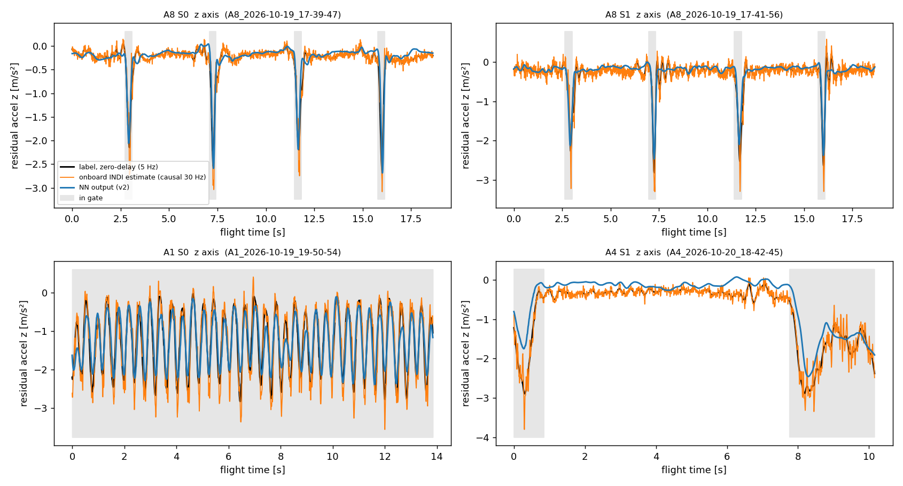
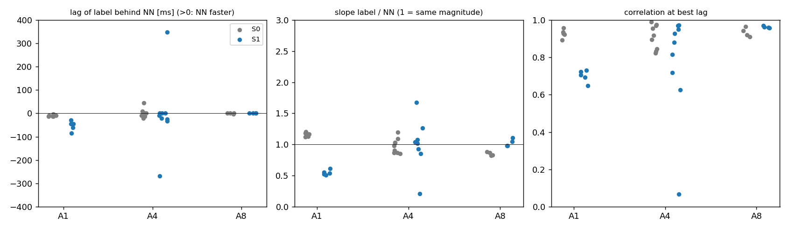

# NN output vs INDI estimate — offline check (Task 2, step 1, 2026-10-22)

Black = zero-delay label (raw a_imu − a_rpm, offline filtfilt 5 Hz), orange = onboard INDI estimate (causal 30 Hz), blue = logged NN output (ns2 v2), grey = in the NS2 gate. Bottom drone, 37 flights with the NN **not** applied (S0 geometric, S1 INDI; under S2/S3 the label is what is left after the NN). Medians per cell, z axis, 5 Hz:

| cell | flights | corr | lag of label behind NN | slope label/NN | mean NN / mean label [m/s²] |
|---|---|---|---|---|---|
| A8 S0 / S1 (gate) | 4 / 4 | 0.93 / 0.96 | 0 / 0 ms | 0.85 / 1.01 | −1.24 / −1.36 and −1.11 / −1.31 |
| A1 S0 | 6 | 0.93 | −10 ms | 1.17 | −1.27 / −1.42 |
| A1 S1 | 5 | 0.71 | −44 ms | 0.54 | −2.41 / −2.77 |
| A4 S0 / S1 (gate) | 9 / 9 | 0.92 / 0.88 | 0 / −8 ms | 0.98 / 1.02 | −1.12 / −1.72 and −0.39 / −0.82 |

- The NN follows the zero-delay label closely in magnitude and timing (corr 0.9–0.96, lag within ±10 ms, slope ≈ 1) in A8, A1 S0 and A4; it is **not** faster than the zero-delay label, it is in phase with it. The onboard causal INDI estimate lags that label by 0–8 ms and is much noisier.
- Weakest: A1 under INDI (corr 0.71, NN level 13 % low) and two A4 S1 flights (corr 0.07 / 0.63, few gate samples). A4 level is 30–50 % low in the gate.
- NN predicts the z component only (x, y outputs are 0, the labels there are small: RMS 0.2–0.3 m/s²).
- The labels differ between strategies at the same setting only through the geometry (A1 S1 holds the gap at 0.5 m, S0 sags to ≈ 0.7 m), the NN reproduces that.
- Reconstruction check: rebuilt INDI estimate vs the onboard-logged one on 39 INDI flights: RMS 0.03 m/s² (max 0.07), corr 0.996.
- **Limit:** these flights are new but their settings are inside the v2 training set (dz 0.5, 0.5 m/s), so this is a quality check, not a generalisation test (step 2).

Code: `experiments/analysis/nn_vs_indi_raw.py` (system python, bindings, cache not committed) and `nn_vs_indi_check.py`; data `experiments/results/nn_vs_indi_2026-10-22/` (`per_flight.csv`, `summary_z_5Hz.csv`).
