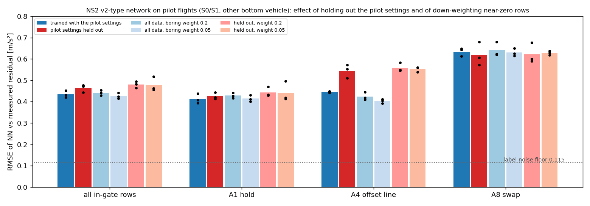

# NS2: do the pilot settings overfit, and does down-weighting boring rows help? (Task 2, steps 2–3, 2026-10-22)

Networks of the v2 type (same architecture, 40 epochs, 3 seeds each, bars = mean, dots = seeds) scored on the **37 pilot flights without the NN applied** (S0/S1: label = measured residual; a different bottom vehicle and new flights, so v2 was never in-sample on them). "Held out" = trained on 59 of the 73 flights without the pilot settings (A8 dz 0.5 at 0.5 m/s, A1 dz 0.5, all A4 and A9). "Boring weight" = rows with |a_res| < 0.3 m/s² (54 % of the data) count with weight 0.2 or 0.05 in the loss.

| in-gate RMSE [m/s²] | all | A1 hold | A4 offset | A8 swap |
|---|---|---|---|---|
| trained with the pilot settings (= v2 recipe) | 0.435 ± 0.017 | 0.414 | 0.446 | 0.635 |
| pilot settings held out | 0.464 ± 0.018 | 0.426 | **0.545** | 0.619 |
| all data, boring weight 0.05 | 0.426 ± 0.014 | 0.415 | 0.403 | 0.630 |
| held out, boring weight 0.05 | 0.479 ± 0.034 | 0.442 | 0.553 | 0.628 |

- **Overfit to the tested settings is small for A1 (+3 %) and A8 (none), clear for A4 (+22 %)** — A4 and A9 (8 flights) were removed as a whole family there, so this is the pessimistic case. S2/S3 numbers in A1 and A8 are not inflated by the overlap; A4 somewhat.
- **Down-weighting boring rows gives at most a small gain** (0.435 → 0.426 with all data, within the seed spread of ±0.015; no gain when the settings are held out). Not a reason to retrain.
- The recipe is reproducible: the retrain with all 73 flights and seed 0 gives exactly the v2 numbers.
- Limits: offline error only (no closed-loop flights); the metric uses the causal 30 Hz label (noise floor ≈ 0.115 m/s²); one architecture, 3 seeds; boring weights tested: 0.2 and 0.05 (no hard subsampling, no weighting by input-space coverage).

Code: `experiments/analysis/ns2_heldout_pilot_study.py` (trains and scores, `--seed`), `ns2_heldout_plot.py`, `flying_drone_stack/tools/residual/train.py` (new `--boring-weight`, default 1 = unchanged); data `experiments/results/ns2_heldout_2026-10-22/results.json` (weights not committed, regenerate).
