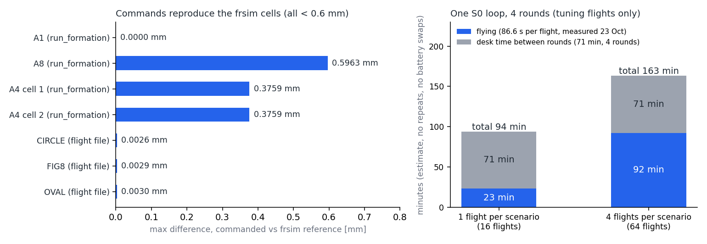

# Stage 4c report: proposals for the open protocol points (S0, DiffCoTune; 13 Nov 2026)

> **CORRECTED in Stage 4d (13 Nov):** the pad windows and findings 3 and 5 below took the file origin as the hover point. That is wrong: `startTrajectory(relative=True)` shifts the trajectory so that its first point sits at the hover point (`crazyflie-firmware planner.c:335–348`). The correct windows are in `dryrun/stage4d/report_stage4d.md`: the unturned CIRCLE does NOT fit at the cf5 pad (0.0, 0.3) (x window [0.50, 1.00] m; the check of Stage 4c wrongly passed it), OVAL does not fit (x [0.31, 1.00], y ±0.20 m), FIG8 fits. The "setpoint step" open point does not exist (the firmware shift removes it). The table `P1` rows for CIRCLE and OVAL and the `fly_file.py` text of this report are superseded; the user decisions of 13 Nov (circle turned by 90°, OVAL dropped) are in the protocol draft.

Desk only. Nothing flown, no drone or radio connection, nothing changed in `crazyswarm2`, `flying_drone_stack`, `simulator` (read only; `find` shows no file in crazyswarm2 newer than 15:00 today). The earlier stray `cat >` shell was my mistake; no such command was used again.

New files: `lab/cmd_check.py` (+ `results/cmd_check.json`), `lab/apply_gains.py`, `lab/fly_file.py`, `dryrun/stage4c/plot_stage4c.py`, `lab/figs/stage4c_checks_and_time.png`. Same text as in the protocol draft, section "Proposals for the open points (Stage 4c)".

## 1. P1: cell → command, rotate_deg, reference check

| Cell | Role | Command (lab PC, CS2 running) | `--rotate` | `rotate_deg` for `flights.json` | Reference check (commanded vs frsim) |
|---|---|---|---|---|---|
| A1 dz 0.375, hold 15 s | tuning | `ros2 run crazyflie_examples run_formation --scenario A1 --dz 0.375 --hold 15.0 --height 0.5 --auto-center --yes` | none | 0 (not observable, hover) | bottom path 0.0000 mm, top − bottom 0.0000 mm, dz 0.375 / 0.375, start z 0.500 / 0.500, 15.0 / 15.0 s |
| A8 dz 0.375, 8 s per pass, 2 passes | tuning | `… run_formation --scenario A8 --dz 0.375 --duration 8.0 --passes 2 --height 0.5 --auto-center --yes` | none | 0 | bottom 0.298 mm, top − bottom 0.596 mm, dz 0.375 / 0.375, z 0.500 / 0.500, 18.0 / 18.0 s |
| CIRCLE r 0.75, period 7.065 s | tuning | `python3 experiments/diffcotune/lab/fly_file.py --cell CIRCLE` (proposal, P3; = `simple_flight --trajectory circle --height 1.0` with `circle_frsim_tuning_mode1.csv`; `cf_second` disabled) | none | 0 | file vs frsim 0.0026 mm (Stage 4a `checks.json`), start z 1.0 / 1.0 |
| FIG8 a 0.92, period 9.064 s | tuning | `python3 experiments/diffcotune/lab/fly_file.py --cell FIG8` (file turned by +90°; `cf_second` disabled) | in the file: +90 | **−90** (Stage 4a: fitted −89.99999971) | file 0.0029 mm |
| A4 cell 1 dz 0.4, offset 0.125, 0.35 m/s, line | test | `… run_formation --scenario A4 --dz 0.4 --speed 0.35 --offset 0.125 --motion line --rotate 90 --height 0.5 --auto-center --yes` | 90 | **−90** (23 Oct: fitted −90.0 on 4 of 4 A4 flights) | bottom 0.376 mm, top − bottom 0.376 mm, dz 0.4 / 0.4, z 0.500 / 0.500, 15.0 / 15.0 s |
| A4 cell 2 offset 0.075 | test | same, `--offset 0.075` | 90 | −90 | 0.376 mm / 0.376 mm, same |
| OVAL a 0.655, b 1.8, period 12.69 s | test | `python3 experiments/diffcotune/lab/fly_file.py --cell OVAL` (`cf_second` disabled) | none | 0 | file 0.0030 mm; **pad window y ±0.2 m, see finding 3** |

1. **A8 passes:** the frsim cells have 2 passes. The 23 Oct command had `--passes 4` (27 s flown); its first 14.5 s equal the study cell (0.05 mm). The tuning cell needs `--passes 2` (18 s, exact). `--speed 0.2734375` gives the same curve as `--duration 8.0` (`run_formation` converts 35/16·span/speed, `scenarios.py`).
2. **Heights:** run_formation scenarios `--height 0.5` (frsim bottom start z = 0.5, top 0.5 + dz); solo files `--height 1.0` (the files hold z = reference − 1.0, default of `simple_flight`).
3. **OVAL does not fit at the present pad position.** The file spans y ±1.8 m about the hover point (hover point = `initial_position` + `--height`; `startTrajectory` is relative). Flight space y ±2.0 m (`safety.FLIGHT_SPACE`) → pad y must be in [−0.2, +0.2] m; cf5 has `initial_position: [0.0, 0.3, 0.0]` in `crazyflies.yaml` → 0.1 m outside. `fly_file.py --cell OVAL --check --pad 0.0 0.3` fails; CIRCLE and FIG8 pass (windows x ±0.25 / ±0.54, y ±1.25 / ±1.08). `simple_flight.py` has no fence check in the part I read (lines 215–540). Pad windows: `lab/fly_file.py --check`.
4. **Existing files cannot be used:** no `data/<shape>_mode1_kt*.csv` has the cell duration (nearest: circle 0.68 s, figure 8 0.70 s, oval 1.62 s off). Hence the Stage 4a flight files and P3.
5. **Not clear from the files:** the circle and oval files start at +0.75 / +0.655 m in x (file frame), as the existing circle and oval files do; with a relative start that is a setpoint step from the hover point. How earlier circle flights handled it is not stated in what I read → open.
6. **rotate_deg convention:** the ingest value is the negative of the lab `--rotate` (A4 `--rotate 90` → fitted −90.0). Proposal: leave `rotate_deg` empty in `flights.json` so the ingest fits it, and compare the fitted value with the table (a difference above 1° means a wrong command).

How the check was done: command line parsed by `crazyflie_examples.run_formation.build_parser()` (imported read-only, no bytecode), `scenarios.build`, `poly4d.compile_curve` + `poly4d.evaluate` (what the drone flies), compared on the 1 ms grid over scenario time 0 … scenario_s with `reference.build` (bottom path relative to its start, turned back by −rotate; top − bottom vector; start z). `safety.check` at the centred anchor and `check_spec` report no problems for all run_formation cells. The 0.3–0.6 mm of A8 and A4 is the Poly4D fit tolerance of `compile_curve` (2 mm tolerance), not a parameter difference.

## 2. P2: how the gain file is applied

| | A. yaml merge per round (recommended) | B. set over the radio before the CS2 launch | C. set from a CS2 client while CS2 runs |
|---|---|---|---|
| Steps | `apply_gains.py merge --fragment S0/round_<l>/gains.yaml --yaml <crazyflies.yaml>` (checks that only the 15 `ctrlOmarIndi` values of cf5 changed, writes `<yaml>.new`); put it in place; `lab_check_strategy.py`; launch CS2; read the `Update parameter` lines; then the firmware readback (CS2 stopped, `apply_gains.py readback`, relaunch) | CS2 stopped: `apply_gains.py set --uri radio://0/80/2M/E7E7E7BB02 --fragment …` (writes, reconnects, reads back), then launch CS2 | a ROS script with `cf.setParam(...)` (like `set_param.py`); not written |
| Why it works | the yaml is what CS2 applies on launch (`firmware_params`); same routine as the 23 Oct and 26 Oct blocks (patch, `lab_check_strategy.py`, launch) | no yaml edit | no radio stop |
| Risk of a wrong gain set | merge script verifies the 15 keys and that nothing else changed (tested on a copy of the present `crazyflies.yaml`); stale install copy is caught by `lab_check_strategy.py`; a power cycle may drop RAM values if CS2 does not re-push the yaml on reconnect (not stated) → readback after every battery swap | the later CS2 launch re-applies the yaml's own `Kpos_Iz` (1.5) and `indi` → the tuned `Kpos_Iz` would be overwritten unless the cf5 yaml has no `Kpos_Iz` line; values lost at a power cycle | readback only from the server cache, not from the firmware |
| Time per round | stop / launch times are not recorded in the repository → not stated (2 launches per round with the readback, 3 if CIRCLE / FIG8 need `cf_second` disabled) | 1 radio session (~15 values × 0.1 s + reconnects) + 1 launch; not measured | not stated |
| Readback | firmware, fresh connection (cflib's `get_value` after a set on the same connection is a cache: `fbl_prime_controller.py`, memory note 2026-10-24) | built in (same code) | none independent |

Facts behind it: (1) `controller_omar_indi.c` (crazyflie-firmware `ccb0606d`, read only): `controllerOmarIndiInit` does `*self = g_self` and the boot call is `controllerOmarIndiInit(&g_self)` → no-op for the gains, so switching to controller 9 does not reset `KR_*`, `Kw_*`, `Kpos_*`, `KI_*` (the earlier wipe was `fbl_defaults()` for `ctrlFbl.*`). The image on the drones was not checked → the readback covers it. (2) The 15 gains are not in the uSD log: `usd_study_config.txt` has no `ctrlOmarIndi.KR|Kw|Kpos` line; 12 of the 15 exist as firmware log variables (not `Kpos_Iz`, `KI_x`, `KI_y`), but the file already has about 100 entries (memory: 96-variable cap) → a per-flight readback in the log would mean removing others (not done). (3) `crazyflies.yaml` as read: cf5 block has `ctrlOmarIndi: indi 0, Kpos_Iz 1.5` and no other gain.

**Recommendation: A.** It is the routine of the earlier blocks (yaml, `lab_check_strategy.py`, launch), the yaml is what CS2 applies again, and the merge script checks that exactly the 15 gains of cf5 change. The firmware readback adds the independent check that the cflib cache and the launch output cannot give. Script: `lab/apply_gains.py` (`merge`, `readback`, `set`); `merge` was run on a copy of the present `crazyflies.yaml` (15 values merged, nothing else differs, `Kpos_Iz` 1.5 → 1.875 for round 1 of the dry test); the comparison logic was tested with float32 values (all pass; a 1 % error in `Kw_x` is caught). `readback` and `set` import cflib and were **not run** (no drone, not tested on hardware).

## 3. P3: file names

Proposal: **wrapper, nothing copied** (`lab/fly_file.py`, not tested with ROS or on hardware; `--check` runs without ROS and passed for CIRCLE and FIG8, and failed for OVAL at pad y = 0.3).

| Way | What | Cost |
|---|---|---|
| **Wrapper (proposed)** | `simple_flight._csv_path(trajectory, kt)` returns `DATA_DIR/<trajectory>_mode1_kt<kt>.csv`; `fly_file.py` replaces that one function in memory by the file in `experiments/diffcotune/flightfiles/`, runs `simple_flight.main()` with `--trajectory circle\|figure8\|oval --kt <label> --height 1.0`. kt labels 0.0007 / 0.0008 / 0.0009 (no existing file uses them; the label only names the log and meta) | nothing in crazyswarm2 changes; needs the CS2/ROS python of the lab PC |
| Copy with the expected name | `cp flightfiles/circle_frsim_tuning_mode1.csv <install>/crazyflie_examples/data/circle_mode1_kt0.0007.csv` and `--kt 0.0007` | the installed `data/` is a real directory (copy from 3 Sep), the scripts there are symlinks → the file goes into the install tree (or a rebuild) = a change in crazyswarm2's install, at lab time |
| New flag `--file` in `simple_flight.py` | one argument | a change to a crazyswarm2 script; not done |

Also: the solo cells need `cf_second` disabled in the yaml (`set_tree_strategy.py <S> --solo` does that; `simple_flight` flies the same trajectory with every enabled drone). `simple_flight` has `--height` (default 1.0 = the file's reference), `--speed` (timescale, keep 1.0), `--reps` (1).

## 4. P4: remaining points

**Flights per scenario and order (point 1)**

| Option | Flights per round | 4 rounds | Flying time at 86.6 s per flight | Source |
|---|---|---|---|---|
| 1 flight per scenario | 4 | 16 | 23 min | sim loop (`loop_lib.fly_set`, 1 flight per scenario per round); protocol draft step 6 |
| 4 flights per scenario | 16 | 64 | 92 min | `docs/diffcotune_lab_plan_2026-11-02.md` §3 (4 per scenario; that plan had 3 scenarios × 4 × 3 rounds = 36) |
| bound with repeats (attempt ≤ 3) | up to 12 (n = 1) / 48 (n = 4) | up to 48 / 192 | 69 / 277 min | `round.py` (2 repeats per flight) |

Rate: 86.6 s per flight = mean spacing of the 10 flight stamps of the S0 block of 23 Oct (74–95 s; includes launch and landing; no battery or card change is recorded in that span, not stated whether there was none). `docs/comparative_study_protocol.md` §4 estimates 12 flights per hour (10-09, with 3 flashes and card swaps) = 300 s per flight, the other end.

Order (proposal, no rule): sim order is A1, A8, CIRCLE, FIG8 (`loop_lib.TUNING`). A1 and A8 fly with both drones, CIRCLE and FIG8 with `cf_second` disabled, so grouping A1, A8 | CIRCLE, FIG8 costs one yaml change and launch per round; the 23 Oct block went A4, A8, A1 (checklist). Test cells (A4 ×2, OVAL): number of flights not stated; the study protocol has 5 clean flights per cell (§4).

**Gain readback (point 4):** follows P2: firmware readback with `apply_gains.py readback` after the launch of every round and after every battery swap; not available from the uSD log (above).

**Battery rule for repeats (point 6): existing rules only**

| Rule | Source |
|---|---|
| fresh batteries, rest ≥ 4.1 V; swap if either drone < 4.0 V, or after the flights agreed at the shakedown | `docs/comparative_study_protocol.md` §4 |
| note the resting voltage before every flight; ≥ 2 fresh packs per drone per block; INDI strategies: a fresh pack per INDI flight (S0 is not INDI) | `docs/lab_sessions/ns2_unseen_block_checklist.md` §0, `next_session_plan.md` item 4 ("proposal, to be confirmed") |
| change below ≈ 4.1 V resting (four S2 flights were lost to 2.6 V cut-offs) | `next_session_plan.md` |
| fresh batteries, `vbat` logged | `docs/diffcotune_lab_plan_2026-11-02.md` §3 |
| **not stated:** flights per pack for S0, time limit per battery, whether a repeat gets a fresh pack, the voltage limit for a repeat, whether pack changes during a round are allowed | open |

## 5. P5: lab time for one S0 loop

| Round | Tuning flights (1 per scenario) | Flying | Desk time before the next round | Basis |
|---|---|---|---|---|
| 0 (default gains) | 4 | 5.8 min | 20.1 min | desk: dry test round 0, 1209 s (measured) |
| 1 | 4 | 5.8 min | 20.5 min | dry test round 1, 1232 s (measured) |
| 2 | 4 | 5.8 min | about 20.3 min | mean of the two (estimate) |
| 3 (last, no β fit) | 4 | 5.8 min | about 10 min | protocol draft: tune only, about half (estimate) |
| **Total, 1 flight per scenario** | **16** | **23 min** | **71 min** | **94 min** (estimate) |
| Total, 4 flights per scenario | 64 | 92 min | 71 min | 163 min (estimate) |
| Plus final test flights | not stated (3 with 1 each, 15 with 5 each) | 4.3 / 21.6 min | – | estimate |
| Plus repeats | none expected from 23 Oct (10 of 10 flights usable, no floor flag); bound 48 flights = 69 min (n = 1) | – | – | estimate |

Not in the table (not stated): CS2 stop / launch, yaml change, readback, battery changes, card checks (`docs/lab_sessions/ns2_unseen_block_checklist.md` §0), the pilot's time. The desk step of round l needs the files of round l, so it cannot overlap with flying; the next round's flights wait for it.

## 6. Still open

1. Which of the options in P2 (recommended: A) and P3 (recommended: wrapper); whether `crazyflies.yaml` changes go on a branch / tag per round.
2. Flights per scenario (1 or 4), the number of test flights, scenario order and grouping.
3. OVAL: pad position within y ±0.2 m (cf5 `initial_position` is y = 0.3 now), or drop OVAL from the test set, or fly it with a different pad.
4. The start of the circle and oval files (+0.75 / +0.655 m step from the hover point) — how it was handled before is not stated.
5. Battery rule for S0 and repeats (list above).
6. Times not in the repository: CS2 stop / launch, yaml change, readback, battery change.
7. Whether CS2 re-pushes the yaml on a reconnect after a power cycle (decides if a readback after each battery swap is enough); whether the image on the drones has the same init as the source read.
8. Nothing here was run with ROS or on hardware: `apply_gains.py readback|set` and `fly_file.py` (without `--check`) are untested; `apply_gains.py merge` and the commands' scenario build were run on the desk (copy of the yaml, in-memory scenario build).
