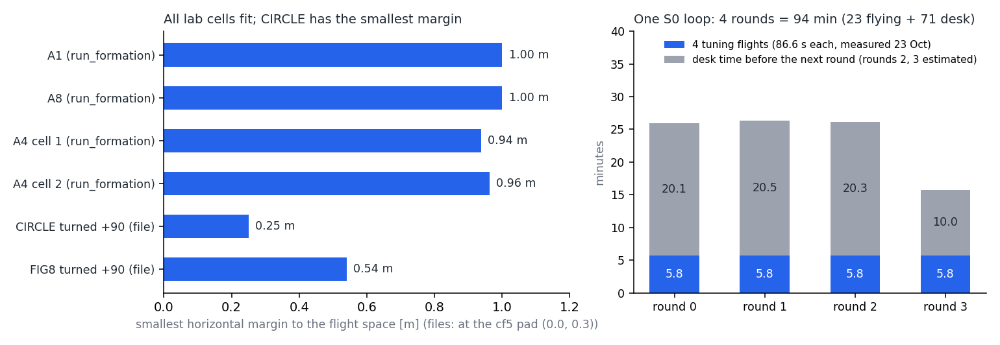

# Stage 4d report: pad windows corrected, turned circle, decisions written in (S0, DiffCoTune; 13 Nov 2026)

Desk only. Nothing flown, no drone or radio connection, nothing copied into or changed in `crazyswarm2`, `flying_drone_stack`, `simulator`, `crazyflie-firmware` (read only). No shell waiting on standard input was used.

## 1. The fixed check

The error was mine (Stage 4a margins and Stage 4c windows took the file origin as the hover point). Verified in the source: `crazyflie_py/crazyflie.py:417–419` (`relative=True` default) and `crazyflie-firmware/src/modules/src/planner.c:335–348` (`shift = start_from − traj_eval(t_begin).pos`). Path about the hover point = file − file(0).

Table for the current files (`lab/circle_turn_choice.py`, `lab/fly_file.py --check`; flight space x ±1.0, y ±2.0, z 0–1.70 m; cf5 pad (0.0, 0.3) and cf_second pad (0.0, −0.3) as read from the crazyswarm2 yaml):

| File | Path about the hover point | Pad x window | Pad y window | cf5 pad (0.0, 0.3) | Matches your table (≤ 1 cm) |
|---|---|---|---|---|---|
| CIRCLE unturned | x −1.50…0, y ±0.75 | [0.50, 1.00] | [−1.25, 1.25] | **outside** (margin −0.50 m) | yes |
| FIG8 (turned +90°) | x ±0.46, y ±0.92 | [−0.54, 0.54] | [−1.08, 1.08] | ok (margin 0.54 m) | yes |
| OVAL | x −1.31…0, y ±1.8 | [0.31, 1.00] | [−0.20, 0.20] | **outside** (x −0.31, y −0.10 m) | yes |
| CIRCLE turned +90° (new) | x ±0.75, y −1.50…0 | [−0.25, 0.25] | [−0.50, 2.00] | ok (margin 0.25 m) | – |

The check now also tests the z window at `--height` (1.0 m: 1.0 m to the floor, 0.7 m to the ceiling), the number of pieces (≤ 31) and prints the margins and the horizontal distance to the cf_second pad; `fly_file.py` refuses to fly when it fails. OVAL is refused with a message. The old check passed CIRCLE; the new one fails it (tested on the old file by a temporary override).

**Places that were wrong, now corrected**

| Place | Was | Now |
|---|---|---|
| `lab/fly_file.py` (docstring, `check()`) | file origin = hover point | path about the hover point, cites `planner.c:335–348`; CIRCLE → turned file, OVAL refused |
| `flightfiles/make_flightfiles.py`, `checks.json` | Stage 4a `margin_m` about the origin (CIRCLE 0.25 / 1.25, FIG8 0.54 / 1.08, OVAL 0.345 / 0.20; and `start_world` = file + height) | `volume()`: path about the hover point, pad windows, margins at the cf5 pad, distance to the cf_second pad, `lab_use` per file. The three Stage 4a CSV files are byte-identical after the rerun (`cmp`) |
| protocol draft: "Flight files" table | the Stage 4a margins | corrected table with windows (and the turned circle) |
| `lab/figs/flightfiles_volume.png` (`lab/plot_protocol.py`) | files drawn from the file origin | paths drawn from the cf5 pad, old circle and oval marked outside |
| `dryrun/stage4c/report_stage4c.md`, protocol draft Stage 4c section, `docs/diffcotune_spec.md` item 32 | "CIRCLE and FIG8 fit", OVAL window, the "setpoint step" open point | banner / rewritten; the step point is removed (the firmware shift removes it) |
| Checked, nothing to change | `lab/cmd_check.py` (no volume statement for the files; now it has one for the run_formation cells), `dryrun/stage3e/report_stage3e.md` line 161 ("margins and peaks in the protocol draft", points to the draft, now corrected), spec item 22 and the inventory (no margins). No file `report_stage4a` exists; `docs/plan_diffcotune_2026-11-11.md` has no volume statement | – |

## 2. A1, A8, A4: relative or absolute start, volume

`run_formation` takes off to `anchor + slot`, `goTo`s it, then `startTrajectory(0, timescale)` (relative default). The curves are relative to the slot and start at rest; the first point of every compiled curve is 0.0 mm in all cells, so the firmware shift is zero and the path is `anchor + slot + curve`. The pads only enter through the vertical takeoff and the goTo. At the centred anchor (`--auto-center`, `centred_anchor`) the absolute paths are (`lab/results/cmd_check.json`):

| Cell | Path x / y / z (m) | Margin x / y / z ceiling (m) |
|---|---|---|
| A1 | 0 / 0 / 0.5…0.875 | 1.0 / 2.0 / 0.83 |
| A8 | 0 / −0.5…0.5 / 0.5…0.875 | 1.0 / 1.5 / 0.83 |
| A4 cell 1 | −0.06…0.06 / −0.6…0.6 / 0.5…0.9 | 0.94 / 1.4 / 0.80 |
| A4 cell 2 | −0.04…0.04 / −0.6…0.6 / 0.5…0.9 | 0.96 / 1.4 / 0.80 |

`safety.check` and `check_spec` report no problem. The floor margin is the hover height 0.5 m.

## 3. Turned circle

`flightfiles/circle_frsim_rot90_tuning_mode1.csv`. Both turns at the cf5 pad (0.0, 0.3) (`lab/results/circle_turn_choice.json`):

| Turn | Path about the hover point | Pad window x / y | Margins at the pad x / y | Smallest margin | Distance to the cf_second pad |
|---|---|---|---|---|---|
| **+90° (chosen)** | x ±0.75, y −1.5…0 | ±0.25 / [−0.50, 2.00] | 0.25 / 0.80 | **0.25 m** | 0.60 m |
| −90° | x ±0.75, y 0…1.5 | ±0.25 / [−2.00, 0.50] | 0.25 / 0.20 | 0.20 m | 0.60 m |

Checks (as Stage 4a, `checks.json`): sampled path against the turned frsim reference 0.0026 mm (≤ 1 mm); peak speed 0.667 m/s and peak acceleration 0.747 m/s², both equal to the reference; 19 pieces (≤ 31); pad windows by the fixed check; horizontal distance to the cf_second pad 0.60 m (that drone disabled on the floor, the path at z = 1.0 m; the FIG8 path passes at 0.32 m horizontal; no limit is stated). The old circle file is kept, marked in `checks.json` (`lab_use`), the protocol draft and `flightfiles` as not for the lab.

**Frame test (`lab/test_frame_circle.py`, `lab/results/test_frame_circle.log`): the fit alone fails for a circle.** A fake flight with an 80 ms lead and a (0.1, −0.2) m anchor shift: without `rotate_deg` the ingest returns −95.4° and a lag of −112 ms (a rotation of a circle is a time shift: ω = 2π/7.065 s = 0.889 rad/s, 5.4° = 112 ms), with an aligned difference of 5.8 cm. With `rotate_deg = −90` given it returns −90°, lag 80 ms, residual 2.7 µm, real cost 6e-5 cm. **`flights.json` must give `rotate_deg: -90` for CIRCLE**; the FIG8 fit finds −90 on its own (Stage 4a). The earlier proposal "leave `rotate_deg` empty" is withdrawn.

## 4. Protocol draft changes

- Decisions 1–6 written as decided (user, 13 Nov); decision 7 (number of test flights, battery rule) kept open.
- Setpoint-step point removed; flight-files table and figure corrected; new "flight card per round": A1, A8, `--solo` change and relaunch, CIRCLE (turned), FIG8 (turned), each with the command, `rotate_deg` and the `--check` pad window; lab test cells A4 cell 1 and 2 (OVAL dropped).
- P1 rewritten (A1/A8/A4 start and volume, `rotate_deg` incl. the circle degeneracy); P2 unchanged (decided: option A); P3 shortened to the decided wrapper; P4 keeps readback and the battery table; P5 = 4 rounds × 4 tuning flights with the desk time per round (23 min flying + 71 min desk = 94 min, estimate; 2 or 10 test flights add 2.9 or 14.4 min).
- The original open list got a status line; `fly_file.py` has CIRCLE and FIG8 only.

## 5. Still open for the user

1. Number of test flights (A4 cell 1 and 2).
2. Battery rule: flights per pack, repeats, voltage limit for a repeat.
3. Times not in the repository: CS2 stop / launch (one extra relaunch per round for `--solo`), yaml change, readback, battery change.
4. Whether CS2 re-pushes the yaml on a reconnect after a power cycle; whether the image on the drones has the same init as the source read.
5. Whether the lab PC's cf5 pad is (0.0, 0.3) (CIRCLE needs |x| ≤ 0.25 m, y in [−0.5, 2.0]; FIG8 |x| ≤ 0.54, |y| ≤ 1.08); whether the FIG8 path 0.32 m (horizontal) from the parked cf_second, 1 m above it, is acceptable.
6. `apply_gains.py readback|set` and `fly_file.py` (without `--check`) are not tested with ROS or on hardware.
