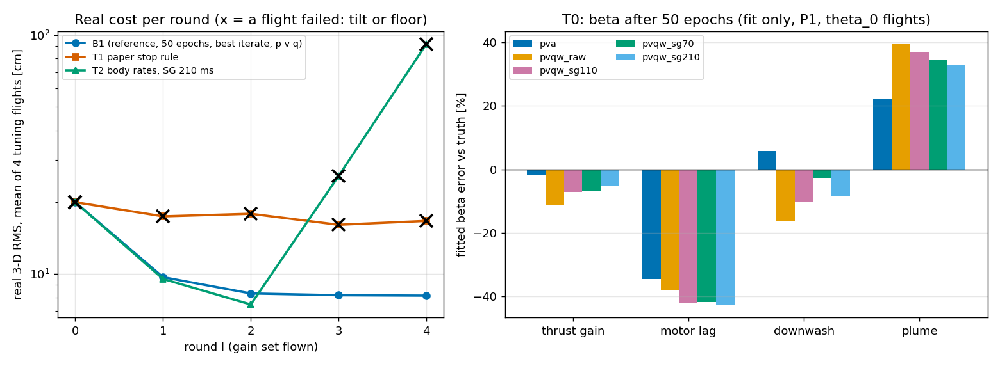

# Stage 4e report: two deviations from the paper tested alone (S0, DiffCoTune; 13 Nov 2026)

Desk work in frsim only. Nothing flown, no drone or radio connection, nothing changed in `simulator/`, `flying_drone_stack/`, `crazyswarm2`, `crazyflie-firmware`, `experiments/tuning/`, Stage 3b-4d results. All runs: one pool of 4 workers at a time, `nice -n 19`, via `dryrun/stage3c/job_runner.py` (one extra single-process desk script, the real-data check, ran during T0). Load 3.1-3.7 and MemAvailable 6.2-6.6 GB one minute after each start (limits 22 and 3 GB). Run times: T0 incl. reference evaluation 60 min (5 fits of 11-13 min; the 30 min estimate assumed fewer fits), T1 7 min, T2 75 min; stage 17:50 - 20:16.

Setup as written: plant P1, tuning A1 / A8 / CIRCLE / FIG8, test A4 (2 cells) and OVAL, 5 rounds (l = 0 ... 4), last-round fit skipped, flight seeds 100 + 10 l + i, noise seeds 6000 + 2 l (+1), evaluation seeds 2000-2004, noise in the tuning step, +-25 % gain limit, lr 0.01, Adam reset per loop. Rounds 0-4 of every run are directly comparable with B1 (round 0 is identical: 19.99 cm in all three). Reference evaluation of B1 (theta_4, 5 seeds): tuning 6.41 cm, test 7.61 cm (`results/ref_eval_B1_5rounds.json`); theta_0 is the Stage 3e value (same seeds, same function). Code: new switches `paper_stop`, `trace_fn`, `stop_after` in `loop_lib.py` (defaults = old behaviour), `stage4e/gyro_variants.py`, `t0_identifiability.py`, `t0_realdata.py`, `ref_eval.py`, `run_4e.py`, `sections_4e.py`.

**Two facts about the setup that differ from the prompt text**

- The frsim state trace holds the TRUE body rate (`episode.py`: `body.w`), not the gyro the controller sees, and is recorded every 10 ms (100 Hz). The "measured gyro" of a dry-run flight is therefore rebuilt as the true rate plus white noise with the plant's gyro noise (12.0755 deg/s, as `sensors.py`), one fresh sample per row, fixed seeds. My choice. The uSD logs (real-data check) hold the measured gyro at 500 Hz.
- "51 samples at 1 kHz" does not fit a 100 Hz trace. Windows are therefore given in ms and converted to odd sample counts at the row rate of the data: **110 ms (11 samples at 100 Hz, -3 dB at 16.2 Hz) is the main window**, 70 ms (7 samples, 28.1 Hz) the shorter, 210 ms (21 samples, 8.2 Hz) the longer. Filter: `scipy.signal.savgol_filter` (scipy 1.15.3 is available in `/usr/bin/python3`), polyorder 5, zero phase; self-test: a 5th-order polynomial is reproduced to 4e-11 and the noise variance falls by the sum of squared coefficients (0.567 / 0.333 / 0.169). The model's body rates are not filtered.

## 1. T0: identifiability with the gyro (fit only)

P1, noisy frsim flights of theta_0 (flight seeds 0 and 1, as Stage 3b B1), 50 epochs, best iterate, lr 0.01. `pva` reproduces the Stage 3b B1 row exactly (-1.7 / -34.5 / +5.7 / +22.3 %).

| Variant | thrust gain factor (err %) | motor lag (err %) | downwash (err %) | plume (err %) | best epoch | J_sysId start -> best |
|---|---|---|---|---|---|---|
| truth | 0.800 | 1.500 | 1.300 | 0.700 | | |
| pva | 0.786 (-1.7) | 0.983 (-34.5) | 1.374 (+5.7) | 0.856 (+22.3) | 50 | 0.1649 -> 0.1474 |
| pvqw_raw | 0.709 (-11.4) | 0.931 (-37.9) | 1.090 (-16.1) | 0.976 (+39.4) | 50 | 3.143 -> 3.095 |
| pvqw_sg110 | 0.742 (-7.2) | 0.869 (-42.0) | 1.166 (-10.3) | 0.958 (+36.8) | 50 | 3.051 -> 3.006 |
| pvqw_sg70 | 0.746 (-6.7) | 0.873 (-41.8) | 1.266 (-2.6) | 0.942 (+34.6) | 50 | 3.086 -> 3.043 |
| pvqw_sg210 | 0.760 (-5.0) | 0.862 (-42.6) | 1.191 (-8.4) | 0.931 (+33.0) | 50 | 2.91 -> 2.871 |

Parts of the full J_sysId (p, v, q, w; m^2, m^2/s^2, -, rad^2/s^2; mean over 4 scenarios x 2 flights) at the start and at the best iterate, share of each part of the four:

| Variant | | p | v | q | w | w share |
|---|---|---|---|---|---|---|
| pva | start | 0.01907 (0.6 %) | 0.13407 (4.5 %) | 0.01177 (0.4 %) | 2.84413 (94.5 %) | 94.5 % |
| pva | end | 0.00331 (0.1 %) | 0.13235 (4.5 %) | 0.01170 (0.4 %) | 2.82107 (95.0 %) | 95.0 % |
| pvqw_raw | start | 0.01907 (0.6 %) | 0.13407 (4.3 %) | 0.01177 (0.4 %) | 2.97852 (94.8 %) | 94.8 % |
| pvqw_raw | end | 0.00757 (0.2 %) | 0.13283 (4.3 %) | 0.01170 (0.4 %) | 2.94313 (95.1 %) | 95.1 % |
| pvqw_sg110 | start | 0.01907 (0.6 %) | 0.13407 (4.4 %) | 0.01177 (0.4 %) | 2.88574 (94.6 %) | 94.6 % |
| pvqw_sg110 | end | 0.00471 (0.2 %) | 0.13269 (4.4 %) | 0.01171 (0.4 %) | 2.85726 (95.0 %) | 95.0 % |
| pvqw_sg70 | start | 0.01907 (0.6 %) | 0.13407 (4.3 %) | 0.01177 (0.4 %) | 2.92112 (94.7 %) | 94.7 % |
| pvqw_sg70 | end | 0.00464 (0.2 %) | 0.13263 (4.4 %) | 0.01171 (0.4 %) | 2.89382 (95.1 %) | 95.1 % |
| pvqw_sg210 | start | 0.01907 (0.7 %) | 0.13407 (4.6 %) | 0.01177 (0.4 %) | 2.74480 (94.3 %) | 94.3 % |
| pvqw_sg210 | end | 0.00395 (0.1 %) | 0.13261 (4.6 %) | 0.01170 (0.4 %) | 2.72254 (94.8 %) | 94.8 % |

Reading: no body-rate variant is within the pva errors on the thrust gain (pva -1.7 %; raw -11.4 %, 110 ms -7.2 %, 70 ms -6.7 %, 210 ms -5.0 %). Downwash: pva +5.7 %; 70 ms -2.6 % is closest, 210 ms -8.4 %, 110 ms -10.3 %, raw -16.1 %. Motor lag is 35-43 % too low and plume 22-39 % too high in every variant. The filter helps (raw -> any window: thrust gain and downwash closer to the truth) but nothing beats pva. **The body-rate part is 94-95 % of the four-part J_sysId at the start and at the end in every variant and falls by only 0.8-1.2 % over the 50 epochs** (pva: w 2.844 -> 2.821 rad^2/s^2 while p falls 0.0191 -> 0.0033 m^2): the fit cannot reduce it. Part of it is the added white noise (constant 3 sigma^2 = 0.133 rad^2/s^2 for raw, no gradient), but the larger part is a mismatch of the true closed-loop rate (the pva row has no noise in w and is already 2.84), i.e. the dynamics gap of Stage 4b.

### Real-data check (no fit): 10 S0 flights of 23 Oct, beta_0, default gains, logged top path for A1 / A8

Gyro from the uSD log (500 Hz), raw or smoothed with the same filter (70 / 110 / 210 ms = 35 / 55 / 105 samples); mean over the 10 flights.

| Gyro | p | v | q | w | sum | w share |
|---|---|---|---|---|---|---|
| raw | 0.0163 | 0.4369 | 0.0391 | 10.985 | 11.477 | 95.7 % |
| sg70 | 0.0163 | 0.4369 | 0.0391 | 10.983 | 11.475 | 95.7 % |
| sg110 | 0.0163 | 0.4369 | 0.0391 | 10.979 | 11.471 | 95.7 % |
| sg210 | 0.0163 | 0.4369 | 0.0391 | 10.929 | 11.422 | 95.7 % |

Per flight, w share (raw -> sg110) and J_w (raw -> sg110, rad^2/s^2):

| Flight | raw w | sg110 w | w share raw | w share sg110 |
|---|---|---|---|---|
| A1_2026-10-23_19-47-31 | 29.750 | 29.733 | 95.8 % | 95.8 % |
| A1_2026-10-23_19-48-59 | 30.874 | 30.852 | 95.6 % | 95.6 % |
| A1_2026-10-23_19-50-23 | 28.794 | 28.793 | 95.6 % | 95.6 % |
| A4_2026-10-23_19-37-24 | 5.251 | 5.247 | 96.1 % | 96.1 % |
| A4_2026-10-23_19-38-38 | 5.515 | 5.507 | 95.8 % | 95.8 % |
| A4_2026-10-23_19-40-01 | 2.209 | 2.206 | 92.5 % | 92.5 % |
| A4_2026-10-23_19-41-36 | 1.815 | 1.812 | 93.2 % | 93.2 % |
| A8_2026-10-23_19-43-07 | 2.093 | 2.089 | 98.2 % | 98.2 % |
| A8_2026-10-23_19-44-24 | 1.735 | 1.734 | 98.5 % | 98.5 % |
| A8_2026-10-23_19-45-56 | 1.817 | 1.813 | 98.1 % | 98.1 % |

**The gyro part dominates on real data (95.7 % of the sum) and the filter does not change it** (raw 10.985, 110 ms 10.979, 210 ms 10.930 rad^2/s^2; the share stays 95.7 %). The 23 Oct gap is therefore not high-frequency noise; it is low-frequency, consistent with the Stage 4b finding (A1 limit cycle, phase uncorrelated). `t0_realdata.py`, `results/t0_realdata.json`.

## 2. T1: the paper's literal stop rule (full loop)

`loop_lib._adam_paper`: raw SI cost, stop when |J_k - J_{k-1}| < 1e-3 or J_k > J_{k-1} + 1e-3 (k >= 1), at most 50 epochs, the last iterate x_k whose cost triggered the stop is returned, also after a rise (paper p. 4, Alg. 2 and 3: "return (beta_l+1, theta_l+1) <- (beta_k, theta_i)"; which iterate is "last" is my reading). The +-25 % projection and the 2 noise seeds are kept. States pva.

**The prediction of spec Stage 1 item 8 (stops at the first epoch) did not hold in round 0:** the fit ran 7 epochs and the tune 5 (J_sysId 0.171 -> 0.163; J_task 0.0169 -> 0.0122 m^2). One loop was longer than 2 epochs, so the early-stop condition ("every inner loop of round 0 within 2 epochs") was not met and the run went over all 5 rounds. From round 1 on, 5 of 6 loops stopped after 2 epochs (= one Adam step of about 1 % per gain), one after 3.

#### Real cost per round (3-D RMS cm, mean of the 4 tuning flights; reference = B1 of Stage 3e, same flight seeds)

| Gain set | this run | B1 | failed flights this run (tilt or floor) | B1 failed | minutes (round) |
|---|---|---|---|---|---|
| theta_0 | 19.99 | 19.99 | A1 | A1 | 3.4 |
| theta_1 | 17.45 | 9.71 | A1 | 0 | 1.0 |
| theta_2 | 17.89 | 8.30 | A1 | 0 | 0.8 |
| theta_3 | 16.09 | 8.16 | A1 | 0 | 0.8 |
| theta_4 | 16.69 | 8.13 | A1 | 0 | 0.1 |

Keep-best over the flown sets: theta_3 (16.09 cm); B1 over rounds 0-4: theta_4 (8.13 cm).

#### Inner loops (epochs = cost evaluations)

| Round | loop | epochs | stop reason / best epoch | J at start | J at end (returned iterate) | gain-limit hits |
|---|---|---|---|---|---|---|
| 0 | fit beta | 7 | converged |dJ| < 1e-3 | 0.1706 | 0.16291 | - |
| 0 | tune theta | 5 | converged |dJ| < 1e-3 | 0.016857 | 0.012209 | [0, 0, 0, 0, 0, 0, 0, 0, 0, 0] |
| 1 | fit beta | 2 | converged |dJ| < 1e-3 | 0.15899 | 0.158 | - |
| 1 | tune theta | 3 | converged |dJ| < 1e-3 | 0.013072 | 0.011803 | [0, 0, 0, 0, 0, 0, 0, 0, 0, 0] |
| 2 | fit beta | 2 | converged |dJ| < 1e-3 | 0.14493 | 0.144 | - |
| 2 | tune theta | 2 | converged |dJ| < 1e-3 | 0.013489 | 0.01261 | [0, 0, 0, 0, 0, 0, 0, 0, 0, 0] |
| 3 | fit beta | 2 | converged |dJ| < 1e-3 | 0.1551 | 0.15448 | - |
| 3 | tune theta | 2 | converged |dJ| < 1e-3 | 0.012714 | 0.012682 | [0, 0, 0, 0, 0, 0, 0, 0, 0, 0] |

#### beta error after each fit (% against the P1 truth: thrust gain / motor lag / downwash / plume)

| Fit of round | this run | B1 |
|---|---|---|
| 0 | +17.7 / -36.8 / -18.3 / +35.2 | -1.6 / -36.0 / +6.1 / +23.3 |
| 1 | +16.5 / -36.2 / -17.5 / +36.6 | +12.0 / -21.5 / -9.3 / +39.0 |
| 2 | +15.4 / -35.5 / -16.7 / +38.0 | +5.1 / -3.0 / -12.7 / +19.5 |
| 3 | +14.2 / -34.9 / -15.8 / +39.4 | +3.7 / +5.0 / -12.8 / +9.0 |

#### Final evaluation (evaluation seeds 2000-2004; 3-D RMS cm / z RMS cm / failed flights of 5)

| Gain set | A1 | A8 | CIRCLE | FIG8 | A4 cell 1 | A4 cell 2 | OVAL | tuning mean | test mean |
|---|---|---|---|---|---|---|---|---|---|
| theta_0 (default) | 37.20 / 35.73 / 5 | 11.44 / 9.47 / 0 | 6.63 / 6.32 / 0 | 6.16 / 5.73 / 0 | 8.80 / 7.14 / 0 | 13.05 / 11.98 / 0 | 5.21 / 5.03 / 0 | 15.36 | 9.02 |
| theta_best of this run (round 3) | 30.03 / 27.85 / 5 | 9.95 / 7.95 / 0 | 6.20 / 5.86 / 0 | 5.80 / 5.33 / 0 | 8.82 / 7.03 / 0 | 11.94 / 10.19 / 0 | 4.90 / 4.71 / 0 | 13.00 | 8.56 |
| B1 theta_best over rounds 0-4 (theta_4) | 13.59 / 7.66 / 0 | 6.08 / 4.64 / 0 | 2.96 / 2.06 / 0 | 2.99 / 1.72 / 0 | 9.31 / 7.59 / 0 | 10.69 / 9.69 / 0 | 2.84 / 2.46 / 0 | 6.41 | 7.61 |

#### Pass criteria 1-4 (against B1, rounds 0-4)

| Criterion | result |
|---|---|
| 1. rounds 2-4 <= round 1 + 1 cm (round 1 = 17.45, limit 18.45) | **yes** (17.89, 16.09, 16.69) |
| 2. no flown set after theta_0 fails (tilt or floor) a scenario that theta_0 or theta_1 passed | **yes** (none) |
| 3. theta_best beats theta_0 on the tuning and the test scenarios (5 seeds) | **yes** (theta_best 13.00 / 8.56, theta_0 15.36 / 9.02, tuning / test) |
| 4. not worse than the B1 reference by more than 1 cm on the tuning mean and the test mean | **no** (difference +6.59 / +0.94 cm, tuning / test) |

Run passes 1-4: **no**.

Cause (from the table): with the literal rule the loops end after one to a few Adam steps, so theta moves by a few percent per round (real cost 19.99 -> 17.45 / 17.89 / 16.09 / 16.69 cm against 9.71 / 8.30 / 8.16 / 8.13 for B1), and A1 stays on the floor in every round and in the final evaluation (5 of 5 flights). Criteria 1-3 are met only formally (rounds 2-4 stay within 1 cm of round 1 because nothing improves; criterion 2 "none" because A1 failed for theta_0 and theta_1 already). **Criterion 4 fails: +6.59 cm on the tuning mean.**

## 3. T2: body rates in J_sysId (full loop)

Variant chosen from T0: the one that recovered the **thrust gain** best of the body-rate variants: **SG 210 ms** (-5.0 %; downwash -8.4 %). No variant is within the pva errors (thrust gain, then downwash), as stated in T0; run for the record as asked. Stop rule as in B1 (50 epochs, best iterate), J_sysId = p + v + q + w, measured gyro (true rate + noise, seed 7000 + 10 l + i) smoothed with SG 210 ms and compared with the unfiltered model rate.

#### Real cost per round (3-D RMS cm, mean of the 4 tuning flights; reference = B1 of Stage 3e, same flight seeds)

| Gain set | this run | B1 | failed flights this run (tilt or floor) | B1 failed | minutes (round) |
|---|---|---|---|---|---|
| theta_0 | 19.99 | 19.99 | A1 | A1 | 19.2 |
| theta_1 | 9.54 | 9.71 | 0 | 0 | 18.2 |
| theta_2 | 7.46 | 8.30 | 0 | 0 | 18.1 |
| theta_3 | 25.72 | 8.16 | A1 | 0 | 18.1 |
| theta_4 | 91.81 | 8.13 | A1, A8, CIRCLE, FIG8 | 0 | 0.1 |

Keep-best over the flown sets: theta_2 (7.46 cm); B1 over rounds 0-4: theta_4 (8.13 cm).

#### Inner loops (epochs = cost evaluations)

| Round | loop | epochs | stop reason / best epoch | J at start | J at end (returned iterate) | gain-limit hits |
|---|---|---|---|---|---|---|
| 0 | fit beta | 51 | best epoch 50 of 50 (no stop) | 2.9895 | 2.9463 | - |
| 0 | tune theta | 51 | best epoch 50 of 50 (no stop) | 0.05021 | 0.014209 | [0, 20, 20, 0, 27, 0, 0, 8, 23, 17] |
| 1 | fit beta | 51 | best epoch 43 of 50 (no stop) | 1.4513 | 1.4485 | - |
| 1 | tune theta | 51 | best epoch 50 of 50 (no stop) | 0.011302 | 0.005935 | [0, 28, 0, 20, 23, 19, 4, 0, 12, 0] |
| 2 | fit beta | 51 | best epoch 50 of 50 (no stop) | 1.9211 | 1.9184 | - |
| 2 | tune theta | 51 | best epoch 50 of 50 (no stop) | 0.0055538 | 0.0017983 | [0, 0, 11, 0, 25, 25, 0, 11, 0, 0] |
| 3 | fit beta | 51 | best epoch 38 of 50 (no stop) | 7.9066 | 7.8405 | - |
| 3 | tune theta | 51 | best epoch 50 of 50 (no stop) | 0.059015 | 0.026653 | [0, 0, 0, 14, 0, 14, 26, 0, 28, 0] |

#### beta error after each fit (% against the P1 truth: thrust gain / motor lag / downwash / plume)

| Fit of round | this run | B1 |
|---|---|---|
| 0 | -5.4 / -43.5 / -1.5 / +32.4 | -1.6 / -36.0 / +6.1 / +23.3 |
| 1 | -0.9 / -43.1 / -11.4 / +30.6 | +12.0 / -21.5 / -9.3 / +39.0 |
| 2 | +12.7 / -39.3 / -4.4 / +33.9 | +5.1 / -3.0 / -12.7 / +19.5 |
| 3 | -21.2 / -56.0 / +36.0 / +38.3 | +3.7 / +5.0 / -12.8 / +9.0 |

#### Final evaluation (evaluation seeds 2000-2004; 3-D RMS cm / z RMS cm / failed flights of 5)

| Gain set | A1 | A8 | CIRCLE | FIG8 | A4 cell 1 | A4 cell 2 | OVAL | tuning mean | test mean |
|---|---|---|---|---|---|---|---|---|---|
| theta_0 (default) | 37.20 / 35.73 / 5 | 11.44 / 9.47 / 0 | 6.63 / 6.32 / 0 | 6.16 / 5.73 / 0 | 8.80 / 7.14 / 0 | 13.05 / 11.98 / 0 | 5.21 / 5.03 / 0 | 15.36 | 9.02 |
| theta_best of this run (round 2) | 13.08 / 5.95 / 0 | 4.96 / 3.61 / 0 | 2.86 / 2.09 / 0 | 2.89 / 1.83 / 0 | 8.66 / 6.74 / 0 | 9.74 / 8.62 / 0 | 2.72 / 2.39 / 0 | 5.95 | 7.04 |
| B1 theta_best over rounds 0-4 (theta_4) | 13.59 / 7.66 / 0 | 6.08 / 4.64 / 0 | 2.96 / 2.06 / 0 | 2.99 / 1.72 / 0 | 9.31 / 7.59 / 0 | 10.69 / 9.69 / 0 | 2.84 / 2.46 / 0 | 6.41 | 7.61 |

#### Pass criteria 1-4 (against B1, rounds 0-4)

| Criterion | result |
|---|---|
| 1. rounds 2-4 <= round 1 + 1 cm (round 1 = 9.54, limit 10.54) | **no** (7.46, 25.72, 91.81) |
| 2. no flown set after theta_0 fails (tilt or floor) a scenario that theta_0 or theta_1 passed | **no** (violations: theta_3 A1, theta_4 A1, theta_4 A8, theta_4 CIRCLE, theta_4 FIG8) |
| 3. theta_best beats theta_0 on the tuning and the test scenarios (5 seeds) | **yes** (theta_best 5.95 / 7.04, theta_0 15.36 / 9.02, tuning / test) |
| 4. not worse than the B1 reference by more than 1 cm on the tuning mean and the test mean | **yes** (difference -0.46 / -0.57 cm, tuning / test) |

Run passes 1-4: **no**.

Cause (my reading of the tables, not a separate test): the fit hardly lowers J_sysId (round 0: 1.4 % against 10.3 % for pva in B1; rounds 1-3: 0.2, 0.1, 0.8 %), because 95 % of it is a rate mismatch beta cannot explain; beta then wanders (thrust gain error after the fits -5.4 / -0.9 / +12.7 / -21.2 %, motor lag -43.5 ... -56.0 %, against B1 -1.6 ... +12.0 % and -36.0 ... +5.0 %). The fit of round 3 started from J_sysId 7.9 after theta_3 had failed A1 (floor) and moved beta to -21 / -56 / +36 % (thrust / lag / downwash); the gain set tuned in that model (theta_4) fails all four tuning scenarios. Up to round 2 T2 is as good as B1 (9.54 / 7.46 against 9.71 / 8.30 cm); the keep-best theta_2 is 0.46 cm (tuning) and 0.57 cm (test) better than B1's theta_4, but this is one run each and the run-to-run spread was not measured (Stage 3e compared only rounds 0-3 of two runs), so no difference is claimed.

## 4. Recommendation per deviation

| Deviation | Result | Recommendation |
|---|---|---|
| **8, stop rule** (50 epochs, best iterate, instead of the paper's rule) | the paper's literal rule on our SI costs gives 16.1-17.9 cm in rounds 1-4 against 8.1-9.7 for B1; A1 never leaves the floor; final tuning mean 13.00 against 6.41 cm (criterion 4 fails by +6.59 cm) | **keep**, now backed by this test (Stage 3 tested the normalised rule). Spec Stage 1 item 8 corrected: the rule does not stop at epoch 1 in round 0 but after 2-7 epochs, which is too early to tune |
| **9, J_sysId without body rates** | with body rates (SG 210 ms, the thrust-gain-best of 5 variants) beta is recovered worse than with pva in T0 (thrust gain -5.0 against -1.7 %), the body-rate part is 94-95 % of J and cannot be reduced, the loop drifts (criteria 1 and 2 fail: rounds 3 and 4 25.72 and 91.81 cm, A1 failed in round 3, all four scenarios in round 4). Real-data gyro share 95.7 %, unchanged by filtering | **keep**, now backed by T0, the real-data check and T2 (the Stage 3 failure was not only the stop rule) |

Limits: one run per variant (no spread); one body-rate variant in the full loop (SG 210 ms, chosen by the stated rule); gyro noise rebuilt, not logged; the real-data check has no fit.

## 5. Deviations from the paper after the ablations

In `docs/diffcotune_spec.md`, section "Stage 4e: deviations after the ablations" (new labels, because Stage 1 items 8-11 and Stage 3b-3d deviations 8-11 shared numbers).

## 6. Lab-time table for 5 rounds

In the protocol draft, P5 (marked Stage 4e): 20 tuning flights = 28.9 min flying + 91.2 min desk = 120.1 min (estimate; desk time of rounds 0 and 1 measured, 2-4 estimated); the 12 test flights add 17.3 min flying.

## Open (not stated, for you)

- Whether one body-rate variant in the full loop is enough or the raw variant should also be run (not requested).
- Run-to-run spread of the method, needed to judge differences below 1 cm in criterion 4.
- Which iterate the paper's loop returns after the stop (the one whose cost triggers it, as here, or the one after the update) is not stated.
