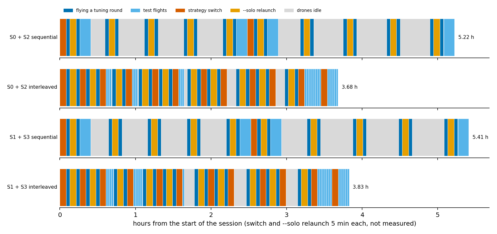

# Stage 6 report: fastest lab session, desk only (15 Nov 2026)

Desk only; nothing flown, no drone or radio connection. Method unchanged; a speed-up counts only if θ₁ and β of the round-0 dry test stay identical (≤ 1e-10 relative). Stage 5c context: S0, S1, S2 lab-ready on the desk side, S3 not (`../stage5c/report_stage5c.md`, `../stage5c_rdfix/report_rdfix.md`).

## 1. Desk speed per lever (round-0 dry test, `lab/dry_test6.py`, results `lab/results/dry6_<C>_<tag>.json`)

| Controller | Lever | Desk min (fit s / tune s) | Compile excess fit / tune (s) | Peak: MemAvailable min GB, load max | θ₁ against reference | Verdict |
|---|---|---|---|---|---|---|
| S0 | reference (4 workers × 2 threads) | 19.4 (575 / 585) | 20.5 / 15.8 | 18.0, 4.2 | 0.0 against `lab/results/dry_test.json` | — |
| S0 | a: 8 tuning workers (scenario × noise seed) | 23.3 (573 / 818) | 20.5 / 50.1 | 11.1, 7.3 | **differs** (abs 0.099) | slower and not identical: rejected |
| S0 | b: 4 threads (fit and tune) | 18.9 (556 / 577) | 20.9 / 14.9 | 17.9, 5.9 | identical | −2.4 %; but see S2 |
| S0 | c: pre-warm pool | 20.2 (648 / 561) | 105.4 / 0.6 | 17.5, 3.9 | identical | benchmark did not wait for the warm start (pool start 0.007 s), so not a fair measure; the compile share of the reference is 36 s of 19.4 min, so at most 3 % |
| S0 | f: compiled-graph cache, cold / second run | 19.2 / 19.3 | 21.7 / 16.1 and 21.7 / 15.8 | 17.9 | identical | no effect |
| S2 | reference | 26.0 (792 / 764) | 28.1 / 20.1 | 16.2, 3.8 | 0.0 against the Stage 5c round test | — |
| S2 | b: 4 threads | 25.9 (794 / 757) | 31.2 / 19.0 | 16.2, 3.9 | **differs** (abs 0.142; β after fit identical) | no gain, not identical: rejected |

(d) Ingest on the ten real 23 Oct S0 flights incl. lag search: mean 0.51 s, max 0.78 s, sum 5.1 s (`lab/results/ingest_timing.json`): no per-flight ingest needed. (e) **GPU not used.** `torch.cuda.is_available()` is True, but `nvidia-smi` reports "Driver/library version mismatch" (NVML library 580.178), which cannot be repaired here (no driver work, no reboot), and the loop worker has no GPU path (compiled CPU graphs); the CPU pool runs at the per-epoch floor of the longest scenario. The probe was not run.

**Adopted: none.** Desk minutes before and after per controller are unchanged: S0 19.4 (dry run 20.1 / 20.5 / 20.3 / 20.3 / 0.1), S1 22.5, S2 26.0 (25.9 in the round test), S3 28.8. The limit is the per-epoch compute of the longest scenario (A8, 13 250 blocks), not compile or ingest. Why a and b changed θ₁ is not established (probably summation order, amplified by Adam; not proven).

## 2. Two controllers at once (S0 + S2, round-0 tests started together, 2 × 4 workers × 2 threads)

| | alone | at once | θ₁ and β |
|---|---|---|---|
| S0 | 19.4 min | 24.8 min (fit 740 / tune 744 s) | identical (0.0) |
| S2 | 26.0 min | 30.7 min (fit 988 / tune 852 s) | identical (0.0) |

Before the start: load 0.13, MemAvailable 25.7 GB; at 1 min: load 4.67, 14.6 GB; peak: load 7.2, minimum 9.6 GB (limits: load ≤ 22, MemAvailable ≥ 3 GB, ≤ 16 CPU processes: 10 used). No job was stopped. Both rounds in 30.7 min instead of 45.4 min one after the other. S1 + S3 at once: not measured. Which machine runs `round.py` in the lab: not stated.

## 3. Timeline (`lab/session_timeline.py`, `lab/results/session_timeline.md`, figure below)

Model: 86.6 s per flight, 4 tuning flights per round, 12 test flights per controller, measured desk minutes (alone; two at once = alone × 1.28 for S0, × 1.18 for S2 and, as a stand-in, for S1 and S3). Switch and the extra `--solo` relaunch: parameter, **not measured**.

| Overhead | S0 + S2 sequential | S0 + S2 interleaved | S1 + S3 sequential | S1 + S3 interleaved | all four seq. / interl. |
|---|---|---|---|---|---|
| 3 min | 4.82 h | 3.28 h | 5.01 h | 3.45 h | 9.83 / 6.72 h |
| 5 min | 5.22 h | 3.68 h | 5.41 h | 3.83 h | 10.63 / 7.51 h |
| 10 min | 6.22 h | 5.21 h | 6.41 h | 5.21 h | 12.63 / 10.41 h |

Flights per hour at 3 min: 13.3 → 19.5 (S0 + S2), 12.8 → 18.6 (S1 + S3); idle drone time 161 → 38 min and 172 → 48 min. Battery packs per hour: not stated.

## 4. Tooling and mock test

`lab/session.py` (status, switch, manifest, desk, cards), `lab/session_timeline.py`, `lab/fake_round_flights.py`, `lab/test_session_mock.py`, draft `lab/INTERLEAVED_LAB_CARD.md` (every item "Stage 6, proposed"). Switch sequence from the existing tools: stop CS2 → `set_tree_strategy.py` → `apply_gains.py merge` → `lab_check_strategy.py` → launch → stop → `readback` → relaunch (S2 / S3 beyond S0: `rnn.en` 1, neighbour enabled for A1 / A8; NS2 weights belong to the flashed image, not checked by the tools: not stated).

**Mock test** (S0 + S2, 5 rounds each, fake uSD files from the Stage 5 dry-run plant, 2 epochs per loop for the tooling test only): job `mock_S0S2`, rc 0. Sequential 1591 s, interleaved 1470 s; 12 switch printouts (10 alternating + 2); both state dirs complete; θ_best round 4 for both; **keep, last θ, last β and θ_best yaml are identical between sequential and interleaved for S0 and S2 (max abs difference 0.0).** The test needed three runs: mock-only flags (`manifest --fake-frame` because the fake files are in the model frame; `round.py --lenient` because the default-gain A1 flight is a floor flight, as in the dry runs; desk steps serialised, one pool at a time) — real use is unchanged. The count of uSD files for a pair: 64 per card (assumption, not stated), start 10 → 74, no archive needed.

## 5. Scenario decision sheet

`scenario_decision.md` (plots first): scenarios not changed; recommendation (not binding): keep option A (current set, the only dry-run-tested one; A8 carries the motor lag, plume and RPM-delay information); options B, C, D1 would each need a new dry run per controller.

## 6. Open points (decisions)

1. Scenario option (A / B / C / D1) and whether "E" meant CIRCLE (read as such).
2. Strategy-switch and `--solo` relaunch overhead (3 / 5 / 10 min assumed; measure in the first lab block).
3. Which PC runs `round.py` in the lab (not stated); whether two desk steps at once are acceptable there (measured on the desk PC only).
4. S1 + S3 two at once not measured (stand-in factor); S3 not lab-ready on the desk side.
5. NS2 weights per strategy not checked by the switch tools; flights per battery pack and packs per hour; uSD files per flight and card (assumed 1).
6. GPU not used (driver mismatch); the per-epoch floor could only be lowered by a different compute path, not by the tested levers.
