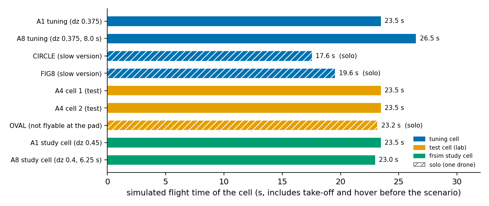
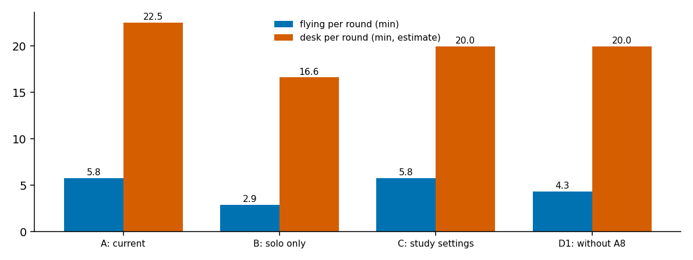

# Scenario decision sheet (Stage 6, desk only, 14 Nov 2026; facts, no new runs)

Scenarios are **not changed** in this stage. This sheet lists the facts and the options; the user decides. "E" in the task text is read as CIRCLE (not stated otherwise; listed as an open point).

## Facts per candidate

| | CIRCLE | FIG8 | OVAL | tier-1 study settings (docs/comparative_study_protocol.md §3) |
|---|---|---|---|---|
| Simulated flight time of the cell | 17.6 s (scenario part 9.1 s) | 19.6 s (11.1 s) | 23.2 s (14.7 s) | A1 23.5 s (15 s hold); A8: the frsim cells give 23.0 s (6.25 s pass) and 26.5 s (8.0 s pass); other durations not computed; A2 … A7 not in the loop |
| Drones | one (solo, `--solo` relaunch needed) | one (solo) | one (solo) | two |
| Role now | tuning cell (slow version, kt 0.01), turned +90° | tuning cell (slow version, kt 0.008), turned +90° | test cell in frsim only; **not flyable at the cf5 pad** (Stage 4d: outside the flight space, refused by `fly_file.py`), dropped from the lab test cells | study scenarios; tier 1 = 12 settings × 4 strategies: A1 dz {0.25, 0.5, 0.75}, A8 dz 0.5 with 4 durations (10.9 / 7.3 / 5.5 / 4.4 s = peak 0.20 / 0.30 / 0.40 / 0.50 m/s), A2, A3, A4, A5, A7 at 0.4 m/s |
| Study scenario? | no: solo scenarios are not in the tier-1 table | no | no | yes |
| Tuning setting against the study settings | the tuned cell is the slower of two exported versions; the faster version (kt 0.02) is the frsim study cell | same (kt 0.008 tuned, kt 0.02 study cell) | never tuned on (study cell only) | A1 tuning dz 0.375 and 0.75 (study protocol: 0.25 / 0.5 / 0.75; frsim study cell 0.45); A8 tuning dz 0.375 with duration 8.0 s (between 7.3 s = 0.30 m/s and 10.9 s = 0.20 m/s; frsim study cell dz 0.4, 6.25 s; protocol dz 0.5); `cells.py`: none of the tuning cells is a study cell |
| Flight-space fit (Stage 4d, cf5 pad (0.0, 0.3)) | turned file ok, smallest margin 0.25 m (the unturned file is outside) | ok, margin 0.54 m (0.32 m horizontal from the parked cf_second, 1 m above) | outside (x −0.31, y −0.10 m) | A1, A8, A4 ok at the centred anchor (margins ≥ 0.80 m at the ceiling) |
| What the loop can learn from it (sensitivity of J_sysId, see below) | thrust gain only (lag, downwash, plume about zero) | the same | the same (by construction) | A1: thrust, downwash; A8: all β including plume |

**Which β a scenario can identify.** Downwash and plume act in the model only while a top drone is above the bottom one (`has_top`), so solo scenarios carry no information on them by construction. The measured sensitivity of the fit cost J_sysId (= p+v+q) to each β at θ₀ and the calibration β (exact forward-mode gradient of Stage 5b, `stage5b/results/fwd_checks_<C>.json`, one scenario at a time; this is a gradient, not an identifiability test; per-scenario fits were not run in Stages 3–5c, only the joint fit of all four tuning cells):

| S1, J_sysId gradient (log-β) | thrust gain | motor lag | downwash | plume | rpm delay |
|---|---|---|---|---|---|
| A1 | 4.6e-3 | 1.1e-5 | 1.7e-3 | **0** | 2.8e-6 |
| A8 | −1.0e-1 | 8.7e-2 | 1.6e-2 | **1.8e-1** | 1.6e-2 |
| CIRCLE | 2.2e-2 | −1.9e-5 | 2.9e-4 | **0** | −5.4e-6 |
| FIG8 | 2.0e-2 | −2.7e-5 | 3.5e-4 | **0** | −6.9e-6 |

(S2: same picture, plume 0 except A8 −6.5e-2, motor lag −4.5e-2 on A8 against about 1e-5 elsewhere.) **A8 carries nearly all the information on motor lag, plume and the RPM delay; A1 and the solo scenarios mainly see the thrust gain.** The joint fit of Stage 5 identified (error against the dry-run truth after the fit, all four cells): S2 thrust +21.4, lag −30.1, downwash −16.8, plume +40.7 %; S1 +17.4 / −30.3 / −27.7 / +35.1 / RPM delay −46.9 % (Stage 5; the Stage 5c reruns are in `dryrun/stage5c/report_stage5c.md`).

## Desk-time effect

The desk epoch with at most 4 scenarios is as long as the longest scenario (one scenario per worker): A8 tuning 13 250 blocks of 2 ms, A1 11 750, FIG8 9 782, CIRCLE 8 782. Measured: 22.5 min per round (S1, round 0, Stage 5c: fit 659 s + tune 690 s). Estimated desk minutes of an option = 22.5 min × (longest scenario blocks / 13 250); this is a scaling estimate, not a measurement (compile and ingest are not scaled).

## Options (flights per round, desk estimate, held-out status)

| Option | Tuning flights per round | Flying per round (86.6 s each) | Desk per round (estimate) | In-sample (tuned on) | Held out for the study | What a non-A option loses / needs |
|---|---|---|---|---|---|---|
| **A: current, dry-run tested** | A1, A8, CIRCLE, FIG8 (4) | 5.8 min | 22.5 min (measured S1) | A1 dz 0.375, A8 8.0 s, CIRCLE and FIG8 slow versions (no study cell is tuned on) | all study cells (A1 0.25 / 0.5 / 0.75, A8 speeds, A2–A7); lab test cells A4 1 / 2 (dz 0.4, speed 0.35: not the tier-1 A4 setting dz 0.5, offset 0.10, 0.4 m/s) | nothing new |
| **B: tuning only on non-study flights, solo only** | CIRCLE, FIG8 (2) | 2.9 min | 16.6 min | the two solo cells | all two-drone scenarios | **loses downwash, plume, most of the motor lag and the RPM delay information** (they live in A8): β would stay at the calibration for these; NS2 controllers (S2, S3) would not have two-drone data at all. Needs a new dry run for S0, S2, S1, S3 and a decision on which β are fitted |
| **C: tuning on the study settings** (A1 dz 0.45, A8 6.25 s, CIRCLE, FIG8) | 4 | 5.8 min | 20.0 min | the study cells A1 and A8 themselves | A1 and A8 are **no longer held out**: a test error on them is in-sample; no held-out claim for these two scenarios. Held out would remain A2–A7, A4 at other settings | Needs a new dry run; the protocol's study settings are several (A1 three dz, A8 four speeds), a single tuned cell cannot cover them; which one is not stated |
| **D1: without A8** (proposal) | A1, CIRCLE, FIG8 (3) | 4.3 min | 20.0 min | A1, CIRCLE, FIG8 | as A | **plume becomes unidentifiable (0 gradient), motor lag and RPM delay almost so** (A8 carries them): same loss as B for these β, a smaller saving: flying −25 %, desk about −11 %. Needs a new dry run |

Not an option on the facts: D2 "shorter A1 hold" would not shorten the desk epoch, because A8 is the longest scenario and sets it (A1 is 11 750 blocks, A8 13 250).

## Recommendation (not binding)

**Keep A.** Reasons: it is the only set that was dry-run tested for all four controllers (criteria a to c); every other option removes information the fit needs (A8 carries the motor lag, plume and RPM-delay sensitivity) or removes the held-out status of the study cells, and each would need a new dry run per controller (about 2 h per controller on this PC) before it could be used. The lab time is better reduced by Stage 6's desk speed-ups and interleaving, which keep the numbers identical. The decision for the user: A (no new dry run), or one of B / C / D1 (new dry run for each controller; B and D1 also need the decision which β to fit).

## Open points

1. "E" read as CIRCLE: confirm.
2. Which of the three A1 distances and four A8 speeds a single tuned cell would stand for under option C: not stated.
3. Per-scenario identifiability (fits on one scenario at a time) was not run; the gradient table above is the evidence, not a fit.
4. Flying time per flight (86.6 s) is the mean spacing of the 10 flight stamps of the 23 Oct S0 block; per-scenario flight times of the solo flights in the lab: not stated.
