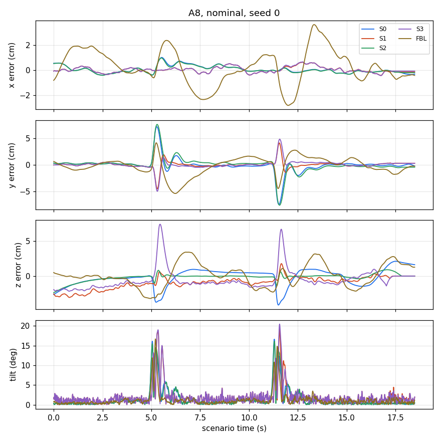

# frsim: the thesis simulator

A simulator of two Crazyflie 2.1 Brushless flying one above the other, with downwash. It is **the same simulator the gain tuning used**: the real firmware controller code (compiled for the PC) in a calibrated model of our brushless Crazyflie. Five controllers: **S0** geometric, **S1** INDI, **S2** geometric + neural downwash compensation (NS2), **S3** INDI + NS2, **FBL** feedback linearisation with a learned downwash residual. Three scenarios: **A1** hover, **A4** pass-by, **A8** figure-eight.



## Quick start (5 minutes)
```
./firmware/build_bindings.sh                  # once: builds the firmware bindings (1-2 min from GitHub, needs gcc, swig, python3-dev)
pip install numpy scipy pyyaml                # tested: numpy 2.2.6, scipy 1.15.3
python3 tests/test_smoke.py                   # every controller on every scenario
```
Details: [SETUP](docs/SETUP.md). Plots need a working matplotlib (see there).

## Three examples
**1. One controller, one scenario, with 40 ms extra delay.**
```
python3 scripts/run_scenario.py --ctrl S0 --scen A8 --gains tuned --delay-ms 40 --out examples/run_S0_A8_delay40
```
```
S0 on A8, tuned gains from S0.yaml (Bayesian optimisation (constrained, best observed point), seed 1), variant: md40 (state delay 40 ms), noise seed 0
cell  settings                                         x RMS cm y RMS cm z RMS cm   3-D cm  max tilt  result
0     dz=0.4, span=1.0, duration=6.25, settle=2.0, passes=2     0.39     2.36     0.94     2.57     18.0 deg  ok
```
It writes a trace CSV and a plot of the position error and tilt over time ([plot](examples/run_S0_A8_delay40/trace_S0_A8_md40_cell0.png)).

**2. Compare controllers.**
```
python3 scripts/compare.py --scen A8 --ctrls S0 S1 S2 S3 FBL --gains tuned --seeds 0 1 2 --out examples/compare_A8
```
```
ctrl  gains                                            error cm   max tilt   crashed
S0    tuned gains from S0.yaml (Bayesian optimisat         2.09     16.8 deg     0 / 3
S1    tuned gains from S1.yaml (CMA-ES, seed 1)            1.40     20.2 deg     0 / 3
S2    tuned gains from S2.yaml (Bayesian optimisat         1.95     16.2 deg     0 / 3
S3    tuned gains from S3.yaml (CMA-ES, seed 1)            2.16     21.4 deg     0 / 3
FBL   default gains (no tuned set for FBL)                 3.56     21.3 deg     0 / 3
```
(FBL has no tuned gains yet, so it flies with its default gains here; the others use their tuned gains. The numbers are a single plant-only comparison, not a result of the study.)

**3. Selection error and test error of a gain set, as in the tuning.**
```
python3 scripts/evaluate_gains.py --ctrl S1 --scen A1 --gains tuned
```
```
selection error: 7.2176653680472285 cm  (2 crashed episodes)
recorded:        7.2176653680472285 cm  (2 crashed episodes)  -> IDENTICAL
test error (cm): nominal 3.949, ffs0.4 3.960, md10 4.110, md40 4.279, md60 4.301
```
From Python:
```python
from frsim import run_episode, EpisodeConfig
r = run_episode(EpisodeConfig('S0', 'A8', variant='md40', seed=0))
print(r.stable, r.x_rms_cm, r.y_rms_cm, r.z_rms_cm)
```

## Documentation
[MODEL](docs/MODEL.md) (equations, blocks, all values and sources) - [CONTROLLERS](docs/CONTROLLERS.md) (S0 - S3, FBL, every gain) - [SCENARIOS](docs/SCENARIOS.md) (A1 / A4 / A8, tuning and study cells, adding a scenario) - [SETUP](docs/SETUP.md) - [REPRODUCE](docs/REPRODUCE.md) (rerun the tuned picks and the closing-table numbers; relation to `experiments/tuning/`).

## Equivalence gate
`tests/test_equivalence.py` reproduces all **199 reference episodes** of the old tuning simulator with `frsim` and a freshly built firmware: stable episodes bit-identical in every RMS field (maximum difference 0), crashed episodes with the same crash time. Result 10 Nov 2026: **199 / 199 identical**. The tuned picks S0 A8 and S1 A1 reproduce their recorded selection errors exactly.

## Limitations
* **Calibrated once, and the validation gate is not fully met:** the plant was calibrated once, on 28 hardware numbers from flights with the default gains, and it does not fully pass its own validation gate (comparison with held-out flights, default gains): it ranks the controllers and gain sets well (23 of 24 pairwise orders right) but predicts the error magnitude within the allowed band in only 9 of 16 cells. Use it to compare gains, not to predict absolute errors. Details in `docs/MODEL.md`.
* Plant only: nothing here was flown. The plant is calibrated on lab flights (see `docs/MODEL.md`); where it differs from the drone, results on the drone can differ.
* The tuned gains are the gains the plant selected; FBL tuned gains will be added when the retuning is finished. S2 and S3 use the gains of S0 and S1.
* Some default-gain flights crash (for example FBL on A4); crash-border cells (S3 on A1 with 40 / 60 ms delay) flip with tiny changes and are marked.
* Left out of the model: options of the old tuning code that no reported number used (list in `docs/MODEL.md`).
* The firmware debug output is hidden; the first episode in a process loads the firmware (about a second).

## Layout
`frsim/` the package (config, firmware, vehicle, sensors, downwash, scenarios, controllers, variants, episode, metrics, evaluation, parallel; `data/` network weights and frozen calibration) - `gains/` default and tuned gains - `scripts/` command-line tools - `firmware/` patches, host files and `build_bindings.sh` - `tests/` equivalence, smoke, frozen reference episodes - `examples/` outputs used above.
