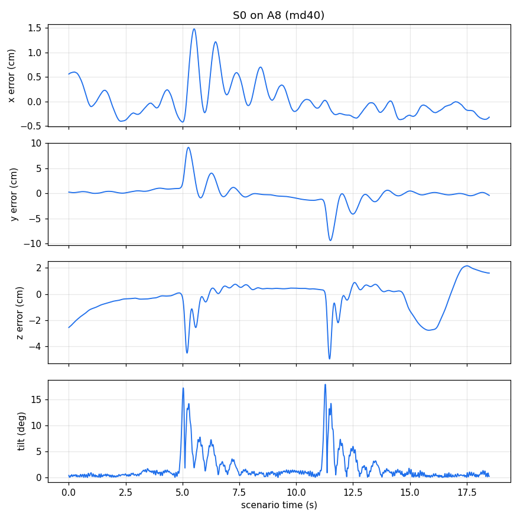

# Model

The simulator flies the **real firmware controller code** (compiled for the PC) in a rigid-body model of our brushless Crazyflie 2.1, with the downwash of a second vehicle above. One episode = takeoff, scenario, landing, simulated at 1 ms.

## One 1 ms tick, in this order (`frsim/episode.py`)

1. **Flight plan** (`flightplan.py`): reference position, velocity, acceleration, jerk of the bottom vehicle; position and velocity of the top vehicle.
2. **Sensors** (`sensors.py`): position and velocity with noise and state delay; gyro with vibration noise; for S0 - S3 accelerometer and rpm telemetry.
3. **Firmware controller**: `controllerOmarIndi` (every 2 ms for S0 - S3, every 1 ms for FBL). Output: force and torque command.
4. **Mixer** (`vehicle.py`): the firmware's own power distribution turns force / torque into four motor commands; commands are sent every 2 ms and arrive 4 ms later.
5. **Motors**: real motor force = quadratic thrust law of the command, limited by the available force, followed by a first-order motor lag.
6. **Downwash** (`downwash.py`, every 2 ms, only while the top vehicle is above): force on the bottom vehicle from the NS2 network, torque from the plume model.
7. **Rigid body** (`vehicle.py`): explicit Euler step of position, velocity, attitude and body rates.

## Values and sources

| Block | Value | Source |
|---|---|---|
| mass | 0.0427 kg | thesis vehicle (brushless Crazyflie 2.1, as flown in the study) |
| inertia | diag(16.571710, 16.655602, 29.261652) x 1e-6 kg m^2, the same in the plant and in the controller | exact values of the Omar C controller tree (all controllers use one inertia and one mass) |
| arm, thrust to torque | torque lever 0.0354 m x sqrt(2); yaw 0.00569278844371417 m per N | firmware platform defaults of the brushless Crazyflie 2.1 |
| maximum motor force of the mixer | 0.2 N per motor, battery compensation assumed ideal | firmware platform defaults |
| thrust law | force = 0.1098 N x (command / (0.2 N x 0.618))^2 | calibrated at hover (about 16 000 rpm) |
| available force | 0.2758 N per motor | plant calibration (2026-10-30) |
| motor lag | 30 ms (variants: 45 ms, 60 ms) | actuator identification, fixed in the joint calibration (2026-10-30) |
| command delay | 4 ms | setting of the tuning plant |
| noise | position 0.5 mm, velocity 5 mm/s; gyro 12.08 deg/s (vibration); accelerometer 0.084 g | position / velocity: setting of the tuning plant; gyro and accelerometer: plant calibration |
| rpm telemetry delay | 4.05 ms; rpm = sqrt(force / 3.91194027330774e-08) in rad/s | plant calibration, firmware constant |
| downwash force | NS2 v2 network (z force), scale 1.3417 | `frsim/data/ns2_v2.npz` (73 flights); scale from the plant calibration |
| plume torque | Gaussian lift loss per rotor, amplitude 0.0537 N x 4.2566, width 0.0608 m x 1.0293, exponent 0.6014 | plume fit on 233 flights, scaled by the calibration |
| top vehicle | scripted: it follows its own part of the scenario | scenario definition (`frsim/scenarios`) |
| FBL residual | reduced-order downwash model with drag coefficient 0.55 + trained 4-neuron network | firmware (`fbl_nn_weights.c`, trained on the thesis data) |
| crash rule | tilt >= 70 deg (S0 - S3) or >= 45 deg (FBL, also: controller not active) inside the scoring window; error then counts as 100 cm | tuning definition |
| flight plan | takeoff 3 s, hold 1.5 s, scenario, landing 3 s, 1 s on the ground; errors scored from 2 s after the scenario start | tuning definition |

The calibration values are frozen in `frsim/data/calibration.json` (with the source files and dates).

## Calibration and validation status

The plant was **calibrated once**, on flights with the **default gains**: 8 plant parameters fitted by CMA-ES to 28 hardware numbers (the pilot cells of 20 Oct 2026 for S0 - S3 on A1 / A4 / A8, and the FBL cells of 26 Oct 2026); the motor lag was then fixed at 30 ms from the actuator identification and the other parameters were refitted (30 Oct 2026). Several fitted parameters (`downwash_scale`, plume amplitude, available force) are larger than a measurement would suggest: they absorb effects the plant does not model.

It was then checked against held-out flights (the unseen block of 23 Oct 2026, default gains, 3 noise seeds), and it **does not fully pass this validation gate**: the predicted error is within the allowed band (max(1.5 cm, 30 % of the hardware value)) in 9 of 16 controller x cell comparisons, and the pairwise order of the controllers is right in 23 of 24 pairs. The geometric controllers (S0, S2) were under-predicted in z before the final calibration and the horizontal error of FBL in A1 / A8 is not reproduced (a known feedforward gap). The plant is therefore used to **rank** gain sets of the same controller on the same cells, not to predict absolute errors; tuned gains still need confirmation on the drone.
Sources: `docs/tuning_plant_p4_2026-10-29.md` (calibration, gate table, 30 Oct update) and `docs/fbl/` / `docs/tuning_procedure_frozen_2026-11-01.md` in the thesis repository (not part of this branch).

## Robustness variants (`frsim/variants.py`)

nominal; state delay 10 / 40 / 60 ms (md10 = measured on the drone); feedforward scaled to 0.4 or 0 (hardware behaves like about 0.4 in A8); motor lag 45 / 60 ms; gyro vibration x1.7; lateral thrust x0.5; feedforward 0.4 with 40 ms delay. The tuning used 5 of them in the search, 9 for the selection error and 5 for the test error.

## Random numbers

One random generator per episode, seeded by the noise seed. Draw order per tick: position (3), velocity (3), gyro (3), then for S0 - S3 accelerometer (3) and rpm (4, zero standard deviation but drawn). Because the order is part of the numbers, it must not change; the equivalence test would catch it.

## Early stop

`stop_on_crash=True` stops an episode at the first tilt over the crash limit. The RMS values of a crashed episode are then not valid (the error counts as 100 cm anyway). The evaluation and the equivalence test use it; `run_scenario.py` also stops at a crash by default; `--full` flies the whole flight and writes the complete trace of a crashed flight.

## Not included (compared with the old tuning simulator)

These options existed in the tuning code but none of the reported numbers uses them: the state-hold model with 4-8 ms updates (`hold`) and the attitude-rate filter option of the FBL (`abg_on_new`); the first FBL version with hand-over, tilt latch and rate limit (`inner = 0`) and the deployed gain preset; constant and slowly varying body-torque disturbances; the linear thrust law (`thrust_law`), the accelerometer low-pass (`accl`) and the separate rpm delay of the INDI paths (`rd_indi`); replay of a logged top-vehicle trajectory; a lateral disturbance acceleration; torque from the network at each rotor (`kappa`); the plume switch; the old plant inertia of the FBL; battery sag and ground effect (only in the earlier single-purpose FBL script); crossing-time output for A8. The INDI controllers use only the plant of record (`S1_PLANT=old`). The old code stays in `experiments/tuning/` and is the record of the tuning.
