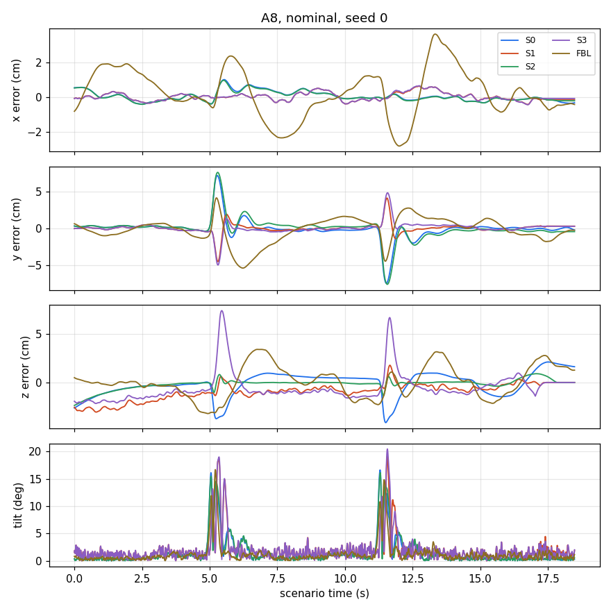

# Scenarios

Two vehicles fly one above the other; the **bottom** vehicle is the one that is controlled and scored, the **top** vehicle follows its own path and causes the downwash. The scenario code is vendored from the crazyswarm2 flight scripts (`frsim/scenarios/`, source and commit in `SOURCE.md`), so the paths are the same as in the lab.

| Scenario | What happens | Settings |
|---|---|---|
| A1 | both hover, top vehicle directly above the bottom one | `dz` vertical distance (m), `hold` hover time (s) |
| A4 | top vehicle moves along a line next to the bottom vehicle | `dz`, `offset` horizontal offset (m), `speed` (m/s), line along y |
| A8 | bottom vehicle flies a figure-eight, the top vehicle crosses it twice | `dz`, `span` (m), `duration` per pass (s), `settle` (s), `passes` |

## Cells: tuning cells and study cells

A **cell** is a scenario with fixed settings (`frsim/scenarios/cells.py`).
* **Tuning cells** are used to tune and to compute the selection error: A1 dz 0.375 and 0.75 m; A4 (dz, offset, speed) = (0.375, 0.05, 0.2), (0.5, 0.1, 0.3), (0.75, 0.15, 0.4); A8 dz 0.375 (8 s per pass) and 0.75 (5 s per pass).
* **Study cells** are never used for tuning; the test error is computed on them: A1 dz 0.45; A4 dz 0.4 with offset 0.125 and 0.075, speed 0.35; A8 dz 0.4, span 1.0, 6.25 s per pass, 2 passes.

`run_scenario.py` flies the study cells by default (`--cells tuning` for the tuning cells).

## Adding a scenario

1. Add a builder function to the scenario code (`frsim/scenarios/scenarios.py` has the pattern: a `Scenario` with two robot plans, each a curve and a slot) or copy a new one from crazyswarm2.
2. Add its cells to `frsim/scenarios/cells.py` (tuning and study cell lists).
3. Add its name to the `choices` of the scripts. The episode code needs nothing else: it reads the scenario only through `Motion`.
