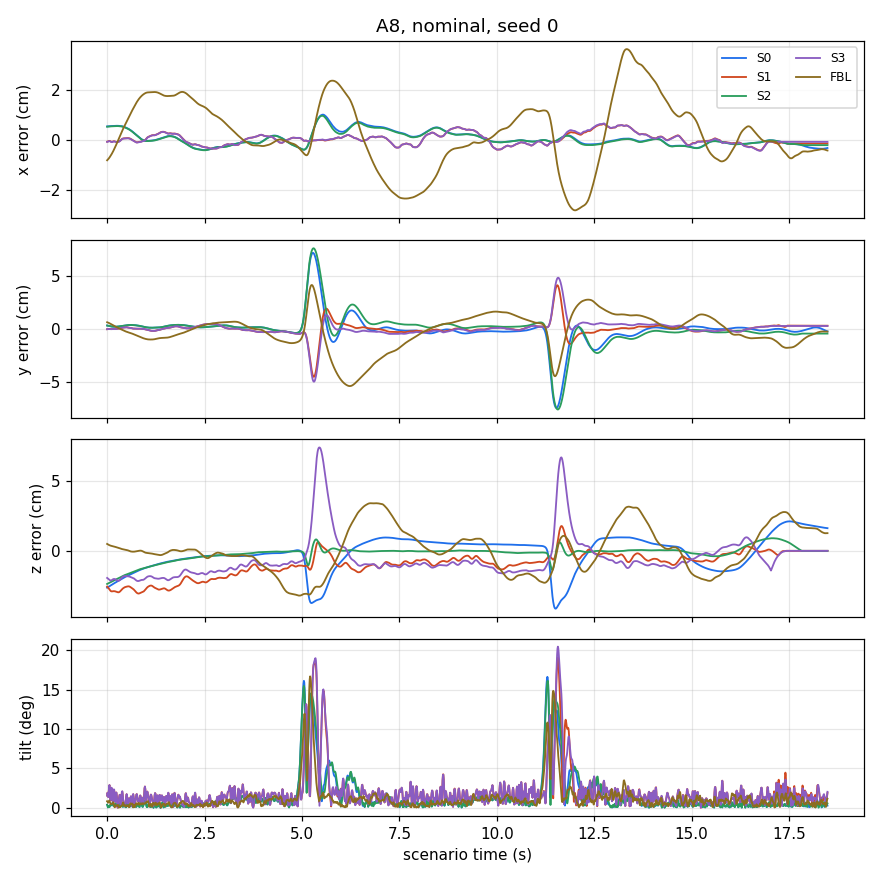

# Comparison on A8

- variant: nominal (calibrated plant), study cells, noise seeds [0, 1, 2]
- command: `python3 scripts/compare.py --scen A8 --ctrls S0 S1 S2 S3 FBL --gains tuned --seeds 0 1 2 --procs 4 --out examples/compare_A8`

| controller | gains | error_cm | max_tilt_deg | crashed_episodes | episodes |
|---|---|---|---|---|---|
| S0 | tuned gains from S0.yaml (Bayesian optimisation (constrained, best observed point), seed 1) | 2.09 | 16.8 | 0 | 3 |
| S1 | tuned gains from S1.yaml (CMA-ES, seed 1) | 1.40 | 20.2 | 0 | 3 |
| S2 | tuned gains from S2.yaml (Bayesian optimisation (constrained, best observed point), seed 1) | 1.95 | 16.2 | 0 | 3 |
| S3 | tuned gains from S3.yaml (CMA-ES, seed 1) | 2.16 | 21.4 | 0 | 3 |
| FBL | default gains (no tuned set for FBL) | 3.56 | 21.3 | 0 | 3 |

Files: [compare_A8_nominal.csv](compare_A8_nominal.csv), [trace_S0_A8_nominal.csv](trace_S0_A8_nominal.csv), [trace_S1_A8_nominal.csv](trace_S1_A8_nominal.csv), [trace_S2_A8_nominal.csv](trace_S2_A8_nominal.csv), [trace_S3_A8_nominal.csv](trace_S3_A8_nominal.csv), [trace_FBL_A8_nominal.csv](trace_FBL_A8_nominal.csv)
[summary.json](summary.json)
